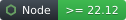

<p align="center">
  
</p>

<h1 align="center">قَاسِمز — Qassimz</h1>

<p align="center" dir="rtl">
  <strong>منصة أحمد قاسم: فيديوهات، أحكام سينما ومسلسلات، أرشيف حكايات، ومقالات.</strong><br />
  واجهة عربية RTL بالكامل، نافبار زجاج سائل، ثلاث ثيمات، وقاسم افتراضي 3D بيرد عليك.
</p>

<p align="center">
  <a href="https://ahmedqassimtv-commits.github.io/QassimChannel/"></a>
</p>

<p align="center">
  
  
  
  
  
  = 22.12" height="20" />
  <a href="./LICENSE"></a>
</p>

<div dir="rtl">

## المحتويات

- [الموقع في سطور](#الموقع-في-سطور)
- [الصفحات](#الصفحات)
- [الثيمات والخطوط](#الثيمات-والخطوط)
- [قاسم الافتراضي](#قاسم-الافتراضي)
- [بنية المشروع](#بنية-المشروع)
- [التشغيل](#التشغيل)
- [النشر](#النشر)
- [ملاحظات](#ملاحظات)

## الموقع في سطور

- **التصميم:** تصميم «قاسمز بورتال» الأصلي (زجاج سائل فوق خلفية فراكتال بتتغير مع كل قسم).
- **النافبار:** كبسولة زجاج سائل (نفس مادة macOS 26: أبيض 10% + بلور 26 + حافة منورة) فيها انكسار حقيقي على Chromium، وبلور، ولمعة ناعمة من فوق، وضوء بيتبع الماوس. التصغير مع السكرول وفتح البحث بيتحركوا بـFLIP، يعني transform بس ونابض واحد، فمفيش تقطيع.
- **البحث:** جوّه النافبار (Ctrl/⌘ K)، والنتايج بتنزل تحته.
- **الحركة:** Framer Motion وLenis للتمرير الناعم، ومع `prefers-reduced-motion` الحركة بتقل.
- **الصوت:** مفيش أصوات حالياً. الدوال موجودة في `src/utils/glassSound.js` بس مابتعملش حاجة، لحد ما الأصوات تتعمل من جديد.

## الصفحات

| المسار | الصفحة |
|---|---|
| `/` | الرئيسية |
| `/videos` · `/videos/shorts` | الفيديوهات والشورتس |
| `/verdict/movies` · `/verdict/series` | الفِردِكت: حُكم السينما والمسلسلات |
| `/stories` | أرشيف الحكايات |
| `/articles` · `/articles/:slug` | المقالات |
| `/on-air` | أون إير |

الروابط القديمة `/reviews` و`/masaha/on-air` بتحوّل للصفحة المقابلة، و`/about` و`/masaha/about` بيرجعوا للرئيسية.

## الثيمات والخطوط

| الثيم | المفتاح | النمط |
|---|---|---|
| 🌌 الليلي (الافتراضي) | `night` | داكن — ألوان خلفية macOS الداكنة |
| 🟢 الأخضر الزمردي | `green` | داكن |
| 🔴 الأحمر الجمري | `red` | داكن |

- **حفظ الثيم:** الاختيار بيتحفظ في `localStorage` (المفتاح `qassimz:theme`)، وبيتطبق من سكربت في `index.html` قبل React، فمفيش وميض.
- **الخطوط:** كلها في `public/fonts`:
  - Lifta swash للعناوين السينمائية
  - A Farhood للتاريخ والحكايات
  - ثمانية Sans وText وDisplay للنصوص

## قاسم الافتراضي

- **الظهور في النافبار:** مع كل فتحة للموقع لوجو قاسمز بيتكتب حرف حرف، وبعدين وش قاسم بيطلع مكانه. لما تدوس عليه بيفتح اللوح.
- **الموديل 3D:** Avaturn في `public/avatar/qassim-3d.glb`. بيترسم بـthree.js r170 وGLTFLoader، ومتجمّعين في ملف واحد `public/vendor/three-gltf.js`. الملف ده بيتحمّل بس لما اللوح يتفتح، ومن غير CDN.
- **الحركة:** الموديل من غير ملامح وش متحركة، فكل الحركة من العظام:
  - الدراعات بتنزل من الـT-pose
  - تنفّس
  - الراس بتبص ناحية الماوس
  - هزة مع كل كلمة
  - الإيدين بتشرح وهو بيتكلم
  - تلويح في التحية
  - ميلة تفكير
- **البديل:** لو WebGL مش موجود بيرجع لشخصية الأنمي (`public/avatar/anime`).
- **الصوت:** نطق المتصفح العربي (Web Speech API)، وتقدر تقفله من اللوح.
- **الردود:** في رد محلي بالكلمات المفتاحية (`src/components/ai/brain.js`). ولو حطيت `QZ_AI_ENDPOINT` الردود بتيجي من Cloudflare Worker بيكلّم Claude API، وطريقة التركيب في [`workers/qz-ai/README.md`](workers/qz-ai/README.md).

## بنية المشروع

```
src/
├─ App.jsx                 المسارات + Lenis + الخلفية
├─ components/
│  ├─ layout/              Navbar (الكبسولة) · Footer · CommandSearch
│  ├─ glass/               الزجاج: GlassBackground · GlassCard · LiquidGlassFilters (#qz-refract)
│  ├─ ai/                  NavHost · LogoIntro · AiHost · Avatar3D · AnimeAvatar · brain · speech
│  ├─ cards/ · ui/         الكروت والمكونات الصغيرة (ThemeSwitch, PlanSwitch, ...)
│  └─ brand/BrandLogo.jsx  شعار قاسمز (LOGO_PATH)
├─ pages/                  صفحة لكل مسار
├─ data/                   الفيديوهات، المراجعات، المقالات، الحكايات، إعدادات يوتيوب
├─ content/articles/       المقالات بصيغة Markdown
└─ utils/ · hooks/ · lib/  الثيم، الزجاج، المسارات (assetUrl)
public/
├─ fonts/ · fractal/ · images/
├─ avatar/                 qassim-3d.glb + صور الأنمي
└─ vendor/three-gltf.js    three.js + GLTFLoader
workers/qz-ai/             Cloudflare Worker لردود قاسم الافتراضي
```

## التشغيل

```bash
npm ci
npm run dev        # http://localhost:5173
npm run build      # dist/
npm run preview
```

لو هتشغّل ردود الذكاء الاصطناعي محلياً، انسخ `.env.example` لـ`.env` وحط رابط الـWorker في `VITE_QZ_AI_ENDPOINT`.

## النشر

- **`main`:** `deploy-pages.yml` بيبني بـ`--base=/QassimChannel/` وبينشر على GitHub Pages.
- **أي فرع تاني:** `preview-build.yml` بيبني ويحط النسخة في فرع `preview-dist` للمراجعة.
- **رابط الـWorker:** متغير الريبو `QZ_AI_ENDPOINT` بيدخل في البيلد على إنه `VITE_QZ_AI_ENDPOINT`.
- **المسارات تحت `/QassimChannel/`:** علشان الموقع شغال تحت المسار ده، الراوتر عليه `basename`، وكل صور `public` بتتنادى بـ`import.meta.env.BASE_URL` أو بـ`assetUrl()`.

## ملاحظات

- **العربي:** ممنوع تقسيم النص العربي لحروف لأنه بيكسر الاتصال، والتقسيم بالكلمات بس. وكمان مفيش `letter-spacing` على العربي.
- **الرخص:**
  - three.js (MIT)
  - الصور من Unsplash حسب رخصتها
  - باقي المشروع [MIT](./LICENSE)

</div>
