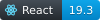
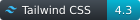
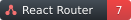

<p align="center">
  
</p>

<h1 align="center">قَاسِمز — Qassimz</h1>

<p align="center" dir="rtl">
  <strong>منصة محتوى عربية — فيديوهات، مراجعات، حكايات، مقالات مصوّرة، قاع الأفكار، وكتب.</strong><br />
  واجهة RTL بالكامل، نافبار متكيّف يتغيّر شكله تلقائياً مع كل قسم، قاسم الافتراضي ثلاثي الأبعاد (AI)، وثلاثة ثيمات بانتقال دائري موجي متحرك.
</p>

<p align="center">
  <a href="https://ahmedqassimtv-commits.github.io/QassimChannel/"></a>
</p>

<p align="center">
  
  
  
  
  
  <br />
  = 22.12" height="20" />
  <a href="./LICENSE"></a>
  <a href="https://github.com/ahmedqassimtv-commits/QassimChannel/actions/workflows/deploy-pages.yml"></a>
</p>

---

## 📖 المحتويات

<div dir="rtl">

- [✨ المميزات](#-المميزات)
- [🛠️ التقنيات](#️-التقنيات)
- [🗺️ الصفحات والمسارات](#️-الصفحات-والمسارات)
- [🎨 الثيمات والانتقال الحركي](#-الثيمات-والانتقال-الحركي)
- [🤖 قاسم الافتراضي (AI)](#-قاسم-الافتراضي-ai)
- [🏗️ بنية المشروع](#️-بنية-المشروع)
- [🚀 التشغيل](#-التشغيل)
- [📦 الأوامر المتاحة](#-الأوامر-المتاحة)
- [🌐 النشر](#-النشر)
- [🤝 المساهمة](#-المساهمة)
- [📄 الرخصة](#-الرخصة)

</div>

---

## ✨ المميزات

<div dir="rtl">

| الميزة | الوصف |
|---|---|
| 🧭 نافبار متكيّف مع كل قسم | يتحوّل مظهره، مادته، حوافه، ألوانه، وقوائمه المنسدلة تلقائياً عند الدخول لكل قسم (معرض **Structured** في الحكايات مع انعكاس تلقائي فوق الغرفة الداكنة، جريدة **Miranda** في المقالات، دفتر **Superr** في قاع الأفكار، شريط سينمائي في الفِردِكت، وزجاج سائل في الرئيسية وعن أحمد) |
| 🤖 قاسم الافتراضي ثلاثي الأبعاد (AI) | مضيف افتراضي مدمج داخل النافبار بنموذج 3D (`Avaturn GLB`) وحركة نوابض مضبوطة (تتبّع للمؤشر، تنفّس، إيماءات يدين، تلويح، وإضاءة حافة تتبع الثيم) مع بديل أنمي سلس ومحرك ردود محلي/سحابي |
| 🏛️ معرض الحكايات (`Structured`) | إعادة تصميم كاملة لقسم الحكايات بنظام **Renaissance Gallery on Putty Paper** (`src/design-systems/structured/`) مع كلمة عرض ضخمة، لوحات زيتية كلاسيكية، بطاقة مقصوصة الزوايا، غرفة Ink Room داكنة بقصّات دائرية ومؤشرات سداسية، وغرفة قراءة Bone |
| 🌊 تبديل ثيم بحركة موجية | انتقال دائري (`View Transitions API` + حلقة موجية مضيئة + بديل متحرك لباقي المتصفحات + إشعار الثيم النشط) بين الثيمات الثلاثة: الزمردي، الجمري، والذهبي |
| 🎬 الفِردِكت (`Cinema Reel`) | بكرة مراجعات سينمائية ومسلسلات تفاعلية بكامل الشاشة مع فيزياء التقاط نابضية |
| 📰 المقالات المصوّرة (`Miranda`) | تصميم جريدة ثقافية عريضة بحرف استهلالي وفلاتر أبواب وعارض قراءة كامل لملفات Markdown |
| 📓 قاع الأفكار (`Superr`) | دفتر مسودات وأفكار تفاعلي بملمس ورق واستيكرات وإمكانية إضافة شرارات أفكار جديدة |
| 🧭 قسم مساحة (`MASAHA`) | يجمع البث الحيّ (`أون إير`)، ومكتبة `الكتب والقصص` ثلاثية الأبعاد، وتجربة `عن أحمد` التفاعلية (WebGL + Rive + GSAP) |
| 🔍 بحث مدمج داخل النافبار | حقل بحث يتمدد بسلاسة داخل شريط التنقل (`⌘K` / `Ctrl+K` أو `/`) مع اقتراحات فورية متسامحة مع التشكيل والهمزات |
| 📱 RTL كامل وتنسيق حركة موحّد | عائلات خط ثمانية الثلاث (`Display` / `Text` / `Sans`)، تمرير Lenis ناعم، نوابض Framer Motion متناسقة، واحترام كامل لـ `prefers-reduced-motion` |

</div>

---

## 🛠️ التقنيات

<div dir="rtl">

| الطبقة | التقنية | الغرض |
|---|---|---|
| ⚛️ واجهة | React 19 | مكتبة واجهة المستخدم |
| ⚡ بناء | Vite 8 (Rolldown) | أداة البناء السريعة وتقسيم الحزم |
| 🎨 تنسيق | Tailwind CSS 4 + CSS Custom Properties | أنماط المرافق وأنظمة تصميم مخصّصة لكل قسم |
| 🎬 حركة | Framer Motion 14 + GSAP + Lenis | انتقالات نوابض موحّدة وتمرير سلس فيزيائي |
| 🧊 ثلاثي الأبعاد | Three.js + GLTFLoader + WebGL2 | نموذج قاسم الافتراضي 3D، المشهد الجوي، وتجربة عن أحمد |
| 🗺️ توجيه | React Router 7 | توجيه تطبيق الصفحة الواحدة (SPA) |
| 🔊 صوت | Howler + Web Audio + Web Speech | مؤثرات زجاجية، أجواء أون إير، ونطق قاسم الافتراضي |
| 📝 محتوى | react-markdown + remark-gfm | عرض المقالات بصيغة Markdown |

</div>

---

## 🗺️ الصفحات والمسارات

<div dir="rtl">

| المسار | الصفحة | المكوّن |
|---|---|---|
| `/` | الرئيسية (Apple Midnight + Origin Portrait) | `Home` |
| `/verdict/movies` | الفِردِكت — حُكم السينما | `Reviews` |
| `/verdict/series` | الفِردِكت — حُكم المسلسلات | `Reviews` |
| `/reviews` ← `/verdict/movies` | إعادة توجيه تلقائية | — |
| `/stories` | معرض الحكايات (`Structured Renaissance Gallery`) | `Stories` |
| `/videos` | الفيديوهات | `Videos` |
| `/videos/shorts` | المقاطع القصيرة | `Videos` |
| `/articles` | المقالات المصوّرة (`Miranda Broadsheet`) | `Articles` |
| `/articles/:slug` | عرض مقال كامل | `ArticleView` |
| `/ideas` | قاع الأفكار (`Superr Tactile Notebook`) | `IdeasCastle` |
| `/masaha/on-air` | مساحة — أون إير (البث الحيّ) | `OnAir` |
| `/masaha/books` | مساحة — الكتب والقصص | `Books` |
| `/masaha/ahmed` | مساحة — عن أحمد (تجربة WebGL + Rive التفاعلية) | `AboutAhmed` |
| `/on-air` ← `/masaha/on-air` | إعادة توجيه تلقائية | — |
| `/about` و `/masaha/about` ← `/masaha/ahmed` | إعادة توجيه تلقائية | — |
| `*` | إعادة توجيه للرئيسية | — |

</div>

---

## 🎨 الثيمات والانتقال الحركي

<div dir="rtl">

| الثيم | الوصف | المفتاح |
|---|---|---|
| 🟢 الأخضر | الزمردي — الثيم الأصلي | `green` |
| 🔴 الأحمر | الجمري — تدرّج أحمر إلى كهرماني | `red` |
| 🟡 الذهبي | الذهبي الفاخر — داكن بلمسات ذهبية دافئة | `gold` |

عند التبديل عبر سويتش الثيم في النافبار، تنطلق حركة دائرية موجية (`View Transitions API` + حلقة ضوئية متمددة بلون الثيم الجديد + نبضة تفاعلية وإشعار فوري)، مع حفظ الاختيار في `localStorage` (`qassimz:theme`) وتطبيقه قبل أول رسم بدون وميض.

</div>

---

## 🤖 قاسم الافتراضي (AI)

<div dir="rtl">

- مدمج مباشرة بجانب الشعار في النافبار عبر [`NavHost.jsx`](src/components/ai/NavHost.jsx) ويتكيّف لوحه تلقائياً مع تصميم الصفحة الحالية.
- يعرض نموذج **Avaturn 3D** (`public/avatar/qassim-3d.glb`) عبر [`Avatar3D.jsx`](src/components/ai/Avatar3D.jsx) مع بديل أنمي متزامن الشفاه ([`AnimeAvatar.jsx`](src/components/ai/AnimeAvatar.jsx)).
- يعمل فوراً بوضع **محلي ذكي** يجيب من بيانات المنصة الحقيقية مع روابط مباشرة، ويمكن ربطه بخادم ذكاء اصطناعي خارجي عبر متغير البيئة الاختياري `VITE_QZ_AI_ENDPOINT`.

</div>

---

## 🏗️ بنية المشروع

```
QassimChannel/
├── .github/
│   ├── badges/                     # شارات SVG محلية
│   └── workflows/
│       ├── deploy-pages.yml        # نشر تلقائي على GitHub Pages من main
│       └── preview-build.yml       # بناء تجريبي للفروع
│
├── public/
│   ├── about-ahmed/                # أصول تجربة «عن أحمد» (WebGL + Rive + GSAP)
│   ├── admin/                      # لوحة إدارة المحتوى
│   ├── avatar/                     # نموذج قاسم 3D (qassim-3d.glb) ورسوم الأنمي
│   ├── fonts/                      # عائلات خط ثمانية الثلاث (Display / Text / Sans)
│   ├── fractal/optimized/          # الخلفيات الفراكتالية
│   ├── images/                     # الشعار، بورتريه أحمد، ولوحات معرض الحكايات الزيتية
│   ├── sounds/                     # موسيقى أون إير
│   └── vendor/                     # Three.js + GLTFLoader المحلي
│
├── src/
│   ├── components/
│   │   ├── ai/                     # قاسم الافتراضي (Avatar3D, AnimeAvatar, AiHost, NavHost, brain, speech)
│   │   ├── brand/                  # شعار قاسمز
│   │   ├── cards/                  # بطاقات المراجعات والفيديوهات
│   │   ├── glass/                  # بطاقات وفلاتر الزجاج
│   │   ├── home/                   # شرائح السحب والمقارنة في الرئيسية
│   │   ├── layout/                 # الفوتر الموحّد
│   │   ├── motion/                 # نظام الحركة والنوابض الموحّدة
│   │   ├── nav/                    # النافبار المتكيّف (SiteNav, NavDropdown, navConfig)
│   │   ├── onair/                  # ورقة أون إير التفاعلية
│   │   ├── qz/                     # مشغّل السينما ومكوّنات الواجهة
│   │   ├── scene/                  # المشهد الجوي WebGL2
│   │   ├── ui/                     # سويتش الثيم WebGL، زر العودة للأعلى، التلميحات
│   │   └── verdict/                # بكرة الفِردِكت السينمائية
│   ├── content/articles/           # المقالات بصيغة Markdown
│   ├── data/                       # بيانات الفيديوهات، المراجعات، المقالات، الحكايات، الكتب
│   ├── design-systems/structured/  # ملفات نظام تصميم Structured الكاملة (DESIGN.md, variables.css, theme.css, tokens.json)
│   ├── lib/                        # Lenis وثوابت الحركة والنوابض
│   ├── pages/                      # صفحات التطبيق (Home, Reviews, Stories, Videos, Articles, ArticleView, IdeasCastle, OnAir, Books, AboutAhmed)
│   ├── styles/                     # أنماط الأقسام (nav, base, home, stories-structured, articles-miranda, ideas, cinema, reading, books, about, footer, a11y)
│   ├── utils/                      # الثيمات والانتقال الموجي، الأصوات، ومسارات الأصول
│   ├── App.jsx                     # المكوّن الرئيسي والتوجيه
│   ├── main.jsx                    # نقطة الدخول
│   └── index.css                   # ملف التنسيق الرئيسي
│
├── index.html
├── package.json
├── tsconfig.json
└── vite.config.js
```

---

## 🚀 التشغيل

### المتطلبات

<div dir="rtl">

- **Node.js** `>= 22.12.0` (انظر `.nvmrc`)
- **npm** `>= 10`

</div>

### التثبيت والتشغيل

```bash
# استنساخ المستودع
git clone https://github.com/ahmedqassimtv-commits/QassimChannel.git
cd QassimChannel

# تثبيت الاعتمادات
npm install

# تشغيل بيئة التطوير
npm run dev
```

---

## 📦 الأوامر المتاحة

<div dir="rtl">

| الأمر | الوصف |
|---|---|
| `npm run dev` | تشغيل بيئة التطوير المحلية |
| `npm run build` | بناء نسخة الإنتاج ← `dist/` |
| `npm run preview` | معاينة نسخة الإنتاج محليًا |
| `npm run format` | تنسيق الكود بـ Prettier |
| `npm run format:check` | التحقق من تنسيق الكود |
| `npm run clean` | حذف مجلد البناء والكاش |

</div>

---

## 🌐 النشر

<div dir="rtl">

يُنشر المشروع تلقائيًا على **GitHub Pages** عند الدفع إلى فرع `main`:

</div>

```
main → GitHub Actions → npm ci → vite build → GitHub Pages
```

<div dir="rtl">

**رابط النشر:** [ahmedqassimtv-commits.github.io/QassimChannel](https://ahmedqassimtv-commits.github.io/QassimChannel/)

</div>

---

## 🤝 المساهمة

<div dir="rtl">

نرحب بالمساهمات! اقرأ [CONTRIBUTING.md](./CONTRIBUTING.md) للتفاصيل.

</div>

---

## 📄 الرخصة

<div dir="rtl">

هذا المشروع مرخص تحت [رخصة MIT](./LICENSE).

</div>

---

<p align="center" dir="rtl">
  صُنع بـ ❤️ بواسطة <a href="https://github.com/ahmedqassimtv-commits">Ahmed Qassim</a>
</p>
