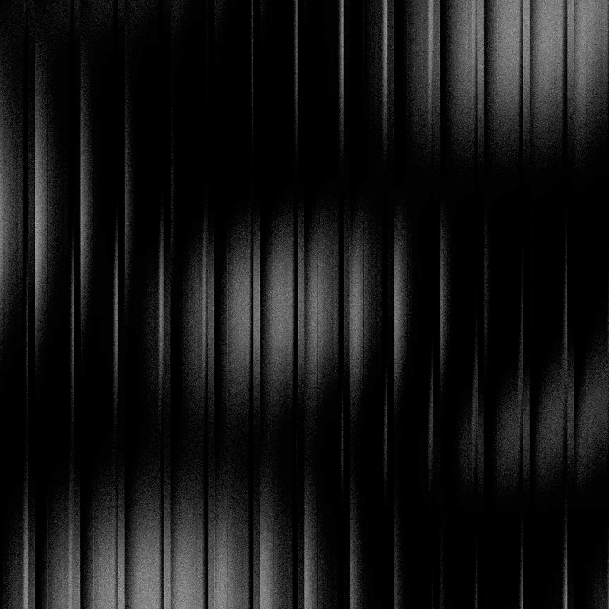
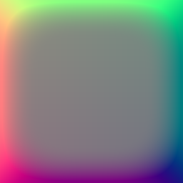
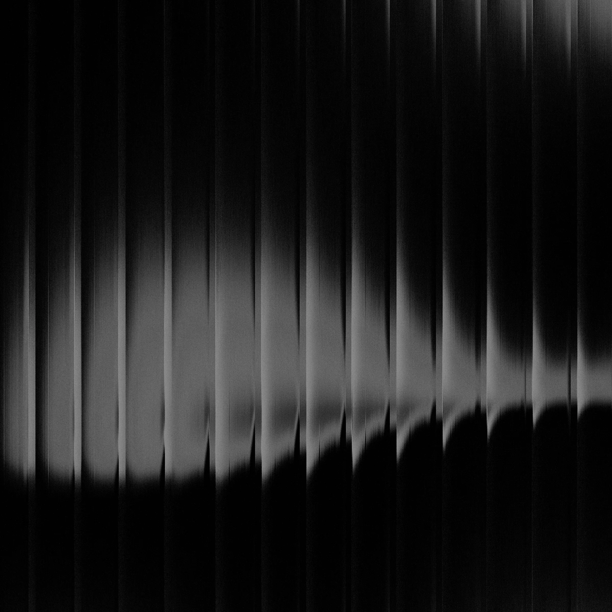

<p align="center">
  
</p>

<h1 align="center">قَاسِمز — Qasimz</h1>

<p align="center">
  <strong>منصة محتوى عربية — فيديوهات، مراجعات، حكايات، ومقالات.</strong><br />
  واجهة RTL بالكامل، نافبار زجاجي، ثلاثة ثيمات، وحركات بنوابض فيزيائية.
</p>

<p align="center">
  <a href="https://ahmedqassimtv-commits.github.io/QassimChannel/"></a>
  
  
  
  
</p>

> ⚠️ **أرشيف** — هذه لقطة من **16 نوفمبر 2026** للموقع القديم المبني بـ React + Vite.
> الموقع الحالي أُعيد بناؤه من الصفر بـ **Astro + GSAP + Lenis + Three.js** في
> [qassimz-platform](https://github.com/ahmedqassimtv-commits/qassimz-platform).
> النسخة هنا كاملة — بكل الخطوط والصور والصوت — وتعمل كموقع على
> [GitHub Pages](https://ahmedqassimtv-commits.github.io/QassimChannel/).

## 📖 المحتويات

- [✨ المميزات](#المميزات)
- [🗺️ الصفحات والمسارات](#الصفحات-والمسارات)
- [🎨 الثيمات](#الثيمات)
- [🧩 المكونات](#المكونات)
- [📦 المحتوى](#المحتوى)
- [🚀 التشغيل](#التشغيل)
- [🗂️ بنية المشروع](#بنية-المشروع)
- [📎 الملفات الثنائية](#الملفات-الثنائية)
- [📁 الكود الكامل](#الكود-الكامل)

## ✨ المميزات

| الميزة | الوصف |
|---|---|
| 🧊 نافبار زجاجي | طبقات زجاج سائل مع عدسة وتفاعل مع الماوس، بمحرك زجاج مخصص |
| 🎨 ثلاثة ثيمات | أخضر زمردي، أحمر جمري، وأزرق — محفوظة في `localStorage` وتُطبق قبل أول رسم |
| 🎬 مراجعات | الفِردِكت — THE VERDICT، مع تقييمات وقائمة مشاهدة محفوظة محليًا |
| 📺 فيديوهات | بطاقات فيديو مع مشغل YouTube خفيف |
| 🔍 بحث سريع | بحث فوري بالأوامر (CommandSearch) |
| 🔊 صوت | مؤثرات صوتية بمحرك Howler مع تحكم بمستوى الصوت |
| 📱 RTL كامل | عربي بالكامل، اتجاه من اليمين لليسار، وخطوط عربية مخصصة |

## 🗺️ الصفحات والمسارات

| المسار | الصفحة |
|---|---|
| `/` | الرئيسية |
| `/about` | عنّي |
| `/articles` | المقالات |
| `/articles/:slug` | عرض مقال |
| `/reviews` | المراجعات |
| `/verdict/movies` | الفِردِكت — أفلام |
| `/verdict/series` | الفِردِكت — مسلسلات |
| `/stories` | أرشيف الحكايات |
| `/videos` | الفيديوهات |
| `/videos/shorts` | المقاطع القصيرة |
| `/on-air` | ON AIR — البث |

## 🎨 الثيمات

| الثيم | الوصف | المفتاح |
|---|---|---|
| 🟢 الأخضر | الزمردي — الثيم الأصلي الداكن | `green` |
| 🔴 الأحمر | الجمري — تدرّج أحمر إلى أصفر | `red` |
| 🔵 الأزرق | الثيم الأزرق | `blue` |

يُحفظ اختيارك في `localStorage` (المفتاح `qassimz:theme`) ويُطبق من سكربت صغير في `index.html` قبل تحميل React — بلا وميض.

## 🧩 المكونات

| المجلد | المحتوى |
|---|---|
| `src/components/layout/` | الناڤبار، التذييل، البحث السريع |
| `src/components/glass/` | طبقات الزجاج والعدسة والبطاقات الزجاجية |
| `src/components/cards/` | بطاقات المراجعات والفيديوهات والمقاطع |
| `src/components/ui/` | مفاتيح الثيم، مؤشر التقدم، أدوات التفاعل |
| `src/components/brand/` | الشعار والهوية |
| `src/lib/` | النوابض الفيزيائية، محرك الصوت، أدوات مساعدة |
| `src/utils/` | الثيمات، محرك الزجاج السائل، خريطة العدسة |

## 📦 المحتوى

محتوى حقيقي من ملفات `src/data/` — بلا محتوى مختلق:

- **مراجعات (3):** Arrival، وDune: Part Two، وBlue Eye Samurai
- **فيديوهات (4):** «حكاية مدينة لا تنام»، و«كيف نحكي بالصورة؟»، و«ضوء آخر النهار»، و«من خلف الكواليس»
- **مقالات وحكايات:** من ملفات البيانات، مع عارض مقالات كامل

## 🚀 التشغيل

````bash
npm install
npm run dev      # http://localhost:5173
npm run build    # إنتاج: dist/
npm run preview  # معاينة نسخة الإنتاج
````

متطلبات التشغيل: Node.js ‏>= 22.12.0 (حسب `engines` في `package.json`).

## 🗂️ بنية المشروع

```
.agents/skills/apple-design/
  SKILL.md

  .gitignore
  .nvmrc

.vscode/
  settings.json

  README.md
  components.json
  index.html
  package-lock.json
  package.json

public/
  _redirects
  favicon.svg

public/fonts/A Farhood/ttf/
  AFarhood.ttf

public/fonts/A Farhood/woff2/
  AFarhood.woff2

public/fonts/liftaswash/ttf/
  Lifta swash fixed Regular.otf
  liftaswash.otf

public/fonts/liftaswash/woff2/
  Lifta swash fixed Regular.woff2
  liftaswash.woff2

public/fonts/thmanyahsans/otf/
  thmanyahsans-Black.otf
  thmanyahsans-Bold.otf
  thmanyahsans-Light.otf
  thmanyahsans-Medium.otf
  thmanyahsans-Regular.otf

public/fonts/thmanyahsans/woff2/
  thmanyahsans-Black.woff2
  thmanyahsans-Bold.woff2
  thmanyahsans-Light.woff2
  thmanyahsans-Medium.woff2
  thmanyahsans-Regular.woff2

public/fonts/thmanyahserifdisplay/otf/
  thmanyahserifdisplay-Black.otf
  thmanyahserifdisplay-Bold.otf
  thmanyahserifdisplay-Light.otf
  thmanyahserifdisplay-Medium.otf
  thmanyahserifdisplay-Regular.otf

public/fonts/thmanyahserifdisplay/woff2/
  thmanyahserifdisplay-Black.woff2
  thmanyahserifdisplay-Bold.woff2
  thmanyahserifdisplay-Light.woff2
  thmanyahserifdisplay-Medium.woff2
  thmanyahserifdisplay-Regular.woff2

public/fonts/thmanyahseriftext/otf/
  thmanyahseriftext-Black.otf
  thmanyahseriftext-Bold.otf
  thmanyahseriftext-Light.otf
  thmanyahseriftext-Medium.otf
  thmanyahseriftext-Regular.otf

public/fonts/thmanyahseriftext/woff2/
  thmanyahseriftext-Black.woff2
  thmanyahseriftext-Bold.woff2
  thmanyahseriftext-Light.woff2
  thmanyahseriftext-Medium.woff2
  thmanyahseriftext-Regular.woff2

public/fractal/optimized/
  01.webp
  02.webp
  08.webp
  09.webp
  106.webp
  107.webp
  15.webp
  48.webp
  51.webp
  58.webp
  70.webp
  71.webp
  78.webp
  86.webp
  99.webp

public/images/
  qassimz-logo.svg
  qz-lens-map.png

public/sounds/
  on-air-chill.mp3

  skills-lock.json

src/
  App.jsx

src/components/brand/
  BrandLogo.jsx

src/components/cards/
  ReviewCard.jsx
  ShortCard.jsx
  VideoCard.jsx

src/components/glass/
  FractalImage.jsx
  GlassBackground.jsx
  GlassBubble.jsx
  GlassCard.jsx
  GlassHoverBubble.jsx
  GlassLayer.jsx
  LiquidGlassFilters.jsx

src/components/layout/
  CommandSearch.jsx
  Footer.jsx
  Navbar.jsx

src/components/ui/
  AnimatedIcons.jsx
  BackToTop.jsx
  DaylightThemeSwitch.jsx
  ExpandCardMenu.jsx
  GlassIcon.jsx
  GlassLens.jsx
  GlassSwitch.jsx
  GlassVolumeSlider.jsx
  LiquidSegmented.jsx
  MarkerText.jsx
  MorphTooltip.jsx
  ParallaxTicket.jsx
  PlanSwitch.jsx
  PortraitLiquidReveal.jsx
  ReadingProgress.jsx
  ToggleDaylight.jsx
  Typewriter.jsx
  WeightWave.jsx
  button.tsx

src/content/articles/
  first-article.md

src/context/
  SoundContext.tsx

src/data/
  articles.js
  lensGallery.js
  reviews.js
  videos.js
  youtubeConfig.js

src/hooks/
  useGlassFilter.js
  useLiquidElement.js
  useLiquidLens.js

src/
  index.css

src/lib/
  click-soft.ts
  sound-engine.ts
  sound-types.ts
  springs.ts
  toggleDaylight.ts
  utils.ts

src/
  main.jsx

src/pages/
  About.jsx
  ArticleView.jsx
  Articles.jsx
  Home.jsx
  OnAir.jsx
  Reviews.jsx
  Stories.jsx
  Videos.jsx

src/utils/
  glassMap.js
  glassSound.js
  liquidGlassEngine.js
  theme.js

  tsconfig.json
  vite.config.js
```

## 📎 الملفات الثنائية

كل الملفات الثنائية موجودة في المستودع — الخطوط والصور والصوت:

```
./package-lock.json
./public/fonts/A Farhood/ttf/AFarhood.ttf
./public/fonts/A Farhood/woff2/AFarhood.woff2
./public/fonts/liftaswash/ttf/Lifta swash fixed Regular.otf
./public/fonts/liftaswash/ttf/liftaswash.otf
./public/fonts/liftaswash/woff2/Lifta swash fixed Regular.woff2
./public/fonts/liftaswash/woff2/liftaswash.woff2
./public/fonts/thmanyahsans/otf/thmanyahsans-Black.otf
./public/fonts/thmanyahsans/otf/thmanyahsans-Bold.otf
./public/fonts/thmanyahsans/otf/thmanyahsans-Light.otf
./public/fonts/thmanyahsans/otf/thmanyahsans-Medium.otf
./public/fonts/thmanyahsans/otf/thmanyahsans-Regular.otf
./public/fonts/thmanyahsans/woff2/thmanyahsans-Black.woff2
./public/fonts/thmanyahsans/woff2/thmanyahsans-Bold.woff2
./public/fonts/thmanyahsans/woff2/thmanyahsans-Light.woff2
./public/fonts/thmanyahsans/woff2/thmanyahsans-Medium.woff2
./public/fonts/thmanyahsans/woff2/thmanyahsans-Regular.woff2
./public/fonts/thmanyahserifdisplay/otf/thmanyahserifdisplay-Black.otf
./public/fonts/thmanyahserifdisplay/otf/thmanyahserifdisplay-Bold.otf
./public/fonts/thmanyahserifdisplay/otf/thmanyahserifdisplay-Light.otf
./public/fonts/thmanyahserifdisplay/otf/thmanyahserifdisplay-Medium.otf
./public/fonts/thmanyahserifdisplay/otf/thmanyahserifdisplay-Regular.otf
./public/fonts/thmanyahserifdisplay/woff2/thmanyahserifdisplay-Black.woff2
./public/fonts/thmanyahserifdisplay/woff2/thmanyahserifdisplay-Bold.woff2
./public/fonts/thmanyahserifdisplay/woff2/thmanyahserifdisplay-Light.woff2
./public/fonts/thmanyahserifdisplay/woff2/thmanyahserifdisplay-Medium.woff2
./public/fonts/thmanyahserifdisplay/woff2/thmanyahserifdisplay-Regular.woff2
./public/fonts/thmanyahseriftext/otf/thmanyahseriftext-Black.otf
./public/fonts/thmanyahseriftext/otf/thmanyahseriftext-Bold.otf
./public/fonts/thmanyahseriftext/otf/thmanyahseriftext-Light.otf
./public/fonts/thmanyahseriftext/otf/thmanyahseriftext-Medium.otf
./public/fonts/thmanyahseriftext/otf/thmanyahseriftext-Regular.otf
./public/fonts/thmanyahseriftext/woff2/thmanyahseriftext-Black.woff2
./public/fonts/thmanyahseriftext/woff2/thmanyahseriftext-Bold.woff2
./public/fonts/thmanyahseriftext/woff2/thmanyahseriftext-Light.woff2
./public/fonts/thmanyahseriftext/woff2/thmanyahseriftext-Medium.woff2
./public/fonts/thmanyahseriftext/woff2/thmanyahseriftext-Regular.woff2
./public/fractal/optimized/01.webp
./public/fractal/optimized/02.webp
./public/fractal/optimized/08.webp
./public/fractal/optimized/09.webp
./public/fractal/optimized/106.webp
./public/fractal/optimized/107.webp
./public/fractal/optimized/15.webp
./public/fractal/optimized/48.webp
./public/fractal/optimized/51.webp
./public/fractal/optimized/58.webp
./public/fractal/optimized/70.webp
./public/fractal/optimized/71.webp
./public/fractal/optimized/78.webp
./public/fractal/optimized/86.webp
./public/fractal/optimized/99.webp
./public/images/qz-lens-map.png
./public/sounds/on-air-chill.mp3
```

ملاحظة: `package-lock.json` موجود في المستودع، لكن محتواه غير مطبوع في قسم الكود أدناه (ملف مولّد، يُعاد توليده بأمر `npm install`).

## 📁 الكود الكامل

كل ملف نصي في قسم مستقل بمساره الكامل:

### `.agents/skills/apple-design/SKILL.md`

````markdown
---
name: apple-design
description: Apple's approach to interface design and fluid, physical motion, translated for the web. Use when building or reviewing gesture-driven UI, spring animations, drag/swipe/sheet interactions, momentum and interruptible transitions, translucent materials and depth, typography (optical sizing, tracking, leading), reduced-motion, or the design foundations (feedback, spatial consistency, restraint) behind Apple-style interfaces.
---

# Apple Design

## Initial Response

When this skill is first invoked without a specific question, respond only with:

> I'm ready to help you build fluid, Apple-style interfaces on the web, my knowledge comes from Apple's WWDC design talks, translated for the web.

Do not provide any other information until the user asks a question.

How Apple builds interfaces that stop feeling like a computer and start feeling like an extension of you. This knowledge comes from Apple's WWDC design talks — chiefly *Designing Fluid Interfaces* (WWDC 2018) — distilled and translated into the web platform (CSS, Pointer Events, `requestAnimationFrame`, spring libraries like Motion/Framer Motion).

The through-line: **an interface feels alive when motion starts from the current on-screen value, inherits the user's velocity, projects momentum forward, and can be grabbed and reversed at any instant.** Springs are the tool that makes all of this natural, because they are inherently interruptible and velocity-aware.

## The Core Idea

> "When we align the interface to the way we think and move, something magical happens — it stops feeling like a computer and starts feeling like a seamless extension of us."

An interface is fluid when it behaves like the physical world: things respond instantly, move continuously, carry momentum, resist at boundaries, and can be redirected mid-motion. Everything below is a way to get closer to that.

Apple frames design as serving four human needs: **safety/predictability, understanding, achievement, and joy.** Every rule here serves one of them.

## 1. Response — kill latency

The moment lag appears, the feeling of directness "falls off a cliff." Response is the foundation everything else is built on.

- **Respond on pointer-down, not on release.** Highlight a button the instant it's pressed. Waiting for `click`/touch-up to show feedback feels dead.
- **Be vigilant about every latency.** Audit debounces, artificial timers, transition waits, and the ~300ms tap delay. Anything on the input path that isn't essential is a regression.
- **Feedback must be continuous *during* the interaction, not just at the end.** For a drag, slider, or drawer, update the UI 1:1 with the pointer the whole way through — never animate only when the gesture completes.

```css
/* Feedback lives on the press, and it's instant */
.button:active {
  transform: scale(0.97);
  transition: transform 100ms ease-out;
}
```

## 2. Direct manipulation — 1:1 tracking

> "Touch and content should move together."

When the user drags something, it must stay glued to the finger — and respect the offset from *where they grabbed it*. Snapping to the element's center on grab breaks the illusion immediately.

- Use Pointer Events with `setPointerCapture` so tracking continues even when the pointer leaves the element's bounds.
- Track a short **velocity/position history** (last few `pointermove` events), not just the current point — you'll need velocity at release.

```js
el.addEventListener('pointerdown', (e) => {
  el.setPointerCapture(e.pointerId);
  const grabOffset = e.clientY - el.getBoundingClientRect().top; // respect where they grabbed
  // ...track position + timestamp history for velocity
});
```

## 3. Interruptibility — the single most important principle

> "The thought and the gesture happen in parallel."

Every animation must be interruptible and redirectable at any moment. A user must be able to grab a moving element mid-flight and reverse it without waiting for the animation to finish. A closing modal the user grabs again should follow the finger — not finish closing first, then reopen.

- **Never lock out input during a transition.**
- **Always animate from the *presentation* (current) value, never the target value.** On interrupt, read the element's live on-screen transform and start the new animation from there. Starting from the logical/target value causes a visible jump.
- **Avoid CSS transitions and `@keyframes` for anything gesture-driven** — they can't be smoothly grabbed and reversed mid-flight. Springs animate from the current value by default, which is exactly what interruption needs.
- **When a gesture reverses, blend velocity — don't hard-cut it.** Replacing one animation with another at a reversal creates a velocity discontinuity, a "brick wall." Spring libraries that carry velocity through a re-target avoid it. (This is what iOS's *additive animations* do natively; on the web, choose a spring library that re-targets from the current velocity.)
- **Decompose 2D motion into independent X and Y springs.** A single spring on a 2D distance desyncs when X and Y have different velocities.

## 4. Behavior over animation — use springs

> "Think of animation as a conversation between you and the object, not something prescribed by the interface."

A pre-scripted, fixed-duration animation can't respond to new input. A spring can — new input just changes the target, and the motion stays continuous. Reach for springs for anything a user can touch.

Apple deliberately replaced the physics triplet (mass/stiffness/damping) with two designer-friendly parameters. Think in these:

- **Damping ratio** — controls overshoot. `1.0` = critically damped, no bounce, smooth settle. `< 1.0` = overshoots and oscillates. Lower = bouncier.
- **Response** — how quickly the value reaches the target, in seconds. Lower = snappier. **This is not "duration"** — a spring has no fixed duration; its settle time emerges from the parameters.

**Defaults:**
- Start most UI at **damping `1.0`** (critically damped) — graceful and non-distracting.
- Add bounce (**damping ~`0.8`**) **only when the gesture itself carried momentum** (a flick, a throw, a drag release). Overshoot on a menu that just faded in feels wrong; overshoot on a card you flicked feels right.

**Concrete values Apple ships:**

| Interaction | Damping | Response |
| --- | --- | --- |
| Move / reposition (e.g. PiP) | `1.0` | `0.4` |
| Rotation | `0.8` | `0.4` |
| Drawer / sheet | `0.8` | `0.3` |

**Web mapping (Motion / Framer Motion):** the `bounce` + `duration` spring API maps closely to Apple's damping + response. A safe house style is `bounce: 0` springs everywhere by default (Motion's `damping` is a physics coefficient, not Apple's damping ratio); reserve bounce for momentum-driven, physical interactions.

```js
import { animate } from 'motion';

// Critically damped default (no overshoot)
animate(el, { y: 0 }, { type: 'spring', bounce: 0, duration: 0.4 });

// Momentum interaction — a little bounce, only because a flick preceded it
animate(el, { y: target }, { type: 'spring', bounce: 0.2, duration: 0.4 });
```

## 5. Velocity handoff — the seam between drag and animation

When a gesture ends, the animation must **continue at the finger's exact velocity**, so there's no visible seam between dragging and animating. This is the detail that most separates "fluid" from "fine."

Pass the pointer's release velocity as the spring's initial velocity. Some spring APIs want **relative** velocity — normalize it by the remaining distance to the target:

```
relativeVelocity = gestureVelocity / (targetValue − currentValue)
```

Example: element at `y=50`, target `y=150` (100px to go), finger moving 50px/s → initial spring velocity = `50 / 100 = 0.5`. Framer Motion / Motion take absolute px/s velocity directly (`velocity` option), so you usually hand it the raw value.

## 6. Momentum projection — animate to where the gesture is *going*

> "Take a small input and make a big output."

Don't snap to the nearest boundary from the *release point*. Use velocity to **project the resting position** — exactly like scroll deceleration — then snap to the target nearest that projected point. This is what makes a flick feel like it throws the element.

Apple's exact projection function (from the *Designing Fluid Interfaces* sample code):

```js
// decelerationRate ≈ 0.998 for normal scroll feel; 0.99 for snappier
function project(initialVelocity /* px/s */, decelerationRate = 0.998) {
  return (initialVelocity / 1000) * decelerationRate / (1 - decelerationRate);
}

const projectedEndpoint = currentPosition + project(releaseVelocity);
const target = nearestSnapPoint(projectedEndpoint);   // choose target from the projection
animateSpringTo(target, { velocity: releaseVelocity }); // then hand off velocity (§5)
```

Note: the physics-textbook `v²/(2·decel)` is *not* what Apple ships — use the exponential-decay form above. This is the standard behavior in good bottom-sheets and carousels (Vaul, Embla).

## 7. Spatial consistency — symmetric paths, anchored origins

> "If something disappears one way, we expect it to emerge from where it came."

- **Enter and exit along the same path.** A panel that slides in from the right must dismiss to the right. In-from-right / out-the-bottom feels disconnected and confusing.
- **Anchor interactions to their source.** A menu, popover, or sheet should originate from the element that triggered it — set `transform-origin` to the trigger, so the spatial relationship between button and content is obvious. (This is the same origin-awareness point as popovers scaling from their trigger, not their center.)

## 8. Hint in the direction of the gesture

Humans predict a final state from a trajectory. Intermediate motion should telegraph where things are going — Control Center modules "grow up and out toward your finger." Make the in-between frames point at the outcome, not just interpolate blindly to it.

## 9. Rubber-banding — soft boundaries

At an edge, resist progressively instead of stopping hard. A hard stop reads as "frozen"; continuous resistance reads as "responsive, but there's nothing more here." Apply damping that increases the further past the boundary the user drags.

```js
// The further past the bound, the less the element follows — real things slow before they stop
function rubberband(overshoot, dimension, constant = 0.55) {
  return (overshoot * dimension * constant) / (dimension + constant * Math.abs(overshoot));
}
```

## 10. Gesture design details (the "feel" checklist)

- **Tap:** highlight on touch-*down* (instant), commit on touch-*up*. Add ~10px of hysteresis/hit padding around the target, and allow cancel-by-dragging-away and back.
- **Drag/swipe:** require a small movement threshold (hysteresis, ~10px) before committing to a direction, then track 1:1.
- **Detect all plausible gestures in parallel from the first move**, then confidently cancel the losers once intent is clear. Avoid recognizers that only report a *final* state (`swipeleft`-type events) — they throw away the continuous tracking you need for feedback.
- **Minimize disambiguation delays.** Double-tap detection unavoidably delays single taps; only pay that cost where double-tap truly exists.

## 11. Frame-level smoothness

Smoothness is about *what's in the frames*, not just the frame rate.

- For very fast motion, a subtle **motion blur / stretch** encodes speed and reads better than a hard sharp streak.
- `requestAnimationFrame` is the web's display-synced clock (Apple uses `CADisplayLink`). Animate only compositor-friendly properties — `transform` and `opacity` — and add `will-change` only after you measure a shift or dropped frames (see `../animation-performance/SKILL.md`).

## 12. Materials & depth — translucency conveys hierarchy

Apple uses translucent materials as a floating functional layer that brings structure without stealing focus. On the web, approximate with `backdrop-filter`.

- **Build nav/toolbars/sheets as translucent layers** (`backdrop-filter: blur()` + a semi-transparent background) with content scrolling underneath — not opaque bars that consume a fixed strip.
- **Material weight encodes hierarchy:** darker/heavier materials separate structural regions (sidebars); lighter materials draw attention to interactive elements (buttons). **Never stack a light translucent surface on another** — legibility collapses.
- **Bigger surfaces should read as thicker:** stronger blur + a deeper shadow than small chips. Consider context-aware shadow — heavier over busy/text content for separation, lighter over plain backgrounds.
- **Dim to focus, separate to keep flow.** A modal task pairs the surface with a dimming scrim and pushes the background back/down. A parallel, non-blocking panel uses translucency and offset *without* a scrim so the flow isn't broken. For stacked sheets, progressively dim and push back each parent layer.
- **Vibrancy keeps text legible over changing backgrounds.** Over blurred/translucent surfaces, don't use flat gray text — use higher-contrast, slightly heavier weight, and a small letter-spacing bump. Put color on a solid layer, not the translucent foreground.
- **Scroll edge effects, not hard dividers.** Instead of a 1px border under a sticky header, fade a small blur/gradient mask where content meets floating chrome — only where floating UI actually overlaps content.
- **Materialize, don't just fade.** For glass/blur surfaces, animate blur radius and scale together on enter/exit, so the surface reads as a real material arriving rather than a plain opacity fade.

```css
.toolbar {
  background: rgba(255, 255, 255, 0.6);
  backdrop-filter: blur(20px) saturate(180%);
  border-top: 1px solid rgba(255, 255, 255, 0.4); /* bright top edge = light catching the material */
}
```

## 13. Multimodal feedback — motion + sound + haptics

Three rules for combining senses (from *Designing Audio-Haptic Experiences*):

1. **Causality** — it must be obvious what caused the feedback. Trigger it on the actual causal event (the toggle flipping, the item snapping home), and match its character to the action's physicality.
2. **Harmony** — the visual, the sound, and the haptic must fire on the **same frame**. Latency between them destroys the illusion. Don't let a CSS transition lag the audio/haptic (Vibration API).
3. **Utility** — add feedback only where it earns its place. Reserve haptics/sound for meaningful moments (success, error, commit, snap). Over-feedback trains users to ignore all of it.

## 14. Reduced motion & accessibility

Reduced motion doesn't mean *no* feedback — it means a gentler, non-vestibular equivalent. Respond to three independent signals and bake them into your components:

- **`prefers-reduced-motion: reduce`** — replace slides/springs/parallax with short opacity **cross-fades or static transitions**. Drop elastic/overshoot. Keep opacity/color changes that aid comprehension.
- **`prefers-reduced-transparency: reduce`** — make translucent surfaces frostier/solid: raise background opacity, drop the blur.
- **`prefers-contrast: more`** — near-solid backgrounds with a defined, contrasting border.

Also: avoid full-viewport moving backgrounds, slow looping oscillations (near 0.2 Hz / one cycle per 5s), and abrupt brightness jumps (ease dark↔light theme changes). Make large moving objects semi-transparent while they travel, and fade big surfaces out during a large reposition and back in once settled.

```css
@media (prefers-reduced-motion: reduce) {
  .sheet { transition: opacity 200ms ease; transform: none !important; }
}
@media (prefers-reduced-transparency: reduce) {
  .toolbar { background: white; backdrop-filter: none; }
}
```

## 15. Typography — optical sizing, tracking, leading

Apple designs type to change shape with size; the same discipline applies on the web. (From *The Details of UI Typography*, WWDC 2020.)

- **Tracking (letter-spacing) is size-specific — never one value for all sizes.** Large display text wants *negative* tracking (letters read too far apart as they grow); small text wants slightly *positive* tracking for legibility. A fixed `letter-spacing` is wrong somewhere. Tighten headings, leave body near `0`.
- **Leading (line-height) tracks size inversely.** Tight on large headings, looser on body copy. Increase it for scripts with tall ascenders/descenders; tighten it for dense, information-heavy UI.
- **Build hierarchy from weight + size + leading as a set,** not size alone. Emphasize with weight — it adds presence without taking more space.
- **Respect the user's text-size setting** (Dynamic Type). Scale layout *with* the text — spacing in `rem`/`em`, not fixed px — so a larger font doesn't break the layout.
- **Default to the platform's system font** before a custom face; it already ships optical sizing, tracking tables, and legibility tuning. Override only with a reason.

```css
:root { font: 100%/1.5 system-ui, sans-serif; } /* body: system font, comfortable leading */

.display {
  font-size: clamp(2rem, 5vw, 4rem);
  line-height: 1.05;        /* tight leading for large text */
  letter-spacing: -0.02em;  /* negative tracking as it grows */
  font-optical-sizing: auto;
}
```

## 16. Design foundations — the eight principles

The motion and craft above serve Apple's eight design principles (*Principles of Great Design*, WWDC 2026). Use these as the names you reason with:

1. **Purpose.** Make with intention; decide what *not* to build. Every feature asks for the user's time, attention, and trust — spend that budget only where it pays off.
2. **Agency.** Keep people in control: offer choices, don't force a single path. Back it with forgiveness — easy undo for slips, a confirmation dialog only for genuinely destructive, irreversible actions (use sparingly; overusing it trains people to click through).
3. **Responsibility.** Act in the user's interest. Privacy: ask at the right moment, only for what's needed, transparently. Safety: anticipate misuse and harm — especially with AI (an allergy-aware recipe app must not suggest a harmful ingredient). Add previews, confirmations, disclaimers; cut a feature whose risk outweighs its value.
4. **Familiarity.** Build on what people already know. Use metaphors that are neither too literal nor too abstract (a trash can means delete), and honor their physics. Be consistent: things that look the same must behave the same and live in the same place (close is always top-left on macOS) so people can predict what happens next. Only break a familiar pattern if you can prove it's better — then test it, don't assume.
5. **Flexibility.** Design for different contexts, devices, and the full range of abilities. Adapt to the platform (iPhone = quick touch; desktop = deep workflows with precise pointer control) and to the situation. Design inclusively (age, language, expertise, accessibility). When no single layout fits everyone, let people personalize — rearrange controls, hide what they don't use.
6. **Simplicity — not minimalism.** Strip the unnecessary so the core purpose shines; burying everything in one place looks minimal but isn't simple. Be concise (plain language, no jargon, fewer steps) and clear (use hierarchy — order, spacing, contrast — so the most important thing is the most obvious). Every element earns its place; sometimes *adding* context simplifies (a video scrubber that shows time remaining). Show the common path first, advanced options one level deeper.
7. **Craft.** Uncompromising attention to detail builds trust. Beautiful typography, colors that adapt to light/dark, clear iconography, and responsive animations that give immediate, natural feedback. Nothing is random — every spacing, timing, and alignment value is a deliberate choice you can defend. Jittery scroll, misaligned icons, and layouts that break on rotation read as carelessness. Craft needs iteration and longevity — keep evolving the design as features and hardware change.
8. **Delight.** The result of getting the other seven right, not confetti tacked on top. Decide the emotion you want people to feel (calm, confident, excited) and reinforce it in every decision.

Tactical rules that serve these:

- **Feedback comes in four kinds:** status, completion, warning, error. Confirm meaningful actions, expose ongoing status, warn before problems, validate inline (not on submit).
- **Wayfinding.** Every screen should answer: Where am I? Where can I go? What's there? How do I get out? Never trap the user.
- **Grouping & mapping.** Proximity implies relationship; place a control near what it affects and arrange controls to mirror what they change. If you need a label to explain a control, the mapping is weak.
- **Direct, specific labels beat safe generic ones.** Name nav items for their contents ("Progress", "Library"), not vague umbrellas ("Home"). Specificity creates predictability.

## 17. Process

- **Prototype interactively — an interactive demo is worth "a million static designs."** You discover the interface by building and playing with it; a working prototype also sets a concrete bar that prevents a mediocre final implementation.
- **Design interaction and visuals together.** "You shouldn't be able to tell where one ends and the other begins." Motion is not a layer added after the pixels.
- **Test with real people in real context**, and review motion with fresh eyes — play it in slow motion / frame-by-frame to catch what's invisible at full speed.

## Quick Reference

| Need | Technique | Concrete value |
| --- | --- | --- |
| Default UI spring | Critically damped, no overshoot | `damping 1.0`, `response 0.3–0.4` |
| Momentum / flick spring | Under-damped, slight bounce | `damping ~0.8`, `response 0.3–0.4` |
| Gesture → spring velocity | Hand off release velocity | `gestureVelocity / (target − current)` if normalized |
| Flick landing point | Project momentum | `current + (v/1000)·d/(1−d)`, `d ≈ 0.998` |
| Interrupt cleanly | Start from presentation (live) value | read the on-screen transform |
| Avoid reversal "brick wall" | Carry velocity through re-target | spring that blends velocity |
| Decide reverse vs. commit | Snap to the point nearest the projected endpoint | at release |
| 1:1 drag | Pointer Events + capture | respect the grab offset |
| Feedback | On pointer-down, continuous | never only at the end |
| Boundary | Rubber-band, don't hard-stop | progressive resistance |
| Translucent chrome | `backdrop-filter` layer | content scrolls under |
| Type tracking | Size-specific, never fixed | tighten large text (`-0.02em`), body near `0` |
| Reduced motion | Cross-fade, not slide/spring | `@media (prefers-reduced-motion)` |
````

### `.gitignore`

````text
node_modules
dist

# Backup & temporary files
*.bak
*.backup
*.old
*.orig
*~
*.tmp
* - Copy*
*نسخة*
backup/
backups/

# macOS Finder metadata — must not be committed
.DS_Store
````

### `.nvmrc`

````text
22
````

### `.vscode/settings.json`

````json
{
  "css.lint.unknownAtRules": "ignore",
  "files.associations": {
    "*.css": "tailwindcss"
  }
}````

### `README.md`

````markdown
<p align="center">
  
</p>

<h1 align="center">قاسم — Qassimz</h1>

<p align="center">مساحة عربية للصورة والحكاية: فيديوهات، ومراجعات سينمائية، ومقالات، وبثّ مباشر — بواجهة زجاجية عائمة بروح Apple.</p>

<p align="center">
  
  
  
  
  
  = 22.12" />
  
</p>

---

## الفهرس

- [نظرة عامة](#نظرة-عامة)
- [التقنيات](#التقنيات)
- [المميزات](#المميزات)
- [التشغيل محلياً](#التشغيل-محليا)
- [البناء والنشر على Cloudflare Pages](#البناء-والنشر-على-cloudflare-pages)
- [خريطة المشروع](#خريطة-المشروع)
- [التعديلات المطبّقة في هذه الدفعة](#التعديلات-المطبقة-في-هذه-الدفعة)
- [التعديل اليومي بدون لمس الكود](#التعديل-اليومي-بدون-لمس-الكود)
- [ملاحظات معروفة](#ملاحظات-معروفة)

---

## نظرة عامة

**قاسم** بوابة محتوى عربية من اليمين إلى اليسار، تجمع في مكان واحد:

- **الرئيسية** — واجهة افتتاحية بخلفية محيطية حيّة.
- **الفِردِكت — THE VERDICT** — مراجعات أفلام ومسلسلات مع تقييم من 10.
- **أرشيف الحكايات** — قصص مصوّرة بنافذة عرض تفاعلية.
- **الفيديوهات** — مكتبة يوتيوب بمعاينات خفيفة وتشغيل عند الطلب.
- **المقالات** — مقالات Markdown تُكتشف تلقائياً.
- **ON AIR** — قسم البثّ.

التصميم داكن بثلاثة ثيمات — **أخضر** (الافتراضي) و**أحمر** و**لبني** (فاتح) — مع أسطح زجاجية شفافة، وخطوط عربية مخصصة (Thmanyah وLiftaswash وA Farhood)، وحركة بنوابض قابلة للمقاطعة على طريقة Apple.



> الصورة أعلاه هي الخلفية المحيطية الفعلية للصفحة الرئيسية (`public/fractal/optimized/08.webp`)، وهي الصورة التي تُحمّل أولاً عند فتح الموقع.

---

## التقنيات

| التقنية | الإصدار | الدور |
| --- | --- | --- |
| React | 19 | بناء الواجهة |
| Vite | 8 | التطوير والبناء (Rolldown) |
| Tailwind CSS | 4 | التنسيق |
| React Router | 7 | التنقل والصفحات |
| Framer Motion | 14 | الحركة والنوابض |
| react-lite-youtube-embed | 3 | معاينات يوتيوب الخفيفة |
| react-markdown + remark-gfm | — | عرض المقالات |
| Howler | — | أصوات الواجهة الزجاجية |
| Node.js | `>= 22.12` | بيئة البناء (مثبّتة في `.nvmrc`) |
| Cloudflare Pages | — | الاستضافة والنشر التلقائي |

---

## المميزات

- **ثلاثة ثيمات محفوظة** (أخضر / أحمر / لبني) تصمد بعد تحديث الصفحة، مع `theme-color` و`color-scheme` يتبعان الثيم المختار.
- **شريط تنقل زجاجي عائم** بمادة Apple (`blur(20px) saturate(180%)`)، وقوائم منسدلة، وبحث سريع بـ `Ctrl+K`، ومبدّل ثيم، وقائمة محمولة.
- **زجاج سائل تفاعلي** — عدسات انكسار وخلفيات فركتال محيطية وبطاقات زجاجية، مع احترام `prefers-reduced-motion` و`prefers-reduced-transparency`.
- **أداء** — معاينات يوتيوب خفيفة (لا يُنشأ المشغّل إلا عند التشغيل)، وتقسيم الكود حسب الصفحة، وحذف `console` و`debugger` من نسخة الإنتاج.
- **وصول** — نافذة عرض الحكايات `role="dialog"` مع حبس تركيز، ومؤشر تحميل حقيقي عند التنقل بين الصفحات، وتحميل كسول للصور.
- **محتوى بدون كود** — الفيديوهات والمراجعات والمقالات تُضاف من ملفات بيانات وMarkdown (انظر [التعديل اليومي](#التعديل-اليومي-بدون-لمس-الكود)).

---

## التشغيل محلياً

**المتطلبات:** Node.js `22.12` أو أحدث (الملف `.nvmrc` يثبّت الإصدار `22`).

```bash
# 1. نسخ المستودع
git clone https://github.com/ahmedqassimtv-commits/qassimz-portal.git
cd qassimz-portal

# 2. تثبيت الاعتماديات (من ملف القفل)
npm ci

# 3. خادم التطوير
npm run dev

# 4. بناء نسخة الإنتاج ومعاينتها
npm run build
npm run preview
```

> إن ظهر خطأ `Bus error` أثناء البناء، فالسبب غالباً امتلاء مجلد `/tmp` في بيئة العمل — أفرِغ الملفات المؤقتة ثم أعد البناء من مجلد المشروع نفسه.

---

## البناء والنشر على Cloudflare Pages

| الإعداد | القيمة |
| --- | --- |
| أمر البناء | `npm run build` |
| مجلد الملفات الناتجة | `dist` |
| متغيرات البيئة | لا شيء مطلوب |
| الفرع المرتبط | `main` |

1. في Cloudflare Pages اربط المستودع `ahmedqassimtv-commits/qassimz-portal`.
2. اجعل أمر البناء `npm run build` ومجلد الإخراج `dist`.
3. بعد كل رفع إلى `main` يُعاد البناء والنشر تلقائياً.
4. ملف `public/_redirects` يوجّه كل المسارات إلى `index.html`، فيعمل فتح الروابط الداخلية مباشرة (مثل `/verdict` أو `/articles/اسم-المقال`).

---

## خريطة المشروع

```text
qassimz-portal/
├── index.html                  صفحة HTML الرئيسية والبيانات الوصفية وسكربت الثيم
├── vite.config.js              إعداد Vite (تقسيم الكود، تصغير الإنتاج)
├── package.json                الاعتماديات والأوامر و engines (Node >= 22.12)
├── .nvmrc                      تثبيت Node 22
├── public/
│   ├── _redirects              توجيه SPA على Cloudflare Pages
│   ├── images/                 الشعار وخريطة العدسة الزجاجية
│   ├── fractal/optimized/      خلفيات فركتال المحيطية (WebP خفيفة)
│   └── fonts/                  خطوط Thmanyah وLiftaswash وA Farhood
├── src/
│   ├── main.jsx                نقطة تشغيل React
│   ├── App.jsx                 المسارات والإطار العام ومؤشر التحميل
│   ├── index.css               الخطوط والألوان والزجاج وأصناف qz-*
│   ├── components/
│   │   ├── layout/             شريط التنقل والتذييل
│   │   ├── glass/              الخلفية المحيطية والبطاقات والعدسات الزجاجية
│   │   ├── cards/              بطاقات الفيديو والمراجعات
│   │   ├── ui/                 مبدّل الثيم والأيقونات والتلميحات
│   │   └── brand/              الشعار
│   ├── pages/                  الرئيسية، الفيديوهات، المراجعات، الحكايات، المقالات، ON AIR، عني
│   ├── data/                   بيانات الفيديوهات والمراجعات ومعرض العدسات
│   ├── content/articles/       المقالات بصيغة Markdown
│   └── utils/                  الثيمات وأصوات الزجاج ومحرك الزجاج السائل
└── .agents/skills/apple-design/ مبادئ تصميم Apple المتبعة في الحركة والمادة
```

---

## التعديلات المطبّقة في هذه الدفعة

دفعة إصلاحات 2026-11-16، مبنية على مراجعة كاملة للمستودع. كل تعديل أدناه مطبّق ومختبَر (`npm run build` ينجح بلا تحذيرات).

### 1. توحيد الثيمات على ثلاثة فقط

كان سكربت `index.html` يقبل `green` و`emerald` فقط، فيعيد أي ثيم آخر — ومنه اللبني `blue` — إلى الأحمر عند كل تحديث للصفحة. أُصلح السكربت ليقبل `green` و`red` و`blue` فقط، وأي قيمة قديمة (`emerald`/`sand`) تعود إلى الأخضر الافتراضي. كما صار `theme-color` و`color-scheme` يتبعان الثيم (اللبني فاتح `#EBE2CC`)، وحُذف اسم `sand` من `index.css` و`Navbar.jsx` و`GlassBubble.jsx`، وحُدّث تعليق `theme.js` ليصف اللبني بأنه الثيم الفاتح.

### 2. صورة المعاينة للروابط `og:image`

كانت `og:image` و`twitter:image` تشيران إلى `public/images/home.jpg` غير الموجودة أصلاً في المستودع، فكانت معاينة الروابط بلا صورة. وُجّهتا الآن إلى الشعار الموجود فعلاً `public/images/qassimz-logo.svg`، من دون اختراع أي صورة جديدة.


### 3. إصلاح تبويب «حلقات» في المراجعات

كان تبويب «حلقات» في صفحة الفِردِكت فارغاً دائماً، لأن الفلتر يبحث عن مراجعات بنوع `حلقة` ولا توجد أي مراجعة بهذا النوع. صار وضع «حلقات» يعرض المسلسلات (الحلقات جزء من المسلسل)، من دون اختراع مراجعات وهمية.

### 4. تعريف أصناف CSS المفقودة

كانت 28 صنفاً من أصناف `qz-*` مستخدمة في JSX بلا أي تعريف في `index.css`، فعناصرها بلا تنسيق — أخطرها `qz-nav-lens` (الحبة المتحركة في المبدّلات، كانت غير مرئية) و`qz-marker` (تظليل الاقتباسات، كان بلا خلفية فلا أثر له). أُضيف قسم كامل في `index.css` يعرّفها من استخدام كل مكوّن: الحبة الزجاجية، وعدسة التحويم، وتظليل الاقتباس بخلفية متدرجة، ومبدّل الأقسام، والسويتش الزجاجي، والتلميحات، وبطاقة المواعيد، ولوحة الصورة، وأصناف صفحة «عني».



> الصورة أعلاه هي `public/images/qz-lens-map.png`، خريطة العدسة التي يستخدمها محرك الزجاج السائل (`LiquidGlassFilters.jsx`) لحساب الانكسار — وهي أساس مادة الحبة الزجاجية والتظليل أعلاه.

### 5. تصحيح `vite.config.js`

كان خيار `build.oxcOptions` غير موثّق في Vite 8 ويُتجاهل بصمت، فلم يكن حذف `console` و`debugger` يعمل فعلاً. حُذف الخيار ونُقل الحذف إلى الصيغة الموثّقة `rolldownOptions.output.minify.compress` بصيغة camelCase (`dropConsole`/`dropDebugger`). وبقي تقسيم الكود `manualChunks` كما هو.

### 6. تثبيت Node 22

Vite 8 يتطلب Node `^20.19 || >=22.12` ولم يكن الإصدار مثبّتاً في أي مكان. أُضيف `"engines": { "node": ">=22.12.0" }` إلى `package.json` وأُنشئ ملف `.nvmrc` بمحتوى `22`.

### 7. إزالة التبعيات غير المستخدمة وملفات `.DS_Store`

حُذفت 8 حزم معلنة بلا أي استخدام في الكود (بعد التحقق مجدداً): `@fontsource-variable/geist`، و`@justinribeiro/lite-youtube`، و`@phosphor-icons/react`، و`cmdk`، و`fuse.js`، و`html-to-image`، و`react-parallax-tilt`، و`sonner` — وجُدّد `package-lock.json` (32 حزمة أُزيلت). كما حُذفت 9 ملفات `.DS_Store` كانت ملتزَمة في `public/fonts/`، وأُضيف `.DS_Store` إلى `.gitignore`.

### 8. تحسينات وصول: نافذة الحكايات ومؤشر التحميل والصور الكسولة

- نافذة عرض الحكايات صارت حواراً حقيقياً (`role="dialog"` و`aria-modal="true"`) مع حبس تركيز داخلها وإعادة التركيز إلى مكانه عند الإغلاق.
- مؤشر التحميل عند التنقل بين الصفحات صار مرئياً (دوّار + «جارٍ تحميل الصفحة…» مع `role="status"`) بدل `div` فارغ.
- صور الحكايات صارت تُحمّل كسولاً (`loading="lazy"` مع `decoding="async"`).



> الصورة أعلاه إحدى الخلفيات الفركتال الفعلية (`public/fractal/optimized/01.webp`) التي تظهر خلف نافذة العرض الزجاجية.

### 9. إعادة تصميم الناڤبار بأسلوب Apple — مع الحفاظ على شكله

الشكل والبنية والروابط والتسميات والأقسام كما هي (الرئيسية، الفِردِكت، أرشيف الحكايات، الفيديوهات، المقالات، ON AIR، البحث، مبدّل الثيم). ما تغيّر هو المادة والحركة، حسب skill التصميم المرفق في `.agents/skills/apple-design/`:

- **نوابض حرجة التخميد** (`bounce: 0`، مدة 0.4 ثانية) تبدأ من القيمة الظاهرة على الشاشة ويمكن مقاطعتها وإعادة توجيهها في أي لحظة — حسب WWDC18 «Designing Fluid Interfaces» (الجلسة 803).
- **مادة Apple الحقيقية** — `backdrop-filter: blur(20px) saturate(180%)` مع حافة علوية فاتحة، كما في شريط apple.com — حسب WWDC25 «Meet Liquid Glass» (الجلسة 219).
- **استجابة على pointer-down** — تصغير 0.97 خلال 100ms عند الضغط على روابط الناڤبار، لا عند الإفلات.
- **تتبع حسب الحجم** (`-0.01em` لتسميات الناڤبار) **وسطوح صلبة** عند تفضيل `prefers-reduced-transparency`.
- القوائم المنسدلة، والبحث بـ `Ctrl+K`، ومبدّل الثيم، والقائمة المحمولة، وأصوات `glassSound` — كلها تعمل كما كانت.


> الصورة أعلاه هي الخلفية المحيطية التي يطفو فوقها شريط التنقل الزجاجي العائم.

---

## التعديل اليومي بدون لمس الكود

### إضافة فيديو يوتيوب

في `src/data/videos.js` أضف عنصراً إلى مصفوفة `videos`، مع `id` فريد ومعرّف يوتيوب (`type: 'long'` للطويل أو `'short'` للقصير):

```js
{
  id: 'my-new-video',
  youtubeId: 'معرّف_الفيديو_من_رابط_يوتيوب',
  title: 'عنوان الفيديو',
  type: 'long',
  category: 'وثائقيات',
  date: '2025-03-01',
  summary: 'وصف موجز للفيديو.',
}
```

معرّف يوتيوب هو الجزء بعد `v=` في الرابط العادي أو بعد `youtu.be/`.

### إضافة مراجعة وتقييمها

في `src/data/reviews.js` أضف عنصراً إلى `reviews`. التقييم من 10، و`mediaType` إما `فيلم` أو `مسلسل`:

```js
{
  id: 'review-my-film',
  title: 'اسم العمل',
  mediaType: 'فيلم',
  rating: 8.5,
  youtubeId: 'معرّف_مقطع_الإعلان',
  verdict: 'رأيك المختصر في العمل.',
  date: '2025-03-01',
  tags: ['دراما', 'سينما'],
}
```

### كتابة مقال جديد

أنشئ ملف `.md` داخل `src/content/articles/` (مثل `my-article.md`)، واكتب بياناته أولاً بين علامتي `---` ثم المحتوى بصيغة Markdown — سيُكتشف تلقائياً وتُنشأ له صفحة:

```md
---
title: "عنوان المقال"
date: "2025-03-01"
category: "السينما"
excerpt: "نبذة قصيرة تظهر في قائمة المقالات."
---

# عنوان المقال

اكتب مقالك هنا.
```

### إضافة خط عربي مخصص

ضع ملف الخط في `public/fonts/`، ثم عدّل مسار `src` في `@font-face` داخل `src/index.css` ليتطابق مع اسم الملف. الخطوط الحالية: Thmanyah Sans وThmanyah Display وThmanyah Text وLiftaswash وA Farhood.

### صور صفحة «عني» (اختيارية)

تعرض الصفحة بديلاً مرسوماً ما لم تُضف `public/images/about-base.png` و`public/images/about-logo.png`؛ بإضافتهما تظهر الصورة الشخصية التفاعلية في مكوّن `PortraitLiquidReveal`.

---

## ملاحظات معروفة

- **لا توجد لقطات شاشة بعد** — كل الصور في هذا الملف ملفات حقيقية من المستودع (الشعار، وخريطة العدسة، والخلفيات الفركتال)، لا لقطات مصطنعة.
- **صورتان ما زالتا مطلوبتين من مالك المشروع:** `public/images/home.jpg` (كانت الصورة الرئيسية المشار إليها في `lensGallery.js`) و`public/images/about-base.png` و`public/images/about-logo.png` لصفحة «عني» — لم تُخترع أي صورة بديلة.
- **تنظيف لاحق بانتظار قرار المالك:** 11 ملفاً يتيماً وكود ميت رصدتها المراجعة، لم تُحذف في هذه الدفعة لأن حذفها أكبر من إصلاح.
- **لا يوجد تكامل مستمر (CI) بعد** — البناء يُختبَر محلياً بـ `npm run build` ويُنفَّذ تلقائياً على Cloudflare Pages عند كل رفع إلى `main`.
````

### `components.json`

````json
{
  "$schema": "https://ui.shadcn.com/schema.json",
  "style": "base-nova",
  "rsc": false,
  "tsx": true,
  "tailwind": {
    "config": "",
    "css": "src/index.css",
    "baseColor": "neutral",
    "cssVariables": true,
    "prefix": ""
  },
  "iconLibrary": "lucide",
  "rtl": false,
  "aliases": {
    "components": "@/components",
    "utils": "@/lib/utils",
    "ui": "@/components/ui",
    "lib": "@/lib",
    "hooks": "@/hooks"
  },
  "menuColor": "default",
  "menuAccent": "subtle",
  "registries": {
    "@soundcn": "https://soundcn.xyz/r/{name}.json"
  }
}
````

### `index.html`

````html
<!doctype html>
<html lang="ar" dir="rtl">
  <head>
    <meta charset="UTF-8" />
    <meta name="viewport" content="width=device-width, initial-scale=1.0" />
    <link rel="preconnect" href="https://fonts.googleapis.com" />
    <link rel="preconnect" href="https://fonts.gstatic.com" crossorigin />
    <link href="https://fonts.googleapis.com/css2?family=Readex+Pro:wght@300..900&display=swap" rel="stylesheet" />
    <meta name="theme-color" content="#051F20" />
    <meta name="color-scheme" content="dark" />
    <meta name="description" content="منصة قاسم للأفلام والوثائقيات والمراجعات والمقالات." />
    <link rel="icon" type="image/svg+xml" href="/favicon.svg" />
    <link rel="mask-icon" href="/favicon.svg" color="#051F20" />

    <!-- مشاركة الروابط (واتساب / فيسبوك / X) -->
    <meta property="og:type" content="website" />
    <meta property="og:site_name" content="قاسمز" />
    <meta property="og:locale" content="ar_AR" />
    <meta property="og:title" content="قاسم | مساحة للصورة والحكاية" />
    <meta property="og:description" content="منصة قاسم للأفلام والوثائقيات والمراجعات والمقالات." />
    <!-- home.jpg غير موجودة في المستودع؛ تُستخدم شعار المنصة كصورة معاينة للروابط -->
    <meta property="og:image" content="/images/qassimz-logo.svg" />
    <meta name="twitter:card" content="summary_large_image" />
    <meta name="twitter:title" content="قاسم | مساحة للصورة والحكاية" />
    <meta name="twitter:description" content="منصة قاسم للأفلام والوثائقيات والمراجعات والمقالات." />
    <meta name="twitter:image" content="/images/qassimz-logo.svg" />

    <!-- تحميل مسبق لخلفية الصفحة الرئيسية -->
    <link rel="preload" as="image" href="/fractal/optimized/08.webp" type="image/webp" />

    <!-- تطبيق الثيم المحفوظ قبل تحميل React (مفيش وميض) -->
    <script>
      // الثيمات الثلاثة فقط: green (أخضر) و red (أحمر) و blue (لبني)
      // أي قيمة أخرى (ومنها emerald/sand القديمتان) تُعاد إلى الأخضر الافتراضي
      var THEME_COLORS = { green: '#051F20', red: '#1A0A07', blue: '#EBE2CC' }
      document.documentElement.dataset.theme = 'green'
      try {
        var t = localStorage.getItem('qassimz:theme')
        if (t === 'green' || t === 'red' || t === 'blue') {
          document.documentElement.dataset.theme = t
        }
        var themeNow = document.documentElement.dataset.theme
        document.querySelector('meta[name="theme-color"]').setAttribute('content', THEME_COLORS[themeNow])
        // الثيم اللبني فاتح، والثيمان الآخران داكنان
        document.querySelector('meta[name="color-scheme"]').setAttribute('content', themeNow === 'blue' ? 'light' : 'dark')
      } catch (e) {}
    </script>

    <title>قاسم | مساحة للصورة والحكاية</title>
  </head>
  <body>
    <div id="root"></div>
    <script type="module" src="/src/main.jsx"></script>
  </body>
</html>
````

### `package.json`

````json
{
  "name": "qassimz-portal",
  "private": true,
  "version": "1.0.0",
  "type": "module",
  "scripts": {
    "dev": "vite",
    "build": "vite build",
    "preview": "vite preview"
  },
  "dependencies": {
    "@base-ui/react": "^1.9.0",
    "class-variance-authority": "^0.7.1",
    "cn": "^0.5.2",
    "framer-motion": "^14.13.0",
    "howler": "^2.2.4",
    "lenis": "^1.3.27",
    "liquid-gl": "^3.0.0",
    "lucide-react": "^1.72.0",
    "react": "^19.3.1",
    "react-dom": "^19.3.1",
    "react-lite-youtube-embed": "^3.7.0",
    "react-markdown": "^10.1.0",
    "react-router-dom": "^7.18.5",
    "remark-gfm": "^4.0.1",
    "tw-animate-css": "^1.4.0",
    "use-sound": "^5.0.0",
    "yet-another-react-lightbox": "^3.33.0"
  },
  "devDependencies": {
    "@tailwindcss/typography": "^0.5.4",
    "@tailwindcss/vite": "^4.3.5",
    "@vitejs/plugin-react": "^6.3.0",
    "shadcn": "^4.23.0",
    "tailwindcss": "^4.3.5",
    "vite": "^8.3.8"
  },
  "engines": {
    "node": ">=22.12.0"
  }
}
````

### `public/_redirects`

````text
/* توجيه جميع المسارات إلى تطبيق الصفحة الواحدة على Cloudflare Pages. */
/* /index.html 200
````

### `public/favicon.svg`

````xml
<svg xmlns="http://www.w3.org/2000/svg" viewBox="0 0 64 64"><rect width="64" height="64" rx="16" fill="#051F20"/><path transform="translate(15.59 9.00) scale(0.10900)" fill="#DAF1DE" fill-rule="evenodd" d="M272,196 L266,194 L79,205 L15,283 L11,291 L87,344 L0,344 L0,415 L283,421 L299,420 L300,410Z M125,277 L129,275 L201,264 L203,269 L199,340 L197,341 L133,286Z M259,133 L210,97 L203,99 L171,136 L164,130 L163,127 L139,113 L126,103 L121,103 L80,155 L78,160 L82,165 L134,187 L141,186 L161,159 L181,166 L215,182 L223,182 L244,160 L257,142Z M236,2 L234,0 L230,0 L78,74 L77,80 L83,86 L88,88 L229,39 L233,36Z"/></svg>````

### `public/images/qassimz-logo.svg`

````xml
<svg xmlns="http://www.w3.org/2000/svg" viewBox="0 0 1483 558" fill="#DAF1DE"><path fill-rule="evenodd" d="M946,459 L945,456 L940,455 L784,490 L780,494 L781,505 L783,509 L791,510 L928,501 L932,498Z M6,496 L118,551 L124,551 L239,414 L248,418 L429,411 L434,407 L441,292 L443,283 L515,297 L509,327 L504,330 L463,326 L460,329 L458,409 L461,413 L657,420 L708,369 L734,425 L744,422 L814,381 L834,411 L837,413 L1036,400 L1038,396 L1008,255 L1000,207 L997,202 L991,203 L921,244 L921,253 L934,325 L933,330 L877,334 L875,332 L865,243 L861,241 L788,264 L783,267 L782,272 L794,337 L789,340 L762,346 L736,270 L732,270 L638,335 L573,335 L572,334 L601,256 L600,251 L522,223 L423,184 L414,182 L358,240 L357,328 L238,346 L217,298 L212,298 L182,311 L179,316 L166,384 L7,492Z M209,148 L198,153 L126,198 L120,204 L172,266 L179,264 L254,215 L252,207Z M1435,139 L1386,103 L1379,105 L1347,142 L1340,136 L1339,133 L1315,119 L1302,109 L1297,109 L1256,161 L1254,166 L1258,171 L1310,193 L1317,192 L1337,165 L1357,172 L1391,188 L1399,188 L1420,166 L1433,148Z M1064,86 L1063,125 L1069,416 L1072,419 L1473,427 L1476,425 L1448,202 L1444,200 L1257,210 L1191,289 L1187,297 L1263,350 L1227,351 L1136,349 L1135,344 L1167,67 L1165,63Z M1301,283 L1305,281 L1377,270 L1379,275 L1375,346 L1373,347 L1309,292Z M1412,8 L1410,6 L1406,6 L1254,80 L1253,86 L1259,92 L1264,94 L1405,45 L1409,42Z"/></svg>````

### `skills-lock.json`

````json
{
  "version": 2,
  "skills": {
    "apple-design": {
      "source": "emilkowalski/skills",
      "sourceType": "github",
      "skillPath": "skills/apple-design/SKILL.md",
      "computedHash": "163ba8b42c7d9d5ccb08674266d4727c9ec610b9d876c906b1f29ce5e0d933da"
    }
  }
}
````

### `src/App.jsx`

````jsx
import { lazy, Suspense, useEffect, useLayoutEffect, useRef } from 'react'
import { BrowserRouter, Navigate, Route, Routes, useLocation } from 'react-router-dom'
import Lenis from 'lenis'
import GlassBackground from './components/glass/GlassBackground.jsx'
import Navbar from './components/layout/Navbar.jsx'
import Footer from './components/layout/Footer.jsx'
import BackToTop from './components/ui/BackToTop.jsx'
import LiquidGlassFilters from './components/glass/LiquidGlassFilters.jsx'
import { playGlassTap } from './utils/glassSound.js'

// تحميل الصفحات بشكل كسول لتقليل حزمة الصفحة الأولى
const Home = lazy(() => import('./pages/Home.jsx'))
const Videos = lazy(() => import('./pages/Videos.jsx'))
const Reviews = lazy(() => import('./pages/Reviews.jsx'))
const Stories = lazy(() => import('./pages/Stories.jsx'))
const Articles = lazy(() => import('./pages/Articles.jsx'))
const ArticleView = lazy(() => import('./pages/ArticleView.jsx'))
const OnAir = lazy(() => import('./pages/OnAir.jsx'))
const About = lazy(() => import('./pages/About.jsx'))

function ScrollToTop({ lenisRef }) {
  const { pathname, hash, state } = useLocation()

  // تعطيل استعادة التمرير التلقائية للمتصفح لمنع تضاربها مع الانتقال بين الأقسام
  useLayoutEffect(() => {
    if ('scrollRestoration' in window.history) {
      window.history.scrollRestoration = 'manual'
    }
  }, [])

  // مزامنة موضع التمرير قبل الرسم لمنع اهتزاز النوف بار عند الانتقال من منتصف/أسفل الصفحة
  useLayoutEffect(() => {
    if (hash) {
      const targetEl = document.getElementById(hash.slice(1))
      if (targetEl) {
        if (lenisRef.current) {
          lenisRef.current.scrollTo(targetEl, { immediate: true, force: true })
        } else {
          targetEl.scrollIntoView({ behavior: 'auto', block: 'start' })
        }
        return
      }
    }

    const targetY = state?.resumeScroll ?? 0
    if (lenisRef.current) {
      lenisRef.current.scrollTo(targetY, { immediate: true, force: true })
    }
    window.scrollTo(0, targetY)
  }, [pathname, hash, state, lenisRef])

  return null
}

function AppRoutes() {
  return (
    <Suspense
      fallback={
        <div className="flex min-h-[65vh] flex-col items-center justify-center gap-3" role="status" aria-live="polite">
          <span className="size-8 animate-spin rounded-full border-2 border-[color:var(--qz-sage)]/30 border-t-[color:var(--qz-mint)]" aria-hidden="true" />
          <span className="text-sm text-[color:var(--qz-sage)]">جارٍ تحميل الصفحة…</span>
        </div>
      }
    >
      <Routes>
        <Route path="/" element={<Home />} />
        <Route path="/videos" element={<Videos />} />
        <Route path="/videos/shorts" element={<Videos shorts />} />
        <Route path="/verdict/movies" element={<Reviews defaultTab="فيلم" />} />
        <Route path="/verdict/series" element={<Reviews defaultTab="مسلسل" />} />
        <Route path="/reviews" element={<Navigate to="/verdict/movies" replace />} />
        <Route path="/stories" element={<Stories />} />
        <Route path="/articles" element={<Articles />} />
        <Route path="/articles/:slug" element={<ArticleView />} />
        <Route path="/on-air" element={<OnAir />} />
        <Route path="/about" element={<About />} />
        <Route path="*" element={<Navigate to="/" replace />} />
      </Routes>
    </Suspense>
  )
}

export default function App() {
  const lenisRef = useRef(null)

  useEffect(() => {
    if (window.matchMedia?.('(prefers-reduced-motion: reduce)').matches) return undefined

    const lenis = new Lenis({
      duration: 1.1,
      smoothWheel: true,
    })
    lenisRef.current = lenis

    let rafId
    function raf(time) {
      lenis.raf(time)
      rafId = requestAnimationFrame(raf)
    }
    rafId = requestAnimationFrame(raf)

    return () => {
      cancelAnimationFrame(rafId)
      lenis.destroy()
      lenisRef.current = null
    }
  }, [])

  // تعميم المؤثر الصوتي الزجاجي الناعم على أزرار التصفية والتفاعل داخل الصفحات
  useEffect(() => {
    const handleGlobalClick = (e) => {
      const btn = e.target.closest('main button, main [role="button"]')
      if (btn && !btn.closest('[data-qz-silent]')) {
        playGlassTap()
      }
    }
    document.addEventListener('click', handleGlobalClick)
    return () => document.removeEventListener('click', handleGlobalClick)
  }, [])

  return (
    <BrowserRouter>
      <ScrollToTop lenisRef={lenisRef} />
      <div className="relative min-h-screen overflow-x-clip bg-[color:var(--qz-ink)] text-[color:var(--qz-mint)]">
        <LiquidGlassFilters />
        <GlassBackground />
        <Navbar />
        <main className="relative z-10 mx-auto min-h-[75vh] w-full max-w-7xl px-5 pb-20 pt-32 sm:px-8">
          <AppRoutes />
        </main>
        <Footer />
        <BackToTop lenisRef={lenisRef} />
      </div>
    </BrowserRouter>
  )
}````

### `src/components/brand/BrandLogo.jsx`

````jsx
import { useId } from 'react'

// شعار «قاسمز» الرسمي — مندمج بصرياً مع ألوان كل ثيم عبر متغيرات CSS
const LOGO_PATH =
  'M946,459 L945,456 L940,455 L784,490 L780,494 L781,505 L783,509 L791,510 L928,501 L932,498Z M6,496 L118,551 L124,551 L239,414 L248,418 L429,411 L434,407 L441,292 L443,283 L515,297 L509,327 L504,330 L463,326 L460,329 L458,409 L461,413 L657,420 L708,369 L734,425 L744,422 L814,381 L834,411 L837,413 L1036,400 L1038,396 L1008,255 L1000,207 L997,202 L991,203 L921,244 L921,253 L934,325 L933,330 L877,334 L875,332 L865,243 L861,241 L788,264 L783,267 L782,272 L794,337 L789,340 L762,346 L736,270 L732,270 L638,335 L573,335 L572,334 L601,256 L600,251 L522,223 L423,184 L414,182 L358,240 L357,328 L238,346 L217,298 L212,298 L182,311 L179,316 L166,384 L7,492Z M209,148 L198,153 L126,198 L120,204 L172,266 L179,264 L254,215 L252,207Z M1435,139 L1386,103 L1379,105 L1347,142 L1340,136 L1339,133 L1315,119 L1302,109 L1297,109 L1256,161 L1254,166 L1258,171 L1310,193 L1317,192 L1337,165 L1357,172 L1391,188 L1399,188 L1420,166 L1433,148Z M1064,86 L1063,125 L1069,416 L1072,419 L1473,427 L1476,425 L1448,202 L1444,200 L1257,210 L1191,289 L1187,297 L1263,350 L1227,351 L1136,349 L1135,344 L1167,67 L1165,63Z M1301,283 L1305,281 L1377,270 L1379,275 L1375,346 L1373,347 L1309,292Z M1412,8 L1410,6 L1406,6 L1254,80 L1253,86 L1259,92 L1264,94 L1405,45 L1409,42Z'

export default function BrandLogo({ className = '', title = 'قاسمز', variant = 'solid', ...props }) {
  const uid = useId().replace(/:/g, '')

  if (variant !== 'glass') {
    return (
      <svg
        viewBox="0 0 1483 558"
        fill="currentColor"
        role="img"
        aria-label={title}
        className={className}
        {...props}
      >
        <title>{title}</title>
        <path fillRule="evenodd" d={LOGO_PATH} />
      </svg>
    )
  }

  const ids = {
    body: `qz-glass-body-${uid}`,
    rim: `qz-glass-rim-${uid}`,
    sheen: `qz-glass-sheen-${uid}`,
    clip: `qz-glass-clip-${uid}`,
  }

  return (
    <svg
      viewBox="-20 -20 1523 598"
      role="img"
      aria-label={title}
      className={`qz-glass-logo overflow-visible ${className}`}
      {...props}
    >
      <title>{title}</title>
      <defs>
        {/* جسم اللوجو: يستمد ألوانه مباشرة من متغيرات الثيم الحالي ليندمج بصرياً مع الخلفية */}
        <linearGradient id={ids.body} x1="0" y1="0" x2="0" y2="1">
          <stop offset="0%" style={{ stopColor: 'var(--qz-x7)', stopOpacity: 0.96 }} />
          <stop offset="52%" style={{ stopColor: 'var(--qz-mint)', stopOpacity: 0.82 }} />
          <stop offset="100%" style={{ stopColor: 'var(--qz-sage)', stopOpacity: 0.68 }} />
        </linearGradient>

        {/* الحافة المضيئة المتوافقة مع الثيم */}
        <linearGradient id={ids.rim} x1="0" y1="0" x2="0" y2="1">
          <stop offset="0%" style={{ stopColor: 'var(--qz-x7)', stopOpacity: 0.95 }} />
          <stop offset="55%" style={{ stopColor: 'var(--qz-mint)', stopOpacity: 0.45 }} />
          <stop offset="100%" style={{ stopColor: 'var(--qz-sage)', stopOpacity: 0.7 }} />
        </linearGradient>

        {/* بريق مائل يمر على الحروف */}
        <linearGradient id={ids.sheen} x1="0" y1="0" x2="1" y2="0">
          <stop offset="0%" stopColor="#FFFFFF" stopOpacity="0" />
          <stop offset="50%" stopColor="#FFFFFF" stopOpacity="0.8" />
          <stop offset="100%" stopColor="#FFFFFF" stopOpacity="0" />
        </linearGradient>

        <clipPath id={ids.clip}>
          <path fillRule="evenodd" clipRule="evenodd" d={LOGO_PATH} />
        </clipPath>
      </defs>

      {/* جسم الشعار */}
      <path fillRule="evenodd" d={LOGO_PATH} fill={`url(#${ids.body})`} />

      {/* تجسيم داخلي ناعم */}
      <g clipPath={`url(#${ids.clip})`} aria-hidden="true">
        <path
          fillRule="evenodd"
          d={LOGO_PATH}
          transform="translate(0 12)"
          fill="none"
          style={{ stroke: 'var(--qz-x7)' }}
          strokeOpacity="0.65"
          strokeWidth="9"
        />
        <path
          fillRule="evenodd"
          d={LOGO_PATH}
          transform="translate(0 -10)"
          fill="none"
          style={{ stroke: 'var(--qz-ink)' }}
          strokeOpacity="0.28"
          strokeWidth="10"
        />
      </g>

      {/* الحافة الخارجية */}
      <path
        fillRule="evenodd"
        d={LOGO_PATH}
        fill="none"
        stroke={`url(#${ids.rim})`}
        strokeWidth="5"
        strokeLinejoin="round"
      />

      {/* البريق المتحرك */}
      <g clipPath={`url(#${ids.clip})`} aria-hidden="true">
        <rect
          className="qz-glass-sheen"
          x="-420"
          y="-40"
          width="380"
          height="640"
          fill={`url(#${ids.sheen})`}
          transform="skewX(-18)"
        />
      </g>
    </svg>
  )
}````

### `src/components/cards/ReviewCard.jsx`

````jsx
import { useState } from 'react'
import { motion, useMotionTemplate, useMotionValue } from 'framer-motion'
import LiteYouTubeEmbed from 'react-lite-youtube-embed'
import { Bookmark, Check, Share2, Eye, EyeOff } from 'lucide-react'
import GlassCard from '../glass/GlassCard.jsx'

export default function ReviewCard({ review }) {
  const [saved, setSaved] = useState(() => {
    try {
      const list = JSON.parse(localStorage.getItem('qassim_watchlist') || '[]')
      return list.includes(review.id)
    } catch {
      return false
    }
  })
  const [copied, setCopied] = useState(false)
  const [showSpoiler, setShowSpoiler] = useState(false)

  // إحداثيات لمعة الضوء ثلاثية الأبعاد على سطح الزجاج
  const mouseX = useMotionValue(0)
  const mouseY = useMotionValue(0)

  function handleMouseMove({ currentTarget, clientX, clientY }) {
    const { left, top } = currentTarget.getBoundingClientRect()
    mouseX.set(clientX - left)
    mouseY.set(clientY - top)
  }

  const toggleWatchlist = () => {
    try {
      const list = JSON.parse(localStorage.getItem('qassim_watchlist') || '[]')
      const updated = saved
        ? list.filter((id) => id !== review.id)
        : [...list, review.id]
      localStorage.setItem('qassim_watchlist', JSON.stringify(updated))
      setSaved(!saved)
    } catch {
      setSaved(!saved)
    }
  }

  const handleShareVerdict = async () => {
    const text = `حُكم الفِردِكت على "${review.title}": ${review.rating}/10 — ${review.verdict}`
    try {
      await navigator.clipboard.writeText(text)
      setCopied(true)
      setTimeout(() => setCopied(false), 2000)
    } catch {
      // تجاهل في حال منع المتصفح النسخ
    }
  }

  return (
    <motion.div
      whileHover={{ y: -4 }}
      transition={{ type: 'spring', stiffness: 300, damping: 24 }}
      onMouseMove={handleMouseMove}
      className="group relative"
    >
      <GlassCard className="liquid-glass-hover relative overflow-hidden p-3">
        {/* لمعة إضاءة زمردية تتبع الماوس */}
        <motion.div
          className="pointer-events-none absolute -inset-px rounded-3xl opacity-0 transition duration-300 group-hover:opacity-100"
          style={{
            background: useMotionTemplate`
              radial-gradient(
                420px circle at ${mouseX}px ${mouseY}px,
                rgb(var(--qz-sage-rgb)/0.14),
                transparent 80%
              )
            `,
          }}
        />

        <div className="relative z-10 overflow-hidden rounded-2xl">
          <LiteYouTubeEmbed
            id={review.youtubeId}
            title={`إعلان ${review.title}`}
            poster="hqdefault"
            noCookie
          />
        </div>

        <div className="relative z-10 px-2 pb-2 pt-4">
          <div className="flex items-start justify-between gap-3">
            <div>
              <span className="text-xs font-medium tracking-wider text-[color:var(--qz-sage)]">
                {review.mediaType}
              </span>
              {/* ✅ عنوان الفيلم أو المسلسل بخط Liftaswash السينمائي
                  (الخط عربي بس ومافيهوش حروف إنجليزي — عشان كده كان العنوان الإنجليزي بيظهر بخط عادي،
                  فبقى العنوان العربي بالخط ده، والإنجليزي تحته صغير) */}
              <h3
                lang="ar"
                className="font-cinema mt-1.5 text-[1.7rem] leading-snug text-[color:var(--qz-mint)]"
              >
                {review.titleAr || review.title}
              </h3>
              {review.titleAr && (
                <span dir="ltr" className="mt-0.5 block text-right font-sans text-[11px] font-medium tracking-[0.12em] text-[color:var(--qz-sage)]/80 uppercase">
                  {review.title}
                </span>
              )}
            </div>

            <div className="shrink-0 rounded-2xl border border-[color:var(--qz-sage)]/25 bg-[color:var(--qz-deep)]/85 px-3 py-2 text-center">
              <span className="block text-lg font-bold text-[color:var(--qz-mint)]">
                {review.rating}
                <span className="text-xs text-[color:var(--qz-sage)]">/10</span>
              </span>
              <span className="text-[10px] text-[color:var(--qz-sage)]/80">الفِردِكت</span>
            </div>
          </div>

          <p className="mt-4 text-sm leading-7 text-[color:var(--qz-mint)]/85">
            {review.verdict}
          </p>

          {/* درع حرق الأحداث الاختياري (يظهر فقط إذا أضفت حقل spoiler للعمل) */}
          {review.spoiler && (
            <div className="mt-4 rounded-2xl border border-[color:var(--qz-sage)]/20 bg-[color:var(--qz-ink)]/70 p-3">
              <button
                type="button"
                onClick={() => setShowSpoiler((prev) => !prev)}
                className="flex w-full items-center justify-between text-xs font-medium text-[color:var(--qz-sage)] hover:text-[color:var(--qz-mint)]"
              >
                <span>تحليل النهاية (يحتوي على حرق)</span>
                <span className="flex items-center gap-1">
                  {showSpoiler ? <EyeOff className="size-3.5" /> : <Eye className="size-3.5" />}
                  {showSpoiler ? 'إخفاء' : 'كشف'}
                </span>
              </button>
              {showSpoiler && (
                <p className="mt-2.5 border-t border-[color:var(--qz-sage)]/15 pt-2.5 text-xs leading-6 text-[color:var(--qz-mint)]/80">
                  {review.spoiler}
                </p>
              )}
            </div>
          )}

          {/* التصنيفات + أزرار الحفظ والمشاركة */}
          <div className="mt-4 flex items-center justify-between gap-2 border-t border-[color:var(--qz-sage)]/10 pt-3.5">
            <div className="flex flex-wrap gap-1.5">
              {review.tags.map((tag) => (
                <span
                  key={tag}
                  className="rounded-full border border-[color:var(--qz-sage)]/15 bg-[color:var(--qz-deep)]/60 px-2.5 py-1 text-xs text-[color:var(--qz-sage)]"
                >
                  {tag}
                </span>
              ))}
            </div>

            <div className="flex shrink-0 items-center gap-1.5">
              <button
                type="button"
                onClick={toggleWatchlist}
                title={saved ? 'محفوظ في قائمتك' : 'حفظ للمشاهدة لاحقاً'}
                className={`grid size-8 place-items-center rounded-full border transition ${
                  saved
                    ? 'border-[color:var(--qz-sage)]/50 bg-[color:var(--qz-forest)] text-[color:var(--qz-mint)]'
                    : 'border-[color:var(--qz-sage)]/20 bg-[color:var(--qz-ink)]/60 text-[color:var(--qz-sage)] hover:text-[color:var(--qz-mint)]'
                }`}
              >
                <Bookmark className={`size-3.5 ${saved ? 'fill-current' : ''}`} />
              </button>

              <button
                type="button"
                onClick={handleShareVerdict}
                title="نسخ التقييم للمشاركة"
                className="flex h-8 items-center gap-1 rounded-full border border-[color:var(--qz-sage)]/20 bg-[color:var(--qz-ink)]/60 px-2.5 text-[11px] text-[color:var(--qz-sage)] transition hover:border-[color:var(--qz-sage)]/50 hover:text-[color:var(--qz-mint)]"
              >
                {copied ? <Check className="size-3.5 text-emerald-300" /> : <Share2 className="size-3.5" />}
                {copied && <span>تم النسخ</span>}
              </button>
            </div>
          </div>
        </div>
      </GlassCard>
    </motion.div>
  )
}````

### `src/components/cards/ShortCard.jsx`

````jsx
import { useState } from 'react'
import { motion } from 'framer-motion'
import { Play, Flame } from 'lucide-react'

export default function ShortCard({ video }) {
  const [playing, setPlaying] = useState(false)
  const thumbnail =
    video.thumbnail || `https://i.ytimg.com/vi/${video.youtubeId}/oar2.jpg`

  return (
    <motion.article
      whileHover={{ y: -4 }}
      transition={{ type: 'spring', stiffness: 320, damping: 24 }}
      className="liquid-glass liquid-glass-hover group relative overflow-hidden rounded-3xl p-2.5"
    >
      <div className="relative aspect-[9/16] w-full overflow-hidden rounded-2xl bg-[color:var(--qz-ink)]">
        {playing ? (
          <iframe
            src={`https://www.youtube-nocookie.com/embed/${video.youtubeId}?autoplay=1&rel=0&playsinline=1`}
            title={video.title}
            allow="accelerometer; autoplay; clipboard-write; encrypted-media; gyroscope; picture-in-picture"
            allowFullScreen
            className="h-full w-full border-0"
          />
        ) : (
          <button
            type="button"
            onClick={() => setPlaying(true)}
            className="relative block h-full w-full text-right focus:outline-none"
            aria-label={`تشغيل ${video.title}`}
          >
             {
                e.currentTarget.src = `https://i.ytimg.com/vi/${video.youtubeId}/hqdefault.jpg`
              }}
              alt={video.title}
              loading="lazy"
              className="h-full w-full object-cover transition duration-500 group-hover:scale-105"
            />
            <div className="absolute inset-0 bg-gradient-to-t from-[color:var(--qz-ink)] via-[color:var(--qz-ink)]/25 to-transparent" />

            {/* شارة Shorts */}
            <span className="absolute right-3 top-3 flex items-center gap-1 rounded-full border border-[color:var(--qz-mint)]/25 bg-[color:var(--qz-ink)]/80 px-2.5 py-1 font-mono text-[10px] font-bold tracking-wider text-[color:var(--qz-mint)] backdrop-blur-md">
              <Flame className="size-3 text-[color:var(--qz-sage)]" />
              SHORTS
            </span>

            {/* زر التشغيل الوسطي */}
            <span className="absolute inset-0 m-auto grid size-12 place-items-center rounded-full border border-[color:var(--qz-mint)]/40 bg-[color:var(--qz-forest)]/85 text-[color:var(--qz-mint)] shadow-xl backdrop-blur-md transition duration-300 group-hover:scale-110 group-hover:bg-[color:var(--qz-moss)]">
              <Play className="size-5 fill-current" />
            </span>

            {/* عنوان المقطع أسفل الإطار */}
            <div className="absolute inset-x-0 bottom-0 p-3.5">
              <h3 className="font-display line-clamp-2 text-sm font-bold leading-snug text-[color:var(--qz-mint)]">
                {video.title}
              </h3>
              {video.duration && (
                <span className="mt-1.5 inline-block font-mono text-[11px] text-[color:var(--qz-sage)]">
                  {video.duration}
                </span>
              )}
            </div>
          </button>
        )}
      </div>
    </motion.article>
  )
}````

### `src/components/cards/VideoCard.jsx`

````jsx
import { Link } from 'react-router-dom'
import LiteYouTubeEmbed from 'react-lite-youtube-embed'
import GlassCard from '../glass/GlassCard.jsx'
import MorphTooltip from '../ui/MorphTooltip.jsx'

export default function VideoCard({ video }) {
  return (
    <GlassCard className="liquid-glass-hover group p-3">
      <div className="overflow-hidden rounded-2xl">
        <LiteYouTubeEmbed id={video.youtubeId} title={video.title} poster="hqdefault" noCookie />
      </div>
      <div className="px-2 pb-2 pt-4">
        <div className="mb-2 flex items-center justify-between gap-3 text-xs text-neutral-400">
          <MorphTooltip label={`تصنيف الفيديو: ${video.category}`}><span className="rounded-full border border-emerald-300/20 bg-emerald-300/[0.07] px-2.5 py-1 text-emerald-200">{video.category}</span></MorphTooltip>
          <time dateTime={video.date}>{new Date(`${video.date}T00:00:00`).toLocaleDateString('ar', { year: 'numeric', month: 'short' })}</time>
        </div>
        <h3 className="text-lg font-semibold text-white">{video.title}</h3>
        <p className="mt-2 text-sm leading-7 text-neutral-400">{video.summary}</p>
      </div>
    </GlassCard>
  )
}
````

### `src/components/glass/FractalImage.jsx`

````jsx
import React, { useId, useRef } from 'react';

/**
 * FractalImage — 4K Optical Reeded Glass & Emerald Refraction Component
 * يطبق تأثير الانكسار الزجاجي المضلّع والهوية الزمردية على أي صورة
 */
export default function FractalImage({
  src,
  alt = 'Fractal Glass Visual',
  className = '',
  mode = 'split', // 'split' = نص الصورة منكسر ونصها حاد زي المرجع | 'full' = الصورة كلها منكسرة
  ribWidth = 34, // عرض كل شريحة زجاجية بالبيكسل
  refraction = 24, // قوة تكسير وتدرج الصورة جوه الشرائح (من 0 إلى 45)
  windowChrome = true, // إظهار شريط النافذة المعماري (o o o و ✳)
  overlayText, // نص اختياري يظهر فوق الزجاج زي التصميم المرجعي
  subText,
}) {
  const rawId = useId();
  const filterId = `fractal-optic-${rawId.replace(/[^a-zA-Z0-9]/g, '')}`;
  const boxRef = useRef(null);

  const handleMouseMove = (e) => {
    const el = boxRef.current;
    if (!el) return;
    const rect = el.getBoundingClientRect();
    el.style.setProperty('--ix', `${(e.clientX - rect.left).toFixed(1)}px`);
    el.style.setProperty('--iy', `${(e.clientY - rect.top).toFixed(1)}px`);
  };

  return (
    <div
      ref={boxRef}
      onMouseMove={handleMouseMove}
      style={{
        '--rib': `${ribWidth}px`,
        '--ix': '35%',
        '--iy': '50%',
      }}
      className={`group relative overflow-hidden rounded-2xl border border-[color:var(--qz-sage)]/30 bg-[color:var(--qz-ink)] shadow-[0_28px_70px_rgb(var(--qz-ink-rgb)/0.9)] select-none ${className}`}
    >
      {/* فلتر SVG رياضي بدقة 4K لصنع انكسار الشرائح الرأسية على حواف الصورة */}
      <svg className="pointer-events-none absolute h-0 w-0" aria-hidden="true">
        <defs>
          <filter id={filterId} x="-10%" y="-10%" width="120%" height="120%">
            <feTurbulence
              type="fractalNoise"
              baseFrequency={`${(1.4 / ribWidth).toFixed(4)} 0.0001`}
              numOctaves="1"
              seed="3"
              result="verticalFlutes"
            />
            <feDisplacementMap
              in="SourceGraphic"
              in2="verticalFlutes"
              scale={refraction}
              xChannelSelector="R"
              yChannelSelector="R"
            />
          </filter>
        </defs>
      </svg>

      {/* 1. شريط النافذة الهندسي العلوي (o o o  &  ✳) */}
      {windowChrome && (
        <div className="relative z-30 flex items-center justify-between border-b border-[color:var(--qz-sage)]/25 bg-[color:var(--qz-ink)]/65 px-5 py-3 backdrop-blur-md">
          <div className="flex items-center gap-2">
            <span className="h-2.5 w-2.5 rounded-full border border-[color:var(--qz-mint)]/65" />
            <span className="h-2.5 w-2.5 rounded-full border border-[color:var(--qz-sage)]/65" />
            <span className="h-2.5 w-2.5 rounded-full border border-[color:var(--qz-moss)]" />
          </div>
          <span className="font-mono text-base leading-none text-[color:var(--qz-mint)] transition-transform duration-500 group-hover:rotate-90">
            ✳
          </span>
        </div>
      )}

      {/* 2. حاوية الصورة والتأثيرات البصرية */}
      <div className="relative aspect-[16/9] w-full overflow-hidden bg-[color:var(--qz-ink)]">
        {/* أ. الصورة الأصلية الحادة (أبيض وأسود عالي التباين) */}
        

        {/* ب. طبقة الانكسار الزمردي المضلّع (تغطي النصف الأيسر في وضع split أو الصورة كاملة في وضع full) */}
        <div
          className="absolute inset-0 overflow-hidden"
          style={
            mode === 'split'
              ? {
                  maskImage:
                    'linear-gradient(90deg, black 0%, black 52%, transparent 56%)',
                  WebkitMaskImage:
                    'linear-gradient(90deg, black 0%, black 52%, transparent 56%)',
                }
              : undefined
          }
        >
          {/* نسخة الصورة المنكسرة بصرياً داخل الشرائح */}
          

          {/* تلوين الإضاءة المنكسرة بهويتك الزمردية (var(--qz-moss) -> var(--qz-sage) -> var(--qz-mint)) */}
          <div
            className="pointer-events-none absolute inset-0 mix-blend-color"
            style={{
              background:
                'linear-gradient(135deg, var(--qz-deep) 0%, var(--qz-moss) 45%, var(--qz-sage) 80%, var(--qz-mint) 100%)',
            }}
          />
          <div
            className="pointer-events-none absolute inset-0 opacity-65 mix-blend-multiply"
            style={{
              background:
                'radial-gradient(circle at 42% 52%, var(--qz-sage) 0%, var(--qz-forest) 55%, var(--qz-ink) 95%)',
            }}
          />

          {/* وهج الماوس التفاعلي داخل الشرائح المنكسرة */}
          <div
            className="pointer-events-none absolute inset-0 opacity-85 mix-blend-screen transition-opacity duration-300"
            style={{
              background:
                'radial-gradient(340px circle at var(--ix) var(--iy), rgb(var(--qz-mint-rgb)/0.45), rgb(var(--qz-sage-rgb)/0.22) 45%, transparent 75%)',
            }}
          />

          {/* الأعمدة الزجاجية الرأسية وحواف الانعكاس الحادة */}
          <div
            className="pointer-events-none absolute inset-0"
            style={{
              backgroundImage: `repeating-linear-gradient(
                90deg,
                rgb(var(--qz-mint-rgb)/0.32) 0px,
                rgb(var(--qz-sage-rgb)/0.08) 2px,
                transparent calc(var(--rib) * 0.35),
                rgb(var(--qz-ink-rgb)/0.55) calc(var(--rib) * 0.72),
                rgb(var(--qz-ink-rgb)/0.95) calc(var(--rib) - 1.5px),
                rgb(var(--qz-mint-rgb)/0.25) var(--rib)
              )`,
            }}
          />
        </div>

        {/* ج. خطوط زجاجية خفيفة جداً على باقي الصورة لربط المشهد */}
        <div
          className="pointer-events-none absolute inset-0 opacity-25"
          style={{
            backgroundImage: `repeating-linear-gradient(
              90deg,
              rgb(var(--qz-mint-rgb)/0.08) 0px,
              transparent 1px,
              transparent calc(var(--rib) - 1px),
              rgb(var(--qz-ink-rgb)/0.85) var(--rib)
            )`,
          }}
        />

        {/* د. تحبيب 4K سينمائي خفيف وتظليل الحواف */}
        <div
          className="pointer-events-none absolute inset-0"
          style={{
            background:
              'radial-gradient(ellipse at center, transparent 48%, rgb(var(--qz-ink-rgb)/0.82) 100%)',
          }}
        />

        {/* هـ. النصوص الاختيارية فوق الزجاج */}
        {(overlayText || subText) && (
          <div className="pointer-events-none absolute inset-0 z-20 flex flex-col justify-between p-6 md:p-10">
            <div />
            {overlayText && (
              <h3 className="max-w-md text-2xl font-light tracking-tight text-[color:var(--qz-mint)] drop-shadow-[0_4px_20px_rgb(var(--qz-ink-rgb)/0.95)] md:text-4xl">
                {overlayText}
              </h3>
            )}
            {subText && (
              <p className="text-xs font-medium tracking-wider text-[color:var(--qz-sage)] md:text-sm">
                {subText}
              </p>
            )}
          </div>
        )}
      </div>
    </div>
  );
}````

### `src/components/glass/GlassBackground.jsx`

````jsx
import React, { useEffect, useId, useRef, useState } from 'react';
import { useLocation } from 'react-router-dom';

const PALETTE = {
  obsidian: 'var(--qz-ink)',
  deepPine: 'var(--qz-deep)',
  emeraldSlate: 'var(--qz-forest)',
  richTeal: 'var(--qz-moss)',
  sageMist: 'var(--qz-sage)',
  frostMint: 'var(--qz-mint)',
};

const SECTIONS_CONFIG = {
  home: {
    fractal4k: '/fractal/optimized/08.webp',
    customImage: '',
    darkness: 0.60,
    ribWidth: 44,
    refraction: 24,
    tint: 'linear-gradient(150deg, var(--qz-ink) 0%, var(--qz-deep) 40%, var(--qz-forest) 75%, var(--qz-moss) 100%)',
  },
  movies: {
    fractal4k: '/fractal/optimized/51.webp',
    customImage: '',
    darkness: 0.62,
    ribWidth: 40,
    refraction: 24,
    tint: 'linear-gradient(145deg, var(--qz-ink) 0%, var(--qz-deep) 45%, var(--qz-x1) 100%)',
  },
  series: {
    fractal4k: '/fractal/optimized/01.webp',
    customImage: '',
    darkness: 0.63,
    ribWidth: 36,
    refraction: 22,
    tint: 'linear-gradient(160deg, var(--qz-ink) 0%, var(--qz-x4) 50%, var(--qz-moss) 100%)',
  },
  stories: {
    fractal4k: '/fractal/optimized/106.webp',
    customImage: '',
    darkness: 0.64,
    ribWidth: 52,
    refraction: 20,
    tint: 'linear-gradient(150deg, var(--qz-ink) 0%, var(--qz-x5) 45%, var(--qz-x2) 100%)',
  },
  videos: {
    fractal4k: '/fractal/optimized/01.webp',
    customImage: '',
    darkness: 0.63,
    ribWidth: 38,
    refraction: 24,
    tint: 'linear-gradient(150deg, var(--qz-ink) 0%, var(--qz-deep) 40%, var(--qz-moss) 100%)',
  },
  articles: {
    fractal4k: '/fractal/optimized/106.webp',
    customImage: '',
    darkness: 0.70,
    ribWidth: 52,
    refraction: 18,
    tint: 'linear-gradient(150deg, var(--qz-ink) 0%, var(--qz-deep) 65%, var(--qz-forest) 100%)',
  },
  social: {
    fractal4k: '/fractal/optimized/51.webp',
    customImage: '',
    darkness: 0.60,
    ribWidth: 42,
    refraction: 22,
    tint: 'linear-gradient(135deg, var(--qz-ink) 0%, var(--qz-x3) 50%, var(--qz-moss) 100%)',
  },
};

export default function GlassBackground({ section }) {
  const { pathname } = useLocation();
  const containerRef = useRef(null);
  const mouseLayerRef = useRef(null);
  const rawId = useId();
  const filterId = `fractal-prism-${rawId.replace(/[^a-zA-Z0-9]/g, '')}`;

  const getSectionKey = () => {
    if (section && SECTIONS_CONFIG[section]) return section;
    if (pathname.startsWith('/verdict/series')) return 'series';
    if (pathname.startsWith('/verdict/movies') || pathname.startsWith('/review')) return 'movies';
    if (pathname.startsWith('/stories')) return 'stories';
    if (pathname.startsWith('/video')) return 'videos';
    if (pathname.startsWith('/article')) return 'articles';
    if (pathname.startsWith('/social')) return 'social';
    return 'home';
  };

  const activeConfig =
    SECTIONS_CONFIG[getSectionKey()] || SECTIONS_CONFIG.home;

  const hasCustomImage = Boolean(
    activeConfig.customImage && activeConfig.customImage.trim() !== ''
  );
  const targetSource = hasCustomImage
    ? activeConfig.customImage
    : activeConfig.fractal4k;

  const [resolvedSrc, setResolvedSrc] = useState(targetSource);

  // ✅ أداء: الصورة الجديدة بتتحمّل وتتفك (decode) في الخلفية الأول،
  // وبعدين بس بتتبدّل — فالتنقل بين الأقسام مايقفش وهو بيفك صورة كبيرة.
  useEffect(() => {
    if (targetSource === resolvedSrc) return undefined;
    let cancelled = false;
    const img = new Image();
    img.decoding = 'async';
    img.src = targetSource;
    const apply = () => {
      if (!cancelled) setResolvedSrc(targetSource);
    };
    (img.decode ? img.decode() : Promise.resolve()).then(apply, apply);
    return () => {
      cancelled = true;
    };
    // eslint-disable-next-line react-hooks/exhaustive-deps
  }, [targetSource]);

  // ✅ أداء: تحميل خلفيات كل الأقسام مسبقاً في وقت فراغ المتصفح
  useEffect(() => {
    const sources = [
      ...new Set(
        Object.values(SECTIONS_CONFIG).map((c) =>
          c.customImage && c.customImage.trim() !== '' ? c.customImage : c.fractal4k
        )
      ),
    ];
    const run = () =>
      sources.forEach((src) => {
        const img = new Image();
        img.decoding = 'async';
        img.src = src;
      });
    if ('requestIdleCallback' in window) {
      const id = window.requestIdleCallback(run, { timeout: 2500 });
      return () => window.cancelIdleCallback(id);
    }
    const t = window.setTimeout(run, 1200);
    return () => window.clearTimeout(t);
  }, []);

  // حركة المؤشر الهادئة الأصلية (معامل 0.06 وإزاحة خفيفة -18px)
  useEffect(() => {
    const el = containerRef.current;
    const mouseLayer = mouseLayerRef.current;
    if (!el || !mouseLayer) return;

    let targetX = window.innerWidth * 0.5;
    let targetY = window.innerHeight * 0.5;
    let curX = targetX;
    let curY = targetY;
    let rafId = null;
    let running = false;

    const animate = () => {
      curX += (targetX - curX) * 0.06;
      curY += (targetY - curY) * 0.06;

      const shiftX = (curX / window.innerWidth - 0.5) * -18;
      const shiftY = (curY / window.innerHeight - 0.5) * -18;

      el.style.setProperty('--mx', `${curX.toFixed(1)}px`);
      el.style.setProperty('--my', `${curY.toFixed(1)}px`);
      mouseLayer.style.transform = `translate3d(${shiftX.toFixed(1)}px, ${shiftY.toFixed(1)}px, 0)`;

      // ✅ أداء: الحلقة بتقف لما الحركة توصل لمكانها، بدل ما تفضل شغالة 60 مرة في الثانية
      // على طول وتجبر كل طبقات الزجاج (والنوف بار) تتعاد رسمتها كل فريم
      if (Math.abs(targetX - curX) < 0.3 && Math.abs(targetY - curY) < 0.3) {
        running = false;
        rafId = null;
        return;
      }
      rafId = requestAnimationFrame(animate);
    };

    const onMouseMove = (e) => {
      targetX = e.clientX;
      targetY = e.clientY;
      if (!running) {
        running = true;
        rafId = requestAnimationFrame(animate);
      }
    };

    window.addEventListener('mousemove', onMouseMove, { passive: true });

    running = true;
    animate();
    return () => {
      window.removeEventListener('mousemove', onMouseMove);
      if (rafId) cancelAnimationFrame(rafId);
    };
  }, []);

  return (
    <div
      ref={containerRef}
      aria-hidden="true"
      className="fh-dark-bg pointer-events-none fixed inset-0 z-0 overflow-hidden select-none"
      style={{
        backgroundColor: PALETTE.obsidian,
        '--rib': `${activeConfig.ribWidth}px`,
        '--darkness': activeConfig.darkness,
        '--mx': '50vw',
        '--my': '50vh',
      }}
    >
      <svg className="pointer-events-none absolute h-0 w-0" aria-hidden="true">
        <defs>
          <filter id={filterId} x="-5%" y="-5%" width="110%" height="110%">
            <feTurbulence
              type="fractalNoise"
              baseFrequency={`${(1.35 / activeConfig.ribWidth).toFixed(4)} 0.0001`}
              numOctaves="1"
              seed="5"
              result="prismStrips"
            />
            <feDisplacementMap
              in="SourceGraphic"
              in2="prismStrips"
              scale={activeConfig.refraction}
              xChannelSelector="R"
              yChannelSelector="R"
            />
          </filter>
        </defs>
      </svg>

      <style>{`
        .fh-dark-bg {
          isolation: isolate;
          contain: layout paint style;
        }

        /* حركة تلقائية هادئة وبطيئة مثل الكود الأصلي تماماً */
        @keyframes fhCalmDrift {
          0%, 100% {
            transform: translate3d(0, 0, 0) scale(1.06);
          }
          50% {
            transform: translate3d(-1.2%, -0.8%, 0) scale(1.11);
          }
        }

        @keyframes fhSubtleGlow {
          0%, 100% { opacity: 0.25; transform: scale(1); }
          50% { opacity: 0.48; transform: scale(1.06); }
        }

        .fh-calm-layer {
          animation: fhCalmDrift 22s ease-in-out infinite;
          will-change: transform;
        }

        @media (prefers-reduced-motion: reduce) {
          .fh-calm-layer {
            animation: none !important;
            transform: scale(1.04) !important;
          }
        }
      `}</style>

      {/* 1. طبقة المؤشر الهادئة + طبقة الانسياب البطيء */}
      <div ref={mouseLayerRef} className="absolute inset-[-4%] z-[1] will-change-transform">
        <div className="fh-calm-layer h-full w-full">
           {
              if (resolvedSrc !== activeConfig.fractal4k) {
                setResolvedSrc(activeConfig.fractal4k);
              }
            }}
            alt=""
            decoding="async"
            // الصور المحسّنة متجهزة مسبقاً بالأبيض والأسود والتباين، فالفلتر بيتطبق بس على الصور المخصصة
            className={`h-full w-full object-cover object-center transition-opacity duration-700 ${
              hasCustomImage ? 'grayscale contrast-125 brightness-75' : ''
            }`}
          />

          {hasCustomImage && (
            
          )}
        </div>
      </div>

      {/* 2. صبغة الهوية الزمردية */}
      <div
        className="absolute inset-0 z-[2] mix-blend-color transition-all duration-700"
        style={{ background: `var(--qz-bg-tint, ${activeConfig.tint})` }}
      />

      {/* 3. توهج زمردي خافت في العمق */}
      <div
        className="absolute -bottom-[18%] right-[8%] z-[3] h-[70vh] w-[70vw] rounded-full mix-blend-screen will-change-[opacity,transform]"
        style={{
          // ✅ أداء: شلنا blur-[110px] (كان بيتحسب كل فريم مع الأنيميشن) وعوضناه بتدرج أنعم بنفس الشكل تقريباً
          background:
            'radial-gradient(closest-side, rgb(var(--qz-moss-rgb)/0.38) 0%, rgb(var(--qz-forest-rgb)/0.22) 45%, rgb(var(--qz-forest-rgb)/0.08) 75%, transparent 100%)',
          animation: 'fhSubtleGlow 16s ease-in-out infinite',
        }}
      />

      {/* 4. إضاءة الماوس الهادئة */}
      <div
        className="absolute inset-0 z-[4] mix-blend-screen"
        style={{
          background:
            'radial-gradient(480px circle at var(--mx) var(--my), rgb(var(--qz-sage-rgb)/0.16), rgb(var(--qz-moss-rgb)/0.08) 45%, transparent 75%)',
        }}
      />

      {/* 5. شرائح الزجاج المضلّع الرأسية */}
      <div
        className="absolute inset-0 z-[5] transition-all duration-700"
        style={{
          backgroundImage: `repeating-linear-gradient(
            90deg,
            rgb(var(--qz-sage-rgb)/0.11) 0px,
            rgb(var(--qz-sage-rgb)/0.03) 1.5px,
            transparent calc(var(--rib) * 0.35),
            rgb(var(--qz-ink-rgb)/0.62) calc(var(--rib) * 0.72),
            rgb(var(--qz-ink-rgb)/0.94) calc(var(--rib) - 1.5px),
            rgb(var(--qz-sage-rgb)/0.09) var(--rib)
          )`,
        }}
      />

      {/* 6. طبقة التعتيم الفحمي */}
      <div
        className="absolute inset-0 z-[6] transition-colors duration-700"
        style={{
          backgroundColor: `rgb(var(--qz-ink-rgb)/var(--darkness))`,
          backgroundImage:
            'radial-gradient(ellipse at center, transparent 35%, rgb(var(--qz-ink-rgb)/0.85) 100%)',
        }}
      />
    </div>
  );
}````

### `src/components/glass/GlassBubble.jsx`

````jsx
import { useEffect, useRef, useState } from "react";

/* ── inlined from lab/spring ──────────────────────── */
/* ── one spring, for everything that settles ───────────────
   The maths was already on this bench twice, copied by hand:
   Humidity's wheel and Brightness's column both accumulate
   velocity toward a target, damp it, and snap when both the
   delta and the velocity fall under 0.02. Two copies is a
   coincidence; five would be a policy, so it comes out here
   before the elastic blocks are written against it.

   The two shipped copies are deliberately NOT refactored onto
   this. They work, they are tuned, and rewriting the innards
   of two live components to prove a point about duplication
   is how a good afternoon becomes a bad one. This is the one
   new code uses.

   Frames, not milliseconds. `dt` is expressed in sixtieths of
   a second and the damping is RAISED to it rather than
   multiplied by it, so a dropped frame decays the same amount
   of energy as the two frames it replaced. Multiplying is the
   version that makes a spring behave differently on a busy
   page, which is the hardest kind of bug to see.

   The loop parks itself the moment the value has settled.
   CLAUDE.md is not complimentary about the one permanent
   requestAnimationFrame already on this bench and there is no
   case for five more. */

/* Read once, the way the wheel and the pill nav do. A
   preference, not a live input. */
const stillness = () =>
  typeof window !== "undefined" &&
  !!window.matchMedia?.("(prefers-reduced-motion: reduce)").matches;

/* COW was Bencho's own pictures, which is not licensed
   to travel. Point this at yours. */
const COW = "/fractal/JPG/01.jpg";

/* ══ Glass bubble, liquid ═════════════════════════════════
   A ball of glass you drag over a photograph. It bends what is
   under it — a little bigger in the middle, hard at the rim —
   splits the colour a hair at the very edge, catches the light
   along its top, and can be carried off the picture onto the
   card, where there is nothing to bend and it is only light and
   shadow.

   ── A SHADER, NOT A FILTER ──────────────────────────────
   The first Glass bubble was an SVG displacement map through a
   backdrop filter, and it is still there for the Lens page.
   What it could not do is know where its own edge was: a map
   is a picture, drawn once, so the rim was a band of numbers
   rather than a surface. Here the page is a texture and every
   pixel asks a signed distance function how far it is from
   the capsule's edge, which is what lets the bend, the rim
   light and the shadow all follow the SAME edge exactly —
   including while the capsule stretches under a fast drag.

   ── THE RIM READS OUTWARD ───────────────────────────────
   Near the edge each pixel samples from further out along the
   edge's normal, so the band round the rim shows what is just
   outside it, gathered in. That is what makes text curve at
   the edge of real glass. The middle only magnifies. */

/* ── the picture, and the room round it ─────────────────
   The photograph is square and the ball has the run of a
   margin on every side, so it can be carried half off the
   picture onto the card — the edge is something you cross, not
   a wall. The margin is part of the canvas and left clear, so
   the card itself shows through it. */
const PIC = 440;
const PAD = 90;
const W = PIC + PAD * 2;
const H = W;
/* the photograph's corner at rest; the Corner knob sets it */
const PIC_R = 20;
const VERT = `
attribute vec2 pos;
varying vec2 vUv;
void main() {
  vUv = vec2(pos.x * 0.5 + 0.5, 0.5 - pos.y * 0.5);
  gl_Position = vec4(pos, 0.0, 1.0);
}`;

const FRAG = `
precision highp float;
uniform sampler2D tex;
uniform vec2 res;
uniform vec2 c;
uniform vec2 b;
uniform float r;
uniform float bend;
uniform float fringe;
uniform float dark;
varying vec2 vUv;

float sdf(vec2 p) {
  vec2 q = abs(p - c) - b + vec2(r);
  return length(max(q, 0.0)) + min(max(q.x, q.y), 0.0) - r;
}

/* premultiplied: the margin round the picture is transparent,
   so the real card shows through it and the glass over it bends
   nothing — only its light and its shadow are left */
vec4 read(vec2 p) {
  return texture2D(tex, clamp(p / res, 0.0, 1.0));
}

void main() {
  vec2 p = vUv * res;
  float d = sdf(p);
  vec4 col = read(p);

  /* what it casts: soft, a little below. It darkens the picture
     where there is one and is a shadow of its own where there
     is not. */
  float ds = sdf(p - vec2(0.0, 9.0));
  float sh = (1.0 - smoothstep(-8.0, 26.0, ds)) * mix(0.14, 0.3, dark);
  if (d > 0.0) col = vec4(col.rgb * (1.0 - sh), col.a) + vec4(0.0, 0.0, 0.0, sh * (1.0 - col.a));

  if (d < 1.0) {
    float e = 1.5;
    vec2 n = normalize(vec2(
      sdf(p + vec2(e, 0.0)) - sdf(p - vec2(e, 0.0)),
      sdf(p + vec2(0.0, e)) - sdf(p - vec2(0.0, e))
    ) + 1e-5);
    /* the bending band scales with the ball, so a big one is
       still a lens and a small one is not all rim */
    float bevel = min(b.y, max(22.0, b.y * 0.36));
    /* 0 at the rim, 1 once past the bevel */
    float t = clamp(-d / bevel, 0.0, 1.0);
    float edge = pow(1.0 - t, 2.4);

    vec2 mag = c + (p - c) / 1.1;
    vec2 off = n * edge * bevel * 1.1 * bend;
    vec2 q = mag + off;
    vec4 mid = read(q);
    vec4 g = vec4(read(q + off * fringe).r, mid.g, read(q - off * fringe).b, mid.a);

    /* the light: a thin lit band just inside the edge, bright
       where it faces up-left, a weaker catch on the far side
       where light has come through and out again */
    vec2 L = normalize(vec2(-0.55, -0.85));
    float rim = smoothstep(0.0, 1.6, -d) * (1.0 - smoothstep(1.6, 4.5, -d));
    float lit = max(dot(n, L), 0.0);
    float far = max(dot(n, -L), 0.0);
    g.rgb *= mix(1.03, 1.08, dark);
    /* light is added as light: colour and coverage together, so
       it shows on the card as well as on the picture */
    float light = rim * (0.18 + 0.75 * lit) + rim * far * 0.22 + edge * mix(0.05, 0.08, dark);
    g += vec4(vec3(light), light);
    g = clamp(g, 0.0, 1.0);

    float a = 1.0 - smoothstep(-0.6, 0.6, d);
    col = mix(col, g, a);
  }
  gl_FragColor = col;
}`;

const clamp = (v, a, b) => Math.min(b, Math.max(a, v));

/* ── light or dark, read off the page ────────────────────
   The theme lives on <html data-theme>, so that is where this
   looks — not at the site's store, which keeps the block whole
   when it is copied out into somebody else's app. */
function useDark() {
  const read = () => {
    const t = document.documentElement.dataset.theme;
    return t !== "light" && t !== "blue";
  };
  const [dark, setDark] = useState(read);
  useEffect(() => {
    const mo = new MutationObserver(() => setDark(read()));
    mo.observe(document.documentElement, { attributes: true, attributeFilter: ["data-theme"] });
    return () => mo.disconnect();
  }, []);
  return dark;
}

function compile(gl) {
  const sh = (type, src) => {
    const s = gl.createShader(type);
    gl.shaderSource(s, src);
    gl.compileShader(s);
    return s;
  };
  const prog = gl.createProgram();
  gl.attachShader(prog, sh(gl.VERTEX_SHADER, VERT));
  gl.attachShader(prog, sh(gl.FRAGMENT_SHADER, FRAG));
  gl.linkProgram(prog);
  if (!gl.getProgramParameter(prog, gl.LINK_STATUS)) return null;
  return prog;
}

export function GlassBubble({
  /* the ball's diameter, px */
  size = 180,
  /* how hard the rim bends, 0..100 */
  bend = 60,
  /* how far the colours part at the edge, 0..40 */
  fringe = 30,
  /* the photograph's corner, px */
  corner = PIC_R,
  /* optional image path override */
  src = COW,
} = {}) {
  const dark = useDark();
  const still = stillness();
  const cv = useRef(null);
  const gl = useRef(null);
  const page = useRef(null);
  const raf = useRef(0);
  /* it starts on the picture, up and right of the middle */
  const state = useRef({ x: W * 0.6, y: H * 0.42, vx: 0, vy: 0, tx: W * 0.6, ty: H * 0.42 });
  const grab = useRef(null);
  const knobs = useRef({ size, bend, fringe, dark });
  knobs.current = { size, bend, fringe, dark };

  /* ── one frame ─────────────────────────────────────────── */
  const draw = () => {
    const G = gl.current;
    const c = cv.current;
    if (!G || !c) return;
    const { g, prog } = G;
    const k = c.width / W;
    const s = state.current;
    const { size: sz, bend: bd, fringe: fr, dark } = knobs.current;
    /* a fast drag stretches it along the way it is going and
       thins it across — the same volume, moving */
    const sp = Math.hypot(s.vx, s.vy);
    const stretch = still ? 0 : Math.min(0.14, sp * 0.012);
    const ax = sp > 0.01 ? Math.abs(s.vx) / sp : 1;
    const rad = clamp(sz, 100, 280) / 2;
    const bx = rad * (1 + stretch * ax - stretch * 0.5 * (1 - ax));
    const by = rad * (1 + stretch * (1 - ax) - stretch * 0.5 * ax);
    g.viewport(0, 0, c.width, c.height);
    g.useProgram(prog);
    const u = (n) => g.getUniformLocation(prog, n);
    g.uniform2f(u("res"), c.width, c.height);
    g.uniform2f(u("c"), s.x * k, s.y * k);
    g.uniform2f(u("b"), bx * k, by * k);
    g.uniform1f(u("r"), Math.min(bx, by) * k);
    g.uniform1f(u("bend"), clamp(bd, 0, 100) / 100);
    g.uniform1f(u("fringe"), clamp(fr, 0, 40) / 100);
    g.uniform1f(u("dark"), dark ? 1 : 0);
    g.drawArrays(g.TRIANGLE_STRIP, 0, 4);
  };

  /* ── the loop: a spring toward the hand, then stop ─────── */
  const run = () => {
    if (raf.current) return;
    let prev = 0;
    const tick = (t) => {
      const dt = prev ? clamp((t - prev) / 16.67, 0, 2.5) : 1;
      prev = t;
      const s = state.current;
      if (still) { s.x = s.tx; s.y = s.ty; s.vx = 0; s.vy = 0; }
      else {
        const k = 0.22;
        const d = Math.pow(0.66, dt);
        s.vx = (s.vx + (s.tx - s.x) * k * dt) * d;
        s.vy = (s.vy + (s.ty - s.y) * k * dt) * d;
        s.x += s.vx * dt;
        s.y += s.vy * dt;
      }
      draw();
      const moving = Math.abs(s.tx - s.x) > 0.05 || Math.abs(s.ty - s.y) > 0.05
        || Math.abs(s.vx) > 0.05 || Math.abs(s.vy) > 0.05 || grab.current;
      raf.current = moving ? requestAnimationFrame(tick) : 0;
    };
    raf.current = requestAnimationFrame(tick);
  };

  /* ── the page under the glass ──────────────────────────── */
  const paint = async () => {
    const c = cv.current;
    const G = gl.current;
    if (!c || !G) return;
    const pg = page.current ?? (page.current = document.createElement("canvas"));
    pg.width = c.width;
    pg.height = c.height;
    const x = pg.getContext("2d");
    const k = c.width / W;
    /* the margin stays clear: the card behind the canvas is
       the ground, whatever colour it is */
    x.clearRect(0, 0, pg.width, pg.height);
    const im = new Image();
    im.src = src || COW;
    await im.decode().catch(() => {});
    /* the photograph, square and rounded, cropped to fill */
    const px = PAD * k;
    const ps = PIC * k;
    x.save();
    x.beginPath();
    x.roundRect(px, px, ps, ps, clamp(corner, 0, 60) * k);
    x.clip();
    if (im.naturalWidth > 0 && im.naturalHeight > 0) {
      const s = Math.max(ps / im.naturalWidth, ps / im.naturalHeight);
      const iw = im.naturalWidth * s;
      const ih = im.naturalHeight * s;
      x.drawImage(im, px + (ps - iw) / 2, px + (ps - ih) / 2, iw, ih);
    } else {
      const grad = x.createLinearGradient(px, px, px + ps, px + ps);
      grad.addColorStop(0, "#163832");
      grad.addColorStop(0.5, "#235347");
      grad.addColorStop(1, "#8EB69B");
      x.fillStyle = grad;
      x.fillRect(px, px, ps, ps);
    }
    x.restore();
    const { g, tex } = G;
    g.bindTexture(g.TEXTURE_2D, tex);
    g.pixelStorei(g.UNPACK_PREMULTIPLY_ALPHA_WEBGL, true);
    g.texImage2D(g.TEXTURE_2D, 0, g.RGBA, g.RGBA, g.UNSIGNED_BYTE, pg);
    draw();
  };

  /* ── set up once ───────────────────────────────────────── */
  useEffect(() => {
    const c = cv.current;
    if (!c) return;
    const dpr = Math.min(2, window.devicePixelRatio || 1);
    c.width = Math.round(W * dpr);
    c.height = Math.round(H * dpr);
    const g = c.getContext("webgl", { antialias: true, premultipliedAlpha: true, alpha: true });
    if (!g) return;
    const prog = compile(g);
    if (!prog) return;
    const buf = g.createBuffer();
    g.bindBuffer(g.ARRAY_BUFFER, buf);
    g.bufferData(g.ARRAY_BUFFER, new Float32Array([-1, -1, 1, -1, -1, 1, 1, 1]), g.STATIC_DRAW);
    const loc = g.getAttribLocation(prog, "pos");
    g.enableVertexAttribArray(loc);
    g.vertexAttribPointer(loc, 2, g.FLOAT, false, 0, 0);
    const tex = g.createTexture();
    g.bindTexture(g.TEXTURE_2D, tex);
    g.texParameteri(g.TEXTURE_2D, g.TEXTURE_MIN_FILTER, g.LINEAR);
    g.texParameteri(g.TEXTURE_2D, g.TEXTURE_MAG_FILTER, g.LINEAR);
    g.texParameteri(g.TEXTURE_2D, g.TEXTURE_WRAP_S, g.CLAMP_TO_EDGE);
    g.texParameteri(g.TEXTURE_2D, g.TEXTURE_WRAP_T, g.CLAMP_TO_EDGE);
    gl.current = { g, prog, tex };
    /* NOT loseContext() here. StrictMode runs this cleanup and
       then the setup again on the SAME canvas, and a context
       that has been lost comes straight back from getContext
       still lost — a sad-face canvas. The browser frees it with
       the element. */
    return () => {
      cancelAnimationFrame(raf.current);
      raf.current = 0;
      gl.current = null;
    };
  }, []);

  /* the page repaints when what is on it changes */
  useEffect(() => { paint(); }, [dark, corner, src]);
  /* the glass redraws when a knob moves */
  useEffect(() => { draw(); }, [size, bend, fringe]);

  /* ── the hand ──────────────────────────────────────────── */
  const at = (e) => {
    const r = e.currentTarget.getBoundingClientRect();
    const k = r.width / W;
    return { x: (e.clientX - r.left) / k, y: (e.clientY - r.top) / k };
  };
  const onGlass = (p) => {
    const s = state.current;
    return Math.hypot(p.x - s.x, p.y - s.y) <= clamp(size, 100, 280) / 2 + 4;
  };

  return (
    <div className="lqg">
      <canvas
        ref={cv}
        className="lqg-canvas"
        style={{ width: W, height: H }}
        aria-label="A ball of glass over a photograph. Drag it."
        role="img"
        onPointerDown={(e) => {
          const p = at(e);
          if (!onGlass(p)) return;
          const s = state.current;
          grab.current = { dx: p.x - s.x, dy: p.y - s.y };
          try { e.currentTarget.setPointerCapture(e.pointerId); } catch { /* scripted */ }
          run();
        }}
        onPointerMove={(e) => {
          const p = at(e);
          const gr = grab.current;
          e.currentTarget.dataset.over = onGlass(p) || gr ? "true" : "false";
          if (!gr) return;
          const s = state.current;
          s.tx = clamp(p.x - gr.dx, 0, W);
          s.ty = clamp(p.y - gr.dy, 0, H);
          run();
        }}
        onPointerUp={() => {
          if (!grab.current) return;
          grab.current = null;
          run();
        }}
        onPointerCancel={() => { grab.current = null; run(); }}
      />
    </div>
  );
}

export { GlassBubble as LiquidGlass };
export default GlassBubble;````

### `src/components/glass/GlassCard.jsx`

````jsx
import React, { useRef } from 'react';

/**
 * GlassCard — 4K Fractal Haze & Botanical Emerald Edition
 * Palette: var(--qz-ink) | var(--qz-deep) | var(--qz-forest) | var(--qz-moss) | var(--qz-sage) | var(--qz-mint)
 */
export default function GlassCard({
  children,
  className = '',
  hover = true,
  windowChrome = false, // اجعلها true في البطاقات المميزة لإظهار شريط (o o o و ✳)
  fractalTexture = '/fractal/optimized/02.webp', // ✅ أداء: نسخة خفيفة (20KB بدل 16MB) متجهزة بالأبيض والأسود والتباين
  onClick,
  ...props
}) {
  const cardRef = useRef(null);

  const handleMouseMove = (e) => {
    const el = cardRef.current;
    if (!el) return;
    const rect = el.getBoundingClientRect();
    el.style.setProperty('--cx', `${(e.clientX - rect.left).toFixed(1)}px`);
    el.style.setProperty('--cy', `${(e.clientY - rect.top).toFixed(1)}px`);
  };

  const handleMouseLeave = () => {
    const el = cardRef.current;
    if (!el) return;
    el.style.setProperty('--cx', '-500px');
    el.style.setProperty('--cy', '-500px');
  };

  return (
    <div
      ref={cardRef}
      onMouseMove={hover ? handleMouseMove : undefined}
      onMouseLeave={hover ? handleMouseLeave : undefined}
      onClick={onClick}
      style={{ '--cx': '-500px', '--cy': '-500px' }}
      className={`group relative overflow-hidden rounded-2xl border border-[color:var(--qz-sage)]/20 bg-[color:var(--qz-ink)]/72 backdrop-blur-2xl backdrop-saturate-150 shadow-[0_22px_55px_rgb(var(--qz-ink-rgb)/0.85),inset_0_1px_0_0_rgb(var(--qz-mint-rgb)/0.16)] transition-all duration-300 ease-out ${
        hover
          ? 'hover:-translate-y-1 hover:border-[color:var(--qz-sage)]/40 hover:bg-[color:var(--qz-deep)]/80 hover:shadow-[0_28px_65px_rgb(var(--qz-ink-rgb)/0.95),0_0_32px_rgb(var(--qz-moss-rgb)/0.3)]'
          : ''
      } ${className}`}
      {...props}
    >
      {/* 1. إطار ضوئي حاد بدقة 4K يضيء حافة البطاقة عند موضع الماوس (var(--qz-mint) & var(--qz-sage)) */}
      {hover && (
        <div
          aria-hidden="true"
          className="pointer-events-none absolute inset-0 z-10 rounded-2xl opacity-0 transition-opacity duration-300 group-hover:opacity-100"
          style={{
            background:
              'radial-gradient(280px circle at var(--cx) var(--cy), rgb(var(--qz-mint-rgb)/0.7), rgb(var(--qz-sage-rgb)/0.28) 45%, transparent 75%)',
            WebkitMask:
              'linear-gradient(#fff 0 0) content-box, linear-gradient(#fff 0 0)',
            WebkitMaskComposite: 'xor',
            maskComposite: 'exclude',
            padding: '1px',
          }}
        />
      )}

      {/* 2. شريط النافذة الهندسي الاختياري (o o o  &  ✳) المستوحى من التصميم المرجعي */}
      {windowChrome && (
        <div className="relative z-20 flex items-center justify-between border-b border-[color:var(--qz-sage)]/20 bg-[color:var(--qz-deep)]/45 px-4 py-2.5">
          <div className="flex items-center gap-2">
            <span className="h-2.5 w-2.5 rounded-full border border-[color:var(--qz-mint)]/55 transition-colors duration-300 group-hover:border-[color:var(--qz-mint)] group-hover:bg-[color:var(--qz-mint)]/25" />
            <span className="h-2.5 w-2.5 rounded-full border border-[color:var(--qz-sage)]/55 transition-colors duration-300 group-hover:border-[color:var(--qz-mint)] group-hover:bg-[color:var(--qz-sage)]/25" />
            <span className="h-2.5 w-2.5 rounded-full border border-[color:var(--qz-moss)]/75 transition-colors duration-300 group-hover:border-[color:var(--qz-sage)]" />
          </div>
          <span className="font-mono text-sm leading-none text-[color:var(--qz-sage)] transition-transform duration-500 group-hover:rotate-90 group-hover:text-[color:var(--qz-mint)]">
            ✳
          </span>
        </div>
      )}

      {/* 3. لمعة انكسار الزجاج العلوية (var(--qz-mint)) */}
      <div
        aria-hidden="true"
        className="pointer-events-none absolute inset-x-0 top-0 z-0 h-px bg-gradient-to-r from-transparent via-[color:var(--qz-mint)]/45 to-transparent opacity-80 transition-opacity duration-300 group-hover:opacity-100"
      />

      {/* 4. خامة Fractal Haze الـ 4K محفورة بنعومة داخل سطح الزجاج */}
      {fractalTexture && (
        <div
          aria-hidden="true"
          className={`pointer-events-none absolute inset-0 z-0 bg-cover bg-center opacity-[0.045] mix-blend-screen transition-opacity duration-500 group-hover:opacity-[0.095] ${
            fractalTexture.includes('/optimized/') ? '' : 'grayscale contrast-150'
          }`}
          style={{
            backgroundImage: `url('${fractalTexture}')`,
          }}
        />
      )}

      {/* 5. شرائح انكسار رأسية دقيقة تظهر بنعومة عند تمرير الماوس */}
      <div
        aria-hidden="true"
        className="pointer-events-none absolute inset-0 z-0 opacity-[0.02] transition-opacity duration-500 group-hover:opacity-[0.06]"
        style={{
          backgroundImage: `repeating-linear-gradient(
            90deg,
            rgb(var(--qz-mint-rgb)/0.35) 0px,
            transparent 1px,
            transparent 18px,
            rgb(var(--qz-ink-rgb)/0.85) 20px
          )`,
        }}
      />

      {/* 6. وهج الماوس الداخلي الناعم (var(--qz-sage) & var(--qz-moss)) */}
      {hover && (
        <div
          aria-hidden="true"
          className="pointer-events-none absolute inset-0 z-0 opacity-0 transition-opacity duration-300 group-hover:opacity-100"
          style={{
            background:
              'radial-gradient(360px circle at var(--cx) var(--cy), rgb(var(--qz-mint-rgb)/0.11), rgb(var(--qz-moss-rgb)/0.14) 45%, transparent 80%)',
          }}
        />
      )}

      {/* 7. خط انعكاس سفلي خافت عند الوقوف على البطاقة */}
      <div
        aria-hidden="true"
        className="pointer-events-none absolute inset-x-10 bottom-0 z-0 h-px bg-gradient-to-r from-transparent via-[color:var(--qz-sage)]/45 to-transparent opacity-0 transition-opacity duration-500 group-hover:opacity-100"
      />

      {/* 8. محتوى البطاقة الفعلي */}
      <div className="relative z-20">{children}</div>
    </div>
  );
}````

### `src/components/glass/GlassHoverBubble.jsx`

````jsx
import { useEffect, useState } from 'react'
import { motion } from 'framer-motion'

/*
 * فقاعة Liquid Glass بتتزحلق ورا الماوس جوه القوائم المنسدلة.
 * - أي عنصر عليه data-qz-item بيبقى هدف للفقاعة
 * - لما الماوس يخرج، الفقاعة بترجع للعنصر النشط (aria-current="page") أو تختفي
 * - الفقاعة فوق النص (pointer-events: none) فبتكسر اللي تحتها زي العدسة
 */

// insetX/insetY: الفقاعة أصغر شوية من العنصر نفسه (كانت كبيرة وبتغطي حواف النص)
export default function GlassHoverBubble({ containerRef, radius = 14, insetX = 6, insetY = 4 }) {
  const [box, setBox] = useState(null)
  const [visible, setVisible] = useState(false)

  useEffect(() => {
    const container = containerRef.current
    if (!container) return undefined

    const place = (el) => {
      const c = container.getBoundingClientRect()
      const r = el.getBoundingClientRect()
      // القائمة بتفتح بـ scale، فبنقسم عليه عشان المقاس يبقى مظبوط
      const scale = container.offsetWidth ? c.width / container.offsetWidth : 1
      setBox({
        x: (r.left - c.left) / scale + insetX,
        y: (r.top - c.top) / scale + insetY,
        w: Math.max(0, r.width / scale - insetX * 2),
        h: Math.max(0, r.height / scale - insetY * 2),
      })
      setVisible(true)
    }

    const onOver = (event) => {
      const el = event.target.closest?.('[data-qz-item]')
      if (el && container.contains(el)) place(el)
    }

    const restore = () => {
      const active = container.querySelector('[data-qz-item][aria-current="page"]')
      if (active) place(active)
      else setVisible(false)
    }

    container.addEventListener('pointerover', onOver)
    container.addEventListener('focusin', onOver)
    container.addEventListener('pointerleave', restore)
    const timer = window.setTimeout(restore, 220)

    return () => {
      window.clearTimeout(timer)
      container.removeEventListener('pointerover', onOver)
      container.removeEventListener('focusin', onOver)
      container.removeEventListener('pointerleave', restore)
    }
  }, [containerRef, insetX, insetY])

  if (!box) return null

  return (
    <motion.span
      aria-hidden="true"
      data-liquid-ignore=""
      className="qz-menu-bubble pointer-events-none absolute left-0 top-0 z-0"
      style={{ borderRadius: radius }}
      initial={{ opacity: 0, x: box.x, y: box.y, width: box.w, height: box.h, scale: 0.92 }}
      animate={{ opacity: visible ? 1 : 0, x: box.x, y: box.y, width: box.w, height: box.h, scale: visible ? 1 : 0.92 }}
      transition={{
        type: 'spring',
        stiffness: 420,
        damping: 32,
        mass: 0.8,
        opacity: { duration: 0.18 },
      }}
    />
  )
}
````

### `src/components/glass/GlassLayer.jsx`

````jsx
import { useRef } from 'react'
import useGlassFilter from '../../hooks/useGlassFilter.js'

/*
 * طبقة زجاج سائل (زي صورة الورد المرجعية): القلب صافي والحواف بتكسر اللي وراها.
 *
 * بتتحط كأول ابن جوه عنصر عامل stacking context (relative + z-index أو transform)،
 * وبتقعد ورا المحتوى بـ z-index سالب. كده العنصر الأب نفسه مافيهوش backdrop-filter
 * → أي فقاعة جواه تقدر تكسر الصفحة بحرية من غير «البقعة الغامقة».
 */
export default function GlassLayer({ radius = 9999, bevel = 14, scale = 40, magnify = 0.03, after, className = '' }) {
  const ref = useRef(null)
  useGlassFilter(ref, { radius, bevel, scale, magnify, after })
  return <span ref={ref} aria-hidden="true" className={`qz-glass-layer pointer-events-none absolute inset-0 -z-10 ${className}`} />
}
````

### `src/components/glass/LiquidGlassFilters.jsx`

````jsx
/*
 * فلتر الانكسار المشترك (Liquid Glass) — بيتركب مرة واحدة في App.
 */

const LENS_MAP = '/images/qz-lens-map.png'

export default function LiquidGlassFilters() {
  return (
    <svg
      aria-hidden="true"
      focusable="false"
      width="0"
      height="0"
      style={{ position: 'absolute', width: 0, height: 0, overflow: 'hidden', pointerEvents: 'none' }}
    >
      <defs>
        {/* تدرجات الأيقونات الزجاجية (userSpaceOnUse عشان الخطوط المستقيمة ماتختفيش) */}
        <linearGradient id="qz-icon-stroke" gradientUnits="userSpaceOnUse" x1="3" y1="3" x2="21" y2="21">
          <stop offset="0" style={{ stopColor: '#ffffff' }} />
          <stop offset="0.38" style={{ stopColor: 'var(--qz-mint)' }} />
          <stop offset="0.72" style={{ stopColor: 'var(--qz-sage)' }} />
          <stop offset="1" style={{ stopColor: 'rgb(var(--qz-glow-rgb))' }} />
        </linearGradient>
        <linearGradient id="qz-icon-fill" gradientUnits="userSpaceOnUse" x1="3" y1="3" x2="21" y2="21">
          <stop offset="0" style={{ stopColor: '#ffffff', stopOpacity: 0.32 }} />
          <stop offset="0.5" style={{ stopColor: 'var(--qz-sage)', stopOpacity: 0.12 }} />
          <stop offset="1" style={{ stopColor: 'rgb(var(--qz-glow-rgb))', stopOpacity: 0.3 }} />
        </linearGradient>
        <filter
          id="qz-refract"
          x="0"
          y="0"
          width="100%"
          height="100%"
          filterUnits="objectBoundingBox"
          colorInterpolationFilters="sRGB"
        >
          <feImage
            href={LENS_MAP}
            x="0"
            y="0"
            width="100%"
            height="100%"
            preserveAspectRatio="none"
            result="map"
          />
          <feDisplacementMap in="SourceGraphic" in2="map" scale="20" xChannelSelector="R" yChannelSelector="G" result="d" />
          <feGaussianBlur in="d" stdDeviation="0.35" />
        </filter>
        <filter
          id="qz-refract-soft"
          x="0"
          y="0"
          width="100%"
          height="100%"
          filterUnits="objectBoundingBox"
          colorInterpolationFilters="sRGB"
        >
          <feImage
            href={LENS_MAP}
            x="0"
            y="0"
            width="100%"
            height="100%"
            preserveAspectRatio="none"
            result="map"
          />
          <feDisplacementMap in="SourceGraphic" in2="map" scale="9" xChannelSelector="R" yChannelSelector="G" result="d" />
          <feGaussianBlur in="d" stdDeviation="0.25" />
        </filter>
      </defs>
    </svg>
  )
}````

### `src/components/layout/CommandSearch.jsx`

````jsx
import { useEffect, useState } from 'react'
import { useNavigate } from 'react-router-dom'
import { AnimatePresence, motion } from 'framer-motion'
import { Search, Film, Tv, History, BookOpen, Video, Home, X, ArrowUpLeft } from 'lucide-react'

const quickDestinations = [
  { title: 'الرئيسية', subtitle: 'الواجهة العامة للمنصة', to: '/', icon: Home, group: 'التنقل السريع' },
  { title: 'حُكم السينما — THE VERDICT', subtitle: 'مراجعات وتقييمات الأفلام', to: '/verdict/movies', icon: Film, group: 'الفِردِكت (THE VERDICT)' },
  { title: 'حُكم المسلسلات — THE VERDICT', subtitle: 'مراجعات وتقييمات المسلسلات', to: '/verdict/series', icon: Tv, group: 'الفِردِكت (THE VERDICT)' },
  { title: 'أرشيف الحكايات المصورة', subtitle: 'صور تحكي قصصاً من التاريخ', to: '/stories', icon: History, group: 'الأقسام التحريرية' },
  { title: 'الفيديوهات', subtitle: 'مقاطع مرئية وتحليلات', to: '/videos', icon: Video, group: 'الأقسام التحريرية' },
  { title: 'المقالات', subtitle: 'قراءات طويلة ومقالات متأنية', to: '/articles', icon: BookOpen, group: 'الأقسام التحريرية' },
]

export default function CommandSearch({ open, onClose }) {
  const [query, setQuery] = useState('')
  const navigate = useNavigate()

  useEffect(() => {
    if (!open) return
    const handleKeyDown = (e) => {
      if (e.key === 'Escape') onClose()
    }
    window.addEventListener('keydown', handleKeyDown)
    return () => window.removeEventListener('keydown', handleKeyDown)
  }, [open, onClose])

  const filtered = quickDestinations.filter(
    (item) =>
      item.title.toLowerCase().includes(query.toLowerCase()) ||
      item.subtitle.toLowerCase().includes(query.toLowerCase()) ||
      item.group.toLowerCase().includes(query.toLowerCase())
  )

  const goTo = (path) => {
    navigate(path)
    setQuery('')
    onClose()
  }

  return (
    <AnimatePresence>
      {open && (
        <motion.div
          key="command-search-modal"
          initial={{ opacity: 0 }}
          animate={{ opacity: 1 }}
          exit={{ opacity: 0 }}
          transition={{ duration: 0.16 }}
          className="fixed inset-0 z-[100] flex items-start justify-center px-4 pt-24 sm:pt-32"
        >
          <div
            onClick={onClose}
            className="fixed inset-0 bg-[color:var(--qz-ink)]/80 backdrop-blur-md"
          />

          <motion.div
            initial={{ opacity: 0, scale: 0.96, y: -12 }}
            animate={{ opacity: 1, scale: 1, y: 0 }}
            exit={{ opacity: 0, scale: 0.96, y: -12 }}
            transition={{ duration: 0.18 }}
            className="relative z-10 w-full max-w-xl overflow-hidden rounded-3xl border border-[color:var(--qz-sage)]/30 bg-[color:var(--qz-deep)]/95 shadow-2xl shadow-black/60"
          >
            <div className="flex items-center gap-3 border-b border-[color:var(--qz-sage)]/15 px-5 py-4">
              <Search className="size-5 text-[color:var(--qz-sage)]" />
              <input
                autoFocus
                type="text"
                value={query}
                onChange={(e) => setQuery(e.target.value)}
                placeholder="ابحث عن فيلم، مسلسل، قصة تاريخية، أو قسم..."
                className="w-full bg-transparent text-sm text-[color:var(--qz-mint)] placeholder-[color:var(--qz-sage)]/60 focus:outline-none sm:text-base"
              />
              <button
                onClick={onClose}
                className="rounded-full p-1 text-[color:var(--qz-sage)] transition hover:bg-white/10 hover:text-[color:var(--qz-mint)]"
              >
                <X className="size-4" />
              </button>
            </div>

            <div className="max-h-80 overflow-y-auto p-3">
              {filtered.length === 0 ? (
                <p className="py-10 text-center text-sm text-[color:var(--qz-sage)]/70">
                  لا توجد نتائج مطابقة لـ «{query}»
                </p>
              ) : (
                <div className="space-y-1">
                  {filtered.map((item) => {
                    const Icon = item.icon
                    return (
                      <button
                        key={item.to}
                        onClick={() => goTo(item.to)}
                        className="group flex w-full items-center justify-between rounded-2xl px-4 py-3 text-right transition hover:bg-[color:var(--qz-forest)]"
                      >
                        <div className="flex items-center gap-3.5">
                          <span className="grid size-10 place-items-center rounded-xl border border-[color:var(--qz-sage)]/20 bg-[color:var(--qz-ink)] text-[color:var(--qz-sage)] transition group-hover:border-[color:var(--qz-sage)]/50 group-hover:text-[color:var(--qz-mint)]">
                            <Icon className="size-4" />
                          </span>
                          <div>
                            <div className="text-sm font-bold text-[color:var(--qz-mint)]">{item.title}</div>
                            <div className="text-xs text-[color:var(--qz-sage)]/80">{item.subtitle}</div>
                          </div>
                        </div>
                        <ArrowUpLeft className="size-4 text-[color:var(--qz-sage)]/40 transition group-hover:text-[color:var(--qz-mint)]" />
                      </button>
                    )
                  })}
                </div>
              )}
            </div>

            <div className="flex items-center justify-between border-t border-[color:var(--qz-sage)]/15 bg-[color:var(--qz-ink)]/60 px-5 py-2.5 text-[11px] text-[color:var(--qz-sage)]/75">
              <span>تنقّل سريع داخل منصة قاسم</span>
              <span className="rounded border border-[color:var(--qz-sage)]/25 px-1.5 py-0.5 font-mono text-[10px]">ESC للإغلاق</span>
            </div>
          </motion.div>
        </motion.div>
      )}
    </AnimatePresence>
  )
}````

### `src/components/layout/Footer.jsx`

````jsx
import { Link } from 'react-router-dom'

export default function Footer() {
  return (
    <footer className="relative z-10 mx-auto flex max-w-7xl flex-col items-center justify-between gap-3 border-t border-[color:var(--qz-sage)]/15 px-5 py-8 text-xs text-[color:var(--qz-sage)]/80 sm:flex-row sm:px-8">
      <Link to="/" className="font-display text-sm font-bold text-[color:var(--qz-mint)]">
        قاسم<span className="text-[color:var(--qz-sage)]">.</span> مساحة للصورة والحكاية
      </Link>
      <p>محتوى يُشاهد بتأنٍ، وحكايات تستحق أن تُروى.</p>
      <span>© {new Date().getFullYear()} جميع الحقوق محفوظة</span>
    </footer>
  )
}````

### `src/components/layout/Navbar.jsx`

````jsx
import {
  useCallback,
  useEffect,
  useLayoutEffect,
  useMemo,
  useRef,
  useState,
  useTransition,
} from 'react'
import { NavLink, useLocation, useNavigate } from 'react-router-dom'
import {
  AnimatePresence,
  animate,
  motion,
  useMotionValue,
  useSpring,
  useTransform,
  useVelocity,
} from 'framer-motion'
import {
  Home,
  Scale,
  History,
  Video,
  BookOpen,
  Radio,
  Film,
  Tv,
  ChevronDown,
  Search,
  ArrowUpLeft,
  Check,
} from 'lucide-react'
import {
  playGlassDropdown,
  playGlassHover,
  playGlassKeystroke,
  playGlassMorph,
  playGlassTap,
} from '../../utils/glassSound.js'
import { prefetchRoute } from '../../utils/liquidGlassEngine.js'
import BrandLogo from '../brand/BrandLogo.jsx'
import DaylightThemeSwitch from '../ui/DaylightThemeSwitch.jsx'
import GlassHoverBubble from '../glass/GlassHoverBubble.jsx'
import GlassIcon from '../ui/GlassIcon.jsx'
import { setTheme, useTheme } from '../../utils/theme.js'
import { CloseSpinIcon, MenuMorphIcon } from '../ui/AnimatedIcons.jsx'
// ============================================================================
// إعادة تصميم بأسلوب Apple — مع الحفاظ على الشكل والبنية والروابط والتسميات.
// المراجع:
//  • شريط apple.com الحي: مادة backdrop-filter: saturate(180%) blur(20px)
//    وحافة علوية فاتحة و hairline واحد — انظر .qassimz-apple-nav-shell في
//    src/index.css (التحليل: github.com/tszaks/design-thesis — APPLE_WEB.md).
//  • WWDC25 Session 219 «Meet Liquid Glass»: الزجاج السائل للطبقة الوظيفية
//    العائمة فقط، ولا زجاج فوق زجاج، و«materialize» بدل التلاشي الصريح.
//  • WWDC18 Session 803 «Designing Fluid Interfaces»: النوابض قابلة
//    للمقاطعة وتبدأ من القيمة الظاهرة، damping 1.0 افتراضياً بلا overshoot،
//    والاستجابة على pointer-down لا على release (انظر SKILL.md المرفق).
// التطبيق: نوابض bounce: 0 / duration 0.4، مادة blur(20px) saturate(180%)،
// تصغير 0.97 خلال 100ms على pointer-down لروابط الناڤبار، تتبع -0.01em،
// وسطح صلب عند prefers-reduced-transparency. السلوك الحالي (القوائم،
/// Ctrl+K، مبدّل الثيم، القائمة المحمولة، أصوات glassSound) لم يتغير.
// ============================================================================


const DROPDOWN_CLOSE_DELAY = 360

// فيزياء تحول العناصر الداخلية بسلاسة — بأسلوب Apple (WWDC18 «Designing Fluid
// Interfaces»): نوابض حرجة التخميد افتراضياً (damping 1.0، بلا overshoot) تستأنف
// من القيمة الظاهرة على الشاشة ويمكن مقاطعتها وإعادة توجيهها في أي لحظة.
// في Framer Motion تُترجم إلى bounce: 0 مع duration 0.4 (انظر SKILL.md).
const morphSpring = {
  type: 'spring',
  bounce: 0,
  duration: 0.4,
}

// فيزياء انزلاق الكبسولة الزجاجية الموحدة (مشتركة بين النوف بار وقائمة الفِردِكت)
const tabSlideSpring = {
  type: 'spring',
  bounce: 0,
  duration: 0.4,
}

// فيزياء Spring Dropdown لقائمة اقتراحات البحث
const dropdownHeightSpring = {
  type: 'spring',
  bounce: 0,
  duration: 0.35,
}

const dropdownVerticalSpring = {
  type: 'spring',
  bounce: 0,
  duration: 0.3,
}

const dropdownOpacitySpring = {
  type: 'spring',
  bounce: 0,
  duration: 0.3,
}

// حركات قائمة الفِردِكت المنسدلة المرتبطة بزرها
const verdictMenuVariants = {
  hidden: {
    opacity: 0,
    y: -6,
    scale: 0.95,
    transition: {
      duration: 0.16,
      ease: [0.32, 0, 0.67, 0],
    },
  },
  visible: {
    opacity: 1,
    y: 0,
    scale: 1,
    transition: {
      type: 'spring',
      bounce: 0,
      duration: 0.35,
    },
  },
}

// حركات قائمة الموبايل المستقلة
const mobileMenuVariants = {
  hidden: {
    opacity: 0,
    y: -8,
    scale: 0.97,
    transition: {
      duration: 0.16,
      ease: [0.32, 0, 0.67, 0],
    },
  },
  visible: {
    opacity: 1,
    y: 0,
    scale: 1,
    transition: {
      type: 'spring',
      bounce: 0,
      duration: 0.35,
    },
  },
}

const PLAN_POP = { stiffness: 520, damping: 16, mass: 0.8 }
const PLAN_SOFT = { stiffness: 260, damping: 24, mass: 1 }
const PLAN_FADE = { stiffness: 420, damping: 32, mass: 1 }

// فيزياء Highlight المطاطي لنتائج البحث
const SEARCH_HIGHLIGHT_LEAD = { type: 'spring', stiffness: 620, damping: 36 }
const SEARCH_HIGHLIGHT_TRAIL = { type: 'spring', stiffness: 200, damping: 20 }

const SEARCH_INDEX = [
  { title: 'الرئيسية', sub: 'الواجهة العامة لمنصة قاسم', to: '/', icon: Home },
  { title: 'حُكم السينما — THE VERDICT', sub: 'مراجعات وتقييمات الأفلام', to: '/verdict/movies', icon: Film },
  { title: 'حُكم المسلسلات — THE VERDICT', sub: 'قراءات في المواسم والحلقات', to: '/verdict/series', icon: Tv },
  { title: 'أرشيف الحكايات', sub: 'صور نادرة وقصص من التاريخ', to: '/stories', icon: History },
  { title: 'الفيديوهات', sub: 'حلقات وثائقية ولقطات قصيرة', to: '/videos', icon: Video },
  { title: 'المقالات', sub: 'قراءات ومقالات متأنية', to: '/articles', icon: BookOpen },
  { title: 'أون إير — ON AIR', sub: 'منشورات وحضور قاسم الحيّ', to: '/on-air', icon: Radio },
]

const NAV_ITEMS = [
  { to: '/stories', label: 'أرشيف الحكايات', icon: History },
  { to: '/videos', label: 'الفيديوهات', icon: Video },
  { to: '/articles', label: 'المقالات', icon: BookOpen },
  { to: '/on-air', label: 'أون إير', badge: 'ON AIR', icon: Radio },
]

function resolveRouteKey(pathname) {
  if (pathname.startsWith('/verdict') || pathname.startsWith('/reviews')) return 'verdict'
  if (pathname === '/') return '/'
  if (pathname.startsWith('/stories')) return '/stories'
  if (pathname.startsWith('/videos')) return '/videos'
  if (pathname.startsWith('/articles')) return '/articles'
  if (pathname.startsWith('/on-air')) return '/on-air'
  return '/'
}

function CleanNavIcon({ Icon, active }) {
  return <GlassIcon icon={Icon} size="md" active={active} />
}

// مؤشر Highlight زجاجي مطاطي لنتائج البحث
function SearchElasticHighlight({ containerRef, rowRefs, activeIndex, visible }) {
  const topMV = useMotionValue(0)
  const bottomMV = useMotionValue(46)
  const heightMV = useTransform([topMV, bottomMV], ([t, b]) => Math.max(0, b - t))
  const opacitySpring = useSpring(0, { stiffness: 400, damping: 32 })
  const prevTopRef = useRef(null)

  useLayoutEffect(() => {
    const container = containerRef.current
    const rowEl = activeIndex >= 0 ? rowRefs.current[activeIndex] : null

    if (!visible || !container || !rowEl) {
      opacitySpring.set(0)
      return
    }

    const nextTop = rowEl.offsetTop
    const nextBottom = nextTop + rowEl.offsetHeight

    if (prevTopRef.current === null || opacitySpring.get() < 0.05) {
      topMV.jump(nextTop)
      bottomMV.jump(nextBottom)
    } else {
      const movingDown = nextTop >= prevTopRef.current
      animate(topMV, nextTop, movingDown ? SEARCH_HIGHLIGHT_TRAIL : SEARCH_HIGHLIGHT_LEAD)
      animate(bottomMV, nextBottom, movingDown ? SEARCH_HIGHLIGHT_LEAD : SEARCH_HIGHLIGHT_TRAIL)
    }

    prevTopRef.current = nextTop
    opacitySpring.set(1)
  }, [activeIndex, visible, containerRef, rowRefs, topMV, bottomMV, opacitySpring])

  return (
    <motion.span
      aria-hidden="true"
      style={{
        y: topMV,
        height: heightMV,
        opacity: opacitySpring,
        willChange: 'transform, height, opacity',
      }}
      className="qz-search-highlight pointer-events-none absolute inset-x-0 top-0 z-0 rounded-2xl"
    />
  )
}

// قائمة الفِردِكت المنسدلة بكبسولة موحدة مطابقة لكبسولة الـ Navbar تمامًا
function VerdictPlanDropdown({ currentPath, onNavigateSection, onClose, onHoverSound }) {
  const isSeriesDefault = currentPath.startsWith('/verdict/series')
  const [selected, setSelected] = useState(isSeriesDefault ? 'series' : 'movies')
  const [pillReady, setPillReady] = useState(false)

  const switchTrackRef = useRef(null)
  const moviesBtnRef = useRef(null)
  const seriesBtnRef = useRef(null)
  const hasInitRef = useRef(false)

  // نفس كبسولة وفيزياء النوف بار الرئيسية بالضبط
  const segPillX = useSpring(0, tabSlideSpring)
  const segPillW = useSpring(0, tabSlideSpring)
  const segPillVelocity = useVelocity(segPillX)
  const segPillScaleX = useTransform(segPillVelocity, (v) => 1 + Math.min(Math.abs(v) / 2150, 0.22))
  const segPillScaleY = useTransform(segPillVelocity, (v) => 1 - Math.min(Math.abs(v) / 5400, 0.08))

  const syncSegPill = useCallback(
    (tab, instant = false) => {
      const btn = tab === 'series' ? seriesBtnRef.current : moviesBtnRef.current
      if (!btn) return
      const nextX = Math.round(btn.offsetLeft)
      const nextW = Math.round(btn.offsetWidth)
      if (nextW === 0) return

      if (instant) {
        segPillX.jump(nextX)
        segPillW.jump(nextW)
        hasInitRef.current = true
        setPillReady(true)
      } else {
        segPillX.set(nextX)
        segPillW.set(nextW)
      }
    },
    [segPillW, segPillX]
  )

  useLayoutEffect(() => {
    syncSegPill(selected, !hasInitRef.current)
  }, [selected, syncSegPill])

  useEffect(() => {
    const trackEl = switchTrackRef.current
    if (!trackEl) return undefined
    const ro = new ResizeObserver(() => {
      syncSegPill(selected, false)
    })
    ro.observe(trackEl)
    return () => ro.disconnect()
  }, [selected, syncSegPill])

  const handlePick = (tab) => {
    if (tab === selected) return
    playGlassTap()
    setSelected(tab)
  }

  const isSeries = selected === 'series'

  return (
    <div
      onKeyDown={(e) => {
        if (e.key === 'ArrowLeft' || e.key === 'ArrowRight') {
          e.preventDefault()
          handlePick(e.key === 'ArrowLeft' ? 'series' : 'movies')
        }
      }}
      className="relative z-10 p-2.5 text-right"
    >
      {/* ترويسة تربط القائمة بصريًا بقسم الفِردِكت */}
      <div className="mb-2 flex items-center justify-between border-b border-white/10 px-2 pb-2">
        <span className="flex items-center gap-1.5 text-[11px] font-bold text-white/90">
          <Scale className="size-3.5 text-[color:var(--qz-mint)]" />
          <span>تصفّح الفِردِكت</span>
        </span>
        <span className="rounded-full border border-white/14 bg-white/8 px-2 py-0.5 font-sans text-[8.5px] font-semibold tracking-[0.14em] text-[color:var(--qz-mint)]">
          THE VERDICT
        </span>
      </div>

      {/* Segmented Track واحد بكبسولة زجاجية متحركة واحدة من نفس عائلة مؤشر النوف بار */}
      <div
        ref={switchTrackRef}
        role="radiogroup"
        aria-label="أقسام الفِردِكت"
        className="relative flex items-center gap-1 rounded-full border-y border-x-0 border-white/12 bg-white/[0.04] p-1"
      >
        {pillReady && (
          <motion.span
            aria-hidden="true"
            style={{
              left: 0,
              x: segPillX,
              width: segPillW,
              scaleX: segPillScaleX,
              scaleY: segPillScaleY,
              willChange: 'transform, width',
            }}
            className="qz-nav-pill pointer-events-none absolute inset-y-1 z-0 rounded-full"
          />
        )}

        <button
          ref={moviesBtnRef}
          type="button"
          role="radio"
          aria-checked={!isSeries}
          onMouseEnter={() => {
            onHoverSound()
            prefetchRoute('/verdict/movies')
          }}
          onClick={() => handlePick('movies')}
          className={`relative z-10 flex flex-1 cursor-pointer items-center justify-center gap-1.5 rounded-full py-1.5 text-xs transition-colors duration-200 ${
            !isSeries
              ? 'font-semibold text-white [text-shadow:0_1px_2px_rgba(0,0,0,0.45)]'
              : 'font-medium text-white/75 hover:text-white'
          }`}
        >
          <Film className="size-3.5 text-[color:var(--qz-mint)]" />
          <span>حُكم السينما</span>
        </button>

        <button
          ref={seriesBtnRef}
          type="button"
          role="radio"
          aria-checked={isSeries}
          onMouseEnter={() => {
            onHoverSound()
            prefetchRoute('/verdict/series')
          }}
          onClick={() => handlePick('series')}
          className={`relative z-10 flex flex-1 cursor-pointer items-center justify-center gap-1.5 rounded-full py-1.5 text-xs transition-colors duration-200 ${
            isSeries
              ? 'font-semibold text-white [text-shadow:0_1px_2px_rgba(0,0,0,0.45)]'
              : 'font-medium text-white/75 hover:text-white'
          }`}
        >
          <Tv className="size-3.5 text-[color:var(--qz-mint)]" />
          <span>حُكم المسلسلات</span>
        </button>
      </div>

      {/* تفاصيل القسم المختار داخل الفِردِكت */}
      <div className="px-2 pt-3 pb-1">
        <div className="flex items-center justify-between">
          <div className="flex items-center gap-2">
            <GlassIcon icon={isSeries ? Tv : Film} size="md" active />
            <span className="text-sm font-bold text-white">
              {isSeries ? 'حُكم المسلسلات' : 'حُكم السينما'}
            </span>
          </div>
          <motion.span
            key={selected}
            initial={{ scale: 0.4, opacity: 0 }}
            animate={{ scale: 1, opacity: 1 }}
            transition={{ type: 'spring', ...PLAN_POP }}
            style={{ transformOrigin: '100% 50%' }}
            className="rounded-full border border-emerald-300/30 bg-emerald-400/18 px-2.5 py-0.5 font-sans text-[10px] font-bold tracking-wider text-emerald-200"
          >
            {isSeries ? 'SERIES' : 'MOVIES'}
          </motion.span>
        </div>

        <div className="relative mt-2 h-5 overflow-hidden">
          <AnimatePresence mode="popLayout" initial={false}>
            <motion.p
              key={selected}
              initial={{ y: 18, opacity: 0 }}
              animate={{ y: 0, opacity: 1 }}
              exit={{ y: -18, opacity: 0 }}
              transition={{ type: 'spring', ...PLAN_FADE }}
              className="text-xs text-[color:var(--qz-mint)]/85"
            >
              {isSeries
                ? 'قراءات وتحليلات معمّقة في المواسم والحلقات'
                : 'مراجعات وتقييمات سينمائية شاملة للأفلام'}
            </motion.p>
          </AnimatePresence>
        </div>
      </div>

      <ul className="mt-1 space-y-1.5 px-2 pb-3 text-xs text-white/85">
        <li className="flex items-center gap-2">
          <span className="grid size-4 shrink-0 place-items-center rounded-full bg-white/12 text-white">
            <Check className="size-2.5 stroke-[2.8]" />
          </span>
          <span>تقييم نقدي وبصري متكامل</span>
        </li>
        <li className="flex items-center gap-2">
          <span className="grid size-4 shrink-0 place-items-center rounded-full bg-white/12 text-white">
            <Check className="size-2.5 stroke-[2.8]" />
          </span>
          <span>بطاقات مراجعة قابلة للمشاركة</span>
        </li>
        <motion.li
          initial={false}
          animate={{
            height: isSeries ? 24 : 0,
            opacity: isSeries ? 1 : 0,
          }}
          transition={{ type: 'spring', ...PLAN_SOFT }}
          className="flex items-center gap-2 overflow-hidden"
        >
          <motion.span
            animate={{ scale: isSeries ? 1 : 0 }}
            transition={{ type: 'spring', ...PLAN_POP, delay: isSeries ? 0.12 : 0 }}
            className="grid size-4 shrink-0 place-items-center rounded-full bg-emerald-400 text-[#051F20]"
          >
            <Check className="size-2.5 stroke-[3]" />
          </motion.span>
          <span className="text-emerald-200">متابعة تطور المواسم حلقة بحلقة</span>
        </motion.li>
      </ul>

      <motion.button
        type="button"
        whileHover={{ scale: 1.015 }}
        whileTap={{ scale: 0.96 }}
        transition={{ type: 'spring', ...PLAN_POP }}
        onMouseEnter={onHoverSound}
        onClick={(e) => {
          playGlassDropdown(false)
          onClose()
          onNavigateSection(e, isSeries ? '/verdict/series' : '/verdict/movies', 'verdict')
        }}
        className="flex w-full cursor-pointer items-center justify-center gap-2 rounded-full bg-white py-2 text-xs font-bold text-[#051F20] shadow-[0_6px_18px_rgba(0,0,0,0.28)] transition-colors hover:bg-[color:var(--qz-mint)]"
      >
        <span>{isSeries ? 'دخول حُكم المسلسلات' : 'دخول حُكم السينما'}</span>
        <ArrowUpLeft className="size-3.5" />
      </motion.button>
    </div>
  )
}

export default function Navbar() {
  const location = useLocation()
  const navigate = useNavigate()
  const [, startTransition] = useTransition()
  const theme = useTheme()

  // الفصل الصريح بين القسم النشط الفعلي (activeKey) ومعاينة Hover/Dropdown المؤقتة
  const [activeKey, setActiveKey] = useState(() => resolveRouteKey(location.pathname))
  const [hoveredKey, setHoveredKey] = useState(null)
  const [verdictOpen, setVerdictOpen] = useState(false)
  const [mobileMenuOpen, setMobileMenuOpen] = useState(false)
  const [searchExpanded, setSearchExpanded] = useState(false)
  const [searchSuggestionsOpen, setSearchSuggestionsOpen] = useState(false)
  const [searchQuery, setSearchQuery] = useState('')
  const [activeSearchIndex, setActiveSearchIndex] = useState(0)
  const [isCompact, setIsCompact] = useState(false)
  const [lensReady, setLensReady] = useState(false)
  const [verdictAnchor, setVerdictAnchor] = useState({ right: 144, originX: 250 })
  const [suggestionsHeight, setSuggestionsHeight] = useState(0)

  // مراجع العناصر (DOM Refs)
  const linksTrackRef = useRef(null)
  const itemRefs = useRef({})
  const dropdownHostRef = useRef(null)
  const verdictBtnRef = useRef(null)
  const verdictMenuRef = useRef(null)
  const searchBoxRef = useRef(null)
  const searchDropdownRef = useRef(null)
  const searchListInnerRef = useRef(null)
  const searchRowRefs = useRef({})
  const searchInputRef = useRef(null)
  const mobileBtnRef = useRef(null)
  const mobileMenuRef = useRef(null)

  // مراجع المؤقتات والحالات الفورية
  const hasMountedRef = useRef(false)
  const wasSearchExpandedRef = useRef(false)
  const verdictCloseTimerRef = useRef(null)
  const searchSuggestionsCloseTimerRef = useRef(null)
  const mobileCloseTimerRef = useRef(null)
  const focusTimerRef = useRef(null)
  const lastHoverSoundAtRef = useRef(0)

  const activeKeyRef = useRef(activeKey)
  const hoveredKeyRef = useRef(hoveredKey)
  const searchExpandedRef = useRef(searchExpanded)
  const searchSuggestionsOpenRef = useRef(searchSuggestionsOpen)
  const verdictOpenRef = useRef(verdictOpen)
  const mobileMenuOpenRef = useRef(mobileMenuOpen)

  activeKeyRef.current = activeKey
  hoveredKeyRef.current = hoveredKey
  searchExpandedRef.current = searchExpanded
  searchSuggestionsOpenRef.current = searchSuggestionsOpen
  verdictOpenRef.current = verdictOpen
  mobileMenuOpenRef.current = mobileMenuOpen

  const triggerHoverSound = useCallback(() => {
    const now = performance.now()
    if (now - lastHoverSoundAtRef.current < 48) return
    lastHoverSoundAtRef.current = now
    playGlassHover()
  }, [])

  // المؤشر الزجاجي الموحد: ينتقل بسلاسة بين Hover و Verdict و Active دون Fade Out
  const navPillX = useSpring(0, tabSlideSpring)
  const navPillW = useSpring(0, tabSlideSpring)
  const navPillLean = useSpring(0, { stiffness: 185, damping: 18, mass: 0.78 })
  const navPillRenderX = useTransform([navPillX, navPillLean], ([x, lean]) => x + lean)
  const navPillVelocity = useVelocity(navPillX)
  const navPillScaleX = useTransform(navPillVelocity, (v) => 1 + Math.min(Math.abs(v) / 2150, 0.22))
  const navPillScaleY = useTransform(navPillVelocity, (v) => 1 - Math.min(Math.abs(v) / 5400, 0.08))

  // تفاعل ضوء داخلي خافت يتبع الماوس في المنتصف فقط بعيدًا عن الجوانب
  const rawMouseX = useMotionValue(0)
  const rawMouseY = useMotionValue(0)
  const smoothGlowX = useSpring(rawMouseX, { stiffness: 180, damping: 17 })
  const smoothGlowY = useSpring(rawMouseY, { stiffness: 180, damping: 17 })
  const glowOpacity = useSpring(0, { stiffness: 220, damping: 24 })
  const NAV_GLOW_RADIUS = 150
  const navGlowX = useTransform(smoothGlowX, (v) => v - NAV_GLOW_RADIUS)
  const navGlowY = useTransform(smoothGlowY, (v) => v - NAV_GLOW_RADIUS)

  const handleTrackMouseMove = useCallback(
    (event) => {
      const item = event.target.closest?.('[data-qz-navitem]')
      if (!item) return
      const r = item.getBoundingClientRect()
      if (r.width === 0) return
      const rel = (event.clientX - (r.left + r.width / 2)) / (r.width / 2)
      navPillLean.set(Math.max(-1, Math.min(1, rel)) * 5)
    },
    [navPillLean]
  )

  const handleNavMouseMove = useCallback(
    ({ currentTarget, clientX, clientY }) => {
      const { left, top } = currentTarget.getBoundingClientRect()
      rawMouseX.set(clientX - left)
      rawMouseY.set(clientY - top)
      if (glowOpacity.get() < 0.99) {
        glowOpacity.set(1)
      }
    },
    [rawMouseX, rawMouseY, glowOpacity]
  )

  // مزامنة قياسات المؤشر الموحد مع DOM الفعلي
  const syncNavIndicator = useCallback(
    (targetKey, instant = false) => {
      const itemEl = itemRefs.current[targetKey]
      if (!itemEl) return

      const nextX = Math.round(itemEl.offsetLeft)
      const nextW = Math.round(itemEl.offsetWidth)
      if (nextW === 0) return

      if (instant) {
        navPillX.jump(nextX)
        navPillW.jump(nextW)
        hasMountedRef.current = true
        setLensReady(true)
      } else {
        navPillX.set(nextX)
        navPillW.set(nextW)
      }
    },
    [navPillW, navPillX]
  )

  // تحديث المسار النشط عند تغير الرابط دون إعادة تشغيل أي Animation للرأس أو اللوجو
  useLayoutEffect(() => {
    const nextRouteKey = resolveRouteKey(location.pathname)
    setActiveKey(nextRouteKey)
    setHoveredKey(null)
    setVerdictOpen(false)
    setMobileMenuOpen(false)
    setSearchSuggestionsOpen(false)
    setSearchExpanded(false)
    setSearchQuery('')
  }, [location.pathname])

  // تحديد القسم المستهدف للمؤشر: الأولوية للـ Hover، ثم فتح الفِردِكت، ثم القسم النشط الحقيقي
  const indicatorTargetKey = hoveredKey || (verdictOpen ? 'verdict' : activeKey)

  useLayoutEffect(() => {
    if (!searchExpanded) {
      const returningFromSearch = wasSearchExpandedRef.current
      wasSearchExpandedRef.current = false
      syncNavIndicator(indicatorTargetKey, !hasMountedRef.current || returningFromSearch)
    } else {
      wasSearchExpandedRef.current = true
    }
  }, [indicatorTargetKey, searchExpanded, syncNavIndicator])

  // مراقبة تغير أبعاد المسار أو تحميل الخطوط
  useEffect(() => {
    if (searchExpanded) return
    const trackEl = linksTrackRef.current
    if (!trackEl) return

    let rafId = null
    const resync = () => {
      if (rafId) return
      rafId = window.requestAnimationFrame(() => {
        rafId = null
        if (!searchExpandedRef.current && hasMountedRef.current) {
          const currentTarget =
            hoveredKeyRef.current || (verdictOpenRef.current ? 'verdict' : activeKeyRef.current)
          syncNavIndicator(currentTarget, false)
        }
      })
    }

    const ro = new ResizeObserver(resync)
    ro.observe(trackEl)
    Object.values(itemRefs.current).forEach((el) => {
      if (el && trackEl.contains(el)) ro.observe(el)
    })

    if (document.fonts?.ready) {
      document.fonts.ready.then(resync).catch(() => {})
    }

    return () => {
      ro.disconnect()
      if (rafId) window.cancelAnimationFrame(rafId)
    }
  }, [searchExpanded, syncNavIndicator])

  // محاذاة قائمة الفِردِكت مع زرها فعليًا عبر getBoundingClientRect
  const updateVerdictAlignment = useCallback(() => {
    const btnEl = verdictBtnRef.current
    const hostEl = dropdownHostRef.current
    if (!btnEl || !hostEl) return

    const btnRect = btnEl.getBoundingClientRect()
    const hostRect = hostEl.getBoundingClientRect()
    const menuWidth = Math.min(320, window.innerWidth - 24)

    const rawRight = hostRect.right - btnRect.right
    const maxRight = Math.max(0, hostRect.width - menuWidth)
    const clampedRight = Math.max(0, Math.min(rawRight, maxRight))

    const btnCenterX = btnRect.left + btnRect.width / 2
    const menuLeft = hostRect.right - clampedRight - menuWidth
    const originX = Math.max(24, Math.min(menuWidth - 24, btnCenterX - menuLeft))

    setVerdictAnchor({ right: Math.round(clampedRight), originX: Math.round(originX) })
  }, [])

  useLayoutEffect(() => {
    if (!verdictOpen) return undefined
    updateVerdictAlignment()
    window.addEventListener('resize', updateVerdictAlignment, { passive: true })
    return () => window.removeEventListener('resize', updateVerdictAlignment)
  }, [verdictOpen, updateVerdictAlignment])

  // مراقبة وضع التصغير (Compact Mode) بناءً على موضع Scroll الحقيقي فقط
  useEffect(() => {
    let rafId = null

    const evaluateCompact = () => {
      const y = window.scrollY
      setIsCompact((prev) => {
        if (!prev && y > 58) return true
        if (prev && y < 22) return false
        return prev
      })
    }

    const handleScroll = () => {
      if (rafId) return
      rafId = window.requestAnimationFrame(() => {
        rafId = null
        evaluateCompact()
      })
    }

    evaluateCompact()
    window.addEventListener('scroll', handleScroll, { passive: true })
    return () => {
      window.removeEventListener('scroll', handleScroll)
      if (rafId) window.cancelAnimationFrame(rafId)
    }
  }, [])

  // دوال إدارة المؤقتات المستقلة لكل قائمة منسدلة
  const clearVerdictTimer = useCallback(() => {
    window.clearTimeout(verdictCloseTimerRef.current)
    verdictCloseTimerRef.current = null
  }, [])

  const clearSearchSuggestionsTimer = useCallback(() => {
    window.clearTimeout(searchSuggestionsCloseTimerRef.current)
    searchSuggestionsCloseTimerRef.current = null
  }, [])

  const clearMobileTimer = useCallback(() => {
    window.clearTimeout(mobileCloseTimerRef.current)
    mobileCloseTimerRef.current = null
  }, [])

  const handleVerdictEnter = useCallback(
    (event) => {
      if (event?.pointerType && event.pointerType !== 'mouse') return
      clearVerdictTimer()
    },
    [clearVerdictTimer]
  )

  const handleVerdictLeave = useCallback(
    (event) => {
      if (event?.pointerType && event.pointerType !== 'mouse') return
      if (!verdictOpenRef.current) return
      clearVerdictTimer()
      verdictCloseTimerRef.current = window.setTimeout(() => {
        verdictCloseTimerRef.current = null
        setVerdictOpen((open) => {
          if (open) playGlassDropdown(false)
          return false
        })
      }, DROPDOWN_CLOSE_DELAY)
    },
    [clearVerdictTimer]
  )

  const handleSearchAreaEnter = useCallback(
    (event) => {
      if (event?.pointerType && event.pointerType !== 'mouse') return
      clearSearchSuggestionsTimer()
    },
    [clearSearchSuggestionsTimer]
  )

  const handleSearchAreaLeave = useCallback(
    (event) => {
      if (event?.pointerType && event.pointerType !== 'mouse') return
      clearSearchSuggestionsTimer()
      if (!searchExpandedRef.current || !searchSuggestionsOpenRef.current) return
      searchSuggestionsCloseTimerRef.current = window.setTimeout(() => {
        searchSuggestionsCloseTimerRef.current = null
        if (searchExpandedRef.current) {
          setSearchSuggestionsOpen(false)
        }
      }, DROPDOWN_CLOSE_DELAY)
    },
    [clearSearchSuggestionsTimer]
  )

  const handleMobileEnter = useCallback(
    (event) => {
      if (event?.pointerType && event.pointerType !== 'mouse') return
      clearMobileTimer()
    },
    [clearMobileTimer]
  )

  const handleMobileLeave = useCallback(
    (event) => {
      if (event?.pointerType && event.pointerType !== 'mouse') return
      if (!mobileMenuOpenRef.current) return
      clearMobileTimer()
      mobileCloseTimerRef.current = window.setTimeout(() => {
        mobileCloseTimerRef.current = null
        setMobileMenuOpen((open) => {
          if (open) playGlassDropdown(false)
          return false
        })
      }, DROPDOWN_CLOSE_DELAY)
    },
    [clearMobileTimer]
  )

  const openInlineSearch = useCallback(() => {
    clearVerdictTimer()
    clearMobileTimer()
    clearSearchSuggestionsTimer()

    if (verdictOpenRef.current) {
      playGlassDropdown(false)
      setVerdictOpen(false)
    }
    if (mobileMenuOpenRef.current) {
      setMobileMenuOpen(false)
    }

    playGlassMorph(true)
    setHoveredKey(null)
    setActiveSearchIndex(0)
    setSearchExpanded(true)
    setSearchSuggestionsOpen(true)

    window.clearTimeout(focusTimerRef.current)
    focusTimerRef.current = window.setTimeout(() => {
      searchInputRef.current?.focus()
    }, 65)
  }, [clearMobileTimer, clearSearchSuggestionsTimer, clearVerdictTimer])

  const closeInlineSearch = useCallback(() => {
    clearSearchSuggestionsTimer()
    window.clearTimeout(focusTimerRef.current)
    searchInputRef.current?.blur()
    playGlassMorph(false)
    setSearchSuggestionsOpen(false)
    setSearchExpanded(false)
    setSearchQuery('')
    setActiveSearchIndex(0)
  }, [clearSearchSuggestionsTimer])

  // إغلاق القوائم عند النقر خارجها
  useEffect(() => {
    const handleClickOutside = (event) => {
      const target = event.target

      if (verdictOpenRef.current) {
        const insideVerdict =
          verdictBtnRef.current?.contains(target) || verdictMenuRef.current?.contains(target)
        if (!insideVerdict) {
          clearVerdictTimer()
          playGlassDropdown(false)
          setVerdictOpen(false)
        }
      }

      if (searchExpandedRef.current || searchSuggestionsOpenRef.current) {
        const insideSearch =
          searchBoxRef.current?.contains(target) || searchDropdownRef.current?.contains(target)
        if (!insideSearch) {
          closeInlineSearch()
        }
      }

      if (mobileMenuOpenRef.current) {
        const insideMobile =
          mobileBtnRef.current?.contains(target) || mobileMenuRef.current?.contains(target)
        if (!insideMobile) {
          clearMobileTimer()
          playGlassDropdown(false)
          setMobileMenuOpen(false)
        }
      }
    }

    document.addEventListener('pointerdown', handleClickOutside)
    return () => document.removeEventListener('pointerdown', handleClickOutside)
  }, [clearMobileTimer, clearVerdictTimer, closeInlineSearch])

  // اختصارات لوحة المفاتيح العامة: Ctrl+K / Cmd+K و Escape
  useEffect(() => {
    const handleKeyDown = (event) => {
      if ((event.ctrlKey || event.metaKey) && event.key.toLowerCase() === 'k') {
        event.preventDefault()
        if (searchExpandedRef.current) {
          closeInlineSearch()
        } else {
          openInlineSearch()
        }
        return
      }

      if (event.key === 'Escape') {
        if (searchExpandedRef.current || searchSuggestionsOpenRef.current) {
          closeInlineSearch()
        }
        if (verdictOpenRef.current) {
          clearVerdictTimer()
          playGlassDropdown(false)
          setVerdictOpen(false)
        }
        if (mobileMenuOpenRef.current) {
          clearMobileTimer()
          playGlassDropdown(false)
          setMobileMenuOpen(false)
        }
      }
    }

    window.addEventListener('keydown', handleKeyDown)
    return () => window.removeEventListener('keydown', handleKeyDown)
  }, [clearMobileTimer, clearVerdictTimer, closeInlineSearch, openInlineSearch])

  // إغلاق واجهة البحث الموسعة بالكامل (الحقل + الاقتراحات) والقوائم عند Scroll الفعلي للصفحة
  useEffect(() => {
    if (!verdictOpen && !searchExpanded && !searchSuggestionsOpen && !mobileMenuOpen) {
      return undefined
    }
    const anchorY = window.scrollY
    let rafId = null

    const handleScrollClose = () => {
      if (rafId) return
      rafId = window.requestAnimationFrame(() => {
        rafId = null
        if (Math.abs(window.scrollY - anchorY) < 10) return

        if (verdictOpenRef.current) {
          clearVerdictTimer()
          playGlassDropdown(false)
          setVerdictOpen(false)
        }
        if (searchExpandedRef.current || searchSuggestionsOpenRef.current) {
          closeInlineSearch()
        }
        if (mobileMenuOpenRef.current) {
          clearMobileTimer()
          playGlassDropdown(false)
          setMobileMenuOpen(false)
        }
      })
    }

    window.addEventListener('scroll', handleScrollClose, { passive: true })
    return () => {
      window.removeEventListener('scroll', handleScrollClose)
      if (rafId) window.cancelAnimationFrame(rafId)
    }
  }, [
    verdictOpen,
    searchExpanded,
    searchSuggestionsOpen,
    mobileMenuOpen,
    clearVerdictTimer,
    clearMobileTimer,
    closeInlineSearch,
  ])

  // تنظيف جميع المؤقتات عند تفكيك المكون
  useEffect(
    () => () => {
      window.clearTimeout(verdictCloseTimerRef.current)
      window.clearTimeout(searchSuggestionsCloseTimerRef.current)
      window.clearTimeout(mobileCloseTimerRef.current)
      window.clearTimeout(focusTimerRef.current)
    },
    []
  )

  // التنقل السلس بين الأقسام من أي موضع في الصفحة
  const handleSectionSelect = useCallback(
    (event, targetPath, sectionKey = targetPath) => {
      event.preventDefault()

      clearVerdictTimer()
      clearMobileTimer()
      clearSearchSuggestionsTimer()

      const isRouteChange = location.pathname !== targetPath
      setActiveKey(sectionKey)
      setHoveredKey(null)
      syncNavIndicator(sectionKey, false)
      setVerdictOpen(false)
      setMobileMenuOpen(false)
      setSearchSuggestionsOpen(false)
      setSearchExpanded(false)
      setSearchQuery('')
      playGlassTap()

      if (isRouteChange) {
        startTransition(() => {
          navigate(targetPath)
        })
      }
    },
    [
      clearMobileTimer,
      clearSearchSuggestionsTimer,
      clearVerdictTimer,
      location.pathname,
      navigate,
      syncNavIndicator,
    ]
  )

  const filteredSearch = useMemo(() => {
    const q = searchQuery.trim().toLowerCase()
    if (!q) return SEARCH_INDEX
    return SEARCH_INDEX.filter((item) => `${item.title} ${item.sub}`.toLowerCase().includes(q))
  }, [searchQuery])

  // قياس الارتفاع الفعلي لنتائج البحث لتمدد Spring Dropdown من الأعلى للأسفل بدقة
  useLayoutEffect(() => {
    if (!searchSuggestionsOpen) return undefined
    const innerEl = searchListInnerRef.current
    if (!innerEl) return undefined

    const measure = () => {
      setSuggestionsHeight(innerEl.offsetHeight)
    }
    measure()

    const ro = new ResizeObserver(measure)
    ro.observe(innerEl)
    return () => ro.disconnect()
  }, [searchSuggestionsOpen, filteredSearch])

  // التنقل بلوحة المفاتيح داخل نتائج البحث
  const handleSearchInputKeyDown = (event) => {
    if (event.key === 'ArrowDown') {
      event.preventDefault()
      if (!searchSuggestionsOpen) {
        setSearchSuggestionsOpen(true)
        setActiveSearchIndex(0)
        return
      }
      if (filteredSearch.length > 0) {
        setActiveSearchIndex((prev) => (prev + 1) % filteredSearch.length)
      }
    } else if (event.key === 'ArrowUp') {
      event.preventDefault()
      if (searchSuggestionsOpen && filteredSearch.length > 0) {
        setActiveSearchIndex((prev) => (prev - 1 + filteredSearch.length) % filteredSearch.length)
      }
    } else if (event.key === 'Enter' && searchSuggestionsOpen && filteredSearch[activeSearchIndex]) {
      event.preventDefault()
      const chosen = filteredSearch[activeSearchIndex]
      closeInlineSearch()
      handleSectionSelect(event, chosen.to, resolveRouteKey(chosen.to))
    }
  }

  const isVerdictActive = activeKey === 'verdict'
  const isLightTheme = theme === 'blue' // اللبني هو الثيم الفاتح الوحيد

  return (
    <header
      dir="rtl"
      className="fixed inset-x-0 top-3.5 z-[70] isolation-isolate px-2.5 sm:top-4 sm:px-5"
    >
      {/* كبسولة الزجاج السائل الرئيسية — خالية تمامًا من اللمعان الجانبي ووميض التقاط الصور */}
      <nav
        onMouseMove={handleNavMouseMove}
        onMouseLeave={() => {
          setHoveredKey(null)
          navPillLean.set(0)
          glowOpacity.set(0)
        }}
        aria-label="التنقل الرئيسي"
        className={`qassimz-apple-nav-shell qz-glass-rim group/nav relative z-20 mx-auto flex items-center justify-between gap-2 overflow-hidden rounded-full border-y border-x-0 px-2.5 py-1.5 transition-[max-width,background-color,border-color] duration-300 ease-[cubic-bezier(0.22,1,0.36,1)] ${
          isLightTheme
            ? 'border-[#1F1D18]/14 bg-[#EBE2CC]/74'
            : 'border-white/14 bg-[color:var(--qz-ink)]/34'
        } ${
          searchExpanded
            ? 'w-full max-w-2xl'
            : isCompact
              ? 'w-fit max-w-full'
              : 'w-full max-w-[78rem]'
        }`}
      >
        {/* الطبقة 1: لوح العزل الخلفي والانكسار البصري متعدد الطبقات (خلف المحتوى دون أي Snapshot يسبب وميضًا) */}
        <span
          aria-hidden="true"
          className="qz-glass-layer pointer-events-none absolute inset-0 z-0 rounded-full"
        />

        {/* الطبقة 2: طبقة عمق زجاجي داخلي بفرق انكسار ناعم بعيدًا عن الجوانب */}
        <span
          aria-hidden="true"
          className="pointer-events-none absolute inset-y-[3px] inset-x-14 z-0 rounded-full bg-linear-to-b from-white/[0.07] via-transparent to-black/[0.12]"
        />

        {/* الطبقة 3: ضوء داخلي خافت يتبع الماوس في المنتصف فقط بعيدًا عن الأطراف */}
        <div
          aria-hidden="true"
          className="pointer-events-none absolute inset-x-16 inset-y-0 z-10 overflow-hidden rounded-full"
        >
          <motion.div
            className="absolute left-0 top-0"
            style={{
              x: navGlowX,
              y: navGlowY,
              opacity: glowOpacity,
              width: NAV_GLOW_RADIUS * 2,
              height: NAV_GLOW_RADIUS * 2,
              background: isLightTheme
                ? `radial-gradient(${NAV_GLOW_RADIUS}px circle at center, rgba(255, 255, 255, 0.24), rgba(142, 182, 155, 0.05) 52%, transparent 76%)`
                : `radial-gradient(${NAV_GLOW_RADIUS}px circle at center, rgba(255, 255, 255, 0.09), rgb(var(--qz-glow-rgb) / 0.03) 50%, transparent 76%)`,
              willChange: 'transform, opacity',
            }}
          />
        </div>

        {/* المحتوى الداخلي للكبسولة (نصوص وأيقونات حادة تمامًا) */}
        <div className="relative z-20 flex w-full items-center justify-between gap-2">
          {/* الهوية واللوجو: يتحرك فقط عند تغير وضع Compact أو فتح/إغلاق البحث */}
          <AnimatePresence initial={false}>
            {!isCompact && !searchExpanded && (
              <motion.div
                key="brand-identity"
                initial={{ opacity: 0, width: 0, scale: 0.94 }}
                animate={{
                  opacity: 1,
                  width: 'auto',
                  scale: 1,
                  transition: {
                    width: { duration: 0.34, ease: [0.22, 1, 0.36, 1] },
                    opacity: { duration: 0.24, delay: 0.06, ease: 'easeOut' },
                    scale: { duration: 0.32, ease: [0.22, 1, 0.36, 1] },
                  },
                }}
                exit={{
                  opacity: 0,
                  width: 0,
                  scale: 0.94,
                  transition: {
                    opacity: { duration: 0.14, ease: 'easeIn' },
                    width: { duration: 0.28, ease: [0.22, 1, 0.36, 1] },
                    scale: { duration: 0.22, ease: 'easeIn' },
                  },
                }}
                className="shrink-0 overflow-hidden"
              >
                <button
                  type="button"
                  onMouseEnter={() => {
                    setHoveredKey(null)
                    triggerHoverSound()
                  }}
                  onClick={(event) => {
                    playGlassDropdown(true)
                    handleSectionSelect(event, '/', '/')
                  }}
                  aria-label="قاسمز - الرئيسية"
                  className="group flex shrink-0 cursor-pointer items-center rounded-full px-2 py-1 sm:px-2.5"
                >
                  <BrandLogo
                    variant="glass"
                    title="قاسمز"
                    className="h-7 w-auto transition-transform duration-300 group-hover:scale-[1.04] sm:h-8"
                  />
                </button>
              </motion.div>
            )}
          </AnimatePresence>

          {/* مسار الأقسام الستة */}
          <AnimatePresence initial={false}>
            {!searchExpanded && (
              <motion.div
                key="nav-links-track"
                initial={{ opacity: 0, scale: 0.98 }}
                animate={{ opacity: 1, scale: 1 }}
                exit={{ opacity: 0, scale: 0.98 }}
                transition={{ duration: 0.2, ease: [0.22, 1, 0.36, 1] }}
                ref={linksTrackRef}
                onMouseMove={handleTrackMouseMove}
                onMouseLeave={() => {
                  setHoveredKey(null)
                  navPillLean.set(0)
                }}
                className="relative hidden items-center gap-1 lg:flex xl:gap-1.5"
              >
                {/* الكبسولة الزجاجية الذكية الموحدة */}
                {lensReady && (
                  <motion.div
                    aria-hidden="true"
                    style={{
                      left: 0,
                      x: navPillRenderX,
                      width: navPillW,
                      scaleY: navPillScaleY,
                      scaleX: navPillScaleX,
                      willChange: 'transform, width',
                    }}
                    className="qz-nav-pill pointer-events-none absolute inset-y-0 z-0 rounded-full"
                  />
                )}

                {/* 1. الرئيسية */}
                <NavLink
                  ref={(el) => {
                    itemRefs.current['/'] = el
                  }}
                  to="/"
                  end
                  onMouseEnter={() => {
                    setHoveredKey('/')
                    prefetchRoute('/')
                    triggerHoverSound()
                  }}
                  onClick={(event) => handleSectionSelect(event, '/', '/')}
                  data-qz-navitem=""
                  className={`group/link relative z-10 inline-flex items-center gap-2 rounded-full py-1.5 pl-3 pr-2 text-xs font-medium text-white/90 transition-colors duration-200 hover:text-white xl:pl-3.5 xl:text-sm ${
                    activeKey === '/' && indicatorTargetKey !== '/'
                      ? 'bg-white/[0.06] ring-1 ring-white/14'
                      : ''
                  }`}
                >
                  {() => {
                    const isActive = activeKey === '/'
                    const isHighlighted = indicatorTargetKey === '/'
                    return (
                      <>
                        <CleanNavIcon Icon={Home} active={isActive || isHighlighted} />
                        <span
                          className={`whitespace-nowrap [text-shadow:0_1px_2px_rgba(0,0,0,0.45)] ${
                            isActive ? 'font-semibold text-white' : ''
                          }`}
                        >
                          الرئيسية
                        </span>
                      </>
                    )
                  }}
                </NavLink>

                {/* 2. الفِردِكت | THE VERDICT */}
                <div
                  ref={(el) => {
                    verdictBtnRef.current = el
                    itemRefs.current.verdict = el
                  }}
                  onPointerEnter={handleVerdictEnter}
                  onPointerLeave={handleVerdictLeave}
                  onMouseEnter={() => {
                    setHoveredKey('verdict')
                    prefetchRoute('/verdict/movies')
                    prefetchRoute('/verdict/series')
                    triggerHoverSound()
                  }}
                  className={`relative z-10 rounded-full ${
                    isVerdictActive && indicatorTargetKey !== 'verdict'
                      ? 'bg-white/[0.06] ring-1 ring-white/14'
                      : ''
                  }`}
                >
                  <button
                    type="button"
                    onClick={() => {
                      clearVerdictTimer()
                      const next = !verdictOpen
                      if (next) {
                        closeInlineSearch()
                        setMobileMenuOpen(false)
                        syncNavIndicator('verdict', false)
                      }
                      playGlassDropdown(next)
                      setVerdictOpen(next)
                    }}
                    aria-expanded={verdictOpen}
                    aria-haspopup="true"
                    data-qz-navitem=""
                    className={`group/link relative inline-flex cursor-pointer items-center gap-1.5 rounded-full py-1.5 pl-3 pr-2 text-xs font-medium transition-colors duration-200 xl:text-sm ${
                      isVerdictActive || verdictOpen
                        ? 'font-semibold text-white'
                        : 'text-white/90 hover:text-white'
                    }`}
                  >
                    <CleanNavIcon
                      Icon={Scale}
                      active={isVerdictActive || indicatorTargetKey === 'verdict' || verdictOpen}
                    />
                    <span className="flex items-center gap-1.5 whitespace-nowrap [text-shadow:0_1px_2px_rgba(0,0,0,0.45)]">
                      <span>الفِردِكت</span>
                      <span className="hidden rounded-full border border-white/16 bg-white/8 px-2 py-0.5 font-sans text-[8.5px] font-medium tracking-[0.14em] text-[color:var(--qz-mint)]/90 2xl:inline">
                        THE VERDICT
                      </span>
                      <ChevronDown
                        className={`size-3.5 text-[color:var(--qz-mint)]/90 transition-transform duration-200 ${
                          verdictOpen ? 'rotate-180' : ''
                        }`}
                      />
                    </span>
                  </button>
                </div>

                {/* 3، 4، 5، 6 */}
                {NAV_ITEMS.map(({ to, label, badge, icon: ItemIcon }) => {
                  const isActive = activeKey === to
                  const isHighlighted = indicatorTargetKey === to
                  return (
                    <NavLink
                      key={to}
                      ref={(el) => {
                        itemRefs.current[to] = el
                      }}
                      to={to}
                      onMouseEnter={() => {
                        setHoveredKey(to)
                        prefetchRoute(to)
                        triggerHoverSound()
                      }}
                      onClick={(event) => handleSectionSelect(event, to, to)}
                      data-qz-navitem=""
                      className={`group/link relative z-10 inline-flex items-center gap-2 rounded-full py-1.5 pl-3 pr-2 text-xs font-medium text-white/90 transition-colors duration-200 hover:text-white xl:pl-3.5 xl:text-sm ${
                        isActive && indicatorTargetKey !== to
                          ? 'bg-white/[0.06] ring-1 ring-white/14'
                          : ''
                      }`}
                    >
                      <CleanNavIcon Icon={ItemIcon} active={isActive || isHighlighted} />
                      <span
                        className={`flex items-center gap-1.5 whitespace-nowrap [text-shadow:0_1px_2px_rgba(0,0,0,0.45)] ${
                          isActive ? 'font-semibold text-white' : ''
                        }`}
                      >
                        <span>{label}</span>
                        {badge && (
                          <span className="flex items-center gap-1 rounded-full bg-emerald-400/22 px-1.5 py-0.5 font-sans text-[8px] font-semibold tracking-wider text-emerald-100">
                            <span className="size-1.5 animate-pulse rounded-full bg-emerald-300" />
                            {badge}
                          </span>
                        )}
                      </span>
                    </NavLink>
                  )
                })}
              </motion.div>
            )}
          </AnimatePresence>

          {/* مجموعة البحث وزر تبديل الثيم المتماثلة */}
          <div
            ref={searchBoxRef}
            onPointerEnter={handleSearchAreaEnter}
            onPointerLeave={handleSearchAreaLeave}
            onMouseEnter={() => setHoveredKey(null)}
            className={`flex items-center gap-2 ${
              searchExpanded ? 'min-w-0 flex-1' : 'shrink-0'
            }`}
          >
            {/* كبسولة حقل البحث */}
            <div
              role="combobox"
              aria-expanded={searchSuggestionsOpen}
              aria-haspopup="listbox"
              aria-owns="qz-search-listbox"
              onMouseEnter={() => {
                if (!searchExpanded) triggerHoverSound()
              }}
              onClick={() => {
                if (!searchExpanded) {
                  openInlineSearch()
                } else {
                  clearSearchSuggestionsTimer()
                  setSearchSuggestionsOpen(true)
                  searchInputRef.current?.focus()
                }
              }}
              className={`relative flex items-center overflow-hidden rounded-full border-y border-x-0 transition-[width,background-color,border-color] duration-300 ease-[cubic-bezier(0.22,1,0.36,1)] ${
                searchExpanded
                  ? 'w-full border-white/20 bg-white/[0.11] px-3.5 py-1.5'
                  : 'cursor-pointer border-white/16 bg-white/[0.08] px-3.5 py-1.5 hover:border-white/24 hover:bg-white/[0.13]'
              }`}
            >
              <Search className="size-3.5 shrink-0 text-[color:var(--qz-mint)]" />
              {searchExpanded ? (
                <>
                  <input
                    ref={searchInputRef}
                    type="text"
                    value={searchQuery}
                    onFocus={() => {
                      clearSearchSuggestionsTimer()
                      setSearchSuggestionsOpen(true)
                    }}
                    onChange={(event) => {
                      clearSearchSuggestionsTimer()
                      setActiveSearchIndex(0)
                      if (!searchSuggestionsOpenRef.current) {
                        setSearchSuggestionsOpen(true)
                      }
                      playGlassKeystroke()
                      setSearchQuery(event.target.value)
                    }}
                    onKeyDown={handleSearchInputKeyDown}
                    placeholder="اكتب للبحث السريع في أقسام منصة قاسم..."
                    aria-label="بحث في منصة قاسم"
                    aria-autocomplete="list"
                    aria-controls="qz-search-listbox"
                    aria-activedescendant={
                      searchSuggestionsOpen && filteredSearch[activeSearchIndex]
                        ? `qz-search-opt-${activeSearchIndex}`
                        : undefined
                    }
                    className="mx-2.5 w-full min-w-0 bg-transparent text-xs text-white placeholder-white/60 focus:outline-none sm:text-sm"
                  />
                  <motion.button
                    type="button"
                    onMouseEnter={triggerHoverSound}
                    onClick={(event) => {
                      event.stopPropagation()
                      closeInlineSearch()
                    }}
                    initial={{ opacity: 0, scale: 0.7 }}
                    animate={{ opacity: 1, scale: 1 }}
                    whileHover={{ rotate: 90, scale: 1.12 }}
                    whileTap={{ scale: 0.86 }}
                    transition={morphSpring}
                    className="grid size-6 shrink-0 cursor-pointer place-items-center rounded-full bg-white/14 text-white transition-colors hover:bg-white/24"
                    aria-label="إغلاق البحث"
                  >
                    <CloseSpinIcon size={12} />
                  </motion.button>
                </>
              ) : (
                <span className="mr-2 flex items-center gap-1.5 whitespace-nowrap text-xs text-white [text-shadow:0_1px_2px_rgba(0,0,0,0.45)]">
                  <span>بحث</span>
                  <kbd className="hidden rounded bg-white/12 px-1.5 py-0.5 font-sans text-[8.5px] text-[color:var(--qz-mint)] 2xl:inline">
                    Ctrl K
                  </kbd>
                </span>
              )}
            </div>

            {/* خانة تبديل الثيمات المتماثلة */}
            <div
              onMouseEnter={triggerHoverSound}
              className="flex shrink-0 items-center justify-center overflow-visible"
              style={{ width: 74, minWidth: 74, maxWidth: 74, height: 40, minHeight: 40 }}
            >
              <DaylightThemeSwitch
                theme={theme}
                onCycleTheme={(nextTheme) => setTheme(nextTheme)}
                className="qz-nav-switch"
              />
            </div>

            {/* زر قائمة الموبايل */}
            {!searchExpanded && (
              <motion.button
                ref={mobileBtnRef}
                type="button"
                onMouseEnter={triggerHoverSound}
                onClick={() => {
                  clearMobileTimer()
                  const next = !mobileMenuOpen
                  if (next) {
                    setVerdictOpen(false)
                    setSearchSuggestionsOpen(false)
                  }
                  playGlassDropdown(next)
                  setMobileMenuOpen(next)
                }}
                whileTap={{ scale: 0.88 }}
                animate={{ rotate: mobileMenuOpen ? 90 : 0 }}
                transition={{ type: 'spring', stiffness: 380, damping: 20 }}
                className="grid size-8 shrink-0 cursor-pointer place-items-center rounded-full border-y border-x-0 border-white/18 bg-white/10 text-white transition-colors hover:bg-white/16 lg:hidden"
                aria-label={mobileMenuOpen ? 'إغلاق القائمة' : 'فتح القائمة'}
                aria-expanded={mobileMenuOpen}
              >
                <MenuMorphIcon open={mobileMenuOpen} size={16} />
              </motion.button>
            )}
          </div>
        </div>
      </nav>

      {/* طبقة القوائم المنسدلة المستقلة — نسخة واحدة نظيفة لكل قائمة دون Ghosting */}
      <div
        ref={dropdownHostRef}
        className="pointer-events-none relative z-30 mx-auto max-w-[78rem]"
      >
        {/* 1. قائمة الفِردِكت المنسدلة */}
        <AnimatePresence>
          {verdictOpen && !searchExpanded && (
            <motion.div
              key="verdict-dropdown"
              ref={verdictMenuRef}
              variants={verdictMenuVariants}
              initial="hidden"
              animate="visible"
              exit="hidden"
              onPointerEnter={handleVerdictEnter}
              onPointerLeave={handleVerdictLeave}
              style={{
                right: verdictAnchor.right,
                transformOrigin: `${verdictAnchor.originX}px top`,
              }}
              className="qassimz-dropdown-shell pointer-events-auto absolute top-1.5 hidden w-80 overflow-visible rounded-[28px] border-y border-x-0 border-white/16 bg-[color:var(--qz-ink)]/86 text-right shadow-[0_24px_60px_rgba(0,0,0,0.52)] backdrop-blur-[20px] saturate-[180%] before:absolute before:-top-2.5 before:inset-x-0 before:h-2.5 before:content-[''] lg:block"
            >
              {/* وصلة زجاجية رقيقة تربط القائمة بزر Verdict مباشرة */}
              <span
                aria-hidden="true"
                style={{ left: Math.max(16, verdictAnchor.originX - 28) }}
                className="pointer-events-none absolute -top-1.5 h-2 w-14 rounded-t-full border-t border-white/14 bg-white/[0.08] backdrop-blur-xl"
              />

              <div className="relative overflow-hidden rounded-[28px]">
                <VerdictPlanDropdown
                  currentPath={location.pathname}
                  onNavigateSection={handleSectionSelect}
                  onClose={() => {
                    clearVerdictTimer()
                    setVerdictOpen(false)
                  }}
                  onHoverSound={triggerHoverSound}
                />
              </div>
            </motion.div>
          )}
        </AnimatePresence>

        {/* 2. قائمة اقتراحات البحث (Spring Dropdown نظيفة تمامًا بدون Ghosting عند الخروج) */}
        <AnimatePresence>
          {searchSuggestionsOpen && (
            <motion.div
              key="search-suggestions-dropdown"
              ref={searchDropdownRef}
              initial={{ height: 0, opacity: 0, y: -6 }}
              animate={{
                height: suggestionsHeight > 0 ? suggestionsHeight : 'auto',
                opacity: 1,
                y: 0,
                transition: {
                  height: dropdownHeightSpring,
                  y: dropdownVerticalSpring,
                  opacity: dropdownOpacitySpring,
                },
              }}
              exit={{
                height: 0,
                opacity: 0,
                y: -6,
                transition: {
                  height: { duration: 0.2, ease: [0.32, 0, 0.67, 0] },
                  opacity: { duration: 0.14, ease: 'easeOut' },
                  y: { duration: 0.16, ease: 'easeOut' },
                },
              }}
              onPointerEnter={handleSearchAreaEnter}
              onPointerLeave={handleSearchAreaLeave}
              style={{ transformOrigin: 'top center' }}
              className="qassimz-dropdown-shell pointer-events-auto relative mx-auto mt-2 w-full max-w-2xl overflow-hidden rounded-3xl border-y border-x-0 border-white/16 bg-[color:var(--qz-ink)]/88 text-right shadow-[0_24px_60px_rgba(0,0,0,0.52)] backdrop-blur-[20px] saturate-[180%]"
            >
              <div ref={searchListInnerRef} className="relative p-2">
                <div
                  id="qz-search-listbox"
                  role="listbox"
                  aria-label="اقتراحات البحث"
                  className="relative z-10"
                >
                  {filteredSearch.length === 0 ? (
                    <p className="py-6 text-center text-xs text-[color:var(--qz-sage)]">
                      لا توجد نتائج مطابقة
                    </p>
                  ) : (
                    <motion.div
                      initial="hidden"
                      animate="visible"
                      exit="exit"
                      variants={{
                        hidden: {},
                        visible: {
                          transition: {
                            staggerChildren: 0.045,
                            delayChildren: 0.02,
                          },
                        },
                        exit: {
                          transition: {
                            staggerChildren: 0.02,
                            staggerDirection: -1,
                          },
                        },
                      }}
                      className="relative flex flex-col gap-1"
                    >
                      <SearchElasticHighlight
                        containerRef={searchDropdownRef}
                        rowRefs={searchRowRefs}
                        activeIndex={activeSearchIndex}
                        visible={filteredSearch.length > 0}
                      />

                      {filteredSearch.map((item, idx) => {
                        const ItemIcon = item.icon
                        const isSelected = idx === activeSearchIndex
                        return (
                          <motion.button
                            key={item.to}
                            id={`qz-search-opt-${idx}`}
                            role="option"
                            aria-selected={isSelected}
                            ref={(el) => {
                              searchRowRefs.current[idx] = el
                            }}
                            variants={{
                              hidden: { opacity: 0, y: 14 },
                              visible: {
                                opacity: 1,
                                y: 0,
                                transition: {
                                  type: 'spring',
                                  stiffness: 380,
                                  damping: 28,
                                },
                              },
                              exit: {
                                opacity: 0,
                                y: 6,
                                transition: { duration: 0.1 },
                              },
                            }}
                            type="button"
                            onMouseEnter={() => {
                              setActiveSearchIndex(idx)
                              triggerHoverSound()
                              prefetchRoute(item.to)
                            }}
                            onClick={(event) => {
                              closeInlineSearch()
                              handleSectionSelect(event, item.to, resolveRouteKey(item.to))
                            }}
                            className="group relative z-10 flex min-h-[46px] w-full cursor-pointer items-center justify-between rounded-2xl px-3.5 py-2 text-right transition-colors"
                          >
                            <span className="flex items-center gap-3">
                              <GlassIcon icon={ItemIcon} size="sm" active={isSelected} />
                              <span>
                                <span className="block text-xs font-bold text-white">
                                  {item.title}
                                </span>
                                <span className="block text-[11px] text-[color:var(--qz-mint)]/75">
                                  {item.sub}
                                </span>
                              </span>
                            </span>
                            <ArrowUpLeft
                              className={`size-3.5 shrink-0 transition-colors ${
                                isSelected
                                  ? 'text-white'
                                  : 'text-[color:var(--qz-sage)] group-hover:text-white'
                              }`}
                            />
                          </motion.button>
                        )
                      })}
                    </motion.div>
                  )}
                </div>
              </div>
            </motion.div>
          )}
        </AnimatePresence>

        {/* 3. قائمة الموبايل المستقلة */}
        <AnimatePresence>
          {mobileMenuOpen && (
            <motion.div
              key="mobile-nav-dropdown"
              ref={mobileMenuRef}
              variants={mobileMenuVariants}
              initial="hidden"
              animate="visible"
              exit="hidden"
              onPointerEnter={handleMobileEnter}
              onPointerLeave={handleMobileLeave}
              style={{ transformOrigin: 'top center' }}
              className="qassimz-dropdown-shell pointer-events-auto relative mt-2 overflow-visible rounded-3xl border-y border-x-0 border-white/16 bg-[color:var(--qz-ink)]/90 text-right shadow-2xl backdrop-blur-[20px] saturate-[180%] before:absolute before:-top-3 before:inset-x-0 before:h-3 before:content-[''] lg:hidden"
            >
              <div className="relative overflow-hidden rounded-3xl p-3">
                <GlassHoverBubble containerRef={mobileMenuRef} radius={12} insetX={4} insetY={3} />

                <div className="relative z-10 flex flex-col gap-1">
                  <NavLink
                    to="/"
                    end
                    onMouseEnter={triggerHoverSound}
                    onClick={(event) => handleSectionSelect(event, '/', '/')}
                    data-qz-item=""
                    className="flex items-center gap-2.5 rounded-2xl px-3 py-2 text-sm text-white"
                  >
                    <GlassIcon icon={Home} size="sm" active={activeKey === '/'} />
                    <span>الرئيسية</span>
                  </NavLink>

                  <div className="my-1 rounded-2xl border-y border-x-0 border-white/10 bg-white/4 p-2">
                    <div className="px-2 pb-1 text-[9.5px] font-semibold tracking-wider text-[color:var(--qz-sage)]">
                      الفِردِكت — THE VERDICT
                    </div>
                    <NavLink
                      to="/verdict/movies"
                      onMouseEnter={triggerHoverSound}
                      onClick={(event) => {
                        playGlassDropdown(false)
                        handleSectionSelect(event, '/verdict/movies', 'verdict')
                      }}
                      data-qz-item=""
                      className="flex items-center gap-2.5 rounded-xl px-3 py-2 text-sm text-white"
                    >
                      <GlassIcon icon={Film} size="sm" />
                      <span>حُكم السينما (أفلام)</span>
                    </NavLink>
                    <NavLink
                      to="/verdict/series"
                      onMouseEnter={triggerHoverSound}
                      onClick={(event) => {
                        playGlassDropdown(false)
                        handleSectionSelect(event, '/verdict/series', 'verdict')
                      }}
                      data-qz-item=""
                      className="mt-1 flex items-center gap-2.5 rounded-xl px-3 py-2 text-sm text-white"
                    >
                      <GlassIcon icon={Tv} size="sm" />
                      <span>حُكم المسلسلات</span>
                    </NavLink>
                  </div>

                  {NAV_ITEMS.map(({ to, label, badge, icon: ItemIcon }) => (
                    <NavLink
                      key={to}
                      to={to}
                      onMouseEnter={triggerHoverSound}
                      onClick={(event) => handleSectionSelect(event, to, to)}
                      data-qz-item=""
                      className="flex items-center justify-between rounded-2xl px-3 py-2 text-sm text-white"
                    >
                      <span className="flex items-center gap-2.5">
                        <GlassIcon icon={ItemIcon} size="sm" active={activeKey === to} />
                        <span>{label}</span>
                      </span>
                      {badge && (
                        <span className="rounded-full bg-emerald-400/22 px-2 py-0.5 font-sans text-[9px] text-emerald-200">
                          {badge}
                        </span>
                      )}
                    </NavLink>
                  ))}
                </div>
              </div>
            </motion.div>
          )}
        </AnimatePresence>
      </div>
    </header>
  )
}````

### `src/components/ui/AnimatedIcons.jsx`

````jsx
import { motion } from 'framer-motion'

/*
 * أيقونات بروح (بدل الأيقونات الثابتة):
 * - MenuMorphIcon: التلات خطوط بيتحولوا لعلامة X بحركة سائلة والعكس
 * - CloseSpinIcon: علامة X بتترسم بخطين ولما تقف عليها بتلف وتكبر بسبرنج
 */

const lineSpring = { type: 'spring', stiffness: 520, damping: 30, mass: 0.7 }

export function MenuMorphIcon({ open, size = 16, className = '' }) {
  return (
    <motion.svg
      width={size}
      height={size}
      viewBox="0 0 24 24"
      fill="none"
      stroke="currentColor"
      strokeWidth={2.2}
      strokeLinecap="round"
      className={className}
      aria-hidden="true"
      initial={false}
      animate={open ? 'open' : 'closed'}
    >
      <motion.line
        x1="4"
        x2="20"
        y1="6"
        y2="6"
        style={{ originX: '50%', originY: '50%' }}
        variants={{
          closed: { rotate: 0, y: 0 },
          open: { rotate: 45, y: 6 },
        }}
        transition={lineSpring}
      />
      <motion.line
        x1="4"
        x2="20"
        y1="12"
        y2="12"
        variants={{
          closed: { opacity: 1, scaleX: 1 },
          open: { opacity: 0, scaleX: 0.2 },
        }}
        style={{ originX: '50%' }}
        transition={{ duration: 0.16 }}
      />
      <motion.line
        x1="4"
        x2="20"
        y1="18"
        y2="18"
        style={{ originX: '50%', originY: '50%' }}
        variants={{
          closed: { rotate: 0, y: 0 },
          open: { rotate: -45, y: -6 },
        }}
        transition={lineSpring}
      />
    </motion.svg>
  )
}

export function CloseSpinIcon({ size = 12, className = '' }) {
  return (
    <motion.svg
      width={size}
      height={size}
      viewBox="0 0 24 24"
      fill="none"
      stroke="currentColor"
      strokeWidth={2.6}
      strokeLinecap="round"
      className={className}
      aria-hidden="true"
      initial={{ rotate: -90, scale: 0.4, opacity: 0 }}
      animate={{ rotate: 0, scale: 1, opacity: 1 }}
      transition={{ type: 'spring', stiffness: 420, damping: 18 }}
    >
      <motion.path
        d="M6 6 L18 18"
        initial={{ pathLength: 0 }}
        animate={{ pathLength: 1 }}
        transition={{ duration: 0.22, ease: 'easeOut' }}
      />
      <motion.path
        d="M18 6 L6 18"
        initial={{ pathLength: 0 }}
        animate={{ pathLength: 1 }}
        transition={{ duration: 0.22, delay: 0.08, ease: 'easeOut' }}
      />
    </motion.svg>
  )
}
````

### `src/components/ui/BackToTop.jsx`

````jsx
import { useEffect, useState } from 'react'
import { AnimatePresence, motion } from 'framer-motion'
import { ArrowUp } from 'lucide-react'

// زرار «لأعلى» زجاجي بيظهر بعد ما تنزل شوية، وبيستخدم Lenis للرجوع الناعم
export default function BackToTop({ lenisRef, threshold = 700 }) {
  const [visible, setVisible] = useState(false)

  useEffect(() => {
    let ticking = false
    const update = () => {
      ticking = false
      setVisible(window.scrollY > threshold)
    }
    const onScroll = () => {
      if (ticking) return
      ticking = true
      requestAnimationFrame(update)
    }
    update()
    window.addEventListener('scroll', onScroll, { passive: true })
    return () => window.removeEventListener('scroll', onScroll)
  }, [threshold])

  const scrollUp = () => {
    const lenis = lenisRef?.current
    if (lenis) lenis.scrollTo(0, { duration: 1.2 })
    else window.scrollTo({ top: 0, behavior: 'smooth' })
  }

  return (
    <AnimatePresence>
      {visible && (
        <motion.button
          type="button"
          onClick={scrollUp}
          initial={{ opacity: 0, y: 14, scale: 0.9 }}
          animate={{ opacity: 1, y: 0, scale: 1 }}
          exit={{ opacity: 0, y: 14, scale: 0.9 }}
          transition={{ type: 'spring', stiffness: 420, damping: 32 }}
          aria-label="الرجوع لأعلى الصفحة"
          className="qassimz-dropdown-shell fixed bottom-5 left-5 z-40 grid size-11 place-items-center rounded-full border border-white/20 bg-[color:var(--qz-ink)]/70 text-[color:var(--qz-mint)] shadow-[0_12px_30px_rgba(0,0,0,0.45),inset_0_1px_0_rgba(255,255,255,0.22)] transition-colors hover:bg-[color:var(--qz-deep)]/85 focus-visible:outline-2 focus-visible:outline-offset-2 focus-visible:outline-[color:var(--qz-sage)] sm:bottom-7 sm:left-7"
        >
          <ArrowUp className="size-4" />
        </motion.button>
      )}
    </AnimatePresence>
  )
}
````

### `src/components/ui/DaylightThemeSwitch.jsx`

````jsx
import { useEffect, useRef } from 'react'
import { playGlassToggle } from '../../utils/glassSound.js'

const CORE_W = 192
const CORE_H = 112
const HORIZON = 82
const MARGIN = 14
const WORLD_HZ = 30
const WORLD_SLACK = 0.004
const PILL_RATIO = 1.85
const CLOCK_DAY = 12.2
const CLOCK_SUNSET = 18.0
const CLOCK_NIGHT = 21.5
const CLOCK_SLEEP = 23.4
const NIGHT_CREEP = 26

const RAMPS = [
  ['bg', [0.76, 0.85, 0.93, 0.985]],
  ['surface', [0.4, 0.52, 0.64, 0.76]],
  ['fg', [0.17, 0.25, 0.33, 0.44]],
  ['muted', [0.5, 0.62, 0.74, 0.86]],
  ['accent', [0.5, 0.66, 0.8, 0.92]],
]
const C0 = 0, C1 = 1, C2 = 2, C3 = 3
const G0 = 4, G1 = 5, G2 = 6, G3 = 7
const I0 = 8, I1 = 9, I2 = 10, I3 = 11
const U0 = 12, U1 = 13, U2 = 14, U3 = 15
const A0 = 16, A1 = 17, A2 = 18, A3 = 19

const MATS = [
  ['SKY', C3, C3, C3, C3],
  ['HILL_FAR', U2, U1, I3, I1],
  ['HILL_NEAR', U1, U0, I2, I1],
  ['TREE_FAR', G1, G0, I2, I0],
  ['GRASS', G2, G1, I3, I1],
  ['GRASS_DK', G1, G0, I2, I0],
  ['GRASS_LT', G3, G2, U0, I2],
  ['PATH', C1, C0, U0, I2],
  ['PATH_DK', C0, A0, I3, I1],
  ['WALL', C3, A3, U1, I2],
  ['WALL_SH', C2, A2, U0, I1],
  ['PLANK', C1, A1, I3, I1],
  ['STONE', U1, U0, I2, I1],
  ['STONE_LT', U2, U1, I3, I2],
  ['ROOF', I3, I2, I1, I0],
  ['ROOF_LT', U0, I3, I2, I1],
  ['ROOF_HI', U1, U0, I3, I1],
  ['WOOD', A0, A0, I2, I0],
  ['WOOD_LT', A1, A1, I3, I1],
  ['WOOD_DK', I3, I2, I1, I0],
  ['BRICK', U0, I3, I2, I0],
  ['BRICK_LT', U1, U0, I3, I1],
  ['BARK', I3, I2, I1, I0],
  ['BARK_LT', A0, A0, I1, I0],
  ['LEAF0', G0, G0, I1, I0],
  ['LEAF1', G1, G0, I2, I0],
  ['LEAF2', G2, A0, I2, I1],
  ['LEAF3', G3, A1, I3, I1],
  ['FLOWER_A', A2, A1, A0, I2],
  ['FLOWER_C', C3, A3, U1, I3],
  ['STEM', G0, G0, I2, I0],
  ['GLASS', I2, A0, I1, I0],
  ['GLASS_HI', U1, A1, I2, I1],
  ['ROOM', C1, C0, I3, I1],
  ['SKIN', A3, A3, U2, I3],
  ['HAIR', I0, I0, I0, I0],
  ['SHIRT', A1, A0, I3, I1],
  ['SHIRT_DK', A0, A0, I2, I0],
  ['PANTS', I2, I2, I1, I0],
  ['BOOT', I0, I0, I0, I0],
  ['BOOK', C3, C3, U2, I3],
  ['BOOK_DK', C1, C1, U0, I2],
  ['CLOUD', C3, A3, U1, I2],
  ['CLOUD_SH', U3, A2, U0, I1],
  ['SMOKE', C1, C1, U2, I3],
  ['SMOKE_DK', U2, U1, U0, I2],
  ['SUN', C3, C3, A3, A3],
  ['SUN_RIM', A3, A2, A2, A2],
  ['MOON', C3, C3, C3, C3],
  ['MOON_DK', C1, C1, C1, C1],
  ['STAR', C3, C3, C3, C3],
  ['STAR_DIM', U2, U2, U2, U2],
  ['LIT', A2, A2, A2, A2],
  ['LIT_HI', A3, A3, A3, A3],
  ['LIT_DK', A1, A1, A1, A1],
  ['SIL', I0, I0, I0, I0],
  ['FIREFLY', A3, A3, A3, A3],
  ['BIRD', I2, I2, I1, I0],
  ['MARK', I0, I0, C3, C3],
  ['ZZZ', U3, U3, U3, U3],
  ['WING', A2, A2, A1, I2],
]
const M = Object.fromEntries(MATS.map((row, i) => [row[0], i]))

const KEYS = [
  [0, 3, [I0, I0, I1, I1, I2]],
  [4.8, 3, [I0, I0, I1, I1, I2]],
  [5.4, 3, [I0, I1, I2, I3, U0]],
  [6.0, 2, [I1, I2, I3, U0, U1, A1]],
  [6.7, 1, [I3, U0, U1, U2, A2, A3]],
  [7.8, 0, [U1, U2, U3, C2, C3]],
  [10, 0, [U2, U3, C2, C3, C3]],
  [15, 0, [U1, U2, U3, C2, C3]],
  [17, 1, [U0, U1, U3, C1, A3, A2]],
  [18, 1, [I3, U0, U1, A1, A2, A3]],
  [19, 2, [I1, I2, I3, U0, A0, A1]],
  [20.3, 3, [I0, I0, I1, I1, I2]],
  [24, 3, [I0, I0, I1, I1, I2]],
]

const clamp = (v, lo = 0, hi = 1) => Math.min(hi, Math.max(lo, v))
const mix = (a, b, t) => a + (b - a) * t
const smoothstep = (a, b, x) => {
  const t = clamp((x - a) / (b - a))
  return t * t * (3 - 2 * t)
}
const BAYER = [0, 8, 2, 10, 12, 4, 14, 6, 3, 11, 1, 9, 15, 7, 13, 5]
const bayerAt = (x, y) => BAYER[((y & 3) << 2) | (x & 3)]

function seeded(seed) {
  let a = seed >>> 0
  return () => {
    a = (a + 0x6d2b79f5) >>> 0
    let t = a
    t = Math.imul(t ^ (t >>> 15), t | 1)
    t ^= t + Math.imul(t ^ (t >>> 7), t | 61)
    return ((t ^ (t >>> 14)) >>> 0) / 4294967296
  }
}

function makeNoise(seed) {
  const r = seeded(seed)
  const table = new Float32Array(65536)
  for (let i = 0; i < 65536; i++) table[i] = r()
  const at = (x, y) => table[((x & 255) << 8) | (y & 255)]
  return (x, y) => {
    const xi = Math.floor(x)
    const yi = Math.floor(y)
    const fx = x - xi
    const fy = y - yi
    const u = fx * fx * (3 - 2 * fx)
    const v = fy * fy * (3 - 2 * fy)
    return mix(
      mix(at(xi, yi), at(xi + 1, yi), u),
      mix(at(xi, yi + 1), at(xi + 1, yi + 1), u),
      v
    )
  }
}

const toLinear = (c) => (c <= 0.04045 ? c / 12.92 : Math.pow((c + 0.055) / 1.055, 2.4))
const toGamma = (c) => (c <= 0.0031308 ? c * 12.92 : 1.055 * Math.pow(c, 1 / 2.4) - 0.055)
function rgbToOklab([r8, g8, b8]) {
  const r = toLinear(r8 / 255)
  const g = toLinear(g8 / 255)
  const b = toLinear(b8 / 255)
  const l = Math.cbrt(0.4122214708 * r + 0.5363325363 * g + 0.0514459929 * b)
  const m = Math.cbrt(0.2119034982 * r + 0.6806995451 * g + 0.1073969566 * b)
  const s = Math.cbrt(0.0883024619 * r + 0.2817188376 * g + 0.6299787005 * b)
  return [
    0.2104542553 * l + 0.793617785 * m - 0.0040720468 * s,
    1.9779984951 * l - 2.428592205 * m + 0.4505937099 * s,
    0.0259040371 * l + 0.7827717662 * m - 0.808675766 * s,
  ]
}
function oklabToLinear(L, a, b) {
  const l = Math.pow(L + 0.3963377774 * a + 0.2158037573 * b, 3)
  const m = Math.pow(L - 0.1055613458 * a - 0.0638541728 * b, 3)
  const s = Math.pow(L - 0.0894841775 * a - 1.291485548 * b, 3)
  return [
    4.0767416621 * l - 3.3077115913 * m + 0.2309699292 * s,
    -1.2684380046 * l + 2.6097574011 * m - 0.3413193965 * s,
    -0.0041960863 * l - 0.7034186147 * m + 1.707614701 * s,
  ]
}
function labTone(lab, L) {
  let chroma = 1
  for (let i = 0; i < 24; i++) {
    const rgb = oklabToLinear(L, lab[1] * chroma, lab[2] * chroma)
    if (rgb.every((v) => v >= -0.001 && v <= 1.001)) {
      return rgb.map((v) => Math.round(toGamma(clamp(v)) * 255))
    }
    chroma *= 0.9
  }
  return oklabToLinear(L, 0, 0).map((v) => Math.round(toGamma(clamp(v)) * 255))
}

const CHARS = {
  H: 'HAIR', S: 'SKIN', E: 'HAIR', T: 'SHIRT', D: 'SHIRT_DK',
  P: 'PANTS', B: 'BOOT', W: 'BOOK', K: 'BOOK_DK',
}
const makeSprite = (rows) => {
  const list = []
  rows.forEach((row, y) => {
    ;[...row].forEach((ch, x) => {
      if (ch !== '.') list.push([x, y, M[CHARS[ch]], ch === 'E'])
    })
  })
  return { list, w: rows[0].length, h: rows.length }
}
const HEAD = ['..HHH..', '.HHHHH.', '.HHSSS.', '.HSSES.', '..SSSS.']
const HEAD_BLINK = ['..HHH..', '.HHHHH.', '.HHSSS.', '.HSSSS.', '..SSSS.']
const HEAD_UP = ['..HHH..', '.HHHHH.', '.HHSES.', '.HSSSS.', '..SSSS.']
const BODY_STAND = ['..TTT..', '.TTTTT.', '.STTTS.', '..DDD..', '..PPP..', '..P.P..', '..B.B..']
const BODY_WALK1 = ['..TTT..', '.TTTTT.', '..TTTS.', '.SDDD..', '..PPP..', '.PP.P..', '.B..BB.']
const BODY_WALK2 = ['..TTT..', '.TTTTT.', '.STTTS.', '..DDD..', '..PPP..', '..PP...', '..BB...']
const BODY_WALK3 = ['..TTT..', '.TTTTT.', '.STTT..', '..DDDS.', '..PPP..', '..P.PP.', '.BB..B.']
const BODY_ARMS = ['S.TTT.S', 'STTTTTS', '..TTT..', '..DDD..', '..PPP..', '..P.P..', '..B.B..']
const person = (head, body) => makeSprite([...head, ...body])
const SPR = {
  stand: person(HEAD, BODY_STAND),
  blink: person(HEAD_BLINK, BODY_STAND),
  walk: [
    person(HEAD, BODY_WALK1),
    person(HEAD, BODY_WALK2),
    person(HEAD, BODY_WALK3),
    person(HEAD, BODY_WALK2),
  ],
  up: person(HEAD_UP, BODY_ARMS),
  crouch: person(HEAD, ['..TTT..', '.TTTTTS', '..DDD.S', '..PPP..', '.BB.B..']),
  seat: makeSprite([
    '....HHH..', '...HHHHH.', '...SSSHH.', '...ESSHH.', '...SSSS..',
    '...TTTT..', '...STTTT.', '...STTTT.', 'PPPPPPDD.', 'BB.PPPPP.',
  ]),
  seatBlink: makeSprite([
    '....HHH..', '...HHHHH.', '...SSSHH.', '...SSSHH.', '...SSSS..',
    '...TTTT..', '...STTTT.', '...STTTT.', 'PPPPPPDD.', 'BB.PPPPP.',
  ]),
  seatUp: makeSprite([
    '....HHH..', '...HHHHH.', '...ESSHH.', '...SSSHH.', '...SSSS..',
    '...TTTT..', '...STTTT.', '...STTTT.', 'PPPPPPDD.', 'BB.PPPPP.',
  ]),
  bust: makeSprite(['...HHH...', '..HHHHH..', '..HSSES..', '...SSS...', '..TTTTT..', '.TTTTTTT.', '.TTTTTTT.', '.TTTTTTT.']),
  bustBlink: makeSprite(['...HHH...', '..HHHHH..', '..HSSSS..', '...SSS...', '..TTTTT..', '.TTTTTTT.', '.TTTTTTT.', '.TTTTTTT.']),
  bustUp: makeSprite(['S..HHH..S', 'S.HHHHH.S', 'S.HSSES.S', 'SS.SSS.SS', '.STTTTTS.', '..TTTTT..', '..TTTTT..', '..TTTTT.']),
  bustHalf: makeSprite(['...HHH...', '..HHHHH..', 'S.HSSES.S', 'SS.SSS.SS', '.STTTTTS.', '..TTTTT..', '.TTTTTTT.', '.TTTTTTT.']),
  sil: makeSprite(['...HHH..', '..HHHHH.', '..HHHHH.', '...HHH..', '..HHHHH.', '.HHHHHHH', 'HHHHHHHH', 'HHHHHHHH']),
  silLook: makeSprite(['....HHH.', '...HHHHH', '...HHHHH', '...HHH..', '..HHHHH.', '.HHHHHHH', 'HHHHHHHH', 'HHHHHHHH']),
}

const VERT = `#version 300 es
in vec2 aPos;
void main() { gl_Position = vec4(aPos, 0.0, 1.0); }`

// شيدر WebGL2 ناعم وعالي الوضوح (بدون بكسلة) مع عدسة Glass Lens وانكسار حواف
const FRAG = `#version 300 es
precision highp float;
precision highp sampler2D;
uniform sampler2D uWorld, uGlowNear;
uniform vec2 uRes, uPill, uOrigin, uWorldSize, uGlowSize;
uniform vec4 uLens;
uniform float uBezel, uK, uNight, uLift;
uniform vec3 uShellDay, uShellNight, uInk, uLight, uHiNight, uLoNight, uHomeCol, uSkyCol;
uniform vec2 uHomePos, uSkyPos;
out vec4 outColor;

float rb(vec2 p, vec2 b, float r) {
  vec2 q = abs(p) - b + r;
  return length(max(q, 0.0)) + min(max(q.x, q.y), 0.0) - r;
}

vec3 smoothTex(sampler2D t, vec2 uv, vec2 size) {
  vec2 st = uv * size - 0.5;
  vec2 i = floor(st);
  vec2 f = st - i;
  vec2 f2 = f * f;
  vec2 f3 = f2 * f;
  vec2 w0 = (1.0 - 3.0 * f + 3.0 * f2 - f3) / 6.0;
  vec2 w1 = (4.0 - 6.0 * f2 + 3.0 * f3) / 6.0;
  vec2 w2 = (1.0 + 3.0 * f + 3.0 * f2 - 3.0 * f3) / 6.0;
  vec2 w3 = f3 / 6.0;
  vec2 g0 = w0 + w1;
  vec2 g1 = w2 + w3;
  vec2 h0 = (i - 0.5 + w1 / g0 + 0.5) / size;
  vec2 h1 = (i + 1.5 + w3 / g1 + 0.5) / size;
  return g0.y * (g0.x * texture(t, vec2(h0.x, h0.y)).rgb + g1.x * texture(t, vec2(h1.x, h0.y)).rgb)
       + g1.y * (g0.x * texture(t, vec2(h0.x, h1.y)).rgb + g1.x * texture(t, vec2(h1.x, h1.y)).rgb);
}

vec3 glowNear(vec2 frag) {
  vec2 uv = vec2(frag.x / uRes.x, 1.0 - frag.y / uRes.y);
  vec3 rough = textureLod(uGlowNear, uv, 0.0).rgb;
  if (rough.r + rough.g + rough.b < 1.0e-4) return vec3(0.0);
  return smoothTex(uGlowNear, uv, uGlowSize);
}

vec3 reach(vec2 p, vec2 pos, vec3 col, float radius) {
  vec2 L = pos - p;
  float r2 = radius * radius;
  return col * r2 / (r2 + dot(L, L));
}

// قراءة ناعمة خالية من البكسلة
vec3 worldSmooth(vec2 frag) {
  vec2 w = vec2(frag.x - uOrigin.x, uOrigin.y - frag.y) / uK;
  return smoothTex(uWorld, w / uWorldSize, uWorldSize);
}

// قراءة العدسة المحدّبة مع انكسار الحواف
vec3 worldBent(vec2 frag, float foot) {
  vec2 w = vec2(frag.x - uOrigin.x, uOrigin.y - frag.y) / uK;
  if (foot > 1.35) return textureLod(uWorld, w / uWorldSize, log2(foot) * 0.65).rgb;
  return smoothTex(uWorld, w / uWorldSize, uWorldSize);
}

vec3 envLow, envHigh;
float softBox(vec2 p, vec2 c, vec2 h, float s) {
  vec2 q = abs(p - c) - h;
  float d = length(max(q, 0.0)) + min(max(q.x, q.y), 0.0);
  return 1.0 - smoothstep(-s, s, d);
}
vec3 studio(vec3 R) {
  vec3 c = mix(envLow, envHigh, smoothstep(-0.55, 0.85, R.y));
  vec2 s = R.xy / (1.0 + max(R.z, 0.0));
  float key = softBox(s, vec2(-0.1, 0.56), vec2(0.5, 0.11), 0.17);
  float fill = softBox(s, vec2(0.34, -0.6), vec2(0.3, 0.05), 0.2);
  c += envHigh * key * 1.1;
  c += envHigh * fill * 0.14;
  return c;
}

vec3 shellColor(vec2 p, float d) {
  vec2 q = p;
  float inner = uPill.x - uPill.y;
  q.x = sign(p.x) * max(abs(p.x) - inner, 0.0);
  vec2 g = q / max(length(q), 1.0e-3);
  float t = clamp(-d / uBezel, 0.0, 1.0);
  float a = (1.0 - 2.0 * t);
  a = sign(a) * pow(abs(a), 1.35) * 0.96;
  vec3 N = normalize(vec3(g * a, sqrt(max(1.0 - a * a, 0.02))));
  vec3 R = vec3(2.0 * N.z * N.xy, 2.0 * N.z * N.z - 1.0);
  vec3 albedo = mix(uShellDay, uShellNight, uNight);
  float diffuse = 0.64 + 0.36 * clamp(dot(N, normalize(vec3(-0.25, 0.75, 0.6))), 0.0, 1.0);
  float fresnel = 0.08 + 0.92 * pow(1.0 - N.z, 3.2);
  vec3 c = albedo * diffuse;
  c = mix(c, studio(R), clamp(fresnel * 0.85 + 0.12, 0.0, 1.0));
  float toWindow = smoothstep(0.62, 1.0, t);
  c = mix(c, c * 0.78, toWindow * 0.55);

  float radius = uPill.y * 0.62;
  for (int i = 0; i < 2; i++) {
    vec2 pos = i == 0 ? uHomePos : uSkyPos;
    vec3 col = i == 0 ? uHomeCol : uSkyCol;
    vec3 e = reach(p, pos, col, radius);
    vec2 toL = normalize(pos - p + 1.0e-3);
    float wrap = 0.5 + 0.5 * dot(N.xy, toL);
    c += e * wrap * mix(albedo * 0.9, vec3(dot(albedo, vec3(0.34))) + 0.34, 0.55) * 2.6;
  }
  return c;
}

void main() {
  vec2 frag = gl_FragCoord.xy;
  vec2 p = frag - 0.5 * uRes;
  envLow = mix(uShellDay * 0.78, uLoNight, uNight);
  envHigh = mix(uLight, uHiNight, uNight);

  float d = rb(p, uPill, uPill.y);
  float dw = d + uBezel;

  vec3 premul = vec3(0.0);
  float alpha = 0.0;
  if (d > -2.0) {
    float h = uPill.y;
    float contact = rb(p + vec2(0.0, h * 0.025), uPill, uPill.y);
    float shadow = 0.22 * (1.0 - smoothstep(-h * 0.03, h * 0.08, contact));
    alpha = shadow;
    premul = uInk * shadow;
    vec2 toEdge = 0.5 * uRes - abs(p);
    float room = min(toEdge.x, toEdge.y) / (h * 0.25);
    float fade = smoothstep(0.0, 1.0, clamp(room, 0.0, 1.0));
    premul *= fade;
    alpha *= fade;
  }

  vec3 color = premul;
  if (d < 1.2) {
    vec3 body = dw > -1.0 ? shellColor(p, d) : vec3(0.0);

    if (dw < 1.2) {
      vec3 c = worldSmooth(frag);
      vec3 near = glowNear(frag);
      c = 1.0 - (1.0 - c) * (1.0 - clamp(near * 0.8, 0.0, 1.0));

      float win = uPill.y - uBezel;
      float sheen = smoothstep(win * 0.12, win * 1.02, p.y + p.x * 0.09);
      c = mix(c, envHigh, sheen * sheen * mix(0.15, 0.05, uNight));

      float top = rb(p - vec2(0.0, win * 0.06), uPill - vec2(uBezel), win);
      float inset = 1.0 - smoothstep(-win * 0.2, win * 0.03, top);
      float ring = exp(max(dw, -win) / (win * 0.08));
      float depth = clamp(ring * 0.42 + exp(min(top, 0.0) / (win * 0.1)) * 0.36 * inset, 0.0, 0.78);
      c = mix(c, uInk, depth);

      vec2 lc = uLens.xy;
      vec2 he = uLens.zw;
      float lr = min(he.x, he.y);
      vec2 lq = p - lc;

      float lift = 0.055 + uLift * 0.045;
      float sd = rb(lq + vec2(0.0, lr * lift * 1.5), he, lr);
      float sh = 1.0 - smoothstep(-lr * 0.16, lr * (0.22 + uLift * 0.12), sd);
      c = mix(c, uInk, sh * mix(0.38, 0.56, uNight));

      float ld = rb(lq, he, lr);
      if (ld < 1.2) {
        vec2 axis = lq;
        vec2 inner2 = max(he - lr, vec2(0.0));
        axis.x = sign(lq.x) * max(abs(lq.x) - inner2.x, 0.0);
        axis.y = sign(lq.y) * max(abs(lq.y) - inner2.y, 0.0);
        float rad = length(axis);
        vec2 gr = axis / max(rad, 1.0e-3);
        float rho = clamp(rad / lr, 0.0, 1.0);

        float mag = 1.26;
        float bt = clamp((rho - 0.68) / 0.32, 0.0, 1.0);
        float band = bt * bt * (3.0 - 2.0 * bt);
        float strength = 1.0 - 1.0 / mag + 0.22;
        float bend = pow(band, 2.1) * lr * strength;
        vec2 base = lc + lq / mag;
        vec2 shiftDir = gr * bend;
        vec2 center = 0.5 * uRes;
        float dBand = 6.0 * bt * (1.0 - bt) / 0.32;
        float foot = (1.0 / mag + 2.1 * pow(max(band, 1.0e-3), 1.1) * dBand * strength) / max(uK, 0.5);

        vec3 seen;
        if (band > 0.02) {
          float ca = 0.055 * band;
          seen.r = worldBent(center + base + shiftDir * (1.0 - ca), foot).r;
          seen.g = worldBent(center + base + shiftDir, foot).g;
          seen.b = worldBent(center + base + shiftDir * (1.0 + ca), foot).b;
        } else {
          seen = worldBent(center + base, foot);
        }
        vec3 throughGlow = glowNear(center + base + shiftDir);
        seen = 1.0 - (1.0 - seen) * (1.0 - clamp(throughGlow * 0.8, 0.0, 1.0));

        vec2 tilt = gr * (0.22 * rho + 0.78 * pow(rho, 7.0));
        vec3 N = normalize(vec3(tilt, sqrt(max(1.0 - dot(tilt, tilt), 0.02))));
        vec3 R = vec3(2.0 * N.z * N.xy, 2.0 * N.z * N.z - 1.0);
        vec2 lp = lq / lr;

        vec3 lens = seen * 1.04;
        float edge = pow(rho, 15.0);
        lens = mix(lens, uInk, edge * 0.38);

        float pool = smoothstep(0.05, 0.95, -lp.y * 0.9 + lp.x * 0.2) * smoothstep(1.0, 0.78, rho) * smoothstep(0.42, 0.86, rho);
        lens += envHigh * pool * mix(0.32, 0.12, uNight);

        float broad = softBox(lp, vec2(-0.12, 0.62), vec2(0.48, 0.16), 0.28) * smoothstep(0.98, 0.72, rho);
        lens = mix(lens, envHigh, broad * mix(0.46, 0.14, uNight));

        float rimLight = smoothstep(0.86, 0.98, rho) * (1.0 - smoothstep(0.98, 1.0, rho));
        lens += envHigh * rimLight * 0.24;

        float fresnel = pow(1.0 - N.z, 3.0);
        float dir = 0.2 + 0.8 * smoothstep(-0.6, 0.85, dot(gr, normalize(vec2(-0.42, 0.9))));
        float mirror = clamp(fresnel * dir * dir * 0.58, 0.0, 0.4);
        if (mirror > 1.0e-3) lens = mix(lens, studio(R), mirror);

        c = mix(c, lens, 1.0 - smoothstep(-1.0, 1.0, ld));
      }

      body = mix(body, c, 1.0 - smoothstep(-1.0, 1.0, dw));
    }

    float cover = 1.0 - smoothstep(-1.0, 1.0, d);
    color = mix(premul, body, cover);
    alpha = mix(alpha, 1.0, cover);
  }

  outColor = vec4(clamp(color, 0.0, 1.0), alpha);
}`

// التوافق التام مع الهوية البصرية للموقع:
// green -> الثيم الزمردي الداكن (ليل زمردي + نجوم + نافذة مضيئة)
// red   -> الثيم الجمري (غروب أحمر وعنبر دافئ)
// blue  -> الثيم الرملي الدافئ (#EBE2CC • #DED6C1 • #B7B09E • نهار مشرق)
const THEME_CONFIGS = {
  green: {
    pos: 1,
    clock: CLOCK_NIGHT,
    label: 'الثيم الزمردي الأصلي',
    bg: '#DAF1DE',
    surface: '#235347',
    fg: '#051F20',
    muted: '#8EB69B',
    accent: '#8ef0d2',
    shellDay: '#163832',
    shellNight: '#0B2B26',
  },
  red: {
    pos: 0.5,
    clock: CLOCK_SUNSET,
    label: 'الثيم الجمري',
    bg: '#FFE7C2',
    surface: '#8A2A12',
    fg: '#1A0A07',
    muted: '#F2A65A',
    accent: '#F2672B',
    shellDay: '#3B160C',
    shellNight: '#261009',
  },
  blue: {
    pos: 0,
    clock: CLOCK_DAY,
    label: 'الثيم الرملي الدافئ',
    bg: '#EBE2CC',
    surface: '#8A8271',
    fg: '#1F1D18',
    muted: '#B7B09E',
    accent: '#D99B38',
    shellDay: '#CFC6B1',
    shellNight: '#B7B09E',
  },
}

const THEME_ORDER = ['green', 'red', 'blue']

function nearestThemeForPos(pos) {
  if (pos >= 0.75) return 'green'
  if (pos >= 0.25) return 'red'
  return 'blue'
}

export default function DaylightThemeSwitch({ theme = 'green', onCycleTheme, className = '' }) {
  const rootRef = useRef(null)
  const controllerRef = useRef(null)
  const themeRef = useRef(theme)
  const onCycleRef = useRef(onCycleTheme)
  themeRef.current = theme
  onCycleRef.current = onCycleTheme

  useEffect(() => {
    const root = rootRef.current
    if (!root) return
    const cfg = THEME_CONFIGS[theme] || THEME_CONFIGS.green
    root.style.setProperty('--_bg', cfg.bg)
    root.style.setProperty('--_surface', cfg.surface)
    root.style.setProperty('--_fg', cfg.fg)
    root.style.setProperty('--_muted', cfg.muted)
    root.style.setProperty('--_accent', cfg.accent)
    root.style.setProperty('--_shellday', cfg.shellDay)
    root.style.setProperty('--_shellnight', cfg.shellNight)

    if (controllerRef.current) {
      controllerRef.current.syncTheme(cfg.pos, cfg.label)
    }
  }, [theme])

  useEffect(() => {
    const root = rootRef.current
    if (!root) return undefined

    const cleanups = []
    const on = (target, type, fn, options) => {
      target.addEventListener(type, fn, options)
      cleanups.push(() => target.removeEventListener(type, fn, options))
    }

    let canvas = root.querySelector('.scene')
    const button = root.querySelector('.hit')
    const statusEl = root.querySelector('[data-status]')
    const probe = root.querySelector('.probe')
    const motionQuery = matchMedia('(prefers-reduced-motion: reduce)')
    let calm = motionQuery.matches

    const offscreen = (w, h) =>
      typeof OffscreenCanvas === 'function'
        ? new OffscreenCanvas(w, h)
        : Object.assign(root.ownerDocument.createElement('canvas'), { width: w, height: h })

    const paint = offscreen(1, 1).getContext('2d', { willReadFrequently: true })
    const palette = new Array(20)
    const palette32 = new Uint32Array(20)
    let shellDayUnit = [0.1, 0.22, 0.2]
    let shellNightUnit = [0.04, 0.17, 0.15]

    const readColorUnit = (cssVal, fallback) => {
      probe.style.color = cssVal || fallback
      paint.clearRect(0, 0, 1, 1)
      paint.fillStyle = getComputedStyle(probe).color
      paint.fillRect(0, 0, 1, 1)
      const d = paint.getImageData(0, 0, 1, 1).data
      return [d[0] / 255, d[1] / 255, d[2] / 255]
    }

    const readPalette = () => {
      const style = getComputedStyle(root)
      RAMPS.forEach(([name, tones], ramp) => {
        probe.style.color = style.getPropertyValue(`--_${name}`).trim() || '#888888'
        paint.clearRect(0, 0, 1, 1)
        paint.fillStyle = getComputedStyle(probe).color
        paint.fillRect(0, 0, 1, 1)
        const d = paint.getImageData(0, 0, 1, 1).data
        const lab = rgbToOklab([d[0], d[1], d[2]])
        tones.forEach((L, step) => {
          const rgb = labTone(lab, L)
          const id = ramp * 4 + step
          palette[id] = rgb
          palette32[id] = (255 << 24) | (rgb[2] << 16) | (rgb[1] << 8) | rgb[0]
        })
      })
      shellDayUnit = readColorUnit(style.getPropertyValue('--_shellday').trim(), '#163832')
      shellNightUnit = readColorUnit(style.getPropertyValue('--_shellnight').trim(), '#0B2B26')
    }
    const unit = (id) => palette[id].map((v) => v / 255)

    const STEP_L = RAMPS.flatMap(([, tones]) => tones)
    const shadeOf = (id) => {
      const step = id % 4
      if (step > 0) return id - 1
      if (id === C0 || id === G0 || id === U0 || id === A0) return I3
      return id
    }
    const litOf = (dayId) => (STEP_L[dayId] < 0.9 ? A0 : A1)
    const NM = MATS.length
    const table = KEYS.map(([, col]) => {
      const t = new Uint8Array(NM * 3)
      MATS.forEach((row, m) => {
        const id = row[col + 1]
        t[m] = id
        t[NM + m] = shadeOf(id)
        t[NM * 2 + m] = litOf(row[1])
      })
      return t
    })

    let bw = 1, bh = 1, ox = 0, oy = 0, k = 1
    let matBuf = new Uint8Array(1), baseBuf = new Uint8Array(1), varBuf = new Uint8Array(1)
    let thrA = new Uint8Array(1), pixels = new Uint32Array(1), pixelBytes = new Uint8Array(pixels.buffer)
    let skyKeys = [], canopy = [], stars = []
    const emitList = []
    const sources = [{ w: 0, x: 0, y: 0 }, { w: 0, x: 0, y: 0 }]

    const noiseA = makeNoise(11)
    const noiseB = makeNoise(29)

    const put = (x, y, m) => {
      const px = x + ox, py = y + oy
      if (px < 0 || py < 0 || px >= bw || py >= bh) return
      matBuf[py * bw + px] = m
    }
    const putSky = (x, y, m) => {
      const px = x + ox, py = y + oy
      if (px < 0 || py < 0 || px >= bw || py >= bh) return
      const i = py * bw + px
      if (matBuf[i] === 0) matBuf[i] = m
    }
    const rect = (x, y, w, h, m) => {
      for (let j = 0; j < h; j++) for (let i = 0; i < w; i++) put(x + i, y + j, m)
    }
    const blit = (s, x, y, flip = false, force = -1) => {
      for (const [dx, dy, m] of s.list) put(flip ? x + s.w - 1 - dx : x + dx, y + dy, force >= 0 ? force : m)
    }
    const emit = (x, y, weight, group = 2) => {
      const px = x + ox, py = y + oy
      if (px < 0 || py < 0 || px >= bw || py >= bh) return
      emitList.push(py * bw + px, weight)
      if (group < 2) {
        const c = sources[group]
        c.w += weight
        c.x += px * weight
        c.y += py * weight
      }
    }

    const hillFar = (x) => 58 + noiseA(x * 0.022 + 3, 1.5) * 16 + noiseB(x * 0.09, 4.5) * 3
    const hillNear = (x) => 69 + noiseA(x * 0.034 + 40, 7.5) * 11 + noiseB(x * 0.14 + 7, 2.5) * 2
    const pathDist = (x, y) => {
      const main = Math.abs(x - (74 + Math.pow(Math.max(y - 86, 0), 1.45) * 0.62 + Math.sin(y * 0.3) * 1.5))
      const toTree = y < 100 ? Math.abs(y - (92 + Math.sin(x * 0.09) * 1.4 + (x - 78) * 0.012)) * (x > 78 && x < 136 ? 1 : 99) : 99
      return Math.min(main * 0.5, toTree)
    }

    const paintGround = () => {
      for (let py = 0; py < bh; py++) {
        const y = py - oy
        for (let px = 0; px < bw; px++) {
          const x = px - ox
          const i = py * bw + px
          if (y < HORIZON) {
            if (y >= hillNear(x)) {
              const tuft = noiseB(x * 0.5, y * 0.8) > 0.74 && y > hillNear(x) + 1
              matBuf[i] = tuft ? M.TREE_FAR : M.HILL_NEAR
            } else if (y >= hillFar(x)) {
              const fromTop = y - hillFar(x)
              matBuf[i] = fromTop < 2 && bayerAt(x, y) > 9 ? 0 : M.HILL_FAR
            }
            continue
          }
          const n = noiseA(x * 0.075 + 9, y * 0.2 + 3) + noiseB(x * 0.3, y * 0.5) * 0.28
          const depth = (y - HORIZON) / 30
          const v = n + (bayerAt(x, y) / 16 - 0.5) * 0.14 - depth * 0.14
          let m = M.GRASS
          if (v > 0.84) m = M.GRASS_LT
          else if (v < 0.5) m = M.GRASS_DK
          const pd = pathDist(x, y)
          if (pd < 2.4 + depth * 2.4) {
            m = noiseB(x * 0.7 + 3, y * 0.9) > 0.68 ? M.PATH_DK : M.PATH
          } else if (pd < 3.4 + depth * 2.4 && bayerAt(x, y) > 7) {
            m = M.PATH_DK
          }
          matBuf[i] = m
        }
      }
      const r = seeded(5)
      for (let x = -ox; x < bw - ox; x++) if (r() < 0.6) put(x, HORIZON, M.GRASS_DK)
      for (let i = 0; i < (bw * bh) / 60; i++) {
        const x = Math.floor(r() * bw) - ox
        const y = HORIZON + 2 + Math.floor(r() * (bh - oy - HORIZON))
        if (pathDist(x, y) < 5) continue
        put(x, y, r() < 0.5 ? M.GRASS_LT : M.GRASS_DK)
        if (r() < 0.5) put(x, y - 1, M.GRASS_LT)
      }
    }

    const paintFence = () => {
      for (let x = 90; x < 124; x += 4) {
        rect(x, 74, 2, 9, M.WOOD_LT)
        put(x + 1, 74, M.PLANK)
        rect(x + 1, 75, 1, 8, M.WOOD)
      }
      rect(89, 76, 36, 1, M.WOOD_LT)
      rect(89, 80, 36, 1, M.WOOD)
    }

    const paintBush = (cx, cy, rx, ry, seed) => {
      const r = seeded(seed)
      const blobs = Array.from({ length: 6 }, () => [cx + (r() - 0.5) * rx * 1.5, cy + (r() - 0.5) * ry, 3 + r() * (ry * 0.75)])
      for (let y = cy - ry - 3; y <= cy + ry + 1; y++) {
        for (let x = cx - rx - 3; x <= cx + rx + 3; x++) {
          let inside = false, shade = 0
          for (const [bx, by, br] of blobs) {
            const d = Math.hypot(x - bx, (y - by) * 1.15)
            if (d < br) { inside = true; shade = Math.max(shade, 1 - d / br) }
          }
          if (!inside) continue
          const v = shade * 0.6 + (cy - y) / (ry * 2.4) + (bayerAt(x, y) / 16 - 0.5) * 0.3 + noiseB(x * 0.4, y * 0.5) * 0.25
          put(x, y, v > 0.82 ? M.LEAF3 : v > 0.52 ? M.LEAF2 : v > 0.24 ? M.LEAF1 : M.LEAF0)
        }
      }
    }

    const paintFlowers = (x0, x1, y0, y1, count, seed) => {
      const r = seeded(seed)
      for (let i = 0; i < count; i++) {
        const x = Math.floor(mix(x0, x1, r()))
        const y = Math.floor(mix(y0, y1, r()))
        if (pathDist(x, y) < 4.5) continue
        put(x, y, M.STEM)
        put(x, y - 1, M.STEM)
        const m = r() < 0.55 ? M.FLOWER_A : M.FLOWER_C
        put(x, y - 2, m)
        if (r() < 0.5) {
          put(x - 1, y - 2, m)
          put(x + 1, y - 2, m)
          put(x, y - 3, m)
        }
      }
    }

    const paintHouse = () => {
      const X0 = 38, X1 = 84, TOP = 53, BASE = 85
      rect(68, 28, 8, 18, M.BRICK)
      for (let y = 28; y < 46; y += 2) {
        for (let x = 68; x < 76; x++) if ((x + (((y - 28) / 2) & 1) * 2) % 4 < 2) put(x, y, M.BRICK_LT)
      }
      rect(67, 26, 10, 2, M.STONE_LT)
      rect(67, 28, 10, 1, M.STONE)
      rect(X0, TOP, X1 - X0, BASE - TOP, M.WALL)
      for (let y = TOP + 3; y < BASE; y += 4) {
        for (let x = X0; x < X1; x++) if ((x * 7 + y * 3) % 23 !== 0) put(x, y, M.PLANK)
      }
      for (let y = TOP; y < TOP + 6; y++) {
        for (let x = X0; x < X1; x++) if (y < TOP + 3 || bayerAt(x, y) < (TOP + 6 - y) * 4) put(x, y, M.WALL_SH)
      }
      for (let x = X1 - 3; x < X1; x++) {
        for (let y = TOP; y < BASE; y++) if (bayerAt(x, y) < (x - (X1 - 3) + 1) * 5) put(x, y, M.WALL_SH)
      }
      rect(X0 - 1, BASE - 3, X1 - X0 + 2, 3, M.STONE)
      for (let x = X0 - 1; x < X1 + 1; x += 5) {
        rect(x, BASE - 3, 4, 1, M.STONE_LT)
        put(x + 2, BASE - 2, M.STONE_LT)
      }
      const RT = 34
      for (let y = RT; y < TOP; y++) {
        const t = (y - RT) / (TOP - RT)
        const l = Math.round(mix(47, X0 - 6, t))
        const r = Math.round(mix(75, X1 + 6, t))
        for (let x = l; x <= r; x++) {
          const row = Math.floor((y - RT) / 3)
          const tile = (x + (row & 1) * 3) % 6
          let m = M.ROOF
          if ((y - RT) % 3 !== 0 && tile !== 0) m = (y - RT) % 3 === 1 ? M.ROOF_LT : M.ROOF
          if (x - l < 5 + t * 8 && (y - RT) % 3 === 1 && tile !== 0) m = M.ROOF_HI
          put(x, y, m)
        }
      }
      rect(46, RT - 1, 31, 1, M.ROOF_HI)
      for (let x = X0 - 6; x <= X1 + 6; x++) {
        put(x, TOP, M.WOOD_DK)
        if (x % 3 === 0) put(x, TOP + 1, M.WOOD_DK)
      }
      rect(67, 66, 12, 19, M.WOOD_DK)
      rect(68, 67, 10, 18, M.WOOD)
      for (let x = 70; x < 78; x += 3) rect(x, 67, 1, 18, M.WOOD_DK)
      rect(68, 72, 10, 1, M.WOOD_DK)
      rect(69, 68, 8, 3, M.GLASS)
      put(70, 69, M.GLASS_HI)
      put(71, 69, M.GLASS_HI)
      put(76, 77, M.FLOWER_A)
      rect(66, 85, 14, 2, M.STONE_LT)
      rect(65, 87, 16, 1, M.STONE)
      rect(44, 59, 18, 16, M.WOOD_DK)
      rect(43, 75, 20, 3, M.WOOD)
      rect(43, 75, 20, 1, M.WOOD_LT)
      const r = seeded(77)
      for (let x = 44; x < 62; x++) {
        if (r() < 0.75) put(x, 74, r() < 0.5 ? M.FLOWER_A : M.FLOWER_C)
        if (r() < 0.5) put(x, 73, M.STEM)
      }
      put(64, 63, M.WOOD_DK)
      put(65, 63, M.WOOD_DK)
      rect(92, 82, 1, 8, M.WOOD_DK)
      rect(90, 78, 6, 4, M.ROOF_LT)
      rect(90, 78, 6, 1, M.ROOF_HI)
      put(96, 79, M.FLOWER_A)
      put(96, 80, M.FLOWER_A)
    }

    const buildCanopy = () => {
      canopy = []
      const r = seeded(303)
      const CX = 146, CY = 44
      const blobs = [[CX, CY, 21]]
      for (let i = 0; i < 16; i++) {
        const a = r() * Math.PI * 2
        const d = 14 + r() * 13
        blobs.push([CX + Math.cos(a) * d * 1.08, CY + Math.sin(a) * d * 0.82, 6 + r() * 7])
      }
      for (let y = CY - 36; y <= CY + 32; y++) {
        for (let x = CX - 42; x <= CX + 42; x++) {
          let inside = false, best = 0
          for (const [bx, by, br] of blobs) {
            const d = Math.hypot(x - bx, y - by)
            if (d < br) { inside = true; best = Math.max(best, 1 - d / br) }
          }
          if (!inside) continue
          const lightDir = ((CX - x) * 0.4 + (CY - y) * 0.75) / 26
          const clump = best * 0.5
          const grain = noiseB(x * 0.26 + 20, y * 0.3) * 0.7 + noiseA(x * 0.7, y * 0.7) * 0.3
          const v = lightDir * 0.34 + clump + grain + (bayerAt(x, y) / 16 - 0.5) * 0.16 - 0.3
          const m = v > 0.82 ? M.LEAF3 : v > 0.52 ? M.LEAF2 : v > 0.26 ? M.LEAF1 : M.LEAF0
          canopy.push(x, y, m)
        }
      }
    }

    const paintTrunk = () => {
      const X = 143
      for (let y = 56; y < 90; y++) {
        const flare = y > 83 ? (y - 83) * 0.8 : 0
        const up = y < 66 ? (66 - y) * 0.1 : 0
        const l = Math.round(X - flare - up)
        const r = Math.round(X + 7 + flare * 0.9 + up)
        for (let x = l; x <= r; x++) {
          const t = (x - l) / Math.max(r - l, 1)
          const grain = noiseB(x * 0.9, y * 0.14) > 0.55
          put(x, y, t > 0.84 ? M.BARK : t < 0.2 ? M.WOOD_LT : grain ? M.BARK_LT : M.WOOD)
        }
      }
      rect(156, 87, 5, 2, M.STONE)
      rect(157, 86, 3, 1, M.STONE_LT)
      rect(124, 95, 4, 2, M.STONE)
      rect(125, 94, 2, 1, M.STONE_LT)
    }

    const buildBase = () => {
      matBuf.fill(0)
      paintGround()
      paintFence()
      paintBush(22, 78, 16, 8, 61)
      paintBush(176, 80, 14, 7, 62)
      paintBush(-6, 81, 11, 6, 63)
      paintBush(204, 81, 10, 5, 64)
      paintTrunk()
      paintHouse()
      paintFlowers(96, 126, 85, 92, 26, 91)
      paintFlowers(14, 38, 86, 96, 16, 92)
      paintFlowers(150, 205, 90, 106, 24, 93)
      paintFlowers(-14, 14, 88, 104, 12, 95)
      paintFlowers(40, 62, 90, 104, 12, 94)
      baseBuf.set(matBuf)
      buildCanopy()

      const r = seeded(808)
      stars = []
      for (let i = 0; i < 95; i++) {
        stars.push({ x: Math.floor(r() * (CORE_W + 40)) - 20, y: Math.floor(r() * 66), seed: r(), big: r() < 0.14 })
      }
      skyKeys = KEYS.map(([, , stops]) => {
        const sky = new Uint8Array(bw * bh)
        const n = stops.length - 1
        for (let py = 0; py < bh; py++) {
          const pos = clamp((py - oy) / HORIZON) * n
          const a = Math.min(Math.floor(pos), n)
          const b = Math.min(a + 1, n)
          const f = smoothstep(0.3, 0.7, pos - a) * 4
          for (let px = 0; px < bw; px++) {
            const cell = ((py & 1) << 1) | (px & 1)
            sky[py * bw + px] = f > [0, 2, 3, 1][cell] ? stops[b] : stops[a]
          }
        }
        return sky
      })
    }

    const res = { x: 73, inside: false, face: 1, step: 0, doorOpen: 0, startle: 0, hop: 0, blink: 0, nextBlink: 2, page: 0, nextPage: 4, pageT: 0 }
    const clouds = [
      { x: 8, y: 13, w: 30, h: 9, seed: 1, speed: 0.55 },
      { x: 88, y: 24, w: 22, h: 7, seed: 2, speed: 0.8 },
      { x: 150, y: 9, w: 34, h: 10, seed: 3, speed: 0.42 },
      { x: 214, y: 30, w: 18, h: 5, seed: 4, speed: 1.05 },
    ].map((cloud) => {
      const r = seeded(cloud.seed * 977)
      const blobs = Array.from({ length: 6 }, (_, i) => [cloud.w * ((i + 0.5) / 6) + (r() - 0.5) * 3, cloud.h * (0.45 + (r() - 0.5) * 0.35), cloud.h * (0.3 + r() * 0.32)])
      const list = []
      for (let y = 0; y < cloud.h + 3; y++) {
        for (let x = -2; x < cloud.w + 3; x++) {
          let inside = false
          for (const [bx, by, br] of blobs) if (Math.hypot(x - bx, (y - by) * 1.25) < br) inside = true
          if (!inside) continue
          list.push(x, y, y > cloud.h * 0.62 ? 1 : 0)
        }
      }
      return { ...cloud, list }
    })
    const smoke = [], zees = [], leaves = []
    const birds = { t: -1, next: 8, y: 20, dir: 1 }
    const shoot = { t: -1, next: 14 }
    const flies = Array.from({ length: 8 }, (_, i) => ({ seed: i * 7.3 + 1, x: 150 + (i - 3) * 9, y: 88 + (i % 3) * 6 }))
    const butterfly = { x: 108, y: 84 }
    let anim = 0, smokeAcc = 0, zeeAcc = 0, lampFlick = 1, windowL = 0, lanternL = 0, shutter = 0

    const hourOf = (clock) => ((clock % 24) + 24) % 24
    const planFor = (h) => {
      if (h >= 9.6 && h < 11) return { outside: true, x: 104, act: 'tend' }
      if (h >= 11 && h < 16.2) return { outside: true, x: 131, act: 'read' }
      if (h >= 16.2 && h < 17.2) return { outside: true, x: 88, act: 'stroll' }
      return { outside: false, x: 73, act: 'in' }
    }

    const stepResident = (dt, h, speedHint) => {
      const plan = planFor(h)
      const want = plan.outside ? plan.x : 73
      if (calm) {
        res.inside = !plan.outside
        res.x = want
        return plan
      }
      res.startle = Math.max(0, res.startle - dt)
      res.hop = res.startle > 0.55 ? Math.sin(((0.9 - res.startle) / 0.35) * Math.PI) * 3 : 0
      res.doorOpen = Math.max(0, res.doorOpen - dt)
      if (res.startle > 0) return plan

      if (res.inside && plan.outside) {
        res.inside = false
        res.x = 73
        res.doorOpen = 0.5
      }
      if (!res.inside) {
        const delta = want - res.x
        if (Math.abs(delta) > 0.5) {
          const speed = 17 + clamp(speedHint, 0, 1) * 72 + (Math.abs(delta) > 34 ? 8 : 0)
          const move = Math.min(Math.abs(delta), speed * dt)
          res.x += Math.sign(delta) * move
          res.face = Math.sign(delta)
          res.step += move * 0.28
        } else {
          res.x = want
          res.step = 0
          if (!plan.outside) {
            res.inside = true
            res.doorOpen = 0.45
          }
        }
      }
      res.nextBlink -= dt
      if (res.nextBlink <= 0) {
        res.blink = 0.13
        res.nextBlink = 1.8 + Math.random() * 3.4
      }
      res.blink = Math.max(0, res.blink - dt)
      res.nextPage -= dt
      if (res.nextPage <= 0) {
        res.pageT = 0.42
        res.nextPage = 3.6 + Math.random() * 3.2
      }
      res.pageT = Math.max(0, res.pageT - dt)
      return plan
    }

    const drawSky = (h) => {
      const dark = smoothstep(18.2, 20.2, h) + (1 - smoothstep(4.6, 6.2, h))
      const night = clamp(dark)
      if (night > 0.02) {
        for (const s of stars) {
          if (s.seed > night * 1.05) continue
          const twinkle = calm ? 1 : Math.sin(anim * (1.3 + s.seed * 4.4) + s.seed * 40)
          if (twinkle < -0.72) continue
          const m = twinkle < 0.1 && !s.big ? M.STAR_DIM : M.STAR
          putSky(s.x, s.y, m)
          if (s.big && twinkle > 0.55) {
            putSky(s.x - 1, s.y, M.STAR_DIM)
            putSky(s.x + 1, s.y, M.STAR_DIM)
            putSky(s.x, s.y - 1, M.STAR_DIM)
            putSky(s.x, s.y + 1, M.STAR_DIM)
          }
        }
        if (!calm && night > 0.9 && shoot.t >= 0) {
          const f = shoot.t / 0.55
          for (let i = 0; i < 7; i++) {
            const u = f * 42 - i * 2
            if (u > 0 && u < 42) putSky(Math.round(shoot.x + u), Math.round(shoot.y + u * 0.45), i < 2 ? M.STAR : M.STAR_DIM)
          }
        }
      }
      if (h > 5.2 && h < 19) {
        const a = ((h - 6) / 12) * Math.PI
        const sx = Math.round(96 - Math.cos(a) * 102)
        const sy = Math.round(HORIZON - 2 - Math.sin(a) * 70)
        const low = 1 - clamp(Math.sin(a) * 1.6)
        const R = 5 + Math.round(low * 2)
        for (let dy = -R - 5; dy <= R + 5; dy++) {
          for (let dx = -R - 5; dx <= R + 5; dx++) {
            const d = Math.hypot(dx, dy)
            const x = sx + dx, y = sy + dy
            if (d <= R - 1) { putSky(x, y, M.SUN); emit(x, y, 26 + low * 90, 1) }
            else if (d <= R) putSky(x, y, M.SUN_RIM)
            else if (d <= R + 4 && bayerAt(x, y) < (R + 4.6 - d) * 2.2) putSky(x, y, M.SUN_RIM)
          }
        }
      }
      const mh = h >= 17.6 ? h : h + 24
      if (mh > 17.6 && mh < 30.4) {
        const a = ((mh - 18) / 12) * Math.PI
        const mx = Math.round(96 - Math.cos(a) * 102)
        const my = Math.round(HORIZON - 2 - Math.sin(a) * 66)
        const R = 6
        for (let dy = -R - 3; dy <= R + 3; dy++) {
          for (let dx = -R - 3; dx <= R + 3; dx++) {
            const d = Math.hypot(dx, dy)
            const x = mx + dx, y = my + dy
            if (d <= R) {
              const crater = (dx === -2 && dy === -2) || (dx === 2 && dy === 1) || (dx === -3 && dy === 2) || (dx === 1 && dy === -3)
              const shaded = dx * 0.7 + dy * 0.7 > R * 0.45
              putSky(x, y, crater || shaded ? M.MOON_DK : M.MOON)
              emit(x, y, 12, 1)
            } else if (d <= R + 3 && bayerAt(x, y) < (R + 3.4 - d) * 1.6) putSky(x, y, M.STAR_DIM)
          }
        }
      }
      for (const cloud of clouds) {
        const span = CORE_W + 96
        const cx = ((cloud.x + (calm ? 0 : anim * cloud.speed) + 48) % span) - 48
        const x0 = Math.round(cx)
        for (let i = 0; i < cloud.list.length; i += 3) {
          const x = x0 + cloud.list[i], y = cloud.y + cloud.list[i + 1], under = cloud.list[i + 2]
          if (under && bayerAt(x, y) > 11) continue
          putSky(x, y, under ? M.CLOUD_SH : M.CLOUD)
        }
      }
      if (!calm && h > 7 && h < 18.5 && birds.t >= 0) {
        const flap = Math.floor(anim * 7) % 2
        for (let i = 0; i < 4; i++) {
          const x = Math.round((birds.dir > 0 ? -12 + birds.t * 26 : CORE_W + 12 - birds.t * 26) - birds.dir * i * 6)
          const y = birds.y + (i % 2) * 3 + i
          putSky(x, y, M.BIRD)
          putSky(x - 1, y - flap, M.BIRD)
          putSky(x + 1, y - flap, M.BIRD)
        }
      }
    }

    const drawShadows = (h) => {
      if (h < 6.2 || h > 18.6) return
      const a = ((h - 6) / 12) * Math.PI
      const dir = -Math.cos(a)
      const fade = smoothstep(6.2, 7.6, h) * (1 - smoothstep(17.4, 18.6, h))
      const reach = 3 + Math.abs(dir) * 22
      const mark = (x, y, strength) => {
        const px = x + ox, py = y + oy
        if (px < 0 || py < 0 || px >= bw || py >= bh) return
        const i = py * bw + px
        if (matBuf[i] !== 0 && strength * fade * 16 > bayerAt(x, y)) varBuf[i] = 1
      }
      const tx = 146 + reach * 0.8 * dir
      for (let y = 87; y < 101; y++) {
        const t = (y - 87) / 14
        const half = 25 * Math.sqrt(1 - Math.pow(t * 2 - 1, 2)) * (1 + Math.abs(dir) * 0.3)
        const cx = tx + (t - 0.5) * dir * 8
        for (let x = Math.round(cx - half); x <= cx + half; x++) mark(x, y, 1 - (Math.abs(x - cx) / (half + 1)) * 0.4)
      }
      for (let y = 87; y < 94; y++) {
        const t = (y - 87) / 7
        const shift = dir * reach * 0.8 * t
        for (let x = Math.round(36 + Math.min(shift, 0)); x <= 86 + Math.max(shift, 0); x++) mark(x, y, 1 - t * 0.5)
      }
    }

    const drawWindow = (h) => {
      const WX = 46, WY = 61, WW = 14, WH = 12
      const lamp = h >= 19.6 && h < 22.9
      const cook = h >= 17.2 && h < 19.6
      const morning = h >= 7 && h < 9.6
      const asleep = h >= 22.9 || h < 6.5

      if (lamp || cook) {
        const flick = lamp ? lampFlick : 0.6 + 0.08 * Math.sin(anim * 9)
        const swing = lamp && !calm ? Math.round(Math.sin(anim * 0.9) * 0.7) : 0
        for (let y = 0; y < WH; y++) {
          for (let x = 0; x < WW; x++) {
            let m
            if (lamp) {
              const cone = Math.abs(x - (4.5 + swing)) - (y - 2) * 0.62
              m = cone < 0 && y >= 3 ? M.LIT_HI : cone < 2.2 ? M.LIT : M.LIT_DK
            } else {
              m = Math.hypot(x - 6.5, y - 8) < 5 && bayerAt(x, y) < 8 ? M.LIT : M.LIT_DK
            }
            if (y >= WH - 1) m = M.LIT_DK
            put(WX + x, WY + y, m)
            if (y < WH) emit(WX + x, WY + y, (m === M.LIT_HI ? 255 : m === M.LIT ? 210 : 130) * flick, 0)
          }
        }
        if (lamp) {
          const lx = WX + 4 + swing
          put(lx, WY, M.SIL); put(lx, WY + 1, M.SIL)
          rect(lx - 2, WY + 2, 5, 1, M.SIL)
          rect(lx - 1, WY + 3, 3, 1, M.LIT_HI)
          rect(WX + 1, WY + 10, 9, 1, M.SIL)
          rect(WX + 2, WY + 11, 1, 1, M.SIL)
          rect(WX + 8, WY + 11, 1, 1, M.SIL)
          rect(WX + 4, WY + 9, 3, 1, M.SIL)
          if (res.pageT > 0 && !calm) put(WX + 5, WY + 8, M.SIL)
          if (!res.inside) return { lamp, cook, asleep }
          const startled = res.startle > 0
          const look = startled || (!calm && Math.sin(anim * 0.46) > 0.72)
          const nod = !calm && !look && Math.sin(anim * 1.7) > 0.86 ? 1 : 0
          const hy = WY + 3 + nod - (startled ? 1 : 0)
          const hx = WX + 8
          rect(hx, hy + (look ? 0 : 1), 4, 3, M.SIL)
          put(hx + 1, hy + (look ? -1 : 0), M.SIL)
          put(hx + 2, hy + (look ? -1 : 0), M.SIL)
          if (!look) put(hx - 1, hy + 2, M.SIL)
          rect(WX + 8, WY + 7, 5, 3, M.SIL)
          rect(WX + 9, WY + 10, 4, 2, M.SIL)
          rect(WX + 6, WY + 8, 3, 1, M.SIL)
        } else {
          const walk = calm ? 0 : Math.sin(anim * 0.8) * 3
          if (res.inside) blit(SPR.sil, Math.round(WX + 3 + walk), WY + 5, false, M.SIL)
          if (!calm) {
            for (let i = 0; i < 3; i++) {
              const s = (anim * 0.9 + i * 0.33) % 1
              put(WX + 11 + Math.round(Math.sin(s * 8 + i)), WY + 7 - Math.round(s * 6), M.LIT_HI)
            }
          }
          rect(WX + 10, WY + 8, 4, 1, M.SIL)
        }
      } else if (morning) {
        rect(WX, WY, WW, WH, M.ROOM)
        for (let y = 0; y < 2; y++) for (let x = 0; x < WW; x++) put(WX + x, WY + y, M.GLASS_HI)
        let bust = SPR.bust
        if (!calm) {
          const c = (anim % 5.4) / 5.4
          if (c > 0.16 && c < 0.24) bust = SPR.bustHalf
          else if (c >= 0.24 && c < 0.5) bust = SPR.bustUp
          else if (c >= 0.5 && c < 0.58) bust = SPR.bustHalf
          else if (res.blink > 0) bust = SPR.bustBlink
        }
        const dy = res.startle > 0 ? -1 : 0
        if (res.inside) blit(bust, WX + 3, WY + 4 + dy)
      } else {
        rect(WX, WY, WW, WH, M.GLASS)
        for (let i = 0; i < 6; i++) {
          put(WX + 2 + i, WY + 7 - i, M.GLASS_HI)
          if (i < 4) put(WX + 6 + i, WY + 8 - i, M.GLASS_HI)
        }
      }

      rect(WX + 6, WY, 2, 2, M.WOOD_DK)
      rect(WX, WY + 4, 1, 1, M.WOOD_DK)
      rect(WX + 13, WY + 4, 1, 1, M.WOOD_DK)

      const closed = asleep ? 1 : 0
      shutter += calm ? closed - shutter : clamp(closed - shutter, -0.09, 0.09)
      const leaf = Math.round(shutter * 7)
      const drawLeaf = (x0, w) => {
        for (let i = 0; i < w; i++) for (let y = 0; y < 14; y++) put(x0 + i, 60 + y, y % 2 === 0 ? M.WOOD : M.WOOD_LT)
      }
      const open = 4 - Math.min(4, leaf)
      if (open > 0) { drawLeaf(44 - open, open); drawLeaf(62, open) }
      if (leaf > 0) { drawLeaf(46, leaf); drawLeaf(60 - leaf, leaf) }
      return { lamp, cook, asleep }
    }

    const drawDoor = () => {
      if (res.doorOpen > 0) {
        rect(68, 67, 10, 18, M.SIL)
        rect(68, 67, 2, 18, M.WOOD_LT)
      }
    }

    const drawResident = (plan) => {
      if (res.inside) return
      const base = 89
      const dy = -Math.round(res.hop)
      const startled = res.startle > 0
      const moving = Math.abs((plan.outside ? plan.x : 73) - res.x) > 0.5
      if (!moving && plan.act === 'read' && Math.abs(res.x - 131) < 1) {
        const up = startled
        const spr = up ? SPR.seatUp : res.blink > 0 ? SPR.seatBlink : SPR.seat
        const x = 131, y = base - 10 + dy
        blit(spr, x, y)
        const bx = x - 1, by = y + 5
        if (!up) {
          if (res.pageT > 0.28) { rect(bx, by, 4, 3, M.BOOK); rect(bx + 1, by - 1, 2, 1, M.BOOK_DK) }
          else if (res.pageT > 0.14) rect(bx + 1, by - 2, 2, 5, M.BOOK)
          else { rect(bx, by, 4, 3, M.BOOK); rect(bx + 3, by, 1, 3, M.BOOK_DK); put(bx + 1, by + 1, M.BOOK_DK) }
        } else rect(bx, by + 1, 4, 2, M.BOOK_DK)
        if (!calm && Math.sin(anim * 1.1) > 0.8) put(x + 1, y + 9, M.BOOT)
        if (startled) { rect(x + 5, y - 7, 1, 4, M.MARK); put(x + 5, y - 2, M.MARK) }
        return
      }
      if (!moving && plan.act === 'tend') {
        const bob = !calm && Math.sin(anim * 2.2) > 0
        blit(bob ? SPR.crouch : SPR.stand, Math.round(res.x) - 3, bob ? base - 10 : base - 12, false)
        return
      }
      let spr = SPR.stand
      if (startled) spr = SPR.up
      else if (moving) spr = SPR.walk[Math.floor(res.step) % 4]
      else if (res.blink > 0) spr = SPR.blink
      blit(spr, Math.round(res.x) - 3, base - 12 + dy, res.face < 0)
      if (startled) { rect(Math.round(res.x), base - 19 + dy, 1, 4, M.MARK); put(Math.round(res.x), base - 14 + dy, M.MARK) }
    }

    const drawCanopy = () => {
      for (let i = 0; i < canopy.length; i += 3) {
        const y = canopy[i + 1]
        const sway = calm ? 0 : Math.round(Math.sin(anim * 0.9 + y * 0.11) * (1.15 - (y - 10) * 0.012))
        put(canopy[i] + sway, y, canopy[i + 2])
      }
    }

    const drawParticles = (h, dt) => {
      const smoking = (h >= 17.2 && h < 19.8) || (h >= 7 && h < 8.2)
      if (!calm && smoking) {
        smokeAcc += dt * (h >= 17 ? 3.2 : 1.4)
        while (smokeAcc >= 1) {
          smokeAcc -= 1
          smoke.push({ x: 72 + Math.random() * 2, y: 25, t: 0, seed: Math.random() * 10 })
        }
      }
      for (let i = smoke.length - 1; i >= 0; i--) {
        const s = smoke[i]
        s.t += dt; s.y -= dt * (7 - s.t * 0.8); s.x += dt * (2.2 + Math.sin(s.t * 1.7 + s.seed) * 2.6)
        if (s.t > 4.2 || s.y < -4) { smoke.splice(i, 1); continue }
        const size = 1 + Math.floor(s.t * 0.75)
        const thin = s.t * 2.6
        for (let dy = 0; dy < size; dy++) for (let dx = 0; dx < size; dx++) {
          const x = Math.round(s.x) + dx, y = Math.round(s.y) + dy
          if (bayerAt(x, y) < 16 - thin * 1.3) put(x, y, s.t > 2.3 ? M.SMOKE_DK : M.SMOKE)
        }
      }
      if (!calm && (h >= 23.4 || h < 6)) {
        zeeAcc += dt * 0.62
        while (zeeAcc >= 1) { zeeAcc -= 1; zees.push({ x: 60, y: 58, t: 0 }) }
      }
      for (let i = zees.length - 1; i >= 0; i--) {
        const z = zees[i]
        z.t += dt; z.y -= dt * 4; z.x += dt * (1.2 + Math.sin(z.t * 2) * 2)
        if (z.t > 3 || (h >= 6 && h < 23)) { zees.splice(i, 1); continue }
        const x = Math.round(z.x), y = Math.round(z.y), big = z.t > 1.2, n = big ? 3 : 2
        rect(x, y, n, 1, M.ZZZ); put(x + n - 2, y + 1, M.ZZZ)
        if (big) put(x, y + 2, M.ZZZ)
        rect(x, y + (big ? 3 : 2), n, 1, M.ZZZ)
      }
      const night = clamp(smoothstep(19.4, 20.8, h) + (1 - smoothstep(3.6, 5, h)))
      if (night > 0.3 && !calm) {
        for (const f of flies) {
          const wx = f.x + Math.sin(anim * 0.33 + f.seed) * 14 + Math.sin(anim * 0.9 + f.seed * 2) * 3
          const wy = f.y + Math.sin(anim * 0.47 + f.seed * 1.4) * 5
          const pulse = Math.sin(anim * 1.4 + f.seed * 3)
          if (pulse < 0.1) continue
          put(Math.round(wx), Math.round(wy), M.FIREFLY)
          emit(Math.round(wx), Math.round(wy), 170 * pulse)
        }
      }
      if (!calm && h > 8 && h < 17) {
        butterfly.x = 108 + Math.sin(anim * 0.31) * 15 + Math.sin(anim * 1.1) * 2
        butterfly.y = 82 + Math.sin(anim * 0.72) * 5
        const x = Math.round(butterfly.x), y = Math.round(butterfly.y)
        put(x, y, M.WOOD_DK)
        if (Math.floor(anim * 6) % 2) { put(x - 1, y - 1, M.WING); put(x + 1, y - 1, M.WING) }
        else { put(x - 1, y, M.WING); put(x + 1, y, M.WING) }
      }
      if (!calm && h > 7 && h < 19 && Math.random() < dt * 0.18) {
        leaves.push({ x: 124 + Math.random() * 44, y: 54 + Math.random() * 14, t: 0, seed: Math.random() * 6 })
      }
      for (let i = leaves.length - 1; i >= 0; i--) {
        const l = leaves[i]
        l.t += dt; l.y += dt * 9; l.x += Math.sin(l.t * 2.3 + l.seed) * dt * 11 - dt * 2
        if (l.y > 96 || l.t > 8) { leaves.splice(i, 1); continue }
        put(Math.round(l.x), Math.round(l.y), M.LEAF3)
      }
    }

    const drawLights = (state, h) => {
      const targetWin = state.lamp ? 1 : state.cook ? 0.46 : 0
      const targetLan = h >= 18.4 && h < 22.9 ? 1 : 0
      windowL += (targetWin - windowL) * (calm ? 1 : 0.28)
      lanternL += (targetLan - lanternL) * (calm ? 1 : 0.28)
      if (lanternL > 0.02) {
        const flick = calm ? 1 : 0.94 + 0.06 * Math.sin(anim * 11) * Math.sin(anim * 3.7)
        rect(64, 64, 3, 1, M.WOOD_DK); rect(64, 65, 3, 3, M.LIT_HI); rect(64, 68, 3, 1, M.WOOD_DK)
        for (let y = 65; y < 68; y++) for (let x = 64; x < 67; x++) emit(x, y, 255 * lanternL * flick, 0)
      } else {
        rect(64, 64, 3, 1, M.WOOD_DK); rect(64, 65, 3, 3, M.GLASS); rect(64, 68, 3, 1, M.WOOD_DK)
      }
      const pool = (cx, cy, rx, ry, L) => {
        if (L <= 0.01) return
        for (let y = Math.max(cy - ry, -oy); y <= cy + ry; y++) {
          for (let x = cx - rx; x <= cx + rx; x++) {
            const px = x + ox, py = y + oy
            if (px < 0 || py < 0 || px >= bw || py >= bh) continue
            const i = py * bw + px
            const m = matBuf[i]
            if (m === 0 || m === M.SIL || m === M.LIT || m === M.LIT_HI || m === M.LIT_DK) continue
            const d = Math.hypot((x - cx) / rx, (y - cy) / ry)
            if ((1 - d) * L * 1.5 * 16 > bayerAt(x, y)) varBuf[i] = 2
          }
        }
      }
      pool(53, 92, 26, 12, windowL * 0.95)
      pool(53, 67, 17, 10, windowL * 0.36)
      pool(65, 69, 11, 13, lanternL * 0.5)
      pool(65, 90, 19, 7, lanternL * 0.6)
    }

    let keyA = 0, keyB = 1, keyP = 0
    const pickKeys = (h) => {
      for (let i = 0; i < KEYS.length - 1; i++) {
        if (h >= KEYS[i][0] && h < KEYS[i + 1][0]) {
          keyA = i; keyB = i + 1
          keyP = clamp(((h - KEYS[i][0]) / (KEYS[i + 1][0] - KEYS[i][0]) - 0.32) / 0.36)
          return
        }
      }
      keyA = 0; keyB = 1; keyP = 0
    }

    const renderWorld = (clock, dt, hurryVal) => {
      const h = hourOf(clock)
      if (!calm) anim += dt
      matBuf.set(baseBuf)
      varBuf.fill(0)
      emitList.length = 0
      for (const c of sources) { c.w = 0; c.x = 0; c.y = 0 }
      lampFlick = calm ? 1 : 0.95 + 0.05 * Math.sin(anim * 13) * Math.sin(anim * 5.3)

      if (!calm) {
        birds.next -= dt
        if (birds.t >= 0) { birds.t += dt; if (birds.t > 9) birds.t = -1 }
        else if (birds.next <= 0) { birds.t = 0; birds.next = 12 + Math.random() * 14; birds.y = 10 + Math.random() * 24; birds.dir = Math.random() < 0.5 ? 1 : -1 }
        shoot.next -= dt
        if (shoot.t >= 0) { shoot.t += dt; if (shoot.t > 0.6) shoot.t = -1 }
        else if (shoot.next <= 0) { shoot.t = 0; shoot.next = 9 + Math.random() * 16; shoot.x = 10 + Math.random() * 130; shoot.y = 2 + Math.random() * 20 }
      }

      const plan = stepResident(dt, h, hurryVal)
      drawSky(h)
      drawShadows(h)
      const state = drawWindow(h)
      drawDoor()
      drawLights(state, h)
      drawResident(plan)
      drawCanopy()
      drawParticles(h, dt)

      pickKeys(h)
      const ta = table[keyA], tb = table[keyB], sa = skyKeys[keyA], sb = skyKeys[keyB]
      const p = keyP * 16, n = bw * bh
      for (let i = 0; i < n; i++) {
        const m = matBuf[i]
        const useB = thrA[i] < p
        const idx = m === 0 ? (useB ? sb[i] : sa[i]) : (useB ? tb : ta)[varBuf[i] * NM + m]
        pixels[i] = palette32[idx]
      }
    }

    const GRID_W = 72
    let GRID_H = 44
    let glowRaw = new Float32Array(1), glowNearBuf = new Float32Array(1), glowFarBuf = new Float32Array(1), glowTemp = new Float32Array(1)

    const boxBlur = (src, dst, w, h, r) => {
      const size = r * 2 + 1
      for (let y = 0; y < h; y++) {
        const row = y * w * 4
        for (let c = 0; c < 3; c++) {
          let sum = 0
          for (let x = -r; x <= r; x++) sum += src[row + clamp(x, 0, w - 1) * 4 + c]
          for (let x = 0; x < w; x++) {
            dst[row + x * 4 + c] = sum / size
            sum += src[row + clamp(x + r + 1, 0, w - 1) * 4 + c] - src[row + clamp(x - r, 0, w - 1) * 4 + c]
          }
        }
      }
      for (let x = 0; x < w; x++) {
        for (let c = 0; c < 3; c++) {
          let sum = 0
          for (let y = -r; y <= r; y++) sum += dst[clamp(y, 0, h - 1) * w * 4 + x * 4 + c]
          for (let y = 0; y < h; y++) {
            src[y * w * 4 + x * 4 + c] = sum / size
            sum += dst[clamp(y + r + 1, 0, h - 1) * w * 4 + x * 4 + c] - dst[clamp(y - r, 0, h - 1) * w * 4 + x * 4 + c]
          }
        }
      }
    }

    let gl = null
    try {
      gl = canvas.getContext('webgl2', {
        alpha: true,
        premultipliedAlpha: true,
        antialias: true,
        depth: false,
        stencil: false,
        powerPreference: 'high-performance',
      })
    } catch {
      gl = null
    }
    let program = null
    const loc = {}
    let vao = null, quad = null, texWorld = null, texNear = null

    const compile = (type, source) => {
      const s = gl.createShader(type)
      gl.shaderSource(s, source)
      gl.compileShader(s)
      if (!gl.getShaderParameter(s, gl.COMPILE_STATUS)) throw new Error(gl.getShaderInfoLog(s) || 'shader')
      return s
    }
    const setupGl = () => {
      if (!gl) return false
      try {
        program = gl.createProgram()
        const v = compile(gl.VERTEX_SHADER, VERT)
        const f = compile(gl.FRAGMENT_SHADER, FRAG)
        gl.attachShader(program, v); gl.attachShader(program, f)
        gl.bindAttribLocation(program, 0, 'aPos')
        gl.linkProgram(program)
        gl.deleteShader(v); gl.deleteShader(f)
        if (!gl.getProgramParameter(program, gl.LINK_STATUS)) throw new Error(gl.getProgramInfoLog(program) || 'link')
      } catch {
        return false
      }
      gl.useProgram(program)
      for (const name of ['uWorld', 'uGlowNear', 'uRes', 'uPill', 'uOrigin', 'uWorldSize', 'uGlowSize', 'uLens', 'uBezel', 'uK', 'uNight', 'uLift', 'uShellDay', 'uShellNight', 'uInk', 'uLight', 'uHiNight', 'uLoNight', 'uHomeCol', 'uSkyCol', 'uHomePos', 'uSkyPos']) {
        loc[name] = gl.getUniformLocation(program, name)
      }
      vao = gl.createVertexArray()
      gl.bindVertexArray(vao)
      quad = gl.createBuffer()
      gl.bindBuffer(gl.ARRAY_BUFFER, quad)
      gl.bufferData(gl.ARRAY_BUFFER, new Float32Array([-1, -1, 3, -1, -1, 3]), gl.STATIC_DRAW)
      gl.enableVertexAttribArray(0)
      gl.vertexAttribPointer(0, 2, gl.FLOAT, false, 0, 0)
      gl.pixelStorei(gl.UNPACK_ALIGNMENT, 1)
      const makeTex = () => {
        const t = gl.createTexture()
        gl.bindTexture(gl.TEXTURE_2D, t)
        gl.texParameteri(gl.TEXTURE_2D, gl.TEXTURE_MIN_FILTER, gl.LINEAR)
        gl.texParameteri(gl.TEXTURE_2D, gl.TEXTURE_MAG_FILTER, gl.LINEAR)
        gl.texParameteri(gl.TEXTURE_2D, gl.TEXTURE_WRAP_S, gl.CLAMP_TO_EDGE)
        gl.texParameteri(gl.TEXTURE_2D, gl.TEXTURE_WRAP_T, gl.CLAMP_TO_EDGE)
        return t
      }
      texWorld = makeTex()
      texNear = makeTex()
      gl.uniform1i(loc.uWorld, 0)
      gl.uniform1i(loc.uGlowNear, 1)
      gl.disable(gl.BLEND)
      return true
    }

    let ready = setupGl()
    let ctx2d = null, lowCanvas = null
    if (!ready) {
      const fresh = canvas.cloneNode(false)
      canvas.replaceWith(fresh)
      canvas = fresh
      ctx2d = canvas.getContext('2d')
    }

    const shape = { W: 1, H: 1, dpr: 1, pillW: 1, pillH: 1, bezel: 1, winW: 1, winH: 1, r0: 1, travel: 1, travelCss: 1, ox: 0, oy: 0 }

    const measure = () => {
      const box = root.getBoundingClientRect()
      if (!box.width || !box.height) return false
      // دقة فائقة (حتى 3x) لمنع أي بكسلة أو تدرج خشن
      const dpr = Math.min(3, Math.max(2, devicePixelRatio || 1))
      const W = Math.max(2, Math.round(box.width * dpr))
      const H = Math.max(2, Math.round(box.height * dpr))
      const changed = W !== shape.W || H !== shape.H
      shape.W = W; shape.H = H; shape.dpr = dpr
      shape.pillH = H / 1.08
      shape.pillW = shape.pillH * PILL_RATIO
      shape.bezel = shape.pillH * 0.052
      shape.winW = shape.pillW - shape.bezel * 2
      shape.winH = shape.pillH - shape.bezel * 2
      const gap = shape.pillH * 0.032
      shape.r0 = shape.winH / 2 - gap
      shape.travel = shape.winW - (shape.r0 + gap) * 2
      shape.travelCss = shape.travel / dpr

      canvas.style.width = `${W / dpr}px`
      canvas.style.height = `${H / dpr}px`
      if (!changed) return false
      canvas.width = W
      canvas.height = H

      // ملاءمة المشهد بالكامل داخل الكبسولة بدقة ناعمة
      k = Math.max(0.5, shape.winH / CORE_H)
      const needW = Math.ceil(shape.winW / k) + MARGIN * 2
      const needH = Math.ceil(shape.winH / k) + MARGIN * 2
      bw = needW + (needW & 1)
      bh = needH + (needH & 1)
      ox = (bw - CORE_W) >> 1
      oy = (bh - CORE_H) >> 1
      matBuf = new Uint8Array(bw * bh)
      baseBuf = new Uint8Array(bw * bh)
      varBuf = new Uint8Array(bw * bh)
      pixels = new Uint32Array(bw * bh)
      pixelBytes = new Uint8Array(pixels.buffer)
      thrA = new Uint8Array(bw * bh)
      for (let y = 0; y < bh; y++) for (let x = 0; x < bw; x++) thrA[y * bw + x] = bayerAt(x + 1, y + 2)
      buildBase()

      shape.ox = Math.floor(W / 2 - (bw * k) / 2)
      shape.oy = Math.floor(H / 2 + (bh * k) / 2)

      GRID_H = Math.max(8, Math.round((GRID_W * H) / W))
      const size = GRID_W * GRID_H * 4
      glowRaw = new Float32Array(size)
      glowNearBuf = new Float32Array(size)
      glowFarBuf = new Float32Array(size)
      glowTemp = new Float32Array(size)

      if (ready) {
        gl.viewport(0, 0, W, H)
        gl.activeTexture(gl.TEXTURE0)
        gl.bindTexture(gl.TEXTURE_2D, texWorld)
        gl.texImage2D(gl.TEXTURE_2D, 0, gl.RGBA8, bw, bh, 0, gl.RGBA, gl.UNSIGNED_BYTE, null)
        gl.texParameteri(gl.TEXTURE_2D, gl.TEXTURE_MIN_FILTER, gl.LINEAR_MIPMAP_LINEAR)
        gl.activeTexture(gl.TEXTURE1)
        gl.bindTexture(gl.TEXTURE_2D, texNear)
        gl.texImage2D(gl.TEXTURE_2D, 0, gl.RGBA16F, GRID_W, GRID_H, 0, gl.RGBA, gl.FLOAT, null)
      } else {
        lowCanvas = offscreen(bw, bh)
      }
      return true
    }

    const uploadWorld = () => {
      glowRaw.fill(0)
      for (let e = 0; e < emitList.length; e += 2) {
        const i = emitList[e], w = emitList[e + 1] / 255
        const px = i % bw, py = (i - px) / bw
        const fx = ((shape.ox + (px + 0.5) * k) / shape.W) * GRID_W
        const fy = ((shape.H - shape.oy + (py + 0.5) * k) / shape.H) * GRID_H
        const gx = clamp(Math.floor(fx), 0, GRID_W - 1)
        const gy = clamp(Math.floor(fy), 0, GRID_H - 1)
        const c = pixels[i], at = (gy * GRID_W + gx) * 4
        glowRaw[at] += (c & 255) * w * 0.0007
        glowRaw[at + 1] += ((c >>> 8) & 255) * w * 0.0007
        glowRaw[at + 2] += ((c >>> 16) & 255) * w * 0.0007
      }
      glowNearBuf.set(glowRaw)
      boxBlur(glowNearBuf, glowTemp, GRID_W, GRID_H, 1)
      glowFarBuf.set(glowRaw)
      boxBlur(glowFarBuf, glowTemp, GRID_W, GRID_H, 3)
      for (let i = 0; i < glowNearBuf.length; i++) glowNearBuf[i] += glowFarBuf[i] * 0.55

      gl.activeTexture(gl.TEXTURE0)
      gl.bindTexture(gl.TEXTURE_2D, texWorld)
      gl.texSubImage2D(gl.TEXTURE_2D, 0, 0, 0, bw, bh, gl.RGBA, gl.UNSIGNED_BYTE, pixelBytes)
      gl.generateMipmap(gl.TEXTURE_2D)
      gl.activeTexture(gl.TEXTURE1)
      gl.bindTexture(gl.TEXTURE_2D, texNear)
      gl.texSubImage2D(gl.TEXTURE_2D, 0, 0, 0, GRID_W, GRID_H, gl.RGBA, gl.FLOAT, glowNearBuf)
    }

    const initialCfg = THEME_CONFIGS[themeRef.current] || THEME_CONFIGS.green
    let x = initialCfg.pos
    let velocity = 0
    let target = initialCfg.pos
    let moving = false
    let stretch = 0, stretchV = 0, lift = 0, liftTarget = 0, hurry = 0
    let branch = 'pm'
    let amStart = CLOCK_NIGHT
    let nightClock = CLOCK_NIGHT
    let drag = null
    let suppressClick = 0

    const clockOf = () => {
      if (branch === 'am') return mix(36, amStart, x)
      if (x >= 0.98 && !moving && !drag) return nightClock
      return CLOCK_DAY + (CLOCK_NIGHT - CLOCK_DAY) * x
    }

    const beginTravel = () => {
      if (x <= 0.005) branch = 'pm'
      else if (x >= 0.995) {
        branch = 'am'
        amStart = nightClock
      }
    }

    const drawGl = (night) => {
      gl.clearColor(0, 0, 0, 0)
      gl.clear(gl.COLOR_BUFFER_BIT)
      gl.useProgram(program)
      gl.bindVertexArray(vao)
      gl.uniform2f(loc.uRes, shape.W, shape.H)
      gl.uniform2f(loc.uPill, shape.pillW / 2, shape.pillH / 2)
      gl.uniform2f(loc.uOrigin, shape.ox, shape.oy)
      gl.uniform2f(loc.uWorldSize, bw, bh)
      gl.uniform2f(loc.uGlowSize, GRID_W, GRID_H)
      gl.uniform1f(loc.uBezel, shape.bezel)
      gl.uniform1f(loc.uK, k)
      gl.uniform1f(loc.uNight, night)
      gl.uniform1f(loc.uLift, lift)

      const s = clamp(stretch, -0.5, 1.2)
      const r = shape.r0 * (1 + 0.015 * lift)
      const halfX = r * (1 + 0.22 * s)
      const halfY = r * (1 - 0.08 * s)
      const lim = shape.winW / 2 - (shape.winH / 2 - shape.r0) - halfX
      const raw = (x - 0.5) * shape.travel
      const cx = clamp(raw, -lim, lim)
      gl.uniform4f(loc.uLens, cx, 0, halfX, halfY)

      // دمج لون الإطار الخارجي للزر مع هوية الثيم الحالي في الموقع
      gl.uniform3fv(loc.uShellDay, shellDayUnit)
      gl.uniform3fv(loc.uShellNight, shellNightUnit)
      gl.uniform3fv(loc.uInk, unit(I0))
      gl.uniform3fv(loc.uLight, unit(C3))
      gl.uniform3fv(loc.uHiNight, unit(I3))
      gl.uniform3fv(loc.uLoNight, unit(I0))

      const homeW = sources[0].w
      const home = unit(A2)
      const homeI = (homeW / 255 / 150) * 1.05
      const hx = homeW > 0 ? shape.ox + (sources[0].x / homeW + 0.5) * k - shape.W / 2 : 0
      const hy = homeW > 0 ? shape.oy - (sources[0].y / homeW + 0.5) * k - shape.H / 2 : 0
      gl.uniform2f(loc.uHomePos, hx, hy)
      gl.uniform3f(loc.uHomeCol, home[0] * homeI, home[1] * homeI, home[2] * homeI)

      const skyW = sources[1].w
      const skyU = unit(A3)
      const skyI = (skyW / 255 / 110) * 0.55
      const sx = skyW > 0 ? shape.ox + (sources[1].x / skyW + 0.5) * k - shape.W / 2 : 0
      const sy = skyW > 0 ? shape.oy - (sources[1].y / skyW + 0.5) * k - shape.H / 2 : 0
      gl.uniform2f(loc.uSkyPos, sx, sy)
      gl.uniform3f(loc.uSkyCol, skyU[0] * skyI, skyU[1] * skyI, skyU[2] * skyI)
      gl.drawArrays(gl.TRIANGLES, 0, 3)
    }

    const draw2d = () => {
      const g = ctx2d
      if (!g || !lowCanvas) return
      const low = lowCanvas.getContext('2d')
      low.putImageData(new ImageData(new Uint8ClampedArray(pixels.buffer), bw, bh), 0, 0)
      g.clearRect(0, 0, shape.W, shape.H)
      const px = (shape.W - shape.pillW) / 2
      const py = (shape.H - shape.pillH) / 2
      g.save()
      g.beginPath()
      g.roundRect(px, py, shape.pillW, shape.pillH, shape.pillH / 2)
      g.clip()
      g.imageSmoothingEnabled = true
      g.drawImage(lowCanvas, shape.ox, shape.H - shape.oy, bw * k, bh * k)
      g.restore()
      const cx = shape.W / 2 + (x - 0.5) * shape.travel
      const light = unit(C3).map((v) => Math.round(v * 255))
      g.fillStyle = `rgb(${light[0]} ${light[1]} ${light[2]} / 0.5)`
      g.beginPath()
      g.arc(cx, shape.H / 2, shape.r0, 0, Math.PI * 2)
      g.fill()
    }

    let raf = 0, last = 0, worldAcc = 1, dirty = true, lastWorldClock = -1
    const nightAmount = (h) => clamp(smoothstep(17.4, 20.2, h) + (1 - smoothstep(4.8, 7.2, h)))

    const tick = (ms) => {
      raf = 0
      const t = ms / 1000
      const dt = last ? Math.min(0.05, t - last) : 1 / 60
      last = t

      // نفس فيزياء حركة المرجع: السحب السلس + القصور الذاتي + الارتداد المطاطي
      if (drag) {
        const before = x
        x += (clamp(drag.want) - x) * (1 - Math.exp(-dt * 34))
        velocity = (x - before) / Math.max(dt, 1 / 240)
        dirty = true
      } else if (moving) {
        const omega = calm ? 16 : 9.5
        const accel = omega * omega * (target - x) - 2 * omega * velocity
        velocity += accel * dt
        x += velocity * dt
        dirty = true
        if (Math.abs(target - x) < 0.0015 && Math.abs(velocity) < 0.03) {
          x = target
          velocity = 0
          moving = false
          if (!calm) stretchV -= 3.2
          if (x >= 0.98) {
            nightClock = branch === 'am' ? amStart : CLOCK_NIGHT
            branch = 'pm'
          } else {
            branch = 'pm'
          }
        }
        x = clamp(x)
      } else {
        velocity = 0
      }

      if (!calm) {
        const goal = clamp(Math.abs(velocity) * 0.44)
        stretchV += (170 * (goal - stretch) - 11 * stretchV) * dt
        stretch += stretchV * dt
        lift += (liftTarget - lift) * (1 - Math.exp(-dt * 14))
        if (Math.abs(stretch) > 0.002 || Math.abs(stretchV) > 0.01 || Math.abs(liftTarget - lift) > 0.002) dirty = true
      } else {
        stretch = 0
        stretchV = 0
        lift = liftTarget
      }

      if (!calm && x >= 0.98 && !moving && !drag && nightClock < CLOCK_SLEEP) {
        nightClock = Math.min(CLOCK_SLEEP, nightClock + (dt * (CLOCK_SLEEP - CLOCK_NIGHT)) / NIGHT_CREEP)
      }

      const clock = clockOf()
      hurry = Math.max(hurry - dt * 1.4, clamp(Math.abs(velocity) * 0.6))

      worldAcc += dt
      const worldStep = calm ? Math.abs(clock - lastWorldClock) > 1e-4 || dirty : worldAcc >= 1 / WORLD_HZ - WORLD_SLACK
      if (worldStep) {
        renderWorld(clock, Math.min(worldAcc, 0.1), hurry)
        worldAcc = 0
        lastWorldClock = clock
        if (ready) uploadWorld()
        dirty = true
      }

      if (dirty) {
        const night = nightAmount(hourOf(clock))
        if (ready) drawGl(night)
        else draw2d()
        dirty = false
      }

      raf = requestAnimationFrame(tick)
    }

    const wake = () => {
      if (!raf) {
        last = 0
        raf = requestAnimationFrame(tick)
      }
    }

    let startleCool = 0
    const startle = () => {
      if (calm || performance.now() < startleCool) return
      startleCool = performance.now() + 1500
      res.startle = 0.9
    }

    controllerRef.current = {
      syncTheme(nextPos, label) {
        readPalette()
        beginTravel()
        target = nextPos
        moving = true
        if (nextPos >= 0.98) nightClock = CLOCK_NIGHT
        if (statusEl) statusEl.textContent = label
        if (button) button.setAttribute('aria-label', label)
        wake()
      },
    }

    on(button, 'pointerenter', () => {
      liftTarget = 1
      wake()
    })

    on(button, 'pointerleave', () => {
      if (!drag) {
        liftTarget = 0
        wake()
      }
    })

    on(button, 'pointerdown', (event) => {
      if (event.button !== 0) return
      beginTravel()
      moving = false
      drag = {
        id: event.pointerId,
        start: event.clientX,
        from: x,
        want: x,
        moved: false,
        lastX: event.clientX,
        lastT: performance.now(),
        speed: 0,
      }
      liftTarget = 1
      try {
        button.setPointerCapture(event.pointerId)
      } catch {}
      wake()
    })

    on(button, 'pointermove', (event) => {
      if (!drag || event.pointerId !== drag.id) return
      const dx = event.clientX - drag.start
      if (Math.abs(dx) > 3) drag.moved = true
      drag.want = drag.from + dx / Math.max(shape.travelCss, 1)
      const nowMs = performance.now()
      const dtMs = Math.max(nowMs - drag.lastT, 4)
      const speed = (event.clientX - drag.lastX) / Math.max(shape.travelCss, 1) / (dtMs / 1000)
      drag.speed = drag.speed * 0.6 + speed * 0.4
      drag.lastX = event.clientX
      drag.lastT = nowMs
      if (Math.abs(drag.speed) > 3.2) startle()
      wake()
    })

    const release = (event) => {
      if (!drag || event.pointerId !== drag.id) return
      const wasMoved = drag.moved
      const speed = drag.speed
      drag = null
      liftTarget = 0
      if (wasMoved) {
        suppressClick = performance.now() + 300
        const projected = clamp(x + speed * 0.09)
        const nextTheme = nearestThemeForPos(projected)
        const cfg = THEME_CONFIGS[nextTheme]
        target = cfg.pos
        velocity = clamp(speed, -3, 3)
        moving = true
        playGlassToggle(nextTheme !== 'blue')
        onCycleRef.current?.(nextTheme)
      }
      wake()
    }

    on(button, 'pointerup', release)
    on(button, 'pointercancel', release)
    on(button, 'lostpointercapture', release)

    on(button, 'click', () => {
      if (performance.now() < suppressClick) return
      const idx = THEME_ORDER.indexOf(themeRef.current)
      const nextIdx = (idx + 1) % THEME_ORDER.length
      const nextTheme = THEME_ORDER[nextIdx]
      playGlassToggle(nextIdx > 0)
      onCycleRef.current?.(nextTheme)
    })

    on(button, 'keydown', (event) => {
      let dir = 0
      if (event.key === 'ArrowRight' || event.key === 'ArrowUp') dir = 1
      else if (event.key === 'ArrowLeft' || event.key === 'ArrowDown') dir = -1
      else if (event.key === 'Enter' || event.key === ' ') dir = 1
      if (!dir) return
      event.preventDefault()
      const idx = THEME_ORDER.indexOf(themeRef.current)
      const nextIdx = (idx + dir + THEME_ORDER.length) % THEME_ORDER.length
      const nextTheme = THEME_ORDER[nextIdx]
      playGlassToggle(nextIdx > 0)
      onCycleRef.current?.(nextTheme)
    })

    const ro = new ResizeObserver(() => {
      measure()
      dirty = true
      lastWorldClock = -1
      wake()
    })
    ro.observe(root)

    on(motionQuery, 'change', () => {
      calm = motionQuery.matches
      dirty = true
      lastWorldClock = -1
    })

    readPalette()
    measure()
    res.x = 131
    res.inside = false
    renderWorld(clockOf(), 0, 0)
    if (ready) uploadWorld()
    wake()

    return () => {
      if (raf) cancelAnimationFrame(raf)
      ro.disconnect()
      for (const off of cleanups) off()
      controllerRef.current = null
      if (gl && ready) {
        gl.deleteProgram(program)
        gl.deleteBuffer(quad)
        gl.deleteVertexArray(vao)
        gl.deleteTexture(texWorld)
        gl.deleteTexture(texNear)
      }
    }
  }, [])

  return (
    <div
      ref={rootRef}
      data-ld-part="toggle-daylight"
      className={`relative inline-block shrink-0 select-none bg-transparent ${className}`}
      style={{
        width: '74px',
        height: '40px',
      }}
    >
      <canvas
        className="scene pointer-events-none absolute inset-0 block h-full w-full"
        aria-hidden="true"
      />
      <button
        type="button"
        className="hit absolute inset-[5%_4%] cursor-grab rounded-full border-0 bg-transparent p-0 active:cursor-grabbing focus:outline-none focus-visible:ring-2 focus-visible:ring-white/60"
        aria-label={THEME_CONFIGS[theme]?.label || 'تبديل الثيم'}
        title="اسحب أو اضغط للتبديل (الزمردي • الجمري • الرملي)"
      />
      <span className="vh sr-only" role="status" aria-live="polite" data-status />
      <span className="probe hidden" aria-hidden="true" />
    </div>
  )
}````

### `src/components/ui/ExpandCardMenu.jsx`

````jsx
import { useEffect, useRef } from 'react'
import { motion } from 'framer-motion'
import GlassIcon from './GlassIcon.jsx'
import { playGlassDropdown, playGlassHover, playGlassTap } from '../../utils/glassSound.js'

const S = (x, k = 400, c = 30) => ({ x, v: 0, t: x, k, c })
const step = (s, dt) => {
  const a = -s.k * (s.x - s.t) - s.c * s.v
  s.v += a * dt
  s.x += s.v * dt
}
const clamp = (v, a, b) => Math.max(a, Math.min(b, v))

export default function ExpandCardMenu({ items = [], activeKey, onSelect }) {
  const listRef = useRef(null)
  const openRef = useRef(-1)
  const rowsRef = useRef([])
  const timersRef = useRef([])

  useEffect(() => {
    const list = listRef.current
    if (!list) return undefined

    const ROW = 64
    const GAP = 8
    const PAD = 6
    const count = items.length
    const baseHeight = PAD * 2 + count * ROW + Math.max(0, count - 1) * GAP
    list.style.height = `${baseHeight}px`

    const els = [...list.querySelectorAll('.qz-ex-card')]
    const rows = els.map((el, i) => ({
      el,
      i,
      thumb: el.querySelector('.qz-ex-thumb'),
      head: el.querySelector('.qz-ex-head'),
      badge: el.querySelector('.qz-ex-badge'),
      more: el.querySelector('.qz-ex-more'),
      p: S(0, 240, 21),
      a: S(0, 260, 28),
      y: S(PAD + i * (ROW + GAP), 300, 26),
      o: S(1, 300, 30),
      s: S(1, 300, 26),
    }))
    rowsRef.current = rows

    const after = (sec, fn) => {
      const id = window.setTimeout(fn, sec * 1000)
      timersRef.current.push(id)
    }

    const show = (idx) => {
      openRef.current = idx
      playGlassDropdown(idx >= 0)
      rows.forEach((r) => {
        const home = PAD + r.i * (ROW + GAP)
        if (idx < 0) {
          r.p.t = 0
          r.a.t = 0
          r.y.t = home
          r.o.t = 1
          r.s.t = 1
          return
        }
        if (r.i === idx) {
          r.p.t = 1
          r.y.t = PAD
          r.o.t = 1
          r.s.t = 1
          r.el.style.zIndex = '2'
          after(0.16, () => {
            if (openRef.current === idx) r.a.t = 1
          })
        } else {
          r.a.t = 0
          r.p.t = 0
          r.o.t = 0
          r.s.t = 0.94
          r.y.t = home + (r.i < idx ? -22 : 22)
          r.el.style.zIndex = '1'
        }
      })
    }

    const cleanups = rows.map((r) => {
      const onClick = (e) => {
        if (e.target.closest('.qz-ex-go')) return
        show(openRef.current === r.i ? -1 : r.i)
      }
      r.el.addEventListener('click', onClick)
      return () => r.el.removeEventListener('click', onClick)
    })

    let raf = 0
    let last = performance.now()
    const loop = (now) => {
      const dt = Math.min((now - last) / 1000, 1 / 30)
      last = now
      const sub = 4
      for (let k = 0; k < sub; k++) {
        rows.forEach((r) => [r.p, r.a, r.y, r.o, r.s].forEach((st) => step(st, dt / sub)))
      }

      const W = list.offsetWidth
      let targetListH = baseHeight

      rows.forEach((r) => {
        const p = r.p.x
        const q = clamp(p, 0, 1)
        const moreH = r.more ? r.more.offsetHeight : 64
        const full = 136 + moreH + 14
        const curH = ROW + p * (full - ROW)
        if (openRef.current === r.i) {
          targetListH = Math.max(baseHeight, PAD * 2 + curH)
        }

        r.el.style.height = `${curH.toFixed(2)}px`
        r.el.style.transform = `translateY(${r.y.x.toFixed(2)}px) scale(${r.s.x.toFixed(4)})`
        r.el.style.opacity = clamp(r.o.x, 0, 1).toFixed(3)
        r.el.style.pointerEvents = r.o.t > 0.5 ? 'auto' : 'none'

        if (r.thumb) {
          r.thumb.style.width = `${(44 + q * (W - 24 - 44)).toFixed(2)}px`
          r.thumb.style.height = `${Math.max(44, 44 + p * 36).toFixed(2)}px`
          r.thumb.style.borderRadius = `${(12 + q * 4).toFixed(2)}px`
        }
        if (r.head) {
          r.head.style.transform = `translate(${(-64 + 48 * q).toFixed(2)}px, ${(12 + 78 * p).toFixed(2)}px)`
        }
        if (r.badge) {
          r.badge.style.transform = `translateY(${(20 + 74 * p).toFixed(2)}px)`
        }
        if (r.more) {
          const a = clamp(r.a.x, 0, 1)
          r.more.style.opacity = a.toFixed(3)
          r.more.style.transform = `translateY(${((1 - r.a.x) * 10).toFixed(2)}px)`
        }
      })

      list.style.height = `${targetListH.toFixed(1)}px`
      raf = requestAnimationFrame(loop)
    }
    raf = requestAnimationFrame(loop)

    return () => {
      cancelAnimationFrame(raf)
      timersRef.current.forEach((id) => window.clearTimeout(id))
      timersRef.current = []
      cleanups.forEach((fn) => fn())
    }
  }, [items])

  return (
    <div ref={listRef} className="qz-ex-list relative w-full overflow-hidden">
      {items.map((item, idx) => {
        const isActive = activeKey === item.key || activeKey === item.to
        return (
          <motion.div
            key={item.to}
            data-i={idx}
            initial={{ opacity: 0, y: 16, scale: 0.95 }}
            animate={{ opacity: 1, y: 0, scale: 1 }}
            transition={{
              type: 'spring',
              stiffness: 380,
              damping: 26,
              delay: idx * 0.04,
            }}
            onMouseEnter={() => playGlassHover()}
            className={`qz-ex-card absolute inset-x-0 top-0 cursor-pointer overflow-hidden rounded-2xl border transition-colors ${
              isActive
                ? 'border-white/28 bg-white/[0.12]'
                : 'border-white/14 bg-white/[0.06] hover:border-white/26 hover:bg-white/[0.09]'
            }`}
            style={{ height: 64 }}
          >
            {/* البلاطة الزجاجية للأيقونة تتمدد لتصبح رأس البطاقة */}
            <div
              data-av={(idx % 12) + 1}
              className="qz-ex-thumb absolute right-2.5 top-2.5 grid place-items-center overflow-hidden rounded-xl shadow-inner"
              style={{ width: 44, height: 44 }}
            >
              <GlassIcon icon={item.icon} size="md" active={isActive} />
            </div>

            {/* العنوان والوصف المختصر */}
            <div className="qz-ex-head absolute right-0 top-0 text-right">
              <p className="text-sm font-bold leading-5 text-white">{item.label}</p>
              <p className="text-[11.5px] leading-4 text-[color:var(--qz-mint)]/75">
                {item.sub}
              </p>
            </div>

            {/* شارة القسم */}
            {item.badge && (
              <span className="qz-ex-badge absolute left-3.5 top-0 rounded-full bg-emerald-400/20 px-2 py-0.5 font-sans text-[9px] font-semibold tracking-wider text-emerald-200">
                {item.badge}
              </span>
            )}

            {/* تفاصيل البطاقة عند التمدد + زر الانتقال */}
            <div className="qz-ex-more absolute inset-x-3.5 top-[134px] opacity-0">
              <p className="text-xs leading-5 text-white/85">{item.desc}</p>
              <div className="mt-2.5 flex items-center gap-1.5">
                {item.chips?.map((chip) => (
                  <span
                    key={chip}
                    className="rounded-full border border-white/14 bg-white/8 px-2.5 py-0.5 text-[10.5px] font-medium text-[color:var(--qz-mint)]"
                  >
                    {chip}
                  </span>
                ))}
                <button
                  type="button"
                  onMouseEnter={(e) => {
                    e.stopPropagation()
                    playGlassHover()
                  }}
                  onClick={(e) => {
                    e.stopPropagation()
                    playGlassTap()
                    onSelect?.(e, item.to, item.key || item.to)
                  }}
                  className="qz-ex-go mr-auto cursor-pointer rounded-full bg-white px-3.5 py-1 text-xs font-bold text-[#051F20] shadow-sm transition hover:scale-[1.03] active:scale-95"
                >
                  افتح القسم
                </button>
              </div>
            </div>
          </motion.div>
        )
      })}
    </div>
  )
}````

### `src/components/ui/GlassIcon.jsx`

````jsx
/*
 * أيقونة زجاجية (زي صورة السندان المرجعية):
 * - بلاطة غامقة بزوايا ناعمة وحافة منورة رفيعة
 * - الأيقونة نفسها متلونة بتدرج زجاجي (أبيض ⇠ لون الثيم) + جسم شفاف + توهج خفيف
 * التدرجات معرّفة مرة واحدة في LiquidGlassFilters (#qz-icon-stroke / #qz-icon-fill)
 * وبتاخد ألوانها من متغيرات الثيم، فبتتغير لوحدها مع الوضع الجمري.
 */
export default function GlassIcon({ icon: Icon, size = 'md', active = false, tile = true, className = '' }) {
  const box = { sm: 'size-6 rounded-[9px]', md: 'size-7 rounded-[10px]', lg: 'size-9 rounded-xl', xl: 'size-12 rounded-2xl' }[size]
  const icon = { sm: 'size-3.5', md: 'size-[15px]', lg: 'size-[18px]', xl: 'size-6' }[size]

  const glyph = (
    <Icon
      className={`qz-glass-icon ${icon}`}
      color="url(#qz-icon-stroke)"
      fill="url(#qz-icon-fill)"
      strokeWidth={2.1}
      aria-hidden="true"
    />
  )

  if (!tile) return <span className={`inline-grid place-items-center ${className}`}>{glyph}</span>

  return (
    <span
      className={`qz-icon-tile relative grid shrink-0 place-items-center ${box} ${active ? 'is-active' : ''} ${className}`}
    >
      {glyph}
    </span>
  )
}
````

### `src/components/ui/GlassLens.jsx`

````jsx
import { motion, useReducedMotion } from 'framer-motion'
import { springs } from '../../lib/springs'

export default function GlassLens({ layoutId = 'glass-lens' }) {
  const reduce = useReducedMotion()
  return <motion.span layoutId={layoutId} aria-hidden="true" className="qz-nav-lens" transition={reduce ? { duration: 0 } : { type: 'spring', ...springs.lead }} />
}
````

### `src/components/ui/GlassSwitch.jsx`

````jsx
import { useEffect, useRef } from 'react'
import { AnimatePresence, motion } from 'framer-motion'
import { playGlassToggle } from '../../utils/glassSound.js'

/*
 * سويتش زجاجي (Liquid Glass) زي الصور المرجعية:
 * - كبسولة غامقة فيها النص، وفقاعة زجاج أكبر منها بتتحرك من طرف للتاني
 * - الفقاعة بتكسر اللي تحتها (فلتر qz-refract في Chrome) وجواها أيقونة منورة
 * - وهي بتتحرك بتتمط وترجع (squash & stretch) زي السائل
 *
 * checked = الفقاعة ناحية اليمين (زي صورة Dark)، والنص على الشمال — والعكس
 */

const SIZES = {
  // nav: مقاس مظبوط على ارتفاع عناصر الناڤبار (من غير ما الفقاعة تطلع بره الحواف وتتقص)
  // overhang بالسالب = الفقاعة جوه المجرى (نفس ارتفاع كبسولة البحث بالظبط)
  nav: { trackW: 60, trackH: 30, knobW: 34, knobH: 24, overhang: -3, icon: 'size-3.5', text: 'text-[10px]' },
  sm: { trackW: 50, trackH: 22, knobW: 30, knobH: 30, overhang: 3, icon: 'size-3.5', text: 'text-[10px]' },
  md: { trackW: 132, trackH: 38, knobW: 50, knobH: 56, overhang: 5, icon: 'size-[18px]', text: 'text-xs' },
  lg: { trackW: 168, trackH: 50, knobW: 66, knobH: 76, overhang: 7, icon: 'size-6', text: 'text-sm' },
}

export default function GlassSwitch({
  checked,
  onChange,
  labelOn,
  labelOff,
  iconOn: IconOn,
  iconOff: IconOff,
  ariaLabel,
  size = 'md',
  silent = false,
  className = '',
}) {
  const s = SIZES[size] ?? SIZES.md
  const mountedRef = useRef(false)
  useEffect(() => {
    mountedRef.current = true
  }, [])

  const xOff = -s.overhang
  const xOn = s.trackW - s.knobW + s.overhang
  const label = checked ? labelOn : labelOff
  const Icon = checked ? IconOn : IconOff

  return (
    <button
      type="button"
      role="switch"
      aria-checked={checked}
      aria-label={ariaLabel}
      data-qz-silent=""
      dir="ltr"
      onClick={() => {
        if (!silent) playGlassToggle(!checked)
        onChange(!checked)
      }}
      className={`qz-switch group relative inline-flex shrink-0 items-center rounded-full outline-none focus-visible:ring-2 focus-visible:ring-[color:var(--qz-mint)]/70 focus-visible:ring-offset-2 focus-visible:ring-offset-transparent ${className}`}
      style={{ width: s.trackW, height: Math.max(s.trackH, s.knobH) }}
    >
      {/* المجرى */}
      <span
        aria-hidden="true"
        className="qz-switch-track absolute inset-x-0 top-1/2 -translate-y-1/2 rounded-full"
        style={{ height: s.trackH }}
      />

      {/* النص (على عكس جهة الفقاعة) */}
      {label && (
        <span
          aria-hidden="true"
          className={`pointer-events-none absolute top-1/2 -translate-y-1/2 font-semibold ${s.text} text-[color:var(--qz-sage)]`}
          style={
            checked
              ? { left: 0, right: s.knobW - s.overhang, textAlign: 'center' }
              : { right: 0, left: s.knobW - s.overhang, textAlign: 'center' }
          }
        >
          <AnimatePresence mode="wait" initial={false}>
            <motion.span
              key={label}
              className="block whitespace-nowrap"
              initial={{ opacity: 0, y: 4, filter: 'blur(3px)' }}
              animate={{ opacity: 1, y: 0, filter: 'blur(0px)' }}
              exit={{ opacity: 0, y: -4, filter: 'blur(3px)' }}
              transition={{ duration: 0.18 }}
            >
              {label}
            </motion.span>
          </AnimatePresence>
        </span>
      )}

      {/* الفقاعة الزجاجية */}
      <motion.span
        aria-hidden="true"
        className="absolute left-0 top-1/2"
        style={{ width: s.knobW, height: s.knobH, marginTop: -s.knobH / 2 }}
        initial={false}
        animate={{ x: checked ? xOn : xOff }}
        transition={{ type: 'spring', stiffness: 430, damping: 30, mass: 0.9 }}
        whileTap={{ scale: 1.07 }}
      >
        <motion.span
          key={checked ? 'on' : 'off'}
          className="qz-glass-knob absolute inset-0 grid place-items-center rounded-[999px]"
          initial={mountedRef.current ? { scaleX: 1.22, scaleY: 0.88 } : false}
          animate={{ scaleX: 1, scaleY: 1 }}
          transition={{ type: 'spring', stiffness: 360, damping: 14, mass: 0.7 }}
        >
          {Icon && (
            <motion.span
              initial={mountedRef.current ? { opacity: 0, scale: 0.6, rotate: -40 } : false}
              animate={{ opacity: 1, scale: 1, rotate: 0 }}
              transition={{ type: 'spring', stiffness: 420, damping: 22 }}
              className="qz-switch-icon relative z-[1]"
            >
              <Icon className={s.icon} strokeWidth={2.4} />
            </motion.span>
          )}
        </motion.span>
      </motion.span>
    </button>
  )
}
````

### `src/components/ui/GlassVolumeSlider.jsx`

````jsx
import { useEffect, useRef, useState } from 'react'
import { motion, useMotionValue, useSpring, useTransform } from 'framer-motion'
import { Volume1, Volume2, VolumeX } from 'lucide-react'
import { playGlassDetent } from '../../utils/glassSound.js'

/*
 * شريط صوت بأسلوب iOS 26 (Liquid Glass):
 * - مجرى رفيع والتعبئة بيضا منورة
 * - المقبض كبسولة بيضا، ولما تمسكه بيكبر ويتحول لفقاعة زجاج شفافة بتكسر المجرى اللي تحتها
 *   (نفس فكرة الصور المرجعية)
 * - لو سحبت بعد الآخر بيتمط بمرونة (Rubber-band) ويرجع بسبرنج
 * - «درجات» صوتية خفيفة كل 10٪ وانت بتسحب (زي الـ haptic)
 * - RTL: الصفر على اليمين، والمليان ناحية الشمال
 * - كيبورد: الأسهم / Home / End / PageUp / PageDown
 */

const STEP = 0.05

function rubberBand(overflowPx) {
  const sign = Math.sign(overflowPx)
  return sign * Math.min(14, Math.sqrt(Math.abs(overflowPx)) * 1.5)
}

export default function GlassVolumeSlider({ value, onChange, label = 'مستوى الصوت', className = '' }) {
  const trackRef = useRef(null)
  const dragRef = useRef(null)
  const lastDetentRef = useRef(Math.round(value * 10))
  const [dragging, setDragging] = useState(false)

  const fill = useSpring(value, { stiffness: 700, damping: 48, mass: 0.6 })
  useEffect(() => {
    fill.set(value)
  }, [value, fill])
  const pct = useTransform(fill, (v) => `${Math.max(0, Math.min(1, v)) * 100}%`)

  const stretch = useMotionValue(0)
  const stretchSpring = useSpring(stretch, { stiffness: 520, damping: 26 })
  const scaleX = useTransform(stretchSpring, (s) => 1 + Math.abs(s) / 140)
  const originX = useTransform(stretchSpring, (s) => (s > 0 ? 1 : 0))

  const emit = (v) => {
    const next = Number(v.toFixed(3))
    const detent = Math.round(next * 10)
    if (detent !== lastDetentRef.current) {
      lastDetentRef.current = detent
      playGlassDetent(detent / 10)
    }
    onChange(next)
  }

  const valueFromPointer = (clientX) => {
    const rect = trackRef.current.getBoundingClientRect()
    const raw = (rect.right - clientX) / rect.width
    const overflow = raw > 1 ? (raw - 1) * rect.width : raw < 0 ? raw * rect.width : 0
    return { v: Math.max(0, Math.min(1, raw)), overflow }
  }

  const handlePointerDown = (event) => {
    if (event.button !== undefined && event.button !== 0) return
    event.currentTarget.setPointerCapture?.(event.pointerId)
    dragRef.current = { id: event.pointerId }
    setDragging(true)
    emit(valueFromPointer(event.clientX).v)
  }

  const handlePointerMove = (event) => {
    if (!dragRef.current || dragRef.current.id !== event.pointerId) return
    const { v, overflow } = valueFromPointer(event.clientX)
    stretch.set(rubberBand(overflow))
    emit(v)
  }

  const endDrag = (event) => {
    if (!dragRef.current || dragRef.current.id !== event.pointerId) return
    dragRef.current = null
    setDragging(false)
    stretch.set(0)
  }

  const handleKeyDown = (event) => {
    const keys = {
      ArrowLeft: value + STEP, // RTL: الشمال = أعلى
      ArrowUp: value + STEP,
      ArrowRight: value - STEP,
      ArrowDown: value - STEP,
      PageUp: value + STEP * 4,
      PageDown: value - STEP * 4,
      Home: 0,
      End: 1,
    }
    if (!(event.key in keys)) return
    event.preventDefault()
    emit(Math.max(0, Math.min(1, keys[event.key])))
  }

  const Icon = value === 0 ? VolumeX : value < 0.5 ? Volume1 : Volume2

  return (
    <div className={`flex items-center gap-2 ${className}`} data-qz-silent="">
      <Icon className="size-4 shrink-0 text-[color:var(--qz-mint)]/80" strokeWidth={2.3} aria-hidden="true" />

      <motion.div
        ref={trackRef}
        role="slider"
        tabIndex={0}
        aria-label={label}
        aria-valuemin={0}
        aria-valuemax={100}
        aria-valuenow={Math.round(value * 100)}
        aria-valuetext={`${Math.round(value * 100)}٪`}
        onPointerDown={handlePointerDown}
        onPointerMove={handlePointerMove}
        onPointerUp={endDrag}
        onPointerCancel={endDrag}
        onKeyDown={handleKeyDown}
        style={{ scaleX, originX, touchAction: 'none' }}
        className="group relative h-9 w-32 cursor-pointer select-none rounded-full outline-none focus-visible:ring-2 focus-visible:ring-[color:var(--qz-mint)]/60 sm:w-36"
      >
        {/* المجرى */}
        <motion.div
          className="qz-vol-track absolute inset-x-0 top-1/2 -translate-y-1/2 overflow-hidden rounded-full"
          animate={{ height: dragging ? 9 : 6 }}
          transition={{ type: 'spring', stiffness: 500, damping: 30 }}
        >
          <motion.div aria-hidden="true" className="qz-vol-fill absolute inset-y-0 right-0 rounded-full" style={{ width: pct }} />
        </motion.div>

        {/* المقبض */}
        <motion.div
          aria-hidden="true"
          className="pointer-events-none absolute top-1/2"
          style={{ right: pct, x: '50%', y: '-50%' }}
        >
          <motion.div
            className="relative"
            animate={dragging ? { width: 40, height: 28 } : { width: 26, height: 17 }}
            whileHover={{ scale: 1.05 }}
            transition={{ type: 'spring', stiffness: 520, damping: 24, mass: 0.7 }}
          >
            {/* الحالة العادية: كبسولة بيضا */}
            <motion.span
              className="qz-vol-thumb-solid absolute inset-0 rounded-full"
              animate={{ opacity: dragging ? 0 : 1 }}
              transition={{ duration: 0.14 }}
            />
            {/* أثناء السحب: فقاعة زجاج */}
            <motion.span
              className="qz-glass-knob absolute inset-0 rounded-full"
              animate={{ opacity: dragging ? 1 : 0 }}
              transition={{ duration: 0.14 }}
            />
          </motion.div>
        </motion.div>
      </motion.div>
    </div>
  )
}
````

### `src/components/ui/LiquidSegmented.jsx`

````jsx
import { useCallback, useLayoutEffect, useRef, useState } from 'react'
import { motion, useReducedMotion, useSpring } from 'framer-motion'
import { springs } from '../../lib/springs'
import GlassLayer from '../glass/GlassLayer.jsx'
import GlassIcon from './GlassIcon.jsx'
import useLiquidElement from '../../hooks/useLiquidElement.js'
import { playGlassSegment } from '../../utils/glassSound.js'
import { useTheme } from '../../utils/theme.js'

/*
 * أزرار تبديل بفقاعة Liquid Glass بتتزحلق بين الاختيارات
 * (الأفلام/المسلسلات، فلاتر الفيديوهات، الحقب في الحكايات...)
 *
 * طبقات الزجاج (تحسين تدريجي):
 * 1) دايماً: فقاعة زجاج CSS (.qz-glass-knob) + انكسار SVG في Chrome
 * 2) لو الجهاز يقدر: عدسة liquidGL حقيقية (WebGL) فوق الفقاعة وبتتحرك معاها فريم بفريم
 *
 * options: [{ value, label, icon? }]
 */

const LIQUID_Z = 2

export default function LiquidSegmented({
  id,
  options,
  value,
  onChange,
  ariaLabel,
  liquid = true,
  size = 'md',
  className = '',
}) {
  const containerRef = useRef(null)
  const itemRefs = useRef({})
  const [rect, setRect] = useState(null)
  const [moving, setMoving] = useState(false)
  // ✅ بوكس Liquid بيمشي مع الماوس فوق الخانات (زي الناڤبار)
  const [hover, setHover] = useState(null)
  const reduced = useReducedMotion()
  const lean = useSpring(0, springs.soft)

  const handlePointerMove = (event) => {
    if (event.pointerType === 'touch') return
    const container = containerRef.current
    const item = event.target.closest?.('[data-qz-seg-item]')
    if (!container || !item) return
    const c = container.getBoundingClientRect()
    const r = item.getBoundingClientRect()
    const key = item.getAttribute('data-qz-seg-item')
    setHover((prev) => {
      const next = { key, x: r.left - c.left, y: r.top - c.top, w: r.width, h: r.height }
      if (prev && prev.key === next.key && Math.abs(prev.x - next.x) < 0.5 && Math.abs(prev.w - next.w) < 0.5) return prev
      return next
    })
    const rel = (event.clientX - (r.left + r.width / 2)) / (r.width / 2)
    lean.set(Math.max(-1, Math.min(1, rel)) * 6)
  }
  const theme = useTheme()

  const lens = useLiquidElement({
    enabled: liquid && Boolean(rect),
    target: `[data-qz-seg-lens="${id}"]`,
    snapshot: `[data-qz-seg="${id}"]`,
    zIndex: LIQUID_Z,
    refreshKey: theme,
  })

  // قياس مكان الاختيار الحالي جوه الحاوية (بيشتغل حتى لو الأزرار نازلة على أكتر من سطر)
  const measure = useCallback(() => {
    const container = containerRef.current
    const el = itemRefs.current[value]
    if (!container || !el) return
    const c = container.getBoundingClientRect()
    const r = el.getBoundingClientRect()
    setRect((prev) => {
      const next = { x: r.left - c.left, y: r.top - c.top, w: r.width, h: r.height }
      if (prev && Math.abs(prev.x - next.x) < 0.5 && Math.abs(prev.y - next.y) < 0.5 && Math.abs(prev.w - next.w) < 0.5 && Math.abs(prev.h - next.h) < 0.5) return prev
      return next
    })
  }, [value])

  useLayoutEffect(() => {
    measure()
    const container = containerRef.current
    if (!container || typeof ResizeObserver === 'undefined') return undefined
    const ro = new ResizeObserver(measure)
    ro.observe(container)
    // الخطوط بتحمّل متأخر وبتغير عرض الأزرار
    document.fonts?.ready?.then(measure).catch(() => {})
    return () => ro.disconnect()
  }, [measure])

  const pad = size === 'sm' ? 'px-3 py-1.5 text-xs' : 'px-4 py-2 text-xs sm:text-sm'

  return (
    <div
      ref={containerRef}
      role="radiogroup"
      aria-label={ariaLabel}
      data-qz-seg={id}
      data-liquid-active={lens.active || undefined}
      onPointerMove={handlePointerMove}
      onPointerLeave={() => {
        setHover(null)
        lean.set(0)
      }}
      className={`qz-seg qz-seg-glass qz-glass-rim sticky z-[2] inline-flex flex-wrap items-center gap-1 rounded-[22px] p-1 ${className}`}
    >
      {/* لوح زجاج الحاوية: قلب صافي وحواف بتكسر اللي وراها */}
      <GlassLayer radius={22} bevel={12} scale={30} magnify={0.015} after="blur(1px) saturate(170%) brightness(1.04)" />

      {/* بوكس الهوفر السائل: بيتزحلق ورا الماوس وبيتمط وهو بيتنقل */}
      <motion.span
        aria-hidden="true"
        data-liquid-ignore=""
        className="pointer-events-none absolute left-0 top-0 z-0"
        initial={false}
        animate={
          hover
            ? { x: hover.x, y: hover.y, width: hover.w, height: hover.h, opacity: hover.key === String(value) ? 0.35 : 1, scale: 1 }
            : { opacity: 0, scale: 0.92 }
        }
        transition={reduced ? { duration: 0 } : {
          type: 'spring',
          ...springs.fade,
          mass: 0.7,
          opacity: { duration: 0.22 },
        }}
      >
        <motion.span className="qz-liquid-lens absolute inset-0 rounded-full" style={{ x: lean }} />
      </motion.span>

      {/* الفقاعة */}
      {rect && (
        <motion.span
          aria-hidden="true"
          data-liquid-ignore=""
          className="qz-glass-knob qz-seg-bubble pointer-events-none absolute left-0 top-0 rounded-full"
          initial={false}
          animate={{
            x: rect.x,
            y: rect.y,
            width: rect.w,
            height: rect.h,
            scaleY: moving ? 1.14 : 1,
          }}
          transition={reduced ? { duration: 0 } : {
            type: 'spring',
            ...springs.settle,
            mass: 0.9,
            scaleY: { type: 'spring', ...springs.pop },
          }}
          onUpdate={lens.sync}
          onAnimationComplete={() => {
            setMoving(false)
            lens.sync()
          }}
        >
          <span data-qz-seg-lens={id} className="absolute inset-0 rounded-full" />
        </motion.span>
      )}

      {options.map((option) => {
        const selected = option.value === value
        const Icon = option.icon
        return (
          <button
            key={option.value}
            ref={(el) => {
              itemRefs.current[option.value] = el
            }}
            type="button"
            role="radio"
            aria-checked={selected}
            data-qz-silent=""
            data-liquid-ignore=""
            data-qz-seg-item={String(option.value)}
            onClick={() => {
              if (selected) return
              setMoving(true)
              playGlassSegment()
              onChange(option.value)
            }}
            className={`relative z-[1] inline-flex items-center gap-1.5 whitespace-nowrap rounded-full transition-colors duration-300 ${pad} ${
              selected
                ? 'font-bold text-[color:var(--qz-mint)] [text-shadow:0_1px_6px_rgba(0,0,0,0.45)]'
                : 'text-[color:var(--qz-mint)]/70 hover:text-[color:var(--qz-mint)]'
            }`}
          >
            {Icon && <GlassIcon icon={Icon} tile={false} size="sm" />}
            <span>{option.label}</span>
          </button>
        )
      })}
    </div>
  )
}
````

### `src/components/ui/MarkerText.jsx`

````jsx
import { motion, useReducedMotion } from 'framer-motion'

export default function MarkerText({ children }) {
  const reduced = useReducedMotion()
  return <motion.blockquote className="qz-marker" initial={reduced ? false : { backgroundSize: '0% 100%' }} whileInView={{ backgroundSize: '100% 100%' }} viewport={{ once: true, amount: 0.5 }} transition={{ duration: reduced ? 0 : 0.8 }}>{children}</motion.blockquote>
}
````

### `src/components/ui/MorphTooltip.jsx`

````jsx
import { useId, useRef, useState } from 'react'
import { createPortal } from 'react-dom'
import { AnimatePresence, motion, useReducedMotion } from 'framer-motion'
import { springs } from '../../lib/springs'

export default function MorphTooltip({ label, children }) {
  const id = useId(), trigger = useRef(null)
  const [position, setPosition] = useState(null)
  const reduced = useReducedMotion()
  const show = () => { const rect = trigger.current.getBoundingClientRect(); const below = rect.top < 60; setPosition({ left: Math.max(100, Math.min(window.innerWidth - 100, rect.left + rect.width / 2)), top: below ? rect.bottom + 12 : rect.top - 12, translate: below ? '0 0' : '0 -100%' }) }
  return <span ref={trigger} className="qz-tooltip-trigger" tabIndex={0} aria-describedby={position ? id : undefined} onPointerEnter={show} onPointerLeave={() => setPosition(null)} onFocus={show} onBlur={() => setPosition(null)}>{children}{createPortal(<AnimatePresence>{position && <motion.span id={id} role="tooltip" dir="rtl" className="qz-tooltip" style={position} initial={reduced ? false : { opacity: 0, scale: .85, y: 4, x: '-50%' }} animate={{ opacity: 1, scale: 1, y: 0, x: '-50%' }} exit={{ opacity: 0 }} transition={reduced ? { duration: 0 } : { type: 'spring', ...springs.pop }}>{label}</motion.span>}</AnimatePresence>, document.body)}</span>
}
````

### `src/components/ui/ParallaxTicket.jsx`

````jsx
import { motion, useMotionValue, useReducedMotion, useSpring } from 'framer-motion'
import { springs } from '../../lib/springs'

export default function ParallaxTicket() {
  const reduced = useReducedMotion()
  const x = useMotionValue(0), y = useMotionValue(0)
  const rotateY = useSpring(x, springs.ticket), rotateX = useSpring(y, springs.ticket)
  const move = event => {
    if (reduced || event.pointerType === 'touch') return
    const rect = event.currentTarget.getBoundingClientRect()
    x.set(((event.clientX - rect.left) / rect.width - .5) * 14)
    y.set((.5 - (event.clientY - rect.top) / rect.height) * 14)
  }
  return <motion.div className="qz-ticket" style={{ rotateX, rotateY }} onPointerMove={move} onPointerLeave={() => { x.set(0); y.set(0) }}><span>قاسمز · الحلقات</span><h2>مواعيد حلقات قاسمز</h2><p>تابع أحدث الحلقات والمواعيد عند إعلانها في قسم الفيديوهات.</p><a href="/videos">اكتشف الحلقات ←</a></motion.div>
}
````

### `src/components/ui/PlanSwitch.jsx`

````jsx
import GlassLens from './GlassLens.jsx'
import { useSound } from '../../context/SoundContext'

export default function PlanSwitch({ value, onChange, options }) {
  const { play } = useSound()
  return <div className="qz-plan-switch" role="group" aria-label="أقسام المراجعات" dir="rtl" data-qz-silent>{options.map(option => <button key={option.value} type="button" aria-pressed={value === option.value} onClick={() => { play(); onChange(option.value) }}>{value === option.value && <GlassLens layoutId="plan-switch" />}<span>{option.label}</span></button>)}</div>
}
````

### `src/components/ui/PortraitLiquidReveal.jsx`

````jsx
import { useEffect, useRef } from 'react'
import { springs } from '../../lib/springs'

export default function PortraitLiquidReveal() {
  const canvas = useRef(null)
  useEffect(() => {
    const element = canvas.current
    const context = element.getContext('2d')
    if (!context) return undefined
    const reduced = matchMedia('(prefers-reduced-motion: reduce)')
    const base = new Image(); base.src = '/images/about-base.png'
    const reveal = new Image(); reveal.src = '/images/about-logo.png'
    let width = 0, height = 0, frame = 0, previous = 0
    const point = { x: 0.5, y: 0.5, targetX: 0.5, targetY: 0.5, vx: 0, vy: 0 }
    const resize = () => { const rect = element.getBoundingClientRect(); width = rect.width; height = rect.height; const ratio = Math.min(devicePixelRatio || 1, 2); element.width = width * ratio; element.height = height * ratio; context.setTransform(ratio, 0, 0, ratio, 0, 0) }
    const image = (source, fallback) => {
      if (source.complete && source.naturalWidth) {
        const scale = Math.max(width / source.naturalWidth, height / source.naturalHeight)
        const imageWidth = source.naturalWidth * scale, imageHeight = source.naturalHeight * scale
        context.drawImage(source, (width - imageWidth) / 2, (height - imageHeight) / 2, imageWidth, imageHeight)
      } else {
        context.fillStyle = fallback; context.fillRect(0, 0, width, height)
        context.strokeStyle = 'rgba(255,255,255,.06)'; context.lineWidth = 1
        for (let line = 0; line < 12; line++) { context.beginPath(); context.ellipse(width * .5, height * .45, width * (.15 + line * .055), height * (.15 + line * .045), -.25, 0, Math.PI * 2); context.stroke() }
        context.fillStyle = 'rgba(255,255,255,.12)'; context.beginPath(); context.arc(width / 2, height * .36, height * .15, 0, Math.PI * 2); context.fill()
        context.beginPath(); context.ellipse(width / 2, height * .87, width * .27, height * .35, 0, 0, Math.PI * 2); context.fill()
        context.fillStyle = 'rgba(255,255,255,.8)'; context.textAlign = 'center'; context.font = 'bold 30px sans-serif'; context.fillText('قاسمز', width / 2, height * .88)
      }
    }
    const render = time => {
      const dt = Math.min((time - (previous || time)) / 1000, 0.032); previous = time
      const { stiffness, damping } = springs.follow
      if (reduced.matches) { point.x = point.targetX; point.y = point.targetY }
      else {
        point.vx += ((point.targetX - point.x) * stiffness - point.vx * damping) * dt
        point.vy += ((point.targetY - point.y) * stiffness - point.vy * damping) * dt
        point.x += point.vx * dt; point.y += point.vy * dt
      }
      const styles = getComputedStyle(document.documentElement)
      context.clearRect(0, 0, width, height); image(base, styles.getPropertyValue('--qz-deep').trim())
      const radius = Math.min(width, height) * (reduced.matches ? .23 : .23 + .012 * Math.sin(time / 1300))
      context.save(); context.beginPath(); context.arc(point.x * width, point.y * height, radius, 0, Math.PI * 2); context.clip(); image(reveal, styles.getPropertyValue('--qz-moss').trim()); context.restore()
      context.strokeStyle = 'rgba(255,255,255,.55)'; context.lineWidth = 1; context.beginPath(); context.arc(point.x * width, point.y * height, radius, 0, Math.PI * 2); context.stroke()
      context.strokeStyle = 'rgba(255,255,255,.25)'; context.beginPath()
      for (let segment = 0; segment <= 24; segment++) {
        const angle = segment * Math.PI * 2 / 24
        const distance = radius * (segment % 2 ? .96 : 1.04)
        const edgeX = point.x * width + Math.cos(angle) * distance, edgeY = point.y * height + Math.sin(angle) * distance
        if (segment === 0) context.moveTo(edgeX, edgeY); else context.lineTo(edgeX, edgeY)
      }
      context.closePath(); context.stroke()
      if (!reduced.matches && !document.hidden) frame = requestAnimationFrame(render)
    }
    const restart = () => { cancelAnimationFrame(frame); previous = 0; if (!document.hidden) frame = requestAnimationFrame(render) }
    const pointer = event => { const rect = element.getBoundingClientRect(); point.targetX = (event.clientX - rect.left) / rect.width; point.targetY = (event.clientY - rect.top) / rect.height; if (reduced.matches) restart() }
    const reset = () => { point.targetX = .5; point.targetY = .5; if (reduced.matches) restart() }
    const onResize = () => { resize(); restart() }
    const observer = new MutationObserver(restart)
    observer.observe(document.documentElement, { attributes: true, attributeFilter: ['data-theme'] })
    base.addEventListener('load', restart); reveal.addEventListener('load', restart)
    reduced.addEventListener('change', restart); document.addEventListener('visibilitychange', restart)
    resize(); restart(); window.addEventListener('resize', onResize); element.addEventListener('pointermove', pointer); element.addEventListener('pointerleave', reset)
    return () => { cancelAnimationFrame(frame); observer.disconnect(); base.removeEventListener('load', restart); reveal.removeEventListener('load', restart); reduced.removeEventListener('change', restart); document.removeEventListener('visibilitychange', restart); window.removeEventListener('resize', onResize); element.removeEventListener('pointermove', pointer); element.removeEventListener('pointerleave', reset) }
  }, [])
  return <canvas ref={canvas} className="qz-portrait" aria-label="صورة قاسمز التفاعلية؛ أضف صورتي about-base.png وabout-logo.png لإظهار الصورة الشخصية" role="img" />
}
````

### `src/components/ui/ReadingProgress.jsx`

````jsx
import { motion, useScroll, useSpring } from 'framer-motion'

// شريط تقدّم القراءة أعلى الصفحة (للمقالات)
export default function ReadingProgress() {
  const { scrollYProgress } = useScroll()
  const scaleX = useSpring(scrollYProgress, { stiffness: 220, damping: 34, mass: 0.4 })

  return (
    <motion.div
      aria-hidden="true"
      className="pointer-events-none fixed inset-x-0 top-0 z-[60] h-[3px] origin-right bg-linear-to-l from-[color:var(--qz-sage)] via-[color:var(--qz-mint)] to-[color:var(--qz-sage)]"
      style={{ scaleX }}
    />
  )
}
````

### `src/components/ui/ToggleDaylight.jsx`

````jsx
import { useEffect, useRef } from 'react'
import { mount } from '../../lib/toggleDaylight'
import { toggleTheme, useTheme } from '../../utils/theme.js'
import { useSound } from '../../context/SoundContext'

export default function ToggleDaylight() {
  const ref = useRef(null)
  const theme = useTheme()
  const { play } = useSound()
  useEffect(() => ref.current ? mount(ref.current) : undefined, [])
  return <button className="qz-daylight" type="button" onClick={() => { toggleTheme(); play() }} aria-label={theme === 'red' ? 'تفعيل السيم الأخضر' : 'تفعيل السيم الأحمر'} title="تبديل السيم"><span ref={ref} aria-hidden="true" /><span>{theme === 'red' ? 'أحمر' : 'أخضر'}</span></button>
}
````

### `src/components/ui/Typewriter.jsx`

````jsx
import { useEffect, useState } from 'react'
import { useReducedMotion } from 'framer-motion'

export default function Typewriter({ text }) {
  const reduced = useReducedMotion()
  const words = text.split(' ')
  const [count, setCount] = useState(reduced ? words.length : 0)
  useEffect(() => {
    if (reduced) { setCount(words.length); return undefined }
    setCount(0)
    const timer = window.setInterval(() => setCount(value => Math.min(value + 1, words.length)), 170)
    return () => window.clearInterval(timer)
  }, [text, reduced])
  return <span dir="rtl" aria-label={text} className="qz-typewriter"><span aria-hidden="true">{words.slice(0, count).join(' ')}</span></span>
}
````

### `src/components/ui/WeightWave.jsx`

````jsx
import { motion, useReducedMotion } from 'framer-motion'
import { useState } from 'react'
import { springs } from '../../lib/springs'

export default function WeightWave({ text }) {
  const [active, setActive] = useState(-1)
  const reduced = useReducedMotion()
  return <span className="qz-weight-wave" dir="rtl" aria-label={text} onPointerLeave={() => setActive(-1)}>{text.split(' ').map((word, index) => <span key={`${word}-${index}`} aria-hidden="true"><motion.span onPointerEnter={() => setActive(index)} animate={{ fontWeight: reduced ? 700 : active === index ? 850 : Math.abs(active - index) === 1 && active !== -1 ? 650 : 450 }} transition={reduced ? { duration: 0 } : { type: 'spring', ...springs.soft }} style={{ display: 'inline-block', unicodeBidi: 'isolate' }}>{word}</motion.span>{' '}</span>)}</span>
}
````

### `src/components/ui/button.tsx`

````tsx
import { Button as ButtonPrimitive } from "@base-ui/react/button"
import { cva, type VariantProps } from "class-variance-authority"
import { cn } from "cn"

const buttonVariants = cva(
  "group/button inline-flex shrink-0 items-center justify-center rounded-lg border border-transparent bg-clip-padding text-sm font-medium whitespace-nowrap transition-all outline-none select-none focus-visible:border-ring focus-visible:ring-3 focus-visible:ring-ring/50 active:not-aria-[haspopup]:translate-y-px disabled:pointer-events-none disabled:opacity-50 aria-invalid:border-destructive aria-invalid:ring-3 aria-invalid:ring-destructive/20 dark:aria-invalid:border-destructive/50 dark:aria-invalid:ring-destructive/40 [&_svg]:pointer-events-none [&_svg]:shrink-0 [&_svg:not([class*='size-'])]:size-4",
  {
    variants: {
      variant: {
        default: "bg-primary text-primary-foreground hover:bg-primary/80",
        outline:
          "border-border bg-background hover:bg-muted hover:text-foreground aria-expanded:bg-muted aria-expanded:text-foreground dark:border-input dark:bg-input/30 dark:hover:bg-input/50",
        secondary:
          "bg-secondary text-secondary-foreground hover:bg-[color-mix(in_oklch,var(--secondary),var(--foreground)_5%)] aria-expanded:bg-secondary aria-expanded:text-secondary-foreground",
        ghost:
          "hover:bg-muted hover:text-foreground aria-expanded:bg-muted aria-expanded:text-foreground dark:hover:bg-muted/50",
        destructive:
          "bg-destructive/10 text-destructive hover:bg-destructive/20 focus-visible:border-destructive/40 focus-visible:ring-destructive/20 dark:bg-destructive/20 dark:hover:bg-destructive/30 dark:focus-visible:ring-destructive/40",
        link: "text-primary underline-offset-4 hover:underline",
      },
      size: {
        default:
          "h-8 gap-1.5 px-2.5 has-data-[icon=inline-end]:pr-2 has-data-[icon=inline-start]:pl-2",
        xs: "h-6 gap-1 rounded-[min(var(--radius-md),10px)] px-2 text-xs in-data-[slot=button-group]:rounded-lg has-data-[icon=inline-end]:pr-1.5 has-data-[icon=inline-start]:pl-1.5 [&_svg:not([class*='size-'])]:size-3",
        sm: "h-7 gap-1 rounded-[min(var(--radius-md),12px)] px-2.5 text-[0.8rem] in-data-[slot=button-group]:rounded-lg has-data-[icon=inline-end]:pr-1.5 has-data-[icon=inline-start]:pl-1.5 [&_svg:not([class*='size-'])]:size-3.5",
        lg: "h-9 gap-1.5 px-2.5 has-data-[icon=inline-end]:pr-2 has-data-[icon=inline-start]:pl-2",
        icon: "size-8",
        "icon-xs":
          "size-6 rounded-[min(var(--radius-md),10px)] in-data-[slot=button-group]:rounded-lg [&_svg:not([class*='size-'])]:size-3",
        "icon-sm":
          "size-7 rounded-[min(var(--radius-md),12px)] in-data-[slot=button-group]:rounded-lg",
        "icon-lg": "size-9",
      },
    },
    defaultVariants: {
      variant: "default",
      size: "default",
    },
  }
)

function Button({
  className,
  variant = "default",
  size = "default",
  ...props
}: ButtonPrimitive.Props & VariantProps<typeof buttonVariants>) {
  return (
    <ButtonPrimitive
      data-slot="button"
      className={cn(buttonVariants({ variant, size, className }))}
      {...props}
    />
  )
}

export { Button, buttonVariants }
````

### `src/content/articles/first-article.md`

````markdown
---
title: "حين تصبح اللقطة حكاية"
date: "2025-02-20"
category: "الصورة والسينما"
excerpt: "تأملات بسيطة في التفاصيل التي تجعل الصورة قادرة على أن تحكي أكثر مما نرى."
---

# حين تصبح اللقطة حكاية

ليست الكاميرا نافذةً محايدة على العالم؛ إنها اختيار. ما يدخل الإطار وما يبقى خارجه، المسافة بيننا وبين الشخصية، وحتى اللحظة التي نقطع عندها المشهد: كل ذلك يشارك في بناء المعنى.

> أحيانًا لا تحتاج الحكاية إلى شرح إضافي؛ يكفي أن نمنح الصورة وقتًا كي تتكلم.

## الإصغاء إلى التفاصيل

قبل أن نبحث عن لقطة مبهرة، يمكننا أن ننتبه إلى ما يجعل المشهد حيًا:

- حركة ضوء تتغير على جدار قديم.
- صمت قصير يقول أكثر من جملة طويلة.
- تفصيلة صغيرة تعود لاحقًا فتمنح الحكاية معنى جديدًا.

## الإيقاع مساحة للتنفس

المونتاج ليس سباقًا نحو اللقطة التالية. حين نترك مساحة بين حدثين، نتيح للمشاهد أن يشعر بما حدث وأن يتوقع ما سيأتي. الإيقاع الجيد لا يفرض نفسه، بل يقود الانتباه بلطف.

### من المشاهدة إلى الحكاية

في المرة القادمة التي تشاهد فيها فيلمًا، اسأل نفسك: أين وضعت الكاميرا؟ ما الذي اختار المخرج ألا يريكه؟ قد تبدأ الحكاية الحقيقية من هذه الأسئلة.
````

### `src/context/SoundContext.tsx`

````tsx
import { createContext, useCallback, useContext, useEffect, useState } from 'react'
import type { ReactNode } from 'react'
import useSoundEffect from 'use-sound'
import { clickSoftSound } from '../lib/click-soft'
import { setUiMuted } from '../utils/glassSound.js'

const SoundContext = createContext({ muted: false, toggle: () => {}, play: () => {} })

export function SoundProvider({ children }: { children: ReactNode }) {
  const [muted, setMuted] = useState(() => {
    try { return localStorage.getItem('qassimz:muted') === 'true' } catch { return false }
  })
  const [playClick] = useSoundEffect(clickSoftSound.dataUri, { volume: 0.2, soundEnabled: !muted })
  useEffect(() => {
    setUiMuted(muted)
    try { localStorage.setItem('qassimz:muted', String(muted)) } catch {}
  }, [muted])
  const play = useCallback(() => {
    if (!muted) playClick({ playbackRate: 0.9 + Math.random() * 0.25 })
  }, [muted, playClick])
  return <SoundContext.Provider value={{ muted, toggle: () => setMuted(value => !value), play }}>{children}</SoundContext.Provider>
}

export const useSound = () => useContext(SoundContext)
````

### `src/data/articles.js`

````javascript
import { useMemo } from 'react'

const files = import.meta.glob('../content/articles/*.md', { query: '?raw', import: 'default', eager: true })

function parseArticle(path, raw) {
  const slug = path.split('/').pop().replace(/\.md$/, '')
  const match = raw.match(/^---\s*\n([\s\S]*?)\n---\s*\n?([\s\S]*)$/)
  const metadata = {}
  let body = raw
  if (match) {
    for (const line of match[1].split('\n')) {
      const pair = line.match(/^([\w-]+):\s*["']?(.*?)["']?\s*$/)
      if (pair) metadata[pair[1]] = pair[2]
    }
    body = match[2]
  }
  return {
    slug,
    title: metadata.title || slug,
    date: metadata.date || '',
    category: metadata.category || 'مقالات',
    excerpt: metadata.excerpt || '',
    body,
  }
}

export const articles = Object.entries(files)
  .map(([path, raw]) => parseArticle(path, raw))
  .sort((a, b) => b.date.localeCompare(a.date))

export function useArticle(slug) {
  return useMemo(() => articles.find((article) => article.slug === slug), [slug])
}
````

### `src/data/lensGallery.js`

````javascript
import { videos } from './videos.js'
import { reviews } from './reviews.js'

/*
 * صور معرض «العدسة السائلة» في الصفحة الرئيسية.
 * ✏️ للتعديل: زوّد أو امسح أو غيّر أي عنصر في القائمة دي.
 *  - src : مسار الصورة (من فولدر public زي '/images/x.jpg') أو رابط كامل
 *  - alt : وصف قصير للصورة
 * الصور بتتوزع لوحدها على الأعمدة، وكل ما تزود صور كل ما المعرض يبقى أغنى.
 */
const yt = (id) => `https://i.ytimg.com/vi/${id}/hqdefault.jpg`

export const lensGallery = [
  { src: '/fractal/optimized/01.webp', alt: 'خلفية فركتال 1' },
  { src: '/fractal/optimized/02.webp', alt: 'خلفية فركتال 2' },
  { src: '/images/home.jpg', alt: 'الصورة الرئيسية' },
  { src: '/fractal/optimized/08.webp', alt: 'خلفية فركتال 3' },
  { src: '/fractal/optimized/106.webp', alt: 'خلفية فركتال 4' },
  { src: '/fractal/optimized/51.webp', alt: 'خلفية فركتال 5' },

  // صور مصغّرة من فيديوهات القناة والمراجعات (بتتحدث لوحدها لما تضيف فيديو جديد)
  ...videos.filter((v) => v.youtubeId).map((v) => ({ src: yt(v.youtubeId), alt: v.title })),
  ...reviews.filter((r) => r.youtubeId).map((r) => ({ src: yt(r.youtubeId), alt: r.titleAr || r.title || '' })),
]
````

### `src/data/reviews.js`

````javascript
export const reviews = [
  {
    id: 'review-arrival',
    title: 'Arrival',
    titleAr: 'الوصول',
    mediaType: 'فيلم',
    rating: 9,
    youtubeId: 'tFMo3UJ4B4g',
    verdict: 'عمل خيال علمي إنساني يثق في صمت الصورة بقدر ثقته في الحوار.',
    date: '2025-02-05',
    tags: ['خيال علمي', 'دراما'],
  },
  {
    id: 'review-dune',
    title: 'Dune: Part Two',
    titleAr: 'كثيب: الجزء الثاني',
    mediaType: 'فيلم',
    rating: 8.5,
    youtubeId: 'Way9Dexny3w',
    verdict: 'ملحمة ضخمة التفاصيل، تتألق حين تترك للصورة والموسيقى مساحة للتنفس.',
    date: '2025-01-18',
    tags: ['خيال علمي', 'ملحمي'],
  },
  {
    id: 'review-blue-eye',
    title: 'Blue Eye Samurai',
    titleAr: 'ساموراي العين الزرقاء',
    mediaType: 'مسلسل',
    rating: 8,
    youtubeId: 'nJ1yQn17lbE',
    verdict: 'أسلوب بصري جريء وشخصية رئيسية تحمل حكاية تتجاوز حدود الانتقام.',
    date: '2024-12-30',
    tags: ['أنيميشن', 'دراما'],
  },
]
````

### `src/data/videos.js`

````javascript
export const videos = [
  {
    id: 'film-city',
    youtubeId: 'aqz-KE-bpKQ',
    title: 'حكاية مدينة لا تنام',
    type: 'long',
    category: 'وثائقيات',
    date: '2025-02-14',
    summary: 'رحلة بصرية بين الأزقة والوجوه التي تصنع ذاكرة المدينة كل يوم.',
  },
  {
    id: 'episode-camera',
    youtubeId: 'ScMzIvxBSi4',
    title: 'كيف نحكي بالصورة؟',
    type: 'long',
    category: 'حلقات',
    date: '2025-01-28',
    summary: 'حديث هادئ عن اختيار اللقطة، وبناء الإيقاع، وما لا تقوله الكلمات.',
  },
  {
    id: 'short-light',
    youtubeId: 'LXb3EKWsInQ',
    title: 'ضوء آخر النهار',
    type: 'short',
    category: 'لقطات قصيرة',
    date: '2025-01-10',
    summary: 'تفصيلة صغيرة من يوم طويل، كما رأتها الكاميرا.',
  },
  {
    id: 'short-behind',
    youtubeId: 'ysz5S6PUM-U',
    title: 'من خلف الكواليس',
    type: 'short',
    category: 'لقطات قصيرة',
    date: '2024-12-22',
    summary: 'لحظات عفوية من كواليس التصوير والتحضير.',
  },
]
````

### `src/data/youtubeConfig.js`

````javascript
export const YOUTUBE_CONFIG = {
  channelHandle: '@AhmedQassimTV',
  channelUrl: 'https://www.youtube.com/@AhmedQassimTV',
  channelId: '',
  workerFeedUrl: '',
};

export function getYouTubeFeedUrls(channelId) {
  if (!channelId || !channelId.startsWith('UC') || channelId.length < 24) {
    return null;
  }
  const suffix = channelId.slice(2);
  return {
    all: `https://www.youtube.com/feeds/videos.xml?channel_id=${channelId}`,
    longVideos: `https://www.youtube.com/feeds/videos.xml?playlist_id=UULF${suffix}`,
    shorts: `https://www.youtube.com/feeds/videos.xml?playlist_id=UUSH${suffix}`,
  };
}````

### `src/hooks/useGlassFilter.js`

````javascript
import { useEffect, useRef } from 'react'
import { canRefract, getGlassMap } from '../utils/glassMap.js'

/*
 * بيركّب فلتر انكسار SVG خاص بالعنصر (بخريطة على مقاسه الحقيقي) ويطبقه كـ backdrop-filter.
 * - شغال في Chrome/Edge بس (html.qz-refract) — باقي المتصفحات بتفضل على الـ blur اللي في الـ CSS
 * - الخريطة بتتعمل من جديد لو المقاس اتغير (ResizeObserver + rAF)، ومتخزنة في كاش
 *
 * options:
 *  radius  : نصف قطر الزوايا بالبكسل (9999 = كبسولة)
 *  bevel   : عرض الحافة الزجاجية
 *  scale   : قوة الانكسار بالبكسل
 *  magnify : تكبير القلب
 *  after   : فلاتر CSS بعد الانكسار (blur/saturate...)
 *  enabled : تشغيل/إيقاف
 */

const SVG_NS = 'http://www.w3.org/2000/svg'
let root = null
let uid = 0

function getDefs() {
  if (root?.isConnected) return root
  const svg = document.createElementNS(SVG_NS, 'svg')
  svg.setAttribute('aria-hidden', 'true')
  svg.setAttribute('width', '0')
  svg.setAttribute('height', '0')
  svg.style.cssText = 'position:absolute;width:0;height:0;overflow:hidden;pointer-events:none'
  root = document.createElementNS(SVG_NS, 'defs')
  svg.appendChild(root)
  document.body.appendChild(svg)
  return root
}

function createFilter(id, scale, blur) {
  const f = document.createElementNS(SVG_NS, 'filter')
  f.setAttribute('id', id)
  f.setAttribute('x', '0')
  f.setAttribute('y', '0')
  f.setAttribute('width', '100%')
  f.setAttribute('height', '100%')
  f.setAttribute('filterUnits', 'objectBoundingBox')
  f.setAttribute('color-interpolation-filters', 'sRGB')

  const img = document.createElementNS(SVG_NS, 'feImage')
  img.setAttribute('x', '0')
  img.setAttribute('y', '0')
  img.setAttribute('width', '100%')
  img.setAttribute('height', '100%')
  img.setAttribute('preserveAspectRatio', 'none')
  img.setAttribute('result', 'map')

  const disp = document.createElementNS(SVG_NS, 'feDisplacementMap')
  disp.setAttribute('in', 'SourceGraphic')
  disp.setAttribute('in2', 'map')
  disp.setAttribute('scale', String(scale))
  disp.setAttribute('xChannelSelector', 'R')
  disp.setAttribute('yChannelSelector', 'G')
  disp.setAttribute('result', 'd')

  f.appendChild(img)
  f.appendChild(disp)
  if (blur > 0) {
    const g = document.createElementNS(SVG_NS, 'feGaussianBlur')
    g.setAttribute('in', 'd')
    g.setAttribute('stdDeviation', String(blur))
    f.appendChild(g)
  }
  getDefs().appendChild(f)
  return { filter: f, img }
}

export default function useGlassFilter(
  ref,
  { radius = 9999, bevel = 14, scale = 40, magnify = 0.04, edgeBlur = 0.3, after = 'saturate(150%)', enabled = true } = {}
) {
  const idRef = useRef(null)
  if (!idRef.current) {
    uid += 1
    idRef.current = `qz-gf-${uid}`
  }

  useEffect(() => {
    const el = ref.current
    if (!enabled || !el || typeof window === 'undefined') return undefined
    if (!canRefract()) return undefined

    const id = idRef.current
    const { filter, img } = createFilter(id, scale, edgeBlur)
    let lastKey = ''
    let raf = null

    const update = () => {
      raf = null
      const w = Math.round(el.offsetWidth)
      const h = Math.round(el.offsetHeight)
      if (!w || !h) return
      const key = `${Math.round(w / 4)}x${Math.round(h / 4)}`
      if (key === lastKey) return
      lastKey = key
      const url = getGlassMap(w, h, { radius, bevel, magnify })
      if (!url) return
      img.setAttribute('href', url)
      img.setAttributeNS('http://www.w3.org/1999/xlink', 'xlink:href', url)
      const value = `url(#${id}) ${after}`.trim()
      el.style.backdropFilter = value
      el.style.webkitBackdropFilter = value
    }

    const schedule = () => {
      if (raf == null) raf = window.requestAnimationFrame(update)
    }

    update()
    const ro = typeof ResizeObserver !== 'undefined' ? new ResizeObserver(schedule) : null
    ro?.observe(el)

    return () => {
      ro?.disconnect()
      if (raf != null) window.cancelAnimationFrame(raf)
      el.style.backdropFilter = ''
      el.style.webkitBackdropFilter = ''
      filter.remove()
    }
  }, [ref, radius, bevel, scale, magnify, edgeBlur, after, enabled])
}
````

### `src/hooks/useLiquidElement.js`

````javascript
import { useCallback, useEffect, useRef, useState } from 'react'
import { canUseLiquidGL, loadLiquidGL } from './useLiquidLens.js'

/*
 * عدسة liquidGL دايمة على عنصر ظاهر طول الوقت (زي فقاعة التبديل بين الأفلام والمسلسلات).
 *
 * الحيلة: الحاوية لازم تبقى `sticky` + z-index → liquidGL بيعتبرها "anchor" وبيحط الـ canvas جواها
 * تحت الأزرار ومن فوق خلفيتها (نفس فكرة الهيدر الثابت). والـ snapshot بيبقى للحاوية بس → خفيف جداً.
 *
 * - العدسة بتتعمل بعد ما الصفحة تهدى (idle) عشان ماتأخرش أول ظهور
 * - sync() → نادِها مع كل فريم أنيميشن عشان العدسة تمشي مع الفقاعة
 * - refreshKey → لو اتغير (مثلاً الثيم) العدسة بتتعمل من جديد بصورة محدثة
 * - أي فشل / جهاز ضعيف → active يفضل false والفقاعة بتفضل بزجاج الـ CSS
 */

const DEFAULTS = {
  resolution: 1.5,
  content: false,
  refraction: 0.022,
  bevelDepth: 0.09,
  bevelWidth: 0.26,
  frost: 0,
  aberration: 0, // من غير فصل ألوان RGB (كان بيبان غريب وقت الانتقال)
  tint: 'rgba(255, 255, 255, 0.05)',
  shadow: false,
  specular: true,
  reveal: 'fade',
}

export default function useLiquidElement({
  enabled = true,
  target,
  snapshot,
  zIndex,
  options,
  refreshKey,
  delay = 650,
}) {
  const lensRef = useRef(null)
  const optionsRef = useRef(options)
  optionsRef.current = options
  const [active, setActive] = useState(false)

  useEffect(() => {
    if (!enabled || !target || !canUseLiquidGL()) return undefined

    let cancelled = false
    let lens = null
    let idleId = null

    const start = async () => {
      const liquidGL = await loadLiquidGL()
      if (cancelled || !liquidGL || !document.querySelector(target)) return
      try {
        const result = liquidGL({
          ...DEFAULTS,
          ...optionsRef.current,
          target,
          snapshot: snapshot || target,
          zIndex,
          on: {
            init: () => {
              if (!cancelled) setActive(true)
            },
          },
        })
        lens = Array.isArray(result) ? result[0] : result
        if (!lens) return
        if (cancelled) {
          lens.destroy?.()
          lens = null
          return
        }
        lensRef.current = lens
      } catch (error) {
        if (import.meta.env?.DEV) console.warn('liquidGL element failed, using CSS glass', error)
      }
    }

    const timer = window.setTimeout(() => {
      if (window.requestIdleCallback) idleId = window.requestIdleCallback(start, { timeout: 1500 })
      else start()
    }, delay)

    return () => {
      cancelled = true
      window.clearTimeout(timer)
      if (idleId && window.cancelIdleCallback) window.cancelIdleCallback(idleId)
      lensRef.current = null
      try {
        lens?.destroy?.()
      } catch {
        /* اتشالت بالفعل */
      }
      setActive(false)
    }
  }, [enabled, target, snapshot, zIndex, refreshKey, delay])

  // تحديث مكان العدسة أثناء حركة الفقاعة
  const sync = useCallback(() => {
    const lens = lensRef.current
    if (!lens) return
    try {
      lens.updateMetrics?.()
      lens.renderer?.render?.()
    } catch {
      /* تجاهل */
    }
  }, [])

  return { active, sync }
}
````

### `src/hooks/useLiquidLens.js`

````javascript
import { useCallback, useEffect, useRef, useState } from 'react'

/*
 * عدسة liquidGL للقوائم المنسدلة (تحسين تدريجي):
 * - القائمة بتظهر فوراً بالزجاج الـ CSS العادي (.qassimz-dropdown-shell)
 * - بعد ما أنيميشن الفتح يخلص، بنركّب عدسة liquidGL على طبقة خلفية جوه القائمة
 * - لما العدسة تجهز (on.init) بس، بنشيل خلفية الـ CSS → مفيش وميض ولا لحظة فاضية
 * - لو الجهاز ضعيف / reduce-motion / مفيش WebGL → بيفضل الزجاج الـ CSS زي ما هو
 *
 * ملاحظة: liquidGL بيخلي العنصر الهدف opacity:0 و pointer-events:none،
 * عشان كده الهدف طبقة span فاضية جوه القائمة، مش القائمة نفسها (وإلا اللينكات مش هتتداس).
 */

// كل العدسات بتتشارك نفس الـ canvas جوه الهيدر الثابت، فلازم نفس الـ zIndex (= z-50 بتاع الهيدر)
const LENS_Z_INDEX = 50

const LENS_OPTIONS = {
  snapshot: 'body',
  resolution: 1, // أخف من الافتراضي (2) عشان الفتح يفضل سريع
  zIndex: LENS_Z_INDEX,
  content: false,
  refraction: 0.012,
  bevelDepth: 0.05,
  bevelWidth: 0.18,
  frost: 3.5, // تغبيش أعلى شوية عشان النص يفضل مقروء
  aberration: 0,
  tint: 'rgba(5, 31, 32, 0.6)', // نفس درجة #051F20 بتاعة الموقع
  shadow: false, // القائمة عندها ظل CSS أصلاً
  specular: true,
  reveal: 'fade',
}

let liquidGLPromise = null
export function loadLiquidGL() {
  if (!liquidGLPromise) {
    liquidGLPromise = import('liquid-gl')
      .then((mod) => mod.default || window.liquidGL || null)
      .catch(() => null)
  }
  return liquidGLPromise
}

// صبغة العدسة بلون الثيم الحالي (liquidGL مابيفهمش متغيرات CSS فبنقراها بنفسنا)
function themeTint() {
  const rgb = getComputedStyle(document.documentElement).getPropertyValue('--qz-ink-rgb').trim()
  const parts = rgb.split(/\s+/).map(Number)
  return parts.length === 3 && parts.every(Number.isFinite)
    ? `rgba(${parts.join(', ')}, 0.6)`
    : LENS_OPTIONS.tint
}

export function canUseLiquidGL() {
  if (typeof window === 'undefined') return false
  if (window.matchMedia?.('(prefers-reduced-motion: reduce)').matches) return false
  const cores = navigator.hardwareConcurrency || 8
  if (cores < 4) return false
  if (navigator.deviceMemory && navigator.deviceMemory < 4) return false
  return true
}

/**
 * @param {boolean} open      هل القائمة مفتوحة
 * @param {string}  selector  سيليكتور طبقة العدسة جوه القائمة، مثلاً '[data-qz-lens="verdict"]'
 * @returns {{ active: boolean, attach: () => void }}
 *   attach → حطها في onAnimationComplete بتاع القائمة
 *   active → true لما العدسة تشتغل فعلاً (استخدمها في data-liquid-active)
 */
export default function useLiquidLens(open, selector) {
  const lensRef = useRef(null)
  const tokenRef = useRef(0)
  const [active, setActive] = useState(false)

  const teardown = useCallback(() => {
    tokenRef.current += 1
    const lens = lensRef.current
    lensRef.current = null
    if (lens) {
      try {
        lens.destroy?.()
      } catch {
        /* العدسة اتشالت بالفعل */
      }
    }
  }, [])

  const attach = useCallback(async () => {
    if (!open || lensRef.current || !canUseLiquidGL()) return
    const token = ++tokenRef.current

    const liquidGL = await loadLiquidGL()
    if (!liquidGL || token !== tokenRef.current) return
    if (!document.querySelector(selector)) return

    try {
      const result = liquidGL({
        ...LENS_OPTIONS,
        tint: themeTint(),
        target: selector,
        on: {
          init: () => {
            if (token === tokenRef.current) setActive(true)
          },
        },
      })
      const lens = Array.isArray(result) ? result[0] : result
      if (!lens) return
      if (token !== tokenRef.current) {
        lens.destroy?.()
        return
      }
      lensRef.current = lens
    } catch (error) {
      // أي فشل → نفضل على زجاج الـ CSS
      if (import.meta.env?.DEV) console.warn('liquidGL lens failed, using CSS glass', error)
    }
  }, [open, selector])

  // القفل: نشيل العدسة فوراً قبل أنيميشن الخروج فترجع خلفية الـ CSS بنعومة
  useEffect(() => {
    if (open) return
    teardown()
    setActive(false)
  }, [open, teardown])

  useEffect(() => teardown, [teardown])

  return { active, attach }
}
````

### `src/index.css`

````css
@import "tailwindcss";
@import "yet-another-react-lightbox/styles.css";
@import "yet-another-react-lightbox/plugins/captions.css";
@import "tw-animate-css";
@import "shadcn/tailwind.css";

@custom-variant dark (&:is(.dark *));
@plugin "@tailwindcss/typography";

/* ==========================================================================
   1. تعريف خط ثمانية الرقمي — Thmanyah Sans
   ========================================================================== */
@font-face {
  font-family: 'Thmanyah Sans';
  src: url('/fonts/thmanyahsans/woff2/thmanyahsans-Light.woff2') format('woff2');
  font-weight: 300;
  font-style: normal;
  font-display: swap;
}
@font-face {
  font-family: 'Thmanyah Sans';
  src: url('/fonts/thmanyahsans/woff2/thmanyahsans-Regular.woff2') format('woff2');
  font-weight: 400;
  font-style: normal;
  font-display: swap;
}
@font-face {
  font-family: 'Thmanyah Sans';
  src: url('/fonts/thmanyahsans/woff2/thmanyahsans-Medium.woff2') format('woff2');
  font-weight: 500;
  font-style: normal;
  font-display: swap;
}
@font-face {
  font-family: 'Thmanyah Sans';
  src: url('/fonts/thmanyahsans/woff2/thmanyahsans-Bold.woff2') format('woff2');
  font-weight: 700;
  font-style: normal;
  font-display: swap;
}
@font-face {
  font-family: 'Thmanyah Sans';
  src: url('/fonts/thmanyahsans/woff2/thmanyahsans-Black.woff2') format('woff2');
  font-weight: 900;
  font-style: normal;
  font-display: swap;
}

/* ==========================================================================
   2. تعريف خط ثمانية للعناوين — Thmanyah Serif Display
   ========================================================================== */
@font-face {
  font-family: 'Thmanyah Display';
  src: url('/fonts/thmanyahserifdisplay/woff2/thmanyahserifdisplay-Light.woff2') format('woff2');
  font-weight: 300;
  font-style: normal;
  font-display: swap;
}
@font-face {
  font-family: 'Thmanyah Display';
  src: url('/fonts/thmanyahserifdisplay/woff2/thmanyahserifdisplay-Regular.woff2') format('woff2');
  font-weight: 400;
  font-style: normal;
  font-display: swap;
}
@font-face {
  font-family: 'Thmanyah Display';
  src: url('/fonts/thmanyahserifdisplay/woff2/thmanyahserifdisplay-Medium.woff2') format('woff2');
  font-weight: 500;
  font-style: normal;
  font-display: swap;
}
@font-face {
  font-family: 'Thmanyah Display';
  src: url('/fonts/thmanyahserifdisplay/woff2/thmanyahserifdisplay-Bold.woff2') format('woff2');
  font-weight: 700;
  font-style: normal;
  font-display: swap;
}
@font-face {
  font-family: 'Thmanyah Display';
  src: url('/fonts/thmanyahserifdisplay/woff2/thmanyahserifdisplay-Black.woff2') format('woff2');
  font-weight: 900;
  font-style: normal;
  font-display: swap;
}

/* ==========================================================================
   3. تعريف خط ثمانية للنصوص — Thmanyah Serif Text
   ========================================================================== */
@font-face {
  font-family: 'Thmanyah Text';
  src: url('/fonts/thmanyahseriftext/woff2/thmanyahseriftext-Light.woff2') format('woff2');
  font-weight: 300;
  font-style: normal;
  font-display: swap;
}
@font-face {
  font-family: 'Thmanyah Text';
  src: url('/fonts/thmanyahseriftext/woff2/thmanyahseriftext-Regular.woff2') format('woff2');
  font-weight: 400;
  font-style: normal;
  font-display: swap;
}
@font-face {
  font-family: 'Thmanyah Text';
  src: url('/fonts/thmanyahseriftext/woff2/thmanyahseriftext-Medium.woff2') format('woff2');
  font-weight: 500;
  font-style: normal;
  font-display: swap;
}
@font-face {
  font-family: 'Thmanyah Text';
  src: url('/fonts/thmanyahseriftext/woff2/thmanyahseriftext-Bold.woff2') format('woff2');
  font-weight: 700;
  font-style: normal;
  font-display: swap;
}
@font-face {
  font-family: 'Thmanyah Text';
  src: url('/fonts/thmanyahseriftext/woff2/thmanyahseriftext-Black.woff2') format('woff2');
  font-weight: 900;
  font-style: normal;
  font-display: swap;
}

/* ==========================================================================
   4. تعريف خط Liftaswash
   ========================================================================== */
@font-face {
  font-family: 'Liftaswash';
  src:
    url('/fonts/liftaswash/woff2/liftaswash.woff2') format('woff2'),
    url('/fonts/liftaswash/ttf/liftaswash.otf') format('opentype');
  font-weight: 100 900;
  font-style: normal;
  font-display: swap;
}

/* ==========================================================================
   5. تعريف خط A Farhood
   ========================================================================== */
@font-face {
  font-family: 'A Farhood';
  src:
    url('/fonts/A Farhood/woff2/AFarhood.woff2') format('woff2'),
    url('/fonts/A Farhood/ttf/AFarhood.ttf') format('truetype');
  font-weight: 400;
  font-style: normal;
  font-display: swap;
  font-feature-settings: 'kern' 1, 'liga' 1, 'calt' 1;
}

/* ==========================================================================
   6. التوزيع التلقائي للخطوط وخصائص OpenType
   ========================================================================== */
:root {
  --font-sans-ui: 'Thmanyah Sans', system-ui, -apple-system, sans-serif;
  --font-display: 'Thmanyah Display', 'Thmanyah Sans', serif;
  --font-text: 'Thmanyah Text', 'Thmanyah Sans', serif;
  --font-cinema: 'Liftaswash', 'Thmanyah Display', serif;
  --font-afarhood: 'A Farhood', 'Thmanyah Display', serif;
  --font-history: var(--font-afarhood);
  --background: oklch(1 0 0);
  --foreground: oklch(0.145 0 0);
  --card: oklch(1 0 0);
  --card-foreground: oklch(0.145 0 0);
  --popover: oklch(1 0 0);
  --popover-foreground: oklch(0.145 0 0);
  --primary: oklch(0.205 0 0);
  --primary-foreground: oklch(0.985 0 0);
  --secondary: oklch(0.97 0 0);
  --secondary-foreground: oklch(0.205 0 0);
  --muted: oklch(0.97 0 0);
  --muted-foreground: oklch(0.556 0 0);
  --accent: oklch(0.97 0 0);
  --accent-foreground: oklch(0.205 0 0);
  --destructive: oklch(0.577 0.245 27.325);
  --border: oklch(0.922 0 0);
  --input: oklch(0.922 0 0);
  --ring: oklch(0.708 0 0);
  --chart-1: oklch(0.87 0 0);
  --chart-2: oklch(0.556 0 0);
  --chart-3: oklch(0.439 0 0);
  --chart-4: oklch(0.371 0 0);
  --chart-5: oklch(0.269 0 0);
  --radius: 0.625rem;
  --sidebar: oklch(0.985 0 0);
  --sidebar-foreground: oklch(0.145 0 0);
  --sidebar-primary: oklch(0.205 0 0);
  --sidebar-primary-foreground: oklch(0.985 0 0);
  --sidebar-accent: oklch(0.97 0 0);
  --sidebar-accent-foreground: oklch(0.205 0 0);
  --sidebar-border: oklch(0.922 0 0);
  --sidebar-ring: oklch(0.708 0 0);
}

body {
  font-family: var(--font-sans-ui);
  background-color: var(--qz-ink);
  color: var(--qz-mint);
  -webkit-font-smoothing: antialiased;
  -moz-osx-font-smoothing: grayscale;
}

h1, h2, h3, h4, .font-display {
  font-family: var(--font-display);
  font-feature-settings: "ss01" 1;
}

.thmanyah-swash {
  font-family: var(--font-display);
  font-feature-settings: "ss01" 1, "salt" 1;
}

article, .font-text {
  font-family: var(--font-text);
  font-feature-settings: "ss01" 0, "salt" 0;
  line-height: 1.95;
}

.font-cinema {
  font-family: var(--font-cinema) !important;
  font-feature-settings: normal;
  letter-spacing: 0;
}

.font-history,
.font-afarhood {
  font-family: var(--font-afarhood) !important;
  font-feature-settings: 'kern' 1, 'liga' 1, 'calt' 1;
  letter-spacing: 0;
  line-height: 1.75;
  word-break: keep-all;
  overflow-wrap: anywhere;
}

/* ==========================================================================
   7. نظام الزجاج السائل الموحد للكروت
   ========================================================================== */
.liquid-glass {
  position: relative;
  background: linear-gradient(
    145deg,
    rgb(var(--qz-forest-rgb) / 0.56) 0%,
    rgb(var(--qz-deep-rgb) / 0.64) 52%,
    rgb(var(--qz-ink-rgb) / 0.72) 100%
  );
  backdrop-filter: blur(18px) saturate(150%);
  -webkit-backdrop-filter: blur(18px) saturate(150%);
  border: 1px solid rgb(var(--qz-mint-rgb) / 0.16);
  box-shadow:
    0 18px 44px rgba(0, 0, 0, 0.28),
    inset 0 1px 0 rgba(255, 255, 255, 0.24),
    inset 0 -1px 0 rgb(var(--qz-sage-rgb) / 0.12);
}

.liquid-glass-hover {
  transition: transform 0.32s cubic-bezier(0.22, 1, 0.36, 1),
    border-color 0.32s ease,
    box-shadow 0.32s ease;
}

.liquid-glass-hover:hover {
  border-color: rgb(var(--qz-mint-rgb) / 0.32);
  box-shadow:
    0 24px 54px rgba(0, 0, 0, 0.36),
    inset 0 1px 0 rgba(255, 255, 255, 0.36),
    inset 0 -1px 0 rgb(var(--qz-sage-rgb) / 0.18);
}

.qassimz-apple-nav-shell {
  transform: translate3d(0, 0, 0);
  backface-visibility: hidden;
  -webkit-backface-visibility: hidden;
  will-change: max-width;
}

.qassimz-dropdown-shell {
  -webkit-backdrop-filter: blur(22px) saturate(175%);
  backdrop-filter: blur(22px) saturate(175%);
  transform: translate3d(0, 0, 0);
  backface-visibility: hidden;
  -webkit-backface-visibility: hidden;
}

.qassimz-dropdown-shell[data-liquid-active='true'] {
  background-color: rgb(var(--qz-ink-rgb) / 0.78) !important;
  -webkit-backdrop-filter: blur(22px) saturate(175%);
  backdrop-filter: blur(22px) saturate(175%);
}

/* شريط الصوت بأسلوب iOS */
.qassimz-ios-volume {
  background: linear-gradient(180deg, rgba(255, 255, 255, 0.14), rgba(255, 255, 255, 0.06));
  -webkit-backdrop-filter: blur(16px) saturate(165%);
  backdrop-filter: blur(16px) saturate(165%);
  box-shadow:
    inset 0 1px 0 rgba(255, 255, 255, 0.28),
    inset 0 -1px 0 rgba(255, 255, 255, 0.06),
    inset 0 0 0 0.5px rgba(255, 255, 255, 0.2),
    0 6px 18px rgba(0, 0, 0, 0.32);
  outline: none;
  will-change: transform;
}
.qassimz-ios-volume:focus-visible {
  box-shadow:
    inset 0 1px 0 rgba(255, 255, 255, 0.28),
    0 0 0 2px rgb(var(--qz-mint-rgb) / 0.7),
    0 6px 18px rgba(0, 0, 0, 0.32);
}
.qassimz-ios-volume-fill {
  background: linear-gradient(180deg, #ffffff 0%, var(--qz-x7) 55%, var(--qz-mint) 100%);
  box-shadow:
    inset 0 1px 0 rgba(255, 255, 255, 0.9),
    inset 0 -2px 4px rgb(var(--qz-ink-rgb) / 0.08),
    0 0 14px rgb(var(--qz-mint-rgb) / 0.35);
}

/* لوجو قاسمز الزجاجي */
.qz-glass-logo {
  transition: transform 0.3s ease, opacity 0.3s ease;
  animation: qz-logo-idle-sheen 9s ease-in-out 2.5s infinite;
}
.qz-glass-logo .qz-glass-sheen {
  transform-box: view-box;
  translate: 0 0;
  opacity: 0;
}
.group:hover .qz-glass-logo .qz-glass-sheen,
.group:focus-visible .qz-glass-logo .qz-glass-sheen {
  animation: qz-logo-sheen 0.9s cubic-bezier(0.3, 0.7, 0.2, 1) forwards;
}
@keyframes qz-logo-sheen {
  0% { translate: 0 0; opacity: 0; }
  15% { opacity: 1; }
  100% { translate: 2200px 0; opacity: 0.2; }
}
@keyframes qz-logo-idle-sheen {
  0%, 88%, 100% { opacity: 1; }
  94% { opacity: 0.92; }
}

/* ==========================================================================
   8. الثيمات (متغيرات الألوان)
   ========================================================================== */
:root {
  --qz-ink: #051F20;    --qz-ink-rgb: 5 31 32;
  --qz-deep: #0B2B26;   --qz-deep-rgb: 11 43 38;
  --qz-forest: #163832; --qz-forest-rgb: 22 56 50;
  --qz-moss: #235347;   --qz-moss-rgb: 35 83 71;
  --qz-sage: #8EB69B;   --qz-sage-rgb: 142 182 155;
  --qz-mint: #DAF1DE;   --qz-mint-rgb: 218 241 222;
  --qz-x1: #1E4D42; --qz-x2: #1B463B; --qz-x3: #123B33; --qz-x4: #0F352E;
  --qz-x5: #0D2F29; --qz-x6: #07120C; --qz-x7: #EEF8F0;
  --qz-glow-rgb: 142 240 210;
  --qz-bg-filter: none;
  --qz-grad: linear-gradient(120deg, var(--qz-mint), var(--qz-sage));
}

html[data-theme='red'] {
  --qz-ink: #1A0A07;    --qz-ink-rgb: 26 10 7;
  --qz-deep: #261009;   --qz-deep-rgb: 38 16 9;
  --qz-forest: #3B160C; --qz-forest-rgb: 59 22 12;
  --qz-moss: #8A2A12;   --qz-moss-rgb: 138 42 18;
  --qz-sage: #F2A65A;   --qz-sage-rgb: 242 166 90;
  --qz-mint: #FFE7C2;   --qz-mint-rgb: 255 231 194;
  --qz-x1: #9A3412; --qz-x2: #7C2D12; --qz-x3: #5C1D0C; --qz-x4: #4A170A;
  --qz-x5: #3A1208; --qz-x6: #120604; --qz-x7: #FFF4E3;
  --qz-glow-rgb: 255 160 70;
  --qz-grad: linear-gradient(120deg, #E5372B 0%, #F2672B 35%, #F59E2B 65%, #FFD54A 100%);
  --qz-bg-tint: linear-gradient(150deg, #1A0A07 0%, #6E1A0C 32%, #B9300F 58%, #E0731C 80%, #F2C14A 100%);
  --color-emerald-100: #FFE9C7;
  --color-emerald-200: #FFD39A;
  --color-emerald-300: #FDB45C;
  --color-emerald-400: #F2672B;
  color-scheme: dark;
}

html[data-theme='blue'] {
  --qz-ink: #EBE2CC;    --qz-ink-rgb: 235 226 204;
  --qz-deep: #DED6C1;   --qz-deep-rgb: 222 214 193;
  --qz-forest: #CFC6B1; --qz-forest-rgb: 207 198 177;
  --qz-moss: #B7B09E;   --qz-moss-rgb: 183 176 158;
  --qz-sage: #5E584B;   --qz-sage-rgb: 94 88 75;
  --qz-mint: #1F1D18;   --qz-mint-rgb: 31 29 24;
  --qz-x1: #CFC6B1; --qz-x2: #B7B09E; --qz-x3: #DED6C1; --qz-x4: #E5DEC9;
  --qz-x5: #EBE2CC; --qz-x6: #F5EFE0; --qz-x7: #1A1814;
  --qz-glow-rgb: 94 88 75;
  --qz-grad: linear-gradient(120deg, #1F1D18 0%, #3D382E 45%, #5E584B 80%, #7A7364 100%);
  --qz-bg-tint: linear-gradient(160deg, #EBE2CC 0%, #DED6C1 38%, #CFC6B1 72%, #B7B09E 100%);
  --color-emerald-100: #1F1D18;
  --color-emerald-200: #2E2B24;
  --color-emerald-300: #4A453A;
  --color-emerald-400: #6E6758;
  color-scheme: light;
}

html[data-theme='blue'] .text-white,
html[data-theme='blue'] .text-white\/95,
html[data-theme='blue'] .text-white\/90 {
  color: #1F1D18 !important;
  text-shadow: none !important;
}

html[data-theme='blue'] .text-white\/80,
html[data-theme='blue'] .text-white\/75,
html[data-theme='blue'] .text-white\/70,
html[data-theme='blue'] .text-white\/60,
html[data-theme='blue'] .text-white\/50 {
  color: #3D382E !important;
  text-shadow: none !important;
}

html[data-theme='blue'] .border-white\/25,
html[data-theme='blue'] .border-white\/24,
html[data-theme='blue'] .border-white\/22,
html[data-theme='blue'] .border-white\/20,
html[data-theme='blue'] .border-white\/18,
html[data-theme='blue'] .border-white\/16 {
  border-color: rgba(31, 29, 24, 0.16) !important;
}

html[data-theme='blue'] .bg-white\/10,
html[data-theme='blue'] .bg-white\/8 {
  background-color: rgba(31, 29, 24, 0.05) !important;
}

html[data-theme='red'] img:not(.grayscale):not([data-no-tint]),
html[data-theme='red'] iframe {
  filter: sepia(0.5) saturate(1.55) hue-rotate(-16deg) contrast(1.04);
  transition: filter 0.6s ease;
}

html[data-theme='red'] h1,
html[data-theme='red'] .font-cinema,
html[data-theme='red'] h2.font-history,
html[data-theme='blue'] h1,
html[data-theme='blue'] .font-cinema,
html[data-theme='blue'] h2.font-history {
  background-image: var(--qz-grad);
  -webkit-background-clip: text;
  background-clip: text;
  -webkit-text-fill-color: transparent;
  position: relative;
  top: -0.22em;
  padding: 0.22em 0.12em 0.28em;
  margin-inline: -0.12em;
  margin-bottom: -0.5em;
  -webkit-box-decoration-break: clone;
  box-decoration-break: clone;
}

html.qz-theme-switching *,
html.qz-theme-switching *::before,
html.qz-theme-switching *::after {
  transition: background-color 0.5s ease, border-color 0.5s ease, color 0.5s ease, fill 0.5s ease,
    box-shadow 0.5s ease !important;
}

/* ==========================================================================
   9. Liquid Glass — نظام المؤشر الموحد واقتراحات البحث في الـ Navbar
   ========================================================================== */
.qz-glass-knob {
  background: linear-gradient(
    180deg,
    rgba(255, 255, 255, 0.26) 0%,
    rgba(255, 255, 255, 0.12) 100%
  );
  -webkit-backdrop-filter: blur(12px) saturate(150%);
  backdrop-filter: blur(12px) saturate(150%);
  box-shadow:
    inset 0 1px 0 rgba(255, 255, 255, 0.52),
    inset 0 -1px 0 rgba(255, 255, 255, 0.14),
    inset 0 0 0 1px rgba(255, 255, 255, 0.24),
    0 4px 12px rgba(0, 0, 0, 0.18);
  will-change: transform;
}

/* الكبسولة الزجاجية الذكية الموحدة (Active / Hover) في الـ Navbar */
.qz-nav-pill {
  transform-origin: center center;
  border-radius: 9999px;
  background: linear-gradient(
    180deg,
    rgb(var(--qz-mint-rgb) / 0.21) 0%,
    rgb(var(--qz-sage-rgb) / 0.11) 100%
  );
  box-shadow:
    inset 0 1px 0 rgba(255, 255, 255, 0.36),
    inset 0 -1px 0 rgba(255, 255, 255, 0.08),
    inset 0 0 0 1px rgb(var(--qz-mint-rgb) / 0.24),
    0 4px 14px rgba(0, 0, 0, 0.18);
  will-change: transform, width;
}

html[data-theme='blue'] .qz-nav-pill {
  background: linear-gradient(
    180deg,
    rgba(255, 255, 255, 0.74) 0%,
    rgba(235, 226, 204, 0.86) 100%
  );
  box-shadow:
    inset 0 1px 0 rgba(255, 255, 255, 0.95),
    inset 0 0 0 1px rgba(31, 29, 24, 0.16),
    0 4px 12px rgba(31, 29, 24, 0.09);
}

/* مؤشر Highlight المطاطي لنتائج البحث (Spring Dropdown) */
.qz-search-highlight {
  background: linear-gradient(
    180deg,
    rgba(255, 255, 255, 0.14) 0%,
    rgba(255, 255, 255, 0.06) 100%
  );
  box-shadow:
    inset 0 1px 0 rgba(255, 255, 255, 0.22),
    inset 0 0 0 1px rgba(255, 255, 255, 0.16);
}

html[data-theme='blue'] .qz-search-highlight {
  background: linear-gradient(
    180deg,
    rgba(255, 255, 255, 0.72) 0%,
    rgba(235, 226, 204, 0.84) 100%
  );
  box-shadow:
    inset 0 1px 0 rgba(255, 255, 255, 0.95),
    inset 0 0 0 1px rgba(31, 29, 24, 0.14);
}

/* شريط التبويبات في الصفحات الداخلية */
.qz-seg {
  position: relative;
  isolation: isolate;
  background: linear-gradient(
    180deg,
    rgb(var(--qz-deep-rgb) / 0.56) 0%,
    rgb(var(--qz-ink-rgb) / 0.68) 100%
  ) !important;
  -webkit-backdrop-filter: blur(16px) saturate(155%) !important;
  backdrop-filter: blur(16px) saturate(155%) !important;
  box-shadow:
    inset 0 1px 0 rgba(255, 255, 255, 0.22),
    inset 0 -1px 0 rgba(255, 255, 255, 0.08),
    inset 0 0 0 1px rgb(var(--qz-mint-rgb) / 0.16),
    0 8px 24px rgba(0, 0, 0, 0.22) !important;
}

.qz-seg-bubble,
[data-liquid-active='true'] > .qz-seg-bubble {
  background: linear-gradient(
    180deg,
    rgb(var(--qz-moss-rgb) / 0.72) 0%,
    rgb(var(--qz-forest-rgb) / 0.82) 100%
  ) !important;
  -webkit-backdrop-filter: none !important;
  backdrop-filter: none !important;
  box-shadow:
    inset 0 1px 0 rgba(255, 255, 255, 0.38),
    inset 0 0 0 1px rgb(var(--qz-mint-rgb) / 0.28),
    0 4px 12px rgba(0, 0, 0, 0.22) !important;
}

html[data-theme='blue'] .qz-seg-bubble,
html[data-theme='blue'] [data-liquid-active='true'] > .qz-seg-bubble {
  background: linear-gradient(
    180deg,
    rgba(255, 255, 255, 0.78) 0%,
    rgba(235, 226, 204, 0.9) 100%
  ) !important;
  box-shadow:
    inset 0 1px 0 rgba(255, 255, 255, 0.95),
    inset 0 0 0 1px rgba(31, 29, 24, 0.18),
    0 4px 12px rgba(31, 29, 24, 0.12) !important;
}

.qz-menu-bubble {
  border-radius: 1rem;
  background: linear-gradient(180deg, rgba(255, 255, 255, 0.12), rgba(255, 255, 255, 0.05));
  box-shadow:
    inset 0 0 0 1px rgba(255, 255, 255, 0.16),
    inset 0 1px 0 rgba(255, 255, 255, 0.18);
  will-change: transform;
}
[data-qz-item] {
  position: relative;
  z-index: 1;
}

.qz-vol-track {
  background: linear-gradient(180deg, rgba(255, 255, 255, 0.14), rgba(255, 255, 255, 0.07));
  box-shadow: inset 0 1px 1px rgba(0, 0, 0, 0.35), inset 0 0 0 0.5px rgba(255, 255, 255, 0.14);
}
.qz-vol-fill {
  background: linear-gradient(90deg, var(--qz-mint), #ffffff);
  box-shadow: 0 0 10px rgb(var(--qz-mint-rgb) / 0.45);
}
html[data-theme='red'] .qz-vol-fill,
html[data-theme='blue'] .qz-vol-fill {
  background: var(--qz-grad);
  box-shadow: 0 0 12px rgb(var(--qz-glow-rgb) / 0.5);
}
.qz-vol-thumb-solid {
  background: linear-gradient(180deg, #ffffff, #e9eff2);
  box-shadow: 0 2px 6px rgba(0, 0, 0, 0.35), 0 0 0 0.5px rgba(0, 0, 0, 0.08);
}

/* ==========================================================================
   10. Liquid Glass v2 — لوح العزل الخلفي والحدود الزجاجية المتوازنة
   ========================================================================== */
.qz-glass-layer {
  border-radius: inherit;
  -webkit-backdrop-filter: blur(22px) saturate(175%) contrast(1.04) !important;
  backdrop-filter: blur(22px) saturate(175%) contrast(1.04) !important;
  background: linear-gradient(
    180deg,
    rgb(var(--qz-deep-rgb) / 0.58) 0%,
    rgb(var(--qz-ink-rgb) / 0.68) 100%
  ) !important;
}

html[data-theme='blue'] .qz-glass-layer {
  background: linear-gradient(
    180deg,
    rgba(245, 239, 224, 0.72) 0%,
    rgba(235, 226, 204, 0.82) 100%
  ) !important;
}

.qz-glass-rim {
  box-shadow:
    inset 0 1px 0 rgba(255, 255, 255, 0.2),
    inset 0 -1px 0 rgba(255, 255, 255, 0.05),
    0 14px 36px rgba(0, 0, 0, 0.28);
}

html[data-theme='blue'] .qz-glass-rim {
  box-shadow:
    inset 0 1px 0 rgba(255, 255, 255, 0.85),
    inset 0 -1px 0 rgba(31, 29, 24, 0.08),
    0 12px 30px rgba(31, 29, 24, 0.12);
}

.qz-seg.qz-seg-glass {
  background: rgb(var(--qz-ink-rgb) / 0.48) !important;
}

.qz-icon-tile {
  background:
    radial-gradient(120% 80% at 50% 0%, rgba(255, 255, 255, 0.14), transparent 60%),
    linear-gradient(180deg, rgb(var(--qz-deep-rgb) / 0.85), rgb(var(--qz-ink-rgb) / 0.92));
  box-shadow:
    inset 0 1px 0 rgba(255, 255, 255, 0.34),
    inset 0 0 0 1px rgba(255, 255, 255, 0.14),
    inset 0 -2px 4px rgba(0, 0, 0, 0.25),
    0 3px 8px rgba(0, 0, 0, 0.2);
  transition: box-shadow 0.25s ease, transform 0.25s ease;
}
.qz-icon-tile.is-active,
.group\/link:hover .qz-icon-tile,
.group\/item:hover .qz-icon-tile {
  box-shadow:
    inset 0 1px 0 rgba(255, 255, 255, 0.45),
    inset 0 0 0 1px rgb(var(--qz-glow-rgb) / 0.38),
    inset 0 -2px 4px rgba(0, 0, 0, 0.22),
    0 0 14px rgb(var(--qz-glow-rgb) / 0.28),
    0 3px 8px rgba(0, 0, 0, 0.22);
}
.qz-glass-icon {
  filter: drop-shadow(0 0 2.5px rgb(var(--qz-glow-rgb) / 0.55)) drop-shadow(0 1px 0.5px rgba(0, 0, 0, 0.35));
}

.qz-gallery-lens {
  background: linear-gradient(180deg, rgba(255, 255, 255, 0.1), rgba(255, 255, 255, 0.02));
  -webkit-backdrop-filter: blur(12px) saturate(165%);
  backdrop-filter: blur(12px) saturate(165%);
  box-shadow:
    inset 0 1.5px 1px rgba(255, 255, 255, 0.65),
    inset 0 -1.5px 2px rgba(255, 255, 255, 0.3),
    inset 0 0 0 1px rgba(255, 255, 255, 0.28),
    0 18px 40px rgba(0, 0, 0, 0.35);
}

@keyframes qz-col-up {
  from { transform: translateY(0); }
  to { transform: translateY(-50%); }
}
@keyframes qz-col-down {
  from { transform: translateY(-50%); }
  to { transform: translateY(0); }
}
.qz-col-up { animation: qz-col-up var(--qz-col-dur, 48s) linear infinite; }
.qz-col-down { animation: qz-col-down var(--qz-col-dur, 48s) linear infinite; }

@theme inline {
  --font-heading: var(--font-sans);
  --font-sans: 'Thmanyah Sans', sans-serif;
  --color-sidebar-ring: var(--sidebar-ring);
  --color-sidebar-border: var(--sidebar-border);
  --color-sidebar-accent-foreground: var(--sidebar-accent-foreground);
  --color-sidebar-accent: var(--sidebar-accent);
  --color-sidebar-primary-foreground: var(--sidebar-primary-foreground);
  --color-sidebar-primary: var(--sidebar-primary);
  --color-sidebar-foreground: var(--sidebar-foreground);
  --color-sidebar: var(--sidebar);
  --color-chart-5: var(--chart-5);
  --color-chart-4: var(--chart-4);
  --color-chart-3: var(--chart-3);
  --color-chart-2: var(--chart-2);
  --color-chart-1: var(--chart-1);
  --color-ring: var(--ring);
  --color-input: var(--input);
  --color-border: var(--border);
  --color-destructive: var(--destructive);
  --color-accent-foreground: var(--accent-foreground);
  --color-accent: var(--accent);
  --color-muted-foreground: var(--muted-foreground);
  --color-muted: var(--muted);
  --color-secondary-foreground: var(--secondary-foreground);
  --color-secondary: var(--secondary);
  --color-primary-foreground: var(--primary-foreground);
  --color-primary: var(--primary);
  --color-popover-foreground: var(--popover-foreground);
  --color-popover: var(--popover);
  --color-card-foreground: var(--card-foreground);
  --color-card: var(--card);
  --color-foreground: var(--foreground);
  --color-background: var(--background);
  --radius-sm: calc(var(--radius) * 0.6);
  --radius-md: calc(var(--radius) * 0.8);
  --radius-lg: var(--radius);
  --radius-xl: calc(var(--radius) * 1.4);
  --radius-2xl: calc(var(--radius) * 1.8);
  --radius-3xl: calc(var(--radius) * 2.2);
  --radius-4xl: calc(var(--radius) * 2.6);
}

@layer base {
  * {
    @apply border-border outline-ring/50;
  }
  html {
    @apply font-sans;
    --background: var(--qz-ink);
    --foreground: var(--qz-mint);
    --card: var(--qz-deep);
    --card-foreground: var(--qz-mint);
    --popover: var(--qz-deep);
    --popover-foreground: var(--qz-mint);
    --primary: var(--qz-sage);
    --primary-foreground: var(--qz-ink);
    --secondary: var(--qz-forest);
    --secondary-foreground: var(--qz-mint);
    --muted: var(--qz-forest);
    --muted-foreground: var(--qz-sage);
    --accent: var(--qz-moss);
    --accent-foreground: var(--qz-mint);
    --border: rgb(var(--qz-sage-rgb) / .22);
    --input: rgb(var(--qz-sage-rgb) / .22);
    --ring: var(--qz-sage);
  }
  body {
    background-color: var(--qz-ink);
    color: var(--qz-mint);
  }
}

:lang(ar) {
  letter-spacing: 0;
}

@media (prefers-reduced-motion: reduce) {
  html {
    scroll-behavior: auto;
  }
  .qz-col-up, .qz-col-down {
    animation: none;
  }
  *,
  *::before,
  *::after {
    animation-duration: 0.01ms !important;
    animation-iteration-count: 1 !important;
    transition-duration: 0.01ms !important;
    scroll-behavior: auto !important;
  }
}

.lqg {
  position: relative;
  display: grid;
  place-items: center;
}

.lqg-canvas {
  display: block;
  touch-action: none;
  -webkit-user-select: none;
  user-select: none;
}

.lqg-canvas[data-over="true"] {
  cursor: grab;
}

.lqg-canvas[data-over="true"]:active {
  cursor: grabbing;
}
/* ==========================================================================
   11. الأصناف المفقودة (أُضيفت في إصلاحات 2026-11-16)
   أصناف qz-* كانت مستخدمة في JSX بلا أي تعريف، فعناصرها كانت بلا تنسيق.
   ملاحظة: qz-icon-fill / qz-icon-stroke و qz-refract / qz-refract-soft هي
   معرّفات SVG (id) وليست أصنافاً، و qz-seg-item / qz-seg-lens و
   qz-search-listbox سمات data-/id — فلا تُعرَّف هنا.
   ========================================================================== */

/* الحبة الزجاجية المتحركة في المبدّلات (GlassLens) — نفس مادة كبسولة الناڤبار */
.qz-nav-lens {
  position: absolute;
  inset: 0;
  border-radius: 9999px;
  background: linear-gradient(
    180deg,
    rgb(var(--qz-mint-rgb) / 0.21) 0%,
    rgb(var(--qz-sage-rgb) / 0.11) 100%
  );
  box-shadow:
    inset 0 1px 0 rgba(255, 255, 255, 0.36),
    inset 0 -1px 0 rgba(255, 255, 255, 0.08),
    inset 0 0 0 1px rgb(var(--qz-mint-rgb) / 0.24),
    0 4px 14px rgba(0, 0, 0, 0.18);
  will-change: transform, width;
}

/* عدسة التحويم في أشرطة التبويبات (LiquidSegmented) */
.qz-liquid-lens {
  background: linear-gradient(
    180deg,
    rgb(var(--qz-mint-rgb) / 0.16) 0%,
    rgb(var(--qz-sage-rgb) / 0.08) 100%
  );
  box-shadow:
    inset 0 1px 0 rgba(255, 255, 255, 0.28),
    inset 0 0 0 1px rgb(var(--qz-mint-rgb) / 0.18);
  will-change: transform;
}

/* تظليل الاقتباسات (MarkerText) — الخلفية تتحرك من 0% إلى 100% عبر JS */
.qz-marker {
  background-image: linear-gradient(
    90deg,
    rgb(var(--qz-sage-rgb) / 0.38) 0%,
    rgb(var(--qz-mint-rgb) / 0.18) 100%
  );
  background-repeat: no-repeat;
  background-size: 0% 100%;
  border-radius: 0.5rem;
  padding: 0.1em 0.45em;
  -webkit-box-decoration-break: clone;
  box-decoration-break: clone;
}

/* مبدّل أقسام الفِردِكت (PlanSwitch) */
.qz-plan-switch {
  display: inline-flex;
  align-items: center;
  gap: 2px;
  padding: 4px;
  border-radius: 9999px;
  background: linear-gradient(
    180deg,
    rgb(var(--qz-deep-rgb) / 0.56) 0%,
    rgb(var(--qz-ink-rgb) / 0.68) 100%
  );
  -webkit-backdrop-filter: blur(16px) saturate(155%);
  backdrop-filter: blur(16px) saturate(155%);
  box-shadow:
    inset 0 1px 0 rgba(255, 255, 255, 0.22),
    inset 0 0 0 1px rgb(var(--qz-mint-rgb) / 0.16),
    0 8px 24px rgba(0, 0, 0, 0.22);
}
.qz-plan-switch button {
  position: relative;
  z-index: 1;
  padding: 0.45rem 0.9rem;
  border-radius: 9999px;
  font-size: 0.8rem;
  font-weight: 600;
  line-height: 1.2;
  color: var(--qz-mint);
  opacity: 0.72;
  cursor: pointer;
  white-space: nowrap;
  transition: opacity 0.2s ease, color 0.2s ease;
}
.qz-plan-switch button[aria-pressed='true'] {
  opacity: 1;
  font-weight: 700;
}

/* السويتش الزجاجي (GlassSwitch) */
.qz-switch {
  cursor: pointer;
  -webkit-tap-highlight-color: transparent;
}
.qz-switch-track {
  background: linear-gradient(
    180deg,
    rgb(var(--qz-deep-rgb) / 0.8) 0%,
    rgb(var(--qz-ink-rgb) / 0.85) 100%
  );
  box-shadow:
    inset 0 1px 2px rgba(0, 0, 0, 0.4),
    inset 0 0 0 1px rgb(var(--qz-mint-rgb) / 0.14);
}
.qz-switch-icon {
  display: grid;
  place-items: center;
  color: var(--qz-mint);
}

/* زر تبديل الثيم البديل (ToggleDaylight — يتيم حالياً) */
.qz-daylight {
  display: inline-flex;
  align-items: center;
  gap: 0.5rem;
  padding: 0.5rem 0.9rem;
  border-radius: 9999px;
  background: rgb(var(--qz-deep-rgb) / 0.6);
  -webkit-backdrop-filter: blur(12px) saturate(150%);
  backdrop-filter: blur(12px) saturate(150%);
  border: 1px solid rgb(var(--qz-mint-rgb) / 0.16);
  color: var(--qz-mint);
  font-size: 0.8rem;
  font-weight: 600;
  cursor: pointer;
}

/* غلاف مبدّل الثيم داخل الناڤبار */
.qz-nav-switch {
  display: inline-flex;
  align-items: center;
  flex-shrink: 0;
}

/* التلميحات (MorphTooltip) */
.qz-tooltip-trigger {
  display: inline-block;
  cursor: pointer;
  border-radius: 0.5rem;
  outline: none;
}
.qz-tooltip-trigger:focus-visible {
  box-shadow: 0 0 0 2px rgb(var(--qz-mint-rgb) / 0.6);
}
.qz-tooltip {
  position: fixed;
  z-index: 120;
  padding: 0.45rem 0.8rem;
  border-radius: 0.75rem;
  background: rgb(var(--qz-ink-rgb) / 0.92);
  color: var(--qz-mint);
  font-size: 0.75rem;
  font-weight: 600;
  line-height: 1.4;
  white-space: nowrap;
  pointer-events: none;
  -webkit-backdrop-filter: blur(12px) saturate(160%);
  backdrop-filter: blur(12px) saturate(160%);
  box-shadow:
    inset 0 1px 0 rgba(255, 255, 255, 0.2),
    0 8px 24px rgba(0, 0, 0, 0.35);
}

/* بطاقة المواعيد (ParallaxTicket) */
.qz-ticket {
  position: relative;
  border-radius: 1.5rem;
  padding: 1.5rem;
  background: linear-gradient(
    180deg,
    rgb(var(--qz-deep-rgb) / 0.7) 0%,
    rgb(var(--qz-ink-rgb) / 0.8) 100%
  );
  border: 1px solid rgb(var(--qz-mint-rgb) / 0.16);
  box-shadow: 0 18px 40px rgba(0, 0, 0, 0.28);
  transform-style: preserve-3d;
  will-change: transform;
}
.qz-ticket h2 {
  margin-top: 0.5rem;
  font-size: 1.25rem;
  font-weight: 800;
  color: var(--qz-mint);
}
.qz-ticket p {
  margin-top: 0.5rem;
  font-size: 0.875rem;
  line-height: 1.8;
  color: var(--qz-sage);
}
.qz-ticket a {
  display: inline-block;
  margin-top: 1rem;
  font-size: 0.875rem;
  font-weight: 700;
  color: var(--qz-sage);
}

/* لوحة الصورة التفاعلية (PortraitLiquidReveal) */
.qz-portrait {
  display: block;
  width: 100%;
  height: auto;
  border-radius: 1.5rem;
  background: rgb(var(--qz-deep-rgb) / 0.5);
}

/* الكتابة المتدرجة (Typewriter) وموجة الأوزان (WeightWave) */
.qz-typewriter {
  unicode-bidi: isolate;
}
.qz-weight-wave {
  display: inline-block;
  white-space: normal;
}

/* صفحة «عني» */
.qz-about {
  display: flex;
  flex-direction: column;
  gap: 2rem;
}
.qz-about-hero {
  display: grid;
  gap: 1.5rem;
  align-items: center;
}
@media (min-width: 768px) {
  .qz-about-hero {
    grid-template-columns: 1fr 1fr;
  }
}
.qz-eyebrow {
  font-size: 0.75rem;
  font-weight: 700;
  letter-spacing: 0.2em;
  text-transform: uppercase;
  color: var(--qz-sage);
}

/* قائمة البطاقات المتمددة (ExpandCardMenu — يتيمة حالياً) */
.qz-ex-list {
  position: relative;
}
.qz-ex-card {
  background: rgb(var(--qz-deep-rgb) / 0.7);
  -webkit-backdrop-filter: blur(12px) saturate(150%);
  backdrop-filter: blur(12px) saturate(150%);
}
.qz-ex-thumb {
  width: 4rem;
  height: 4rem;
}
.qz-ex-head {
  font-weight: 700;
  color: var(--qz-mint);
}
.qz-ex-badge {
  color: var(--qz-sage);
}
.qz-ex-more {
  color: var(--qz-sage);
}
.qz-ex-go {
  color: var(--qz-mint);
}

/* ==========================================================================
   12. مادة الناڤبار بأسلوب Apple
   المراجع: شريط apple.com الحي (backdrop-filter: saturate(180%) blur(20px)،
   حافة علوية فاتحة، hairline واحد) — WWDC25 «Meet Liquid Glass» (مادة
   الطبقة الوظيفية العائمة فقط، لا زجاج فوق زجاج) — و WWDC18 «Designing
   Fluid Interfaces» (استجابة على pointer-down، نوابض قابلة للمقاطعة).
   الشكل والبنية والروابط كما هي؛ هذه الطبقة مادة وحركة فقط.
   ========================================================================== */
.qassimz-apple-nav-shell {
  -webkit-backdrop-filter: blur(20px) saturate(180%);
  backdrop-filter: blur(20px) saturate(180%);
  /* تتبع حسب الحجم: تضييق طفيف لتسميات الناڤبار الصغيرة */
  letter-spacing: -0.01em;
  box-shadow:
    inset 0 1px 0 rgba(255, 255, 255, 0.45),
    inset 0 -1px 0 rgba(255, 255, 255, 0.08),
    0 12px 32px rgba(0, 0, 0, 0.22);
}
html[data-theme='blue'] .qassimz-apple-nav-shell {
  box-shadow:
    inset 0 1px 0 rgba(255, 255, 255, 0.9),
    inset 0 -1px 0 rgba(31, 29, 24, 0.08),
    0 12px 28px rgba(31, 29, 24, 0.14);
}
/* استجابة فورية على pointer-down: تصغير 0.97 خلال 100ms لروابط الناڤبار */
.qassimz-apple-nav-shell a[data-qz-navitem] {
  transition: transform 100ms ease-out;
}
.qassimz-apple-nav-shell a[data-qz-navitem]:active {
  transform: scale(0.97);
}
/* الشفافية المخففة: سطوح صلبة بدل الزجاج */
@media (prefers-reduced-transparency: reduce) {
  .qassimz-apple-nav-shell {
    -webkit-backdrop-filter: none;
    backdrop-filter: none;
    background-color: rgb(var(--qz-ink-rgb) / 0.94) !important;
  }
  html[data-theme='blue'] .qassimz-apple-nav-shell {
    background-color: #ebe2cc !important;
  }
  .qassimz-apple-nav-shell .qz-glass-layer {
    -webkit-backdrop-filter: none;
    backdrop-filter: none;
  }
}
````

### `src/lib/click-soft.ts`

````typescript
import type { SoundAsset } from "@/lib/sound-types";

export const clickSoftSound: SoundAsset = {
  name: "click-soft",
  dataUri: "",
  duration: 0.007,
  format: "mp3",
  license: "CC0",
  author: "Kenney",
};
````

### `src/lib/sound-engine.ts`

````typescript
let audioContext: AudioContext | null = null;
const bufferCache = new Map<string, AudioBuffer>();

export function getAudioContext(): AudioContext {
  if (!audioContext) {
    audioContext = new AudioContext();
  }
  return audioContext;
}

export async function decodeAudioData(dataUri: string): Promise<AudioBuffer> {
  const cached = bufferCache.get(dataUri);
  if (cached) return cached;

  const ctx = getAudioContext();
  const base64 = dataUri.split(",")[1];
  const binaryString = atob(base64);
  const bytes = new Uint8Array(binaryString.length);
  for (let i = 0; i < binaryString.length; i++) {
    bytes[i] = binaryString.charCodeAt(i);
  }

  const audioBuffer = await ctx.decodeAudioData(bytes.buffer.slice(0));
  bufferCache.set(dataUri, audioBuffer);
  return audioBuffer;
}

export interface PlaySoundOptions {
  volume?: number;
  playbackRate?: number;
  onEnd?: () => void;
}

export interface SoundPlayback {
  stop: () => void;
}

export async function playSound(
  dataUri: string,
  options: PlaySoundOptions = {}
): Promise<SoundPlayback> {
  const { volume = 1, playbackRate = 1, onEnd } = options;
  const ctx = getAudioContext();
  if (ctx.state === "suspended") {
    await ctx.resume();
  }

  const buffer = await decodeAudioData(dataUri);
  const source = ctx.createBufferSource();
  const gain = ctx.createGain();

  source.buffer = buffer;
  source.playbackRate.value = playbackRate;
  gain.gain.value = volume;

  source.connect(gain);
  gain.connect(ctx.destination);

  source.onended = () => {
    onEnd?.();
  };

  source.start(0);

  return {
    stop: () => {
      try {
        source.stop();
      } catch {
        // No-op if already stopped.
      }
    },
  };
}
````

### `src/lib/sound-types.ts`

````typescript
export interface SoundAsset {
  /** Unique identifier for the sound */
  name: string;
  /** Base64-encoded data URI (data:audio/mpeg;base64,...) */
  dataUri: string;
  /** Duration in seconds */
  duration: number;
  /** Audio format */
  format: "mp3" | "wav" | "ogg";
  /** License identifier */
  license: "CC0" | "OGA-BY" | "MIT";
  /** Original author/creator */
  author: string;
}

export interface UseSoundOptions {
  /** Volume level from 0 to 1. Default: 1 */
  volume?: number;
  /** Playback speed multiplier. Default: 1 */
  playbackRate?: number;
  /** If true, calling play() stops current playback first. Default: false */
  interrupt?: boolean;
  /** If false, play() does nothing. Useful for user preferences. Default: true */
  soundEnabled?: boolean;
  /** Called when playback starts */
  onPlay?: () => void;
  /** Called when playback ends naturally */
  onEnd?: () => void;
  /** Called when pause() is called */
  onPause?: () => void;
  /** Called when stop() is called */
  onStop?: () => void;
}

export type PlayFunction = (overrides?: {
  volume?: number;
  playbackRate?: number;
}) => void;

export interface SoundControls {
  stop: () => void;
  pause: () => void;
  isPlaying: boolean;
  duration: number | null;
  sound: SoundAsset;
}

export type UseSoundReturn = readonly [PlayFunction, SoundControls];
````

### `src/lib/springs.ts`

````typescript
export const springs = {
  follow: { stiffness: 900, damping: 50 },
  settle: { stiffness: 280, damping: 22 },
  soft: { stiffness: 260, damping: 24 },
  lead: { stiffness: 620, damping: 36 },
  trail: { stiffness: 190, damping: 19 },
  pop: { stiffness: 520, damping: 16 },
  fade: { stiffness: 420, damping: 32 },
  lens: { stiffness: 180, damping: 17 },
  ticket: { stiffness: 170, damping: 15 },
} as const
````

### `src/lib/toggleDaylight.ts`

````typescript
import { springs } from './springs'

export function mount(root: HTMLElement): () => void {
  const canvas = document.createElement('canvas')
  canvas.width = 48
  canvas.height = 48
  root.appendChild(canvas)
  const gl = canvas.getContext('webgl', { alpha: true, antialias: true })
  if (!gl) return () => canvas.remove()
  const vertex = gl.createShader(gl.VERTEX_SHADER)!
  gl.shaderSource(vertex, 'attribute vec2 p; void main(){gl_Position=vec4(p,0.,1.);}')
  gl.compileShader(vertex)
  const fragment = gl.createShader(gl.FRAGMENT_SHADER)!
  gl.shaderSource(fragment, 'precision mediump float; uniform float t; uniform float green; void main(){vec2 p=gl_PointCoord; vec2 uv=(gl_FragCoord.xy/48.-.5)*2.; float d=length(uv); vec3 a=mix(vec3(.95,.25,.12),vec3(.20,.8,.5),green); float glow=smoothstep(1.,.1,d); float core=smoothstep(.68,.55,d); gl_FragColor=vec4(a*(.55+.45*core)+vec3(.2)*core,glow*(.75+.05*sin(t)));}')
  gl.compileShader(fragment)
  const program = gl.createProgram()!
  gl.attachShader(program, vertex); gl.attachShader(program, fragment); gl.linkProgram(program); gl.useProgram(program)
  const buffer = gl.createBuffer()
  gl.bindBuffer(gl.ARRAY_BUFFER, buffer); gl.bufferData(gl.ARRAY_BUFFER, new Float32Array([-1,-1, 1,-1, -1,1, 1,1]), gl.STATIC_DRAW)
  const position = gl.getAttribLocation(program, 'p')
  gl.enableVertexAttribArray(position); gl.vertexAttribPointer(position, 2, gl.FLOAT, false, 0, 0)
  const time = gl.getUniformLocation(program, 't')
  const colour = gl.getUniformLocation(program, 'green')
  const media = matchMedia('(prefers-reduced-motion: reduce)')
  let frame = 0
  let value = document.documentElement.dataset.theme === 'green' ? 1 : 0
  let velocity = 0
  let previous = 0
  const draw = (now: number) => {
    const target = document.documentElement.dataset.theme === 'green' ? 1 : 0
    const dt = Math.min((now - (previous || now)) / 1000, 0.032)
    previous = now
    if (media.matches) { value = target; velocity = 0 }
    else {
      velocity += ((target - value) * springs.soft.stiffness - velocity * springs.soft.damping) * dt
      value += velocity * dt
    }
    gl.uniform1f(time, media.matches ? 0 : now / 1000); gl.uniform1f(colour, value)
    gl.drawArrays(gl.TRIANGLE_STRIP, 0, 4)
    if (!media.matches && !document.hidden) frame = requestAnimationFrame(draw)
  }
  const restart = () => { cancelAnimationFrame(frame); previous = 0; if (!document.hidden) frame = requestAnimationFrame(draw) }
  const observer = new MutationObserver(restart)
  observer.observe(document.documentElement, { attributes: true, attributeFilter: ['data-theme'] })
  media.addEventListener('change', restart); document.addEventListener('visibilitychange', restart)
  restart()
  return () => { cancelAnimationFrame(frame); observer.disconnect(); media.removeEventListener('change', restart); document.removeEventListener('visibilitychange', restart); gl.deleteBuffer(buffer); gl.deleteProgram(program); gl.deleteShader(vertex); gl.deleteShader(fragment); gl.getExtension('WEBGL_lose_context')?.loseContext(); canvas.remove() }
}
````

### `src/lib/utils.ts`

````typescript
export { cn } from "cn"
````

### `src/main.jsx`

````jsx
import React from 'react'
import ReactDOM from 'react-dom/client'
import App from './App.jsx'
import { SoundProvider } from './context/SoundContext'
import './index.css'
import 'react-lite-youtube-embed/dist/LiteYouTubeEmbed.css'

ReactDOM.createRoot(document.getElementById('root')).render(
  <React.StrictMode>
    <SoundProvider><App /></SoundProvider>
  </React.StrictMode>,
)
````

### `src/pages/About.jsx`

````jsx
import PortraitLiquidReveal from '../components/ui/PortraitLiquidReveal.jsx'
import ParallaxTicket from '../components/ui/ParallaxTicket.jsx'

export default function About() {
  return <div dir="rtl" lang="ar" className="qz-about"><div className="qz-about-hero"><div><p className="qz-eyebrow">وراء الصورة والحكاية</p><h1>عني</h1><p>قاسمز مساحة للحكايات البصرية، والسينما، والبحث في التفاصيل التي تستحق أن نتوقف عندها.</p><p>حرّك المؤشر أو المس الصورة لاستكشاف الوجه الآخر.</p></div><PortraitLiquidReveal /></div><ParallaxTicket /></div>
}
````

### `src/pages/ArticleView.jsx`

````jsx
import { Link, useParams } from 'react-router-dom'
import { motion } from 'framer-motion'
import ReactMarkdown from 'react-markdown'
import remarkGfm from 'remark-gfm'
import GlassCard from '../components/glass/GlassCard.jsx'
import ReadingProgress from '../components/ui/ReadingProgress.jsx'
import MarkerText from '../components/ui/MarkerText.jsx'
import { useArticle } from '../data/articles.js'

export default function ArticleView() {
  const { slug } = useParams()
  const article = useArticle(slug)
  if (!article) return <motion.div initial={{ opacity: 0 }} animate={{ opacity: 1 }} className="py-16 text-center"><h1 className="text-3xl font-bold">المقال غير موجود</h1><Link to="/articles" className="mt-5 inline-block text-emerald-200">العودة إلى المقالات</Link></motion.div>
  return (
    <>
    {/* برّه الـ article عشان الـ transform بتاعه مايأثرش على position: fixed */}
    <ReadingProgress />
    <motion.article initial={{ opacity: 0, y: 12 }} animate={{ opacity: 1, y: 0 }} exit={{ opacity: 0 }} className="mx-auto max-w-3xl">
      <Link to="/articles" className="mb-6 inline-block text-sm text-emerald-200">← كل المقالات</Link>
      <GlassCard className="p-6 sm:p-10">
        <header className="mb-8 border-b border-white/[0.08] pb-6"><p className="text-xs text-emerald-200">{article.category} · {article.date}</p><h1 className="mt-4 text-3xl font-black leading-tight text-white sm:text-4xl">{article.title}</h1><p className="mt-4 leading-8 text-neutral-400">{article.excerpt}</p></header>
        <div className="prose prose-invert max-w-none text-neutral-300 prose-headings:font-bold prose-headings:text-white prose-p:leading-8 prose-li:leading-8 prose-strong:text-white" dir="rtl"><ReactMarkdown remarkPlugins={[remarkGfm]} components={{ blockquote: MarkerText }}>{article.body}</ReactMarkdown></div>
      </GlassCard>
    </motion.article>
    </>
  )
}
````

### `src/pages/Articles.jsx`

````jsx
import { Link } from 'react-router-dom'
import { motion } from 'framer-motion'
import GlassCard from '../components/glass/GlassCard.jsx'
import { articles } from '../data/articles.js'

export default function Articles() {
  return (
    <motion.div initial={{ opacity: 0, y: 12 }} animate={{ opacity: 1, y: 0 }} exit={{ opacity: 0 }}>
      <header className="mb-9"><p className="mb-2 text-xs tracking-[0.2em] text-emerald-300">مساحة للقراءة والتأمل</p><h1 className="text-4xl font-black text-white">المقالات</h1><p className="mt-3 text-neutral-400">خواطر وحكايات عن السينما والصورة.</p></header>
      <div className="grid gap-5 md:grid-cols-2">{articles.map((article) => <GlassCard key={article.slug} className="liquid-glass-hover p-7"><div className="flex items-center gap-3 text-xs text-emerald-200"><span>{article.category}</span><span className="text-neutral-600">•</span><time>{article.date}</time></div><h2 className="mt-4 text-2xl font-bold text-white">{article.title}</h2><p className="mt-3 leading-8 text-neutral-400">{article.excerpt}</p><Link to={`/articles/${article.slug}`} className="mt-6 inline-flex text-sm text-emerald-200 hover:text-emerald-100">اقرأ المقال ←</Link></GlassCard>)}</div>
      {articles.length === 0 && <p className="py-16 text-center text-neutral-400">لا توجد مقالات منشورة حتى الآن.</p>}
    </motion.div>
  )
}
````

### `src/pages/Home.jsx`

````jsx
import { Link } from 'react-router-dom'
import { motion, useReducedMotion } from 'framer-motion'
import { ArrowUpLeft, BookOpen, Clapperboard, Play, Star } from 'lucide-react'
import GlassCard from '../components/glass/GlassCard.jsx'
import VideoCard from '../components/cards/VideoCard.jsx'
import ReviewCard from '../components/cards/ReviewCard.jsx'
import { videos } from '../data/videos.js'
import { reviews } from '../data/reviews.js'
import { articles } from '../data/articles.js'

function SectionHeading({ eyebrow, title, to }) {
  return (
    <div className="mb-6 flex items-end justify-between gap-4">
      <div><p className="mb-2 text-xs font-semibold tracking-[0.2em] text-emerald-300">{eyebrow}</p><h2 className="text-2xl font-bold text-white sm:text-3xl">{title}</h2></div>
      <Link to={to} className="shrink-0 text-sm text-neutral-400 transition hover:text-emerald-200">عرض الكل ←</Link>
    </div>
  )
}

// ===== الواجهة الرئيسية (Hero) — تصميم جديد بنفس الخط والألوان =====
const heroEase = [0.22, 1, 0.36, 1]
const rise = (delay) => ({
  initial: { opacity: 0, y: 18, filter: 'blur(6px)' },
  animate: { opacity: 1, y: 0, filter: 'blur(0px)' },
  transition: { duration: 0.7, delay, ease: heroEase },
})

function HeroStat({ icon: Icon, value, label }) {
  return (
    <div className="flex items-center gap-3 rounded-2xl border border-white/[0.08] bg-white/[0.03] px-4 py-3 backdrop-blur-sm">
      <span className="grid size-9 place-items-center rounded-xl border border-emerald-300/20 bg-emerald-300/[0.08] text-emerald-200">
        <Icon className="size-4" />
      </span>
      <span>
        <span className="block font-sans text-lg font-bold leading-none text-white">{value}</span>
        <span className="mt-1 block text-[11px] text-neutral-400">{label}</span>
      </span>
    </div>
  )
}

// شريط عناوين متحرك في أسفل الواجهة (زي شريط سينما)
function HeroMarquee({ items }) {
  const reduce = useReducedMotion()
  const row = [...items, ...items]
  return (
    <div className="relative overflow-hidden border-t border-white/[0.06] py-3 [mask-image:linear-gradient(90deg,transparent,#000_12%,#000_88%,transparent)]">
      <motion.div
        className="flex w-max gap-8 whitespace-nowrap text-xs text-neutral-400"
        animate={reduce ? undefined : { x: ['0%', '50%'] }}
        transition={{ duration: 38, ease: 'linear', repeat: Infinity }}
      >
        {row.map((item, i) => (
          <span key={`${item}-${i}`} className="flex items-center gap-8">
            <span>{item}</span>
            <span className="size-1 rounded-full bg-emerald-300/60" />
          </span>
        ))}
      </motion.div>
    </div>
  )
}

function HeroHome() {
  const featured = videos[0]
  const second = reviews[0]
  const ticker = [
    ...videos.map((v) => v.title),
    ...reviews.map((r) => r.titleAr || r.title),
    ...articles.slice(0, 4).map((a) => a.title),
  ]

  return (
    <section className="relative overflow-hidden rounded-[2rem] border border-white/[0.08] bg-gradient-to-br from-emerald-400/[0.07] via-white/[0.015] to-transparent">
      {/* إضاءة خلفية ناعمة */}
      <div className="pointer-events-none absolute -left-24 -top-10 size-80 rounded-full bg-emerald-400/[0.09] blur-[100px]" />
      <div className="pointer-events-none absolute -bottom-24 right-1/3 size-72 rounded-full bg-emerald-300/[0.06] blur-[110px]" />

      <div className="relative grid items-center gap-12 px-7 pb-10 pt-14 sm:px-12 lg:grid-cols-[1.15fr_1fr] lg:gap-10 lg:pt-16">
        {/* النص */}
        <div>
          <motion.span
            {...rise(0)}
            className="mb-6 inline-flex items-center gap-2 rounded-full border border-emerald-300/20 bg-emerald-300/[0.06] px-4 py-2 text-xs text-emerald-200"
          >
            <span className="size-1.5 animate-pulse rounded-full bg-emerald-300" /> حكايات تُروى بالصورة والصوت
          </motion.span>

          <motion.h1
            {...rise(0.08)}
            className="text-4xl font-black leading-[1.35] tracking-tight text-white sm:text-6xl"
          >
            مساحة للصورة،
            <br />
            <span className="text-emerald-200">والحكاية التي وراءها.</span>
          </motion.h1>

          <motion.p {...rise(0.16)} className="mt-6 max-w-xl text-base leading-8 text-neutral-300 sm:text-lg">
            أفلام ووثائقيات، مراجعات صادقة، ومقالات عن الأشياء التي تجعل المشاهدة تجربة لا تُنسى.
          </motion.p>

          <motion.div {...rise(0.24)} className="mt-8 flex flex-wrap gap-3">
            <Link
              to="/videos"
              className="group inline-flex items-center gap-2 rounded-full bg-emerald-300 px-6 py-3 text-sm font-bold text-[color:var(--qz-x6)] transition hover:bg-emerald-200"
            >
              اكتشف الفيديوهات
              <ArrowUpLeft className="size-4 transition-transform duration-300 group-hover:-translate-x-0.5 group-hover:-translate-y-0.5" />
            </Link>
            <Link
              to="/articles"
              className="rounded-full border border-white/10 bg-white/[0.04] px-6 py-3 text-sm text-white transition hover:bg-white/[0.08]"
            >
              اقرأ المقالات
            </Link>
          </motion.div>

          <motion.div {...rise(0.32)} className="mt-10 grid max-w-xl grid-cols-3 gap-3">
            <HeroStat icon={Clapperboard} value={videos.length} label="فيديو" />
            <HeroStat icon={Star} value={reviews.length} label="مراجعة" />
            <HeroStat icon={BookOpen} value={articles.length} label="مقال" />
          </motion.div>
        </div>

        {/* «يُعرض الآن» — بطاقات متراصة زي بوسترات */}
        <motion.div
          initial={{ opacity: 0, scale: 0.94, rotate: -2 }}
          animate={{ opacity: 1, scale: 1, rotate: 0 }}
          transition={{ duration: 0.9, delay: 0.2, ease: heroEase }}
          className="relative mx-auto hidden aspect-[4/3.4] w-full max-w-md lg:block"
        >
          {second && (
            <Link
              to="/reviews"
              className="absolute left-0 top-0 w-[62%] -rotate-6 overflow-hidden rounded-3xl border border-white/10 bg-[color:var(--qz-ink)] shadow-[0_24px_60px_rgba(0,0,0,0.5)] transition duration-500 hover:-rotate-3"
            >
              
              <span className="absolute inset-x-0 bottom-0 bg-gradient-to-t from-black/85 to-transparent p-4 pt-10">
                <span className="block text-[10px] tracking-[0.2em] text-emerald-200">مراجعة</span>
                <span className="font-cinema mt-1 block text-2xl leading-[1.4]">{second.titleAr || second.title}</span>
              </span>
            </Link>
          )}

          {featured && (
            <Link
              to="/videos"
              className="group absolute bottom-0 right-0 w-[78%] rotate-3 overflow-hidden rounded-3xl border border-white/15 bg-[color:var(--qz-ink)] shadow-[0_30px_70px_rgba(0,0,0,0.55)] transition duration-500 hover:rotate-1"
            >
              
              <span className="absolute inset-0 grid place-items-center">
                <span className="grid size-14 place-items-center rounded-full border border-white/30 bg-white/15 text-white backdrop-blur-md transition duration-300 group-hover:scale-110">
                  <Play className="size-5 translate-x-[-1px] fill-current" />
                </span>
              </span>
              <span className="absolute inset-x-0 bottom-0 flex items-end justify-between gap-3 bg-gradient-to-t from-black/85 to-transparent p-4 pt-12">
                <span>
                  <span className="flex items-center gap-1.5 text-[10px] tracking-[0.2em] text-emerald-200">
                    <span className="size-1.5 animate-pulse rounded-full bg-emerald-300" /> يُعرض الآن
                  </span>
                  <span className="mt-1 block text-base font-bold text-white">{featured.title}</span>
                </span>
                <span className="shrink-0 rounded-full border border-white/15 bg-black/30 px-2.5 py-1 text-[10px] text-neutral-300">
                  {featured.category}
                </span>
              </span>
            </Link>
          )}
        </motion.div>
      </div>

      <HeroMarquee items={ticker} />
    </section>
  )
}

export default function Home() {
  return (
    <motion.div initial={{ opacity: 0 }} animate={{ opacity: 1 }} exit={{ opacity: 0 }} className="space-y-20">
      <HeroHome />

      <section><SectionHeading eyebrow="مختارات من القناة" title="فيديوهات تستحق المشاهدة" to="/videos" /><div className="grid gap-5 md:grid-cols-2">{videos.slice(0, 2).map((video) => <VideoCard key={video.id} video={video} />)}</div></section>
      <section><SectionHeading eyebrow="على طاولة النقد" title="أحدث المراجعات" to="/reviews" /><div className="grid gap-5 md:grid-cols-2">{reviews.slice(0, 2).map((review) => <ReviewCard key={review.id} review={review} />)}</div></section>
      <section><SectionHeading eyebrow="دفتر الملاحظات" title="من المقالات" to="/articles" /><div className="grid gap-5 md:grid-cols-2">{articles.slice(0, 2).map((article) => <GlassCard key={article.slug} className="liquid-glass-hover p-7"><p className="text-xs text-emerald-200">{article.category} · {article.date}</p><h3 className="mt-3 text-xl font-bold text-white">{article.title}</h3><p className="mt-3 leading-7 text-neutral-400">{article.excerpt}</p><Link to={`/articles/${article.slug}`} className="mt-5 inline-block text-sm text-emerald-200">متابعة القراءة ←</Link></GlassCard>)}</div></section>
    </motion.div>
  )
}
````

### `src/pages/OnAir.jsx`

````jsx
import { useEffect, useSyncExternalStore } from 'react'
import { motion } from 'framer-motion'
import { AudioLines, Play, Radio, Waves } from 'lucide-react'
import GlassSwitch from '../components/ui/GlassSwitch.jsx'
import {
  getOnAirState,
  startOnAirAmbient,
  stopOnAirAmbient,
  subscribeOnAir,
  toggleOnAirPlayback,
} from '../utils/glassSound.js'

const STATUS_LABELS = {
  idle: 'جاهز للتشغيل',
  loading: 'جاري التشغيل…',
  playing: 'أجواء صوتية محيطية نشطة',
  paused: 'الموسيقى متوقفة',
  blocked: 'اضغط في أي مكان لتشغيل الموسيقى',
  fallback: 'أجواء صوتية بديلة',
}

// مشغل مصغّر بستايل الزجاج السائل: تشغيل/إيقاف بس (الصوت بيظهر ويختفي تدريجياً)
function OnAirPlayer() {
  const { status } = useSyncExternalStore(subscribeOnAir, getOnAirState, getOnAirState)
  const isPlaying = status === 'playing' || status === 'loading' || status === 'fallback'

  return (
    <div
      className="inline-flex flex-wrap items-center gap-3 rounded-[28px] border border-[color:var(--qz-mint)]/20 bg-[color:var(--qz-ink)]/60 py-1.5 pe-4 ps-2 text-xs text-[color:var(--qz-sage)] backdrop-blur-md"
      role="group"
      aria-label="مشغل موسيقى أون إير"
    >
      {/* سويتش التشغيل الزجاجي (زي الصور المرجعية) */}
      <GlassSwitch
        checked={isPlaying}
        onChange={() => toggleOnAirPlayback()}
        labelOn="على الهوا"
        labelOff="تشغيل"
        iconOn={AudioLines}
        iconOff={Play}
        ariaLabel={isPlaying ? 'إيقاف الموسيقى' : 'تشغيل الموسيقى'}
        size="md"
      />

      <span className="flex items-center gap-1.5" aria-live="polite">
        <Waves className={`size-3.5 text-emerald-300 ${status === 'playing' ? 'animate-pulse' : 'opacity-50'}`} />
        <span className="whitespace-nowrap">{STATUS_LABELS[status] ?? STATUS_LABELS.idle}</span>
      </span>
    </div>
  )
}

export default function OnAir() {
  useEffect(() => {
    // التشغيل + إعادة المحاولة بعد أول تفاعل لو المتصفح منع الـ Autoplay بقوا جوه المحرك نفسه
    startOnAirAmbient()
    return () => stopOnAirAmbient()
  }, [])

  return (
    <motion.div
      initial={{ opacity: 0, y: 12 }}
      animate={{ opacity: 1, y: 0 }}
      transition={{ duration: 0.28 }}
    >
      <header className="liquid-glass rounded-3xl p-6 sm:p-10">
        <div className="flex flex-wrap items-center justify-between gap-3">
          <div className="flex items-center gap-2.5">
            <span className="grid size-9 place-items-center rounded-xl border border-emerald-400/30 bg-[color:var(--qz-ink)] text-emerald-300">
              <Radio className="size-4" />
            </span>
            <span className="flex items-center gap-2 font-mono text-xs font-bold tracking-[0.2em] text-emerald-300">
              <span className="size-2 animate-pulse rounded-full bg-emerald-400" />
              ON AIR • البث الاجتماعي الحيّ
            </span>
          </div>

          <OnAirPlayer />
        </div>

        <h1 className="thmanyah-swash mt-4 text-4xl font-black text-[color:var(--qz-mint)] sm:text-5xl">
          أون إير
        </h1>
        <p className="mt-3 max-w-2xl text-sm leading-7 text-[color:var(--qz-sage)] sm:text-base">
          مساحة متجددة تجمع منشورات قاسم اليومية، مقتطفاته السريعة، وتحديثاته عبر منصات التواصل الاجتماعي في مكان واحد.
        </p>
      </header>
    </motion.div>
  )
}````

### `src/pages/Reviews.jsx`

````jsx
import { useEffect, useMemo, useState } from 'react'
import { useLocation, useNavigate } from 'react-router-dom'
import { motion } from 'framer-motion'
import { Film, Tv, Sparkles } from 'lucide-react'
import ReviewCard from '../components/cards/ReviewCard.jsx'
import LiquidSegmented from '../components/ui/LiquidSegmented.jsx'
import WeightWave from '../components/ui/WeightWave.jsx'
import PlanSwitch from '../components/ui/PlanSwitch.jsx'
import { reviews } from '../data/reviews.js'

const SECTION_OPTIONS = [
  { value: 'فيلم', label: 'مراجعات الأفلام', to: '/verdict/movies' },
  { value: 'مسلسل', label: 'مراجعات المسلسلات', to: '/verdict/series' },
  { value: 'حلقات', label: 'المواسم والحلقات', to: '/verdict/series?view=episodes' },
]

export default function Reviews({ defaultTab = 'فيلم' }) {
  const navigate = useNavigate()
  const location = useLocation()
  const [selectedTag, setSelectedTag] = useState('الكل')
  // الفقاعة بتتحرك فوراً، والتنقل بيحصل في نفس اللحظة (الصفحة نفسها مش بتتشال فالفقاعة بتكمل حركتها)
  const activeSection = new URLSearchParams(location.search).get('view') === 'episodes' ? 'حلقات' : defaultTab

  // إعادة ضبط فلتر التصنيف عند التنقل بين الأفلام والمسلسلات
  useEffect(() => {
    setSelectedTag('الكل')
  }, [defaultTab])

  const isMovies = defaultTab === 'فيلم'

  // فلترة الأعمال حسب القسم (أفلام فقط أو مسلسلات فقط)
  const sectionItems = useMemo(
    // لا توجد مراجعات بنوع 'حلقة' في البيانات؛ وضع «حلقات» يعرض المسلسلات
    // (الحلقات جزء من المسلسل) بدل قائمة فارغة دائماً.
    () => activeSection === 'حلقات' ? reviews.filter((item) => item.mediaType === 'مسلسل') : reviews.filter((item) => item.mediaType === defaultTab),
    [defaultTab, activeSection]
  )

  // استخراج التصنيفات الموجودة داخل هذا القسم فقط
  const availableTags = useMemo(() => {
    const tagsSet = new Set()
    sectionItems.forEach((item) => item.tags?.forEach((tag) => tagsSet.add(tag)))
    return ['الكل', ...Array.from(tagsSet)]
  }, [sectionItems])

  // الفلترة النهائية بالتصنيف المختار
  const filteredItems = useMemo(() => {
    if (selectedTag === 'الكل') return sectionItems
    return sectionItems.filter((item) => item.tags?.includes(selectedTag))
  }, [sectionItems, selectedTag])

  return (
    <div>
      {/* ترويسة القسم بستايل هوليوودي (THE VERDICT) */}
      <header className="mb-10 rounded-3xl border border-[color:var(--qz-sage)]/20 bg-[color:var(--qz-deep)]/55 p-6 backdrop-blur-md sm:p-8">
        <div className="flex flex-wrap items-center justify-between gap-4">
          <div className="flex items-center gap-2.5">
            <span className="grid size-9 place-items-center rounded-xl border border-[color:var(--qz-sage)]/30 bg-[color:var(--qz-ink)] text-[color:var(--qz-sage)]">
              {isMovies ? <Film className="size-4" /> : <Tv className="size-4" />}
            </span>
            <span className="font-mono text-xs font-bold tracking-[0.22em] text-[color:var(--qz-sage)]">
              THE VERDICT • {isMovies ? 'CINEMA' : 'SERIES'}
            </span>
          </div>

          {/* تبديل الأفلام/المسلسلات بفقاعة liquidGL */}
          <PlanSwitch
            options={SECTION_OPTIONS}
            value={activeSection}
            onChange={(next) => {
              const target = SECTION_OPTIONS.find((o) => o.value === next)
              if (target) navigate(target.to)
            }}
          />
        </div>

        <h1 className="font-cinema mt-4 text-5xl leading-[1.35] text-[color:var(--qz-mint)] sm:text-6xl">
          <WeightWave text={activeSection === 'حلقات' ? 'المواسم والحلقات' : isMovies ? 'حُكم السينما' : 'حُكم المسلسلات'} />
        </h1>
        <p className="mt-3 max-w-2xl text-sm leading-7 text-[color:var(--qz-sage)] sm:text-base">
          {isMovies
            ? 'قراءات نقدية وتقييمات صريحة لأبرز الأفلام السينمائية، بلا حرق قدر الإمكان.'
            : 'تحليل درامي وتقييم شامل للمواسم والحلقات التي تستحق وقتك أمام الشاشة.'}
        </p>
      </header>

      <motion.div
        key={defaultTab}
        initial={{ opacity: 0, y: 14 }}
        animate={{ opacity: 1, y: 0 }}
        transition={{ duration: 0.3 }}
      >

      {/* شريط التصنيفات الداخلية */}
      {availableTags.length > 1 && (
        <LiquidSegmented
          id="verdict-tags"
          className="mb-8"
          size="sm"
          ariaLabel="تصفية حسب النوع"
          options={availableTags.map((tag) => ({ value: tag, label: tag }))}
          value={selectedTag}
          onChange={setSelectedTag}
        />
      )}

      {/* شبكة البطاقات */}
      {filteredItems.length > 0 ? (
        <div className="grid gap-6 md:grid-cols-2">
          {filteredItems.map((review) => (
            <ReviewCard key={review.id} review={review} />
          ))}
        </div>
      ) : (
        <div className="rounded-3xl border border-[color:var(--qz-sage)]/15 bg-[color:var(--qz-deep)]/40 p-12 text-center">
          <Sparkles className="mx-auto mb-3 size-6 text-[color:var(--qz-sage)]" />
          <p className="text-sm text-[color:var(--qz-mint)]">
            لا توجد مراجعات منشورة في قسم {activeSection === 'حلقات' ? 'المواسم والحلقات' : isMovies ? 'الأفلام' : 'المسلسلات'} حالياً.
          </p>
        </div>
      )}
      </motion.div>
    </div>
  )
}
````

### `src/pages/Stories.jsx`

````jsx
import { useEffect, useMemo, useRef, useState } from 'react'
import { AnimatePresence, motion } from 'framer-motion'
import LiquidSegmented from '../components/ui/LiquidSegmented.jsx'
import Typewriter from '../components/ui/Typewriter.jsx'
import { History, MapPin, Calendar, Maximize2, X, ChevronRight, ChevronLeft } from 'lucide-react'

const historicalStories = [
  {
    id: 'story-1',
    year: '1932',
    era: 'ثلاثينيات القرن العشرين',
    location: 'القاهرة — وسط البلد',
    title: 'صباحٌ هادئ قبل ازدحام الترام',
    caption: 'لقطة توثّق سكون الشوارع مع أول خيوط الفجر، حيث كانت الواجهات الحجرية والمقاهي الخشبية تحفظ إيقاع المدينة البطيء.',
    story: 'في مطلع الثلاثينيات، لم تكن شوارع وسط القاهرة قد عرفت بعد صخب السيارات الحديثة. كان الترام الكهربائي هو الشريان الرئيسي الذي يربط الأحياء، وكان باعة الصحف يبدأون جولتهم مع شروق الشمس حاملين أخبار العالم والأدب والسينما الصاعدة.',
    image: 'https://images.unsplash.com/photo-1572252009286-268acec5ca0a?auto=format&fit=crop&w=1400&q=80',
  },
  {
    id: 'story-2',
    year: '1954',
    era: 'خمسينيات القرن العشرين',
    location: 'الإسكندرية — الكورنيش القديم',
    title: 'ذاكرة البحر والضباب الشتوي',
    caption: 'عندما يلتقي موج المتوسط مع أرصفة الميناء العتيقة في صباح شتوي غائم.',
    story: 'كانت الإسكندرية في الخمسينيات ملتقى للثقافات واللغات؛ على امتداد الكورنيش وقفت المصورات الفوتوغرافية المتجولة توثق لحظات العابرين والبحارة، تاركةً أرشيفاً بصرياً يروي حكاية مدينة كانت تعيش على إيقاع البحر.',
    image: 'https://images.unsplash.com/photo-1539768942893-daf53e448371?auto=format&fit=crop&w=1400&q=80',
  },
  {
    id: 'story-3',
    year: '1968',
    era: 'ستينيات القرن العشرين',
    location: 'الأقصر — الضفة الغربية',
    title: 'حوار الحجر والضوء عبر آلاف السنين',
    caption: 'ظلال الأعمدة الفرعونية وقت الغروب كما رصدتها عدسات البعثات الوثائقية.',
    story: 'في أواخر الستينيات، شهدت آثار صعيد مصر حملات توثيق فوتوغرافي دقيقة بالأبيض والأسود وبالألوان المبكرة، لتسجيل تفاصيل النقوش قبل أن تمتد إليها يد الترميم الحديث.',
    image: 'https://images.unsplash.com/photo-1503177119275-0aa32b3a9368?auto=format&fit=crop&w=1400&q=80',
  },
]

export default function Stories() {
  const [selectedEra, setSelectedEra] = useState('الكل')
  const [activeIndex, setActiveIndex] = useState(null)
  const dialogRef = useRef(null)
  const closeButtonRef = useRef(null)

  const eras = useMemo(() => {
    const list = new Set(historicalStories.map((s) => s.era))
    return ['الكل', ...Array.from(list)]
  }, [])

  const filteredStories = useMemo(() => {
    if (selectedEra === 'الكل') return historicalStories
    return historicalStories.filter((s) => s.era === selectedEra)
  }, [selectedEra])

  const activeStory = activeIndex !== null ? filteredStories[activeIndex] : null

  // نافذة الصورة: حبس التركيز داخلها وإعادته لمكانه عند الإغلاق
  useEffect(() => {
    if (!activeStory) return undefined
    const dialog = dialogRef.current
    const previouslyFocused = document.activeElement
    closeButtonRef.current?.focus()
    const handleTab = (event) => {
      if (event.key !== 'Tab' || !dialog) return
      const focusables = [...dialog.querySelectorAll('button, [href], [tabindex]:not([tabindex="-1"])')].filter((el) => !el.disabled)
      if (focusables.length === 0) return
      const first = focusables[0]
      const last = focusables[focusables.length - 1]
      if (event.shiftKey && document.activeElement === first) {
        event.preventDefault()
        last.focus()
      } else if (!event.shiftKey && document.activeElement === last) {
        event.preventDefault()
        first.focus()
      }
    }
    document.addEventListener('keydown', handleTab)
    return () => {
      document.removeEventListener('keydown', handleTab)
      if (previouslyFocused && typeof previouslyFocused.focus === 'function') previouslyFocused.focus()
    }
  }, [activeStory])

  useEffect(() => {
    if (activeIndex === null) return
    const handleKey = (e) => {
      if (e.key === 'Escape') setActiveIndex(null)
      if (e.key === 'ArrowLeft') {
        setActiveIndex((prev) => (prev + 1) % filteredStories.length)
      }
      if (e.key === 'ArrowRight') {
        setActiveIndex((prev) => (prev - 1 + filteredStories.length) % filteredStories.length)
      }
    }
    window.addEventListener('keydown', handleKey)
    return () => window.removeEventListener('keydown', handleKey)
  }, [activeIndex, filteredStories.length])

  return (
    <motion.div
      initial={{ opacity: 0, y: 14 }}
      animate={{ opacity: 1, y: 0 }}
      transition={{ duration: 0.3 }}
    >
      <header className="mb-10 rounded-3xl border border-[color:var(--qz-sage)]/20 bg-[color:var(--qz-deep)]/55 p-6 backdrop-blur-md sm:p-8">
        <div className="flex items-center gap-2.5">
          <span className="grid size-9 place-items-center rounded-xl border border-[color:var(--qz-sage)]/30 bg-[color:var(--qz-ink)] text-[color:var(--qz-sage)]">
            <History className="size-4" />
          </span>
          <span className="font-mono text-xs font-bold tracking-[0.2em] text-[color:var(--qz-sage)]">
            VISUAL ARCHIVE • عدسة وذاكرة
          </span>
        </div>

        <h1 className="font-history mt-4 text-4xl font-bold text-[color:var(--qz-mint)] sm:text-5xl">
          المكتبة وأرشيف الحكايات
        </h1>
        <p className="mt-3 max-w-2xl text-sm leading-7 text-[color:var(--qz-sage)] sm:text-base">
          <Typewriter text="مساحة للبحث في الصور والحكايات ومصادر الذاكرة الوثائقية." />
        </p>
      </header>

      <LiquidSegmented
        id="story-eras"
        className="mb-8"
        ariaLabel="تصفية حسب الحقبة الزمنية"
        options={eras.map((era) => ({ value: era, label: era }))}
        value={selectedEra}
        onChange={setSelectedEra}
      />

      <div className="space-y-8">
        {filteredStories.map((item, idx) => (
          <article
            key={item.id}
            className="group overflow-hidden rounded-3xl border border-[color:var(--qz-sage)]/20 bg-[color:var(--qz-deep)]/65 p-4 backdrop-blur-md transition hover:border-[color:var(--qz-sage)]/40 sm:p-6"
          >
            <div className="grid items-center gap-6 lg:grid-cols-12">
              <div
                onClick={() => setActiveIndex(idx)}
                className="relative cursor-zoom-in overflow-hidden rounded-2xl border border-[color:var(--qz-sage)]/15 bg-[color:var(--qz-ink)] lg:col-span-6"
              >
                
                <div className="absolute inset-0 bg-gradient-to-t from-[color:var(--qz-ink)]/80 via-transparent to-transparent" />
                <span className="absolute right-3 top-3 rounded-full border border-[color:var(--qz-sage)]/30 bg-[color:var(--qz-ink)]/85 px-3 py-1 font-mono text-xs font-bold text-[color:var(--qz-mint)] backdrop-blur-md">
                  {item.year}
                </span>
                <span className="absolute bottom-3 left-3 flex items-center gap-1.5 rounded-full border border-[color:var(--qz-sage)]/25 bg-[color:var(--qz-ink)]/85 px-3 py-1.5 text-xs text-[color:var(--qz-mint)] backdrop-blur-md">
                  <Maximize2 className="size-3.5 text-[color:var(--qz-sage)]" />
                  <span>تكبير الصورة</span>
                </span>
              </div>

              <div className="lg:col-span-6 lg:px-2">
                <div className="flex flex-wrap items-center gap-3 text-xs text-[color:var(--qz-sage)]">
                  <span className="flex items-center gap-1">
                    <Calendar className="size-3.5" />
                    {item.era}
                  </span>
                  <span>•</span>
                  <span className="flex items-center gap-1">
                    <MapPin className="size-3.5" />
                    {item.location}
                  </span>
                </div>

                <h2 className="font-history mt-3 text-2xl font-bold leading-snug text-[color:var(--qz-mint)] sm:text-3xl">
                  {item.title}
                </h2>

                <p className="mt-2 text-sm font-medium text-[color:var(--qz-sage)]">
                  {item.caption}
                </p>

                <p className="font-text mt-4 border-t border-[color:var(--qz-sage)]/15 pt-4 text-sm leading-8 text-[color:var(--qz-mint)]/85">
                  {item.story}
                </p>
              </div>
            </div>
          </article>
        ))}
      </div>

      <AnimatePresence>
        {activeStory && (
          <motion.div
            key="story-lightbox-modal"
            ref={dialogRef}
            role="dialog"
            aria-modal="true"
            aria-label={activeStory.title}
            initial={{ opacity: 0 }}
            animate={{ opacity: 1 }}
            exit={{ opacity: 0 }}
            transition={{ duration: 0.16 }}
            className="fixed inset-0 z-[110] flex items-center justify-center p-4 sm:p-8"
          >
            <div
              onClick={() => setActiveIndex(null)}
              className="fixed inset-0 bg-[color:var(--qz-ink)]/95 backdrop-blur-xl"
            />

            <motion.div
              initial={{ opacity: 0, scale: 0.95 }}
              animate={{ opacity: 1, scale: 1 }}
              exit={{ opacity: 0, scale: 0.95 }}
              className="relative z-10 flex max-h-[90vh] w-full max-w-5xl flex-col overflow-hidden rounded-3xl border border-[color:var(--qz-sage)]/30 bg-[color:var(--qz-deep)] shadow-2xl"
            >
              <div className="flex items-center justify-between border-b border-[color:var(--qz-sage)]/15 px-5 py-3.5">
                <div className="flex items-center gap-2 text-xs text-[color:var(--qz-sage)]">
                  <span className="rounded bg-[color:var(--qz-ink)] px-2 py-0.5 font-mono font-bold text-[color:var(--qz-mint)]">
                    {activeStory.year}
                  </span>
                  <span>{activeStory.location}</span>
                </div>
                <button
                  ref={closeButtonRef}
                  onClick={() => setActiveIndex(null)}
                  className="rounded-full border border-[color:var(--qz-sage)]/25 p-1.5 text-[color:var(--qz-mint)] transition hover:bg-[color:var(--qz-forest)]"
                  aria-label="إغلاق"
                >
                  <X className="size-4" />
                </button>
              </div>

              <div className="relative flex-1 overflow-y-auto bg-[color:var(--qz-ink)]">
                
              </div>

              <div className="border-t border-[color:var(--qz-sage)]/15 bg-[color:var(--qz-deep)] p-5">
                <div className="flex items-center justify-between gap-4">
                  <div>
                    <h3 className="font-history text-xl font-bold text-[color:var(--qz-mint)] sm:text-2xl">
                      {activeStory.title}
                    </h3>
                    <p className="mt-1.5 text-xs leading-6 text-[color:var(--qz-mint)]/80 sm:text-sm">
                      {activeStory.story}
                    </p>
                  </div>

                  <div className="flex shrink-0 items-center gap-2">
                    <button
                      onClick={() =>
                        setActiveIndex((prev) => (prev - 1 + filteredStories.length) % filteredStories.length)
                      }
                      className="grid size-10 place-items-center rounded-full border border-[color:var(--qz-sage)]/25 bg-[color:var(--qz-ink)] text-[color:var(--qz-mint)] hover:bg-[color:var(--qz-forest)]"
                      aria-label="السابق"
                    >
                      <ChevronRight className="size-5" />
                    </button>
                    <button
                      onClick={() => setActiveIndex((prev) => (prev + 1) % filteredStories.length)}
                      className="grid size-10 place-items-center rounded-full border border-[color:var(--qz-sage)]/25 bg-[color:var(--qz-ink)] text-[color:var(--qz-mint)] hover:bg-[color:var(--qz-forest)]"
                      aria-label="التالي"
                    >
                      <ChevronLeft className="size-5" />
                    </button>
                  </div>
                </div>
              </div>
            </motion.div>
          </motion.div>
        )}
      </AnimatePresence>
    </motion.div>
  )
}
````

### `src/pages/Videos.jsx`

````jsx
import { useEffect, useMemo, useState } from 'react'
import { motion } from 'framer-motion'
import LiquidSegmented from '../components/ui/LiquidSegmented.jsx'
import { Video, Flame, ExternalLink, RefreshCw } from 'lucide-react'
import VideoCard from '../components/cards/VideoCard.jsx'
import ShortCard from '../components/cards/ShortCard.jsx'
import { videos as localVideos } from '../data/videos.js'
import { YOUTUBE_CONFIG } from '../data/youtubeConfig.js'

const filters = ['الكل', 'وثائقيات', 'حلقات', 'لقطات قصيرة']

export default function Videos({ shorts = false }) {
  const [active, setActive] = useState(shorts ? 'لقطات قصيرة' : 'الكل')
  useEffect(() => { setActive(shorts ? 'لقطات قصيرة' : 'الكل') }, [shorts])
  const [remoteVideos, setRemoteVideos] = useState([])
  const [syncing, setSyncing] = useState(false)

  // الجلب التلقائي من وسيط Cloudflare Worker عند إعداده مع الاحتفاظ بالبيانات المحلية كاحتياطي
  useEffect(() => {
    if (!YOUTUBE_CONFIG.workerFeedUrl) return
    let ignore = false

    async function fetchChannelFeed() {
      setSyncing(true)
      try {
        const res = await fetch(YOUTUBE_CONFIG.workerFeedUrl)
        if (!res.ok) return
        const data = await res.json()
        if (!ignore && Array.isArray(data?.items)) {
          setRemoteVideos(data.items)
        }
      } catch {
        // عند تعذر الاتصال تبقى البيانات المحلية معروضة بسلاسة
      } finally {
        if (!ignore) setSyncing(false)
      }
    }

    fetchChannelFeed()
    return () => {
      ignore = true
    }
  }, [])

  // دمج الفيديوهات المجلوبة تلقائياً مع الفيديوهات المحلية بدون تكرار
  const allVideos = useMemo(() => {
    if (remoteVideos.length === 0) return localVideos
    const existingIds = new Set(localVideos.map((v) => v.youtubeId))
    const freshRemote = remoteVideos.filter((v) => !existingIds.has(v.youtubeId))
    return [...freshRemote, ...localVideos]
  }, [remoteVideos])

  const filtered = useMemo(
    () =>
      active === 'الكل'
        ? allVideos
        : allVideos.filter((video) => video.category === active),
    [active, allVideos]
  )

  const longFormVideos = useMemo(
    () => filtered.filter((video) => video.category !== 'لقطات قصيرة'),
    [filtered]
  )

  const shortVideos = useMemo(
    () => filtered.filter((video) => video.category === 'لقطات قصيرة'),
    [filtered]
  )

  return (
    <motion.div
      initial={{ opacity: 0, y: 12 }}
      animate={{ opacity: 1, y: 0 }}
      transition={{ duration: 0.28 }}
    >
      {/* ترويسة المكتبة المرئية */}
      <header className="liquid-glass mb-9 rounded-3xl p-6 sm:p-8">
        <div className="flex flex-wrap items-center justify-between gap-4">
          <div className="flex items-center gap-2.5">
            <span className="grid size-9 place-items-center rounded-xl border border-[color:var(--qz-sage)]/30 bg-[color:var(--qz-ink)] text-[color:var(--qz-sage)]">
              <Video className="size-4" />
            </span>
            <span className="font-mono text-xs font-bold tracking-[0.2em] text-[color:var(--qz-sage)]">
              VISUAL LIBRARY • المكتبة المرئية
            </span>
          </div>

          <div className="flex items-center gap-3">
            {syncing && (
              <span className="flex items-center gap-1.5 text-xs text-[color:var(--qz-sage)]">
                <RefreshCw className="size-3.5 animate-spin" />
                <span>تحديث القناة...</span>
              </span>
            )}
            <a
              href={YOUTUBE_CONFIG.channelUrl}
              target="_blank"
              rel="noreferrer"
              className="flex items-center gap-2 rounded-full border border-[color:var(--qz-mint)]/25 bg-[color:var(--qz-forest)]/85 px-4 py-2 text-xs font-bold text-[color:var(--qz-mint)] transition hover:border-[color:var(--qz-mint)]/45 hover:bg-[color:var(--qz-moss)]"
            >
              <span>قناة قاسم على يوتيوب</span>
              <ExternalLink className="size-3.5 text-[color:var(--qz-sage)]" />
            </a>
          </div>
        </div>

        <h1 className="thmanyah-swash mt-4 text-4xl font-black text-[color:var(--qz-mint)] sm:text-5xl">
          الفيديوهات
        </h1>
        <p className="mt-3 max-w-2xl text-sm leading-7 text-[color:var(--qz-sage)] sm:text-base">
          أفلام وثائقية، حلقات تحليلية، ولقطات قصيرة تُشاهد بتأنٍ داخل مساحة قاسم.
        </p>
      </header>

      {/* أزرار التصفية بفقاعة Liquid Glass */}
      <LiquidSegmented
        id="video-filters"
        className="mb-8"
        ariaLabel="تصفية الفيديوهات"
        options={filters.map((filter) => ({ value: filter, label: filter }))}
        value={active}
        onChange={setActive}
      />

      {/* قسم الحلقات الطويلة والوثائقيات (16:9) */}
      {longFormVideos.length > 0 && (
        <section className="mb-12">
          {active === 'الكل' && shortVideos.length > 0 && (
            <h2 className="mb-5 text-xl font-bold text-[color:var(--qz-mint)]">
              الحلقات والوثائقيات
            </h2>
          )}
          <div className="grid gap-6 md:grid-cols-2">
            {longFormVideos.map((video) => (
              <VideoCard key={video.id} video={video} />
            ))}
          </div>
        </section>
      )}

      {/* قسم اللقطات القصيرة العمودية (Shorts 9:16) */}
      {shortVideos.length > 0 && (
        <section>
          <div className="mb-5 flex items-center gap-2">
            <Flame className="size-5 text-[color:var(--qz-sage)]" />
            <h2 className="text-xl font-bold text-[color:var(--qz-mint)]">
              لقطات قصيرة <span className="font-mono text-xs text-[color:var(--qz-sage)]">SHORTS</span>
            </h2>
          </div>
          <div className="grid grid-cols-2 gap-4 sm:grid-cols-3 lg:grid-cols-4">
            {shortVideos.map((video) => (
              <ShortCard key={video.id} video={video} />
            ))}
          </div>
        </section>
      )}

      {filtered.length === 0 && (
        <p className="py-16 text-center text-[color:var(--qz-sage)]">
          لا توجد فيديوهات في هذا التصنيف بعد.
        </p>
      )}
    </motion.div>
  )
}
````

### `src/utils/glassMap.js`

````javascript
/*
 * تعطيل فلتر feDisplacementMap في backdrop-filter لتفادي تشوهات الحواف الماسية
 * والاعتماد على العزل الزجاجي النظيف (backdrop-filter: blur + saturate) في كل المكونات.
 */

export function getGlassMap() {
  return ''
}

export function canRefract() {
  return false
}````

### `src/utils/glassSound.js`

````javascript
/*
 * محرك الصوت الموحّد لموقع قاسمز
 * ------------------------------------------------------------------
 * - AudioContext واحد بيتعمل بس بعد أول تفاعل حقيقي (ضغطة/كيبورد)
 *   → مفيش تحذير "The AudioContext was not allowed to start" في الكونسول
 * - أصوات واجهة بأسلوب iOS: نقرات قصيرة جافة + نبضة haptic، من غير نغمات موسيقية
 * - موسيقى أون إير بتتفك مرة واحدة في الذاكرة وبتلف (loop) من غير أي فاصل أو تقطيع
 * - لما الموسيقى شغالة، أصوات الواجهة بتوطى أوتوماتيك (Ducking) عشان مايتخانقوش
 */

const ON_AIR_SRC = '/sounds/on-air-chill.mp3'
const ON_AIR_VOLUME_KEY = 'qassimz:on-air-volume'
const DEFAULT_MUSIC_VOLUME = 0.5
const FADE_IN_S = 2.4
const FADE_OUT_S = 1.6
// كل صوت واجهة بيظهر ويختفي بمنحنى ناعم (من غير «طقة» في البداية أو قطع مفاجئ في الآخر)
const UI_ATTACK = 0.004
const UI_TAIL = 0.035

/* ==================================================================
 * 1. الكونتكست والـ Buses
 * ================================================================== */
let ctx = null
let masterGain = null
let uiBus = null
let uiMuted = false
let musicBus = null
let reverbSend = null
let noiseBuffer = null
let masterVolume = 0.7

// المتصفح بيسمح بالصوت بس بعد تفاعل حقيقي (hover مش بيتحسب)
let userActivated =
  typeof navigator !== 'undefined' && Boolean(navigator.userActivation?.hasBeenActive)
const activationWaiters = new Set()

function markActivated() {
  if (userActivated) return
  userActivated = true
  window.removeEventListener('pointerdown', markActivated, true)
  window.removeEventListener('keydown', markActivated, true)
  window.removeEventListener('touchend', markActivated, true)
  const ac = ensureContext()
  if (ac && ac.state === 'suspended') ac.resume().catch(() => {})
  activationWaiters.forEach((fn) => fn())
  activationWaiters.clear()
}

if (typeof window !== 'undefined' && !userActivated) {
  window.addEventListener('pointerdown', markActivated, true)
  window.addEventListener('keydown', markActivated, true)
  window.addEventListener('touchend', markActivated, true)
}

function onActivated(fn) {
  if (userActivated) fn()
  else activationWaiters.add(fn)
  return () => activationWaiters.delete(fn)
}

// صدى قصير مصنوع برمجياً (غرفة صغيرة) — بيدّي الأصوات عمق احترافي من غير ملفات
function buildImpulse(ac, seconds = 0.45, decay = 3.2) {
  const length = Math.floor(ac.sampleRate * seconds)
  const impulse = ac.createBuffer(2, length, ac.sampleRate)
  for (let ch = 0; ch < 2; ch += 1) {
    const data = impulse.getChannelData(ch)
    for (let i = 0; i < length; i += 1) {
      data[i] = (Math.random() * 2 - 1) * Math.pow(1 - i / length, decay)
    }
  }
  return impulse
}

function ensureContext() {
  if (typeof window === 'undefined') return null
  if (ctx) return ctx
  if (!userActivated) return null

  const AudioContextClass = window.AudioContext || window.webkitAudioContext
  if (!AudioContextClass) return null

  ctx = new AudioContextClass({ latencyHint: 'interactive' })

  // Master: ضاغط ناعم + ليميتر يمنع أي ذروة مؤذية للودن
  const compressor = ctx.createDynamicsCompressor()
  compressor.threshold.value = -20
  compressor.knee.value = 14
  compressor.ratio.value = 3.5
  compressor.attack.value = 0.004
  compressor.release.value = 0.2

  masterGain = ctx.createGain()
  masterGain.gain.value = masterVolume
  masterGain.connect(compressor)
  compressor.connect(ctx.destination)

  // Bus الواجهة: فلتر دفا يقص الحدة
  const uiWarmth = ctx.createBiquadFilter()
  uiWarmth.type = 'lowpass'
  uiWarmth.frequency.value = 4200 // أنعم: بيشيل الحدة العالية اللي بتزعج الودن
  uiWarmth.Q.value = 0.5
  // Leveler: ضاغط سريع على أصوات الواجهة بس → كل الأصوات تطلع بنفس العلو تقريباً
  const leveler = ctx.createDynamicsCompressor()
  leveler.threshold.value = -34
  leveler.knee.value = 8
  leveler.ratio.value = 5
  leveler.attack.value = 0.0015
  leveler.release.value = 0.09
  const makeup = ctx.createGain()
  makeup.gain.value = 1.1
  uiBus = ctx.createGain()
  uiBus.gain.value = uiMuted ? 0 : 1
  uiBus.connect(leveler)
  leveler.connect(makeup)
  makeup.connect(uiWarmth)
  uiWarmth.connect(masterGain)

  // Send للصدى
  const convolver = ctx.createConvolver()
  convolver.buffer = buildImpulse(ctx)
  reverbSend = ctx.createGain()
  reverbSend.gain.value = 0.1
  reverbSend.connect(convolver)
  convolver.connect(masterGain)

  // Bus الموسيقى
  musicBus = ctx.createGain()
  musicBus.gain.value = 1
  musicBus.connect(masterGain)

  // ضوضاء بيضاء جاهزة لكل النقرات
  noiseBuffer = ctx.createBuffer(1, Math.floor(ctx.sampleRate * 0.5), ctx.sampleRate)
  const nd = noiseBuffer.getChannelData(0)
  for (let i = 0; i < nd.length; i += 1) nd[i] = Math.random() * 2 - 1

  // لما التاب يتخبى/يرجع: الصوت كله بيختفي ويظهر بنعومة بدل ما يقطع أو يرجع فجأة
  if (typeof document !== 'undefined') {
    document.addEventListener('visibilitychange', () => {
      if (!ctx || !masterGain) return
      const now = ctx.currentTime
      masterGain.gain.cancelScheduledValues(now)
      masterGain.gain.setValueAtTime(masterGain.gain.value, now)
      masterGain.gain.setTargetAtTime(document.hidden ? 0.0001 : masterVolume, now, document.hidden ? 0.25 : 0.4)
    })
  }

  return ctx
}

function getEngine() {
  const ac = ensureContext()
  if (!ac) return null
  if (ac.state === 'suspended') ac.resume().catch(() => {})
  if (ac.state === 'closed') return null
  return ac
}

export function setUiMuted(muted) {
  uiMuted = muted
  if (ctx && uiBus) uiBus.gain.setTargetAtTime(muted ? 0 : 1, ctx.currentTime, 0.03)
}

/* ==================================================================
 * 2. لبنات الصوت (Voices) — بأسلوب iOS: نقرات قصيرة جافة، من غير نغمات موسيقية
 * ================================================================== */
function connectOut(node, { reverb = 0 } = {}) {
  node.connect(uiBus)
  if (reverb > 0) {
    const send = ctx.createGain()
    send.gain.value = reverb
    node.connect(send)
    send.connect(reverbSend)
  }
}

// «تك» iOS: موجة sine بتنزل بسرعة جداً في الطبقة (pitch drop) → إحساس نقرة خشب/زجاج صغيرة
function tick({ at = 0, freq = 1700, drop = 0.55, decay = 0.022, peak = 0.08 }) {
  const t = ctx.currentTime + at
  const osc = ctx.createOscillator()
  osc.type = 'sine'
  // طبقة أوطى (×0.68) → النقرة بقت «طَب» دافية بدل «تِك» حادة
  const f = freq * 0.68
  osc.frequency.setValueAtTime(f, t)
  osc.frequency.exponentialRampToValueAtTime(f * drop, t + decay)
  const g = ctx.createGain()
  g.gain.setValueAtTime(0.0001, t)
  g.gain.exponentialRampToValueAtTime(peak, t + UI_ATTACK)
  g.gain.setTargetAtTime(0.0001, t + UI_ATTACK, (decay + UI_TAIL) / 4)
  osc.connect(g)
  connectOut(g, { reverb: 0.06 })
  osc.start(t)
  osc.stop(t + decay + UI_TAIL + 0.08)
}

// حافة النقرة: ضوضاء عالية التردد لمدة ملي ثواني (اللي بتدّي الإحساس "النضيف")
function transient({ at = 0, freq = 4200, q = 0.8, duration = 0.005, peak = 0.035 }) {
  const t = ctx.currentTime + at
  const src = ctx.createBufferSource()
  src.buffer = noiseBuffer
  const bp = ctx.createBiquadFilter()
  bp.type = 'bandpass'
  bp.frequency.value = freq * 0.7
  bp.Q.value = q
  const g = ctx.createGain()
  g.gain.setValueAtTime(0.0001, t)
  g.gain.exponentialRampToValueAtTime(peak, t + 0.0015)
  g.gain.setTargetAtTime(0.0001, t + 0.0015, (duration + 0.01) / 3)
  src.connect(bp)
  bp.connect(g)
  connectOut(g, { reverb: 0.04 })
  src.start(t, Math.random() * 0.4)
  src.stop(t + duration + 0.06)
}

// جسم النقرة: نبضة منخفضة قصيرة جداً (زي الـ Haptic) بتحسسك إن الزرار "اتداس"
function thump({ at = 0, freq = 150, decay = 0.03, peak = 0.05 }) {
  const t = ctx.currentTime + at
  const osc = ctx.createOscillator()
  osc.type = 'sine'
  osc.frequency.setValueAtTime(freq, t)
  osc.frequency.exponentialRampToValueAtTime(freq * 0.6, t + decay)
  const g = ctx.createGain()
  g.gain.setValueAtTime(0.0001, t)
  g.gain.exponentialRampToValueAtTime(peak, t + UI_ATTACK * 1.5)
  g.gain.setTargetAtTime(0.0001, t + UI_ATTACK * 1.5, (decay + UI_TAIL) / 4)
  osc.connect(g)
  connectOut(g)
  osc.start(t)
  osc.stop(t + decay + UI_TAIL + 0.08)
}

// نفَس هوا هادي جداً (فتح/قفل القوائم)
function swish({ at = 0, from = 1200, to = 3200, duration = 0.12, peak = 0.018 }) {
  const t = ctx.currentTime + at
  const src = ctx.createBufferSource()
  src.buffer = noiseBuffer
  const bp = ctx.createBiquadFilter()
  bp.type = 'bandpass'
  bp.Q.value = 0.7
  bp.frequency.setValueAtTime(from, t)
  bp.frequency.exponentialRampToValueAtTime(to, t + duration)
  const g = ctx.createGain()
  g.gain.setValueAtTime(0.0001, t)
  g.gain.linearRampToValueAtTime(peak, t + duration * 0.45)
  g.gain.setTargetAtTime(0.0001, t + duration * 0.45, duration * 0.3)
  src.connect(bp)
  bp.connect(g)
  connectOut(g, { reverb: 0.15 })
  src.start(t, Math.random() * 0.3)
  src.stop(t + duration * 2.2 + 0.05)
}

const lastPlayed = {}
function throttle(key, ms) {
  const now = performance.now()
  if (now - (lastPlayed[key] || 0) < ms) return false
  lastPlayed[key] = now
  return true
}

const vary = (amount = 0.04) => 1 + (Math.random() - 0.5) * amount

/* ==================================================================
 * 3. أصوات الواجهة (نفس أسماء الدوال القديمة عشان مفيش حاجة تتكسر)
 * ================================================================== */

/*
 * توازن الصوت: كل الأصوات معمولة على نفس «المستوى» (LEVEL) عشان مفيش صوت يطلع عالي وصوت واطي.
 * - النقرة الأساسية لكل صوت = TICK، حافة النقرة = EDGE، نبضة الـ haptic = BODY
 * - الأصوات القصيرة جداً (hover / الدرجات) بنطوّل ذيلها شوية بدل ما نعلّي الذروة
 *   عشان الودن تسمعها بنفس الإحساس من غير ما تبقى حادة
 * - وفيه Leveler (ضاغط سريع) على bus الواجهة بيوحّد أي فرق متبقي
 */
const LEVEL = 0.028 // هادي ومريح — مش عالي
const TICK = LEVEL
const EDGE = LEVEL * 0.42
const BODY = LEVEL * 0.6
const AIR = LEVEL * 0.3

// نقرة اختيار/تنقل: «تك» iOS نضيفة + نبضة haptic خفيفة
export function playGlassTap() {
  if (!getEngine() || !throttle('tap', 50)) return
  const v = vary()
  transient({ freq: 3800 * v, peak: EDGE })
  tick({ freq: 1500 * v, decay: 0.024, peak: TICK })
  thump({ freq: 140, peak: BODY })
}

// تمدد/انكماش البحث: نفَس هوا + نقرة هبوط في الآخر
export function playGlassMorph(expanding = true) {
  if (!getEngine() || !throttle('morph', 120)) return
  swish(expanding ? { from: 900, to: 2600, duration: 0.14, peak: AIR } : { from: 2600, to: 900, duration: 0.12, peak: AIR })
  transient({ at: expanding ? 0.11 : 0.09, freq: 3400, peak: EDGE * 0.8 })
  tick({ at: expanding ? 0.11 : 0.09, freq: expanding ? 1800 : 1400, decay: 0.022, peak: TICK })
}

// فتح/قفل القائمة: «فوب» ناعمة زي فتح قائمة سياق في iOS
export function playGlassDropdown(opening = true) {
  if (!getEngine() || !throttle('dropdown', 90)) return
  if (opening) {
    transient({ freq: 3200, peak: EDGE })
    swish({ from: 1100, to: 3000, duration: 0.11, peak: AIR })
    tick({ freq: 1700, decay: 0.022, peak: TICK })
  } else {
    swish({ from: 2800, to: 1000, duration: 0.09, peak: AIR })
    transient({ freq: 3000, peak: EDGE * 0.8 })
    tick({ freq: 1300, decay: 0.022, peak: TICK })
  }
}

// كتابة: نقرة كيبورد iOS، بتتغير شوية كل مرة عشان ماتبقاش آلية
export function playGlassKeystroke() {
  if (!getEngine() || !throttle('key', 28)) return
  const v = vary(0.1)
  transient({ freq: 2600 * v, q: 0.9, duration: 0.006, peak: EDGE * 0.6 })
  tick({ freq: 1900 * v, drop: 0.7, decay: 0.016, peak: TICK * 0.55 })
}

// تمرير الماوس: نفس عيلة الأصوات بس بذيل أطول شوية فبتتسمع بوضوح من غير ما تزعج
export function playGlassHover() {
  if (!userActivated || !getEngine() || !throttle('hover', 220)) return
  tick({ freq: 2200 * vary(), drop: 0.75, decay: 0.014, peak: TICK * 0.35 })
}

// سويتش زجاجي: نقرة بداية + نقرة «هبوط» لما الفقاعة توصل (زي سويتش iOS)
export function playGlassToggle(on = true) {
  if (!getEngine() || !throttle('toggle', 80)) return
  transient({ freq: 3600, peak: EDGE })
  tick({ freq: on ? 1600 : 1300, decay: 0.022, peak: TICK })
  tick({ at: 0.16, freq: on ? 1950 : 1150, decay: 0.022, peak: TICK * 0.9 })
  thump({ at: 0.16, freq: on ? 170 : 130, peak: BODY })
}

// تبديل بين اختيارات (أفلام/مسلسلات...): نقرة + هبوط بنفس المستوى
export function playGlassSegment() {
  if (!getEngine() || !throttle('segment', 80)) return
  const v = vary()
  transient({ freq: 3600 * v, peak: EDGE })
  tick({ freq: 1500 * v, decay: 0.022, peak: TICK })
  tick({ at: 0.2, freq: 1800 * v, decay: 0.02, peak: TICK * 0.85 })
  thump({ at: 0.2, peak: BODY * 0.8 })
}

// «درجات» السلايدر وانت بتسحب (كل 10٪) — كلها بنفس العلو، والطبقة بس هي اللي بتتغير
export function playGlassDetent(value = 0.5) {
  if (!getEngine() || !throttle('detent', 35)) return
  const edge = value === 0 || value === 1
  tick({ freq: 1700 + value * 700, drop: 0.72, decay: edge ? 0.02 : 0.013, peak: TICK * 0.8 })
  if (edge) thump({ freq: 150, peak: BODY * 0.7 })
}

/* ==================================================================
 * 4. موسيقى «أون إير» — Web Audio بالكامل
 * ================================================================== */
function readSavedVolume() {
  try {
    const raw = window.localStorage.getItem(ON_AIR_VOLUME_KEY)
    const v = raw == null ? NaN : Number(raw)
    return Number.isFinite(v) ? Math.max(0, Math.min(1, v)) : DEFAULT_MUSIC_VOLUME
  } catch {
    return DEFAULT_MUSIC_VOLUME
  }
}

// منحنى سمعي: نص السلايدر يبقى فعلاً "نص الصوت" للودن
const volumeToGain = (v) => Math.pow(v, 1.7) * 0.85

let musicVolume = typeof window === 'undefined' ? DEFAULT_MUSIC_VOLUME : readSavedVolume()
let musicArrayPromise = null
let musicBufferPromise = null
let musicBuffer = null
let musicSource = null
let musicGain = null
let musicStartedAt = 0
let musicOffset = 0
let musicStopTimer = null
let musicToken = 0
let fallbackTimer = null

let isOnAirActive = false
let onAirUserPaused = false
let cancelActivationWait = null

// idle | loading | playing | paused | blocked | fallback
let onAirState = { status: 'idle', volume: musicVolume }
const onAirListeners = new Set()

function setOnAirState(patch) {
  onAirState = { ...onAirState, ...patch }
  onAirListeners.forEach((fn) => fn(onAirState))
}

// تحميل الملف مسبقاً (من غير AudioContext) — بيتنادى لما الماوس يقرّب من «أون إير»
export function preloadOnAirMusic() {
  if (typeof window === 'undefined') return null
  if (!musicArrayPromise) {
    musicArrayPromise = fetch(ON_AIR_SRC)
      .then((res) => {
        if (!res.ok) throw new Error(`HTTP ${res.status}`)
        return res.arrayBuffer()
      })
      .catch((error) => {
        musicArrayPromise = null
        throw error
      })
  }
  return musicArrayPromise
}

function getMusicBuffer(ac) {
  if (musicBuffer) return Promise.resolve(musicBuffer)
  if (!musicBufferPromise) {
    musicBufferPromise = preloadOnAirMusic()
      .then((ab) => ac.decodeAudioData(ab.slice(0)))
      .then((buffer) => {
        musicBuffer = buffer
        return buffer
      })
      .catch((error) => {
        musicBufferPromise = null
        throw error
      })
  }
  return musicBufferPromise
}

function setDucking(on) {
  if (!ctx || !uiBus) return
  uiBus.gain.setTargetAtTime(uiMuted ? 0 : on ? 0.6 : 1, ctx.currentTime, 0.6)
}

function stopFallback() {
  if (fallbackTimer) {
    window.clearInterval(fallbackTimer)
    fallbackTimer = null
  }
}

// لو الملف فشل يتحمل: كوردات Rhodes هادية بدل الصمت
function startFallback() {
  if (fallbackTimer || !getEngine()) return
  setOnAirState({ status: 'fallback' })
  const progression = [
    [293.66, 349.23, 440.0, 523.25],
    [261.63, 329.63, 392.0, 493.88],
    [220.0, 261.63, 329.63, 392.0],
    [246.94, 293.66, 369.99, 440.0],
  ]
  let step = 0
  const playChord = () => {
    if (!isOnAirActive || onAirUserPaused || !ctx) return
    const chord = progression[step % progression.length]
    step += 1
    const level = 0.02 * Math.max(0.15, volumeToGain(musicVolume) / volumeToGain(DEFAULT_MUSIC_VOLUME))
    chord.forEach((freq, i) => {
      const t = ctx.currentTime + i * 0.09
      const osc = ctx.createOscillator()
      const g = ctx.createGain()
      osc.type = 'sine'
      osc.frequency.value = freq
      g.gain.setValueAtTime(0.0001, t)
      g.gain.linearRampToValueAtTime(level, t + 0.05)
      g.gain.exponentialRampToValueAtTime(0.0001, t + 2.6)
      osc.connect(g)
      g.connect(musicBus)
      osc.start(t)
      osc.stop(t + 2.7)
    })
  }
  playChord()
  fallbackTimer = window.setInterval(playChord, 3200)
}

// منحنى Fade سلس (S-curve) بدل الخط المستقيم → الدخول والخروج بيبقوا طبيعيين للودن
function fadeGain(param, from, to, duration, at) {
  const steps = 64
  const curve = new Float32Array(steps)
  const a = Math.max(0, from)
  for (let i = 0; i < steps; i += 1) {
    const x = i / (steps - 1)
    const e = 0.5 - 0.5 * Math.cos(Math.PI * x)
    curve[i] = a + (to - a) * e
  }
  try {
    param.setValueCurveAtTime(curve, at, duration)
  } catch {
    param.setValueAtTime(a, at)
    param.linearRampToValueAtTime(to, at + duration)
  }
}

function clearStopTimer() {
  if (musicStopTimer) {
    window.clearTimeout(musicStopTimer)
    musicStopTimer = null
  }
}

function startSource(buffer) {
  const ac = ctx
  clearStopTimer()

  // لو لسه في Fade-Out شغال: نرجّع الصوت بنعومة بدل ما نبدأ من الأول
  if (musicSource && musicGain) {
    musicGain.gain.cancelScheduledValues(ac.currentTime)
    fadeGain(musicGain.gain, musicGain.gain.value, volumeToGain(musicVolume), 0.9, ac.currentTime)
    setOnAirState({ status: 'playing' })
    setDucking(true)
    return
  }

  musicGain = ac.createGain()
  fadeGain(musicGain.gain, 0.0001, volumeToGain(musicVolume), FADE_IN_S, ac.currentTime)
  musicGain.connect(musicBus)

  const src = ac.createBufferSource()
  src.buffer = buffer
  src.loop = true // لف gapless من غير أي تقطيع
  src.connect(musicGain)
  const offset = musicOffset % buffer.duration
  src.start(ac.currentTime, offset)
  musicStartedAt = ac.currentTime - offset
  musicSource = src

  stopFallback()
  setDucking(true)
  setOnAirState({ status: 'playing' })
}

function playMusic() {
  const token = ++musicToken
  clearStopTimer()

  const ac = getEngine()
  if (!ac) {
    // لسه مفيش تفاعل → نحمّل الملف ونستنى أول ضغطة
    preloadOnAirMusic()?.catch(() => {})
    setOnAirState({ status: 'blocked' })
    cancelActivationWait?.()
    cancelActivationWait = onActivated(() => {
      cancelActivationWait = null
      if (isOnAirActive && !onAirUserPaused) playMusic()
    })
    return
  }

  if (!musicBuffer) setOnAirState({ status: 'loading' })

  getMusicBuffer(ac)
    .then((buffer) => {
      if (token !== musicToken || !isOnAirActive || onAirUserPaused) return
      startSource(buffer)
    })
    .catch(() => {
      if (token !== musicToken || !isOnAirActive || onAirUserPaused) return
      startFallback()
    })
}

function pauseMusic(nextStatus) {
  musicToken += 1 // يلغي أي تشغيل مستني الفك
  cancelActivationWait?.()
  cancelActivationWait = null
  stopFallback()
  setDucking(false)
  setOnAirState({ status: nextStatus })

  if (!musicSource || !musicGain || !ctx) return
  const src = musicSource
  const gain = musicGain
  const now = ctx.currentTime
  gain.gain.cancelScheduledValues(now)
  fadeGain(gain.gain, gain.gain.value, 0, FADE_OUT_S, now)

  clearStopTimer()
  musicStopTimer = window.setTimeout(() => {
    musicStopTimer = null
    if (musicSource !== src) return
    if (musicBuffer) musicOffset = (ctx.currentTime - musicStartedAt) % musicBuffer.duration
    try {
      src.stop()
    } catch {
      /* already stopped */
    }
    src.disconnect()
    gain.disconnect()
    musicSource = null
    musicGain = null
  }, FADE_OUT_S * 1000 + 40)
}

export function startOnAirAmbient() {
  isOnAirActive = true
  if (onAirUserPaused) {
    setOnAirState({ status: 'paused' })
    return
  }
  playMusic()
}

export function stopOnAirAmbient() {
  isOnAirActive = false
  pauseMusic('idle')
}

export function toggleOnAirPlayback() {
  const { status } = onAirState
  const isOn = status === 'playing' || status === 'loading' || status === 'fallback'
  if (isOn) {
    onAirUserPaused = true
    pauseMusic('paused')
  } else {
    onAirUserPaused = false
    isOnAirActive = true
    playMusic()
  }
}

export function setOnAirVolume(val) {
  const v = Math.max(0, Math.min(1, Number(val)))
  if (!Number.isFinite(v)) return
  musicVolume = v
  try {
    window.localStorage.setItem(ON_AIR_VOLUME_KEY, String(v))
  } catch {
    /* التخزين مقفول */
  }
  if (ctx && musicGain && onAirState.status === 'playing') {
    musicGain.gain.cancelScheduledValues(ctx.currentTime)
    musicGain.gain.setTargetAtTime(volumeToGain(v), ctx.currentTime, 0.04)
  }
  setOnAirState({ volume: v })
}

export function getOnAirState() {
  return onAirState
}

export function subscribeOnAir(listener) {
  onAirListeners.add(listener)
  return () => onAirListeners.delete(listener)
}

/* ==================================================================
 * 5. توافق مع الكود القديم
 * ================================================================== */
export function setAmbientVolume(val) {
  masterVolume = Math.max(0, Math.min(1, Number(val) || 0.85))
  if (ctx && masterGain) masterGain.gain.setTargetAtTime(masterVolume, ctx.currentTime, 0.05)
}

export function startAmbient() {
  return Boolean(getEngine())
}

export function stopAmbient() {}
````

### `src/utils/liquidGlassEngine.js`

````javascript
import { preloadOnAirMusic } from './glassSound.js';
// محرك الزجاج السائل (Chromatic RGB Refraction + LRU Cache + Safe Prefetcher)

const MAX_CACHE_ENTRIES = 64;
const displacementCache = new Map();
const prefetchedRoutes = new Set();

function getCachedMap(key) {
  if (!displacementCache.has(key)) return null;
  const value = displacementCache.get(key);
  displacementCache.delete(key);
  displacementCache.set(key, value);
  return value;
}

function setCachedMap(key, value) {
  if (displacementCache.has(key)) {
    displacementCache.delete(key);
  } else if (displacementCache.size >= MAX_CACHE_ENTRIES) {
    const oldestKey = displacementCache.keys().next().value;
    displacementCache.delete(oldestKey);
  }
  displacementCache.set(key, value);
}

function squircleProfile(t) {
  const clamped = Math.max(0, Math.min(1, t));
  return Math.sqrt(1 - Math.pow(1 - clamped, 4));
}

// خريطة عدسة Apple: تكبير بصري خفيف جداً يحافظ على وضوح النصوص والصور + انكسار RGB على الحواف
export function getSquircleDisplacementMap(width = 360, height = 52, bevel = 15) {
  if (typeof document === 'undefined') return '';

  const w = Math.max(64, Math.round(width / 4) * 4);
  const h = Math.max(32, Math.round(height / 4) * 4);
  const b = Math.max(6, Math.round(bevel));
  const cacheKey = `chromatic_lens_${w}x${h}x${b}`;

  const cached = getCachedMap(cacheKey);
  if (cached) return cached;

  try {
    const canvas = document.createElement('canvas');
    canvas.width = w;
    canvas.height = h;
    const ctx = canvas.getContext('2d');
    if (!ctx) return '';

    const imgData = ctx.createImageData(w, h);
    const data = imgData.data;
    const radius = h / 2;
    const centerX = w / 2;
    const centerY = h / 2;

    for (let y = 0; y < h; y++) {
      for (let x = 0; x < w; x++) {
        const cx = Math.max(radius, Math.min(w - radius, x));
        const cy = radius;
        const dx = x - cx;
        const dy = y - cy;
        const distFromCenter = Math.hypot(dx, dy);
        const distFromEdge = Math.max(0, radius - distFromCenter);

        // انحناء عدسي لطيف جداً في القلب لتكبير الخلفية بوضوح دون تشويه
        const normX = (x - centerX) / centerX;
        const normY = (y - centerY) / centerY;
        let offsetX = -normX * 10;
        let offsetY = -normY * 14;

        // انكسار قوي على الحافة المنحنية لإبراز تشتت Chromatic RGB
        if (distFromEdge < b && distFromCenter > 0.001) {
          const normalizedEdge = distFromEdge / b;
          const profile = squircleProfile(normalizedEdge);
          const slope = Math.pow(1 - profile, 1.4);

          const nx = dx / distFromCenter;
          const ny = dy / distFromCenter;

          offsetX -= nx * slope * 88;
          offsetY -= ny * slope * 88;
        }

        const rChannel = Math.round(Math.max(0, Math.min(255, 128 + offsetX)));
        const gChannel = Math.round(Math.max(0, Math.min(255, 128 + offsetY)));

        const idx = (y * w + x) * 4;
        data[idx] = rChannel;
        data[idx + 1] = gChannel;
        data[idx + 2] = 128;
        data[idx + 3] = 255;
      }
    }

    ctx.putImageData(imgData, 0, 0);
    const dataUrl = canvas.toDataURL('image/png');
    setCachedMap(cacheKey, dataUrl);
    return dataUrl;
  } catch {
    return '';
  }
}

const availablePages = import.meta.glob('../pages/*.jsx');

const routeToPageName = {
  '/': 'Home',
  '/stories': 'Stories',
  '/videos': 'Videos',
  '/articles': 'Articles',
  '/on-air': 'OnAir',
  '/verdict/movies': 'VerdictMovies',
  '/verdict/series': 'VerdictSeries',
};

export function prefetchRoute(path) {
  // تحميل موسيقى أون إير مسبقاً عشان تبدأ فوراً لما تفتح الصفحة
  if (path === '/on-air') preloadOnAirMusic()?.catch(() => {});
  if (!path || prefetchedRoutes.has(path)) return;
  prefetchedRoutes.add(path);

  const pageName = routeToPageName[path];
  if (!pageName) return;

  const matchedKey = Object.keys(availablePages).find((key) =>
    key.toLowerCase().endsWith(`/${pageName.toLowerCase()}.jsx`)
  );

  const importer = matchedKey ? availablePages[matchedKey] : null;
  if (typeof importer === 'function') {
    if (typeof window !== 'undefined' && 'requestIdleCallback' in window) {
      window.requestIdleCallback(() => importer().catch(() => {}), { timeout: 300 });
    } else {
      window.setTimeout(() => importer().catch(() => {}), 16);
    }
  }
}````

### `src/utils/theme.js`

````javascript
import { useSyncExternalStore } from 'react'

/*
 * الثيمات الثلاثة:
 * - 'green' → الأخضر الزمردي (الأصلي)
 * - 'red'   → الجمري: تدريج أحمر ⇠ أصفر
 * - 'blue'  → اللبني: الثيم الفاتح (خلفية فاتحة ونص داكن)
 */

export const THEMES = ['green', 'red', 'blue']
const STORAGE_KEY = 'qassimz:theme'
const META_COLORS = {
  green: '#051F20',
  red: '#1A0A07',
  blue: '#EBE2CC',
}

const listeners = new Set()

function readTheme() {
  if (typeof document === 'undefined') return 'green'
  const current = document.documentElement.dataset.theme
  if (THEMES.includes(current)) return current
  try {
    const saved = window.localStorage.getItem(STORAGE_KEY)
    if (THEMES.includes(saved)) {
      document.documentElement.dataset.theme = saved
      return saved
    }
  } catch {
    /* وضع التصفح الخاص */
  }
  document.documentElement.dataset.theme = 'green'
  return 'green'
}

let theme = readTheme()

export function getTheme() {
  return theme
}

export function setTheme(next) {
  if (!THEMES.includes(next) || next === theme) return
  theme = next
  const root = document.documentElement
  root.classList.add('qz-theme-switching')
  root.dataset.theme = next
  document.querySelector('meta[name="theme-color"]')?.setAttribute('content', META_COLORS[next])
  try {
    window.localStorage.setItem(STORAGE_KEY, next)
  } catch {
    /* وضع التصفح الخاص */
  }
  window.setTimeout(() => root.classList.remove('qz-theme-switching'), 650)
  listeners.forEach((fn) => fn(theme))
}

export function toggleTheme() {
  const idx = THEMES.indexOf(theme)
  setTheme(THEMES[(idx + 1) % THEMES.length])
}

export function subscribeTheme(fn) {
  listeners.add(fn)
  return () => listeners.delete(fn)
}

export function useTheme() {
  return useSyncExternalStore(subscribeTheme, getTheme, () => 'green')
}````

### `tsconfig.json`

````json
{
  "compilerOptions": {
    "baseUrl": ".",
    "paths": {
      "@/*": ["./src/*"]
    }
  }
}
````

### `vite.config.js`

````javascript
import { fileURLToPath } from 'node:url'
import { defineConfig } from 'vite'
import react from '@vitejs/plugin-react'
import tailwindcss from '@tailwindcss/vite'

export default defineConfig({
  plugins: [react(), tailwindcss()],

  resolve: {
    alias: {
      '@': fileURLToPath(new URL('./src', import.meta.url)),
    },
  },

  build: {
    // Vite 8 uses OXC/Rolldown — minify default is 'oxc'
    cssCodeSplit: true,
    rolldownOptions: {
      output: {
        // حذف console.* و debugger من كود الإنتاج — عبر خيار المصغّر الموثّق
        // في Rolldown (output.minify.compress بصيغة camelCase).
        // ملاحظة: build.oxcOptions ليس خياراً موثقاً في Vite 8 وكان يُتجاهل بصمت.
        minify: {
          compress: {
            dropConsole: true,
            dropDebugger: true,
          },
        },
        // تقسيم واضح للحزم لتسريع تحميل الصفحة
        manualChunks(id) {
          if (id.includes('node_modules/react/') || id.includes('node_modules/react-dom/')) {
            return 'react'
          }
          if (id.includes('node_modules/react-router-dom/') || id.includes('node_modules/react-router/')) {
            return 'router'
          }
          if (id.includes('node_modules/framer-motion/')) {
            return 'framer-motion'
          }
          if (id.includes('node_modules/howler/')) {
            return 'howler'
          }
          if (id.includes('node_modules/liquid-gl/')) {
            return 'liquidGL'
          }
        },
      },
    },
  },
})
````

