<p align="center">
  
</p>

<h1 align="center">قَاسِمز — Qasimz</h1>

<p align="center">
  <strong>منصة محتوى عربية — فيديوهات، مراجعات، حكايات، ومقالات.</strong><br />
  واجهة RTL بالكامل، نافبار زجاجي، ثلاثة ثيمات، وحركات بنوابض فيزيائية.
</p>

<p align="center">
  <a href="https://ahmedqassimtv-commits.github.io/QassimChannel/"></a>
  
  
  
  
</p>

> ⚠️ **أرشيف** — هذه لقطة من **16 نوفمبر 2026** للموقع القديم المبني بـ React + Vite.
> الموقع الحالي أُعيد بناؤه من الصفر بـ **Astro + GSAP + Lenis + Three.js** في
> [qassimz-platform](https://github.com/ahmedqassimtv-commits/qassimz-platform).
> النسخة هنا كاملة — بكل الخطوط والصور والصوت — وتعمل كموقع على
> [GitHub Pages](https://ahmedqassimtv-commits.github.io/QassimChannel/).

## 📖 المحتويات

- [✨ المميزات](#المميزات)
- [🗺️ الصفحات والمسارات](#الصفحات-والمسارات)
- [🎨 الثيمات](#الثيمات)
- [🧩 المكونات](#المكونات)
- [📦 المحتوى](#المحتوى)
- [🚀 التشغيل](#التشغيل)
- [🗂️ بنية المشروع](#بنية-المشروع)
- [📎 الملفات الثنائية](#الملفات-الثنائية)

## ✨ المميزات

| الميزة | الوصف |
|---|---|
| 🧊 نافبار زجاجي | طبقات زجاج سائل مع عدسة وتفاعل مع الماوس، بمحرك زجاج مخصص |
| 🎨 ثلاثة ثيمات | أخضر زمردي، أحمر جمري، وأزرق — محفوظة في `localStorage` وتُطبق قبل أول رسم |
| 🎬 مراجعات | الفِردِكت — THE VERDICT، مع تقييمات وقائمة مشاهدة محفوظة محليًا |
| 📺 فيديوهات | بطاقات فيديو مع مشغل YouTube خفيف |
| 🔍 بحث سريع | بحث فوري بالأوامر (CommandSearch) |
| 🔊 صوت | مؤثرات صوتية بمحرك Howler مع تحكم بمستوى الصوت |
| 📱 RTL كامل | عربي بالكامل، اتجاه من اليمين لليسار، وخطوط عربية مخصصة |

## 🗺️ الصفحات والمسارات

| المسار | الصفحة |
|---|---|
| `/` | الرئيسية |
| `/about` | عنّي |
| `/articles` | المقالات |
| `/articles/:slug` | عرض مقال |
| `/reviews` | المراجعات |
| `/verdict/movies` | الفِردِكت — أفلام |
| `/verdict/series` | الفِردِكت — مسلسلات |
| `/stories` | أرشيف الحكايات |
| `/videos` | الفيديوهات |
| `/videos/shorts` | المقاطع القصيرة |
| `/on-air` | ON AIR — البث |

## 🎨 الثيمات

| الثيم | الوصف | المفتاح |
|---|---|---|
| 🟢 الأخضر | الزمردي — الثيم الأصلي الداكن | `green` |
| 🔴 الأحمر | الجمري — تدرّج أحمر إلى أصفر | `red` |
| 🔵 الأزرق | الثيم الأزرق | `blue` |

يُحفظ اختيارك في `localStorage` (المفتاح `qassimz:theme`) ويُطبق من سكربت صغير في `index.html` قبل تحميل React — بلا وميض.

## 🧩 المكونات

| المجلد | المحتوى |
|---|---|
| `src/components/layout/` | الناڤبار، التذييل، البحث السريع |
| `src/components/glass/` | طبقات الزجاج والعدسة والبطاقات الزجاجية |
| `src/components/cards/` | بطاقات المراجعات والفيديوهات والمقاطع |
| `src/components/ui/` | مفاتيح الثيم، مؤشر التقدم، أدوات التفاعل |
| `src/components/brand/` | الشعار والهوية |
| `src/lib/` | النوابض الفيزيائية، محرك الصوت، أدوات مساعدة |
| `src/utils/` | الثيمات، محرك الزجاج السائل، خريطة العدسة |

## 📦 المحتوى

محتوى حقيقي من ملفات `src/data/` — بلا محتوى مختلق:

- **مراجعات (3):** Arrival، وDune: Part Two، وBlue Eye Samurai
- **فيديوهات (4):** «حكاية مدينة لا تنام»، و«كيف نحكي بالصورة؟»، و«ضوء آخر النهار»، و«من خلف الكواليس»
- **مقالات وحكايات:** من ملفات البيانات، مع عارض مقالات كامل

## 🚀 التشغيل

````bash
npm install
npm run dev      # http://localhost:5173
npm run build    # إنتاج: dist/
npm run preview  # معاينة نسخة الإنتاج
````

متطلبات التشغيل: Node.js ‏>= 22.12.0 (حسب `engines` في `package.json`).

## 🗂️ بنية المشروع

```
.agents/skills/apple-design/
  SKILL.md

  .gitignore
  .nvmrc

.vscode/
  settings.json

  README.md
  components.json
  index.html
  package-lock.json
  package.json

public/
  _redirects
  favicon.svg

public/fonts/A Farhood/ttf/
  AFarhood.ttf

public/fonts/A Farhood/woff2/
  AFarhood.woff2

public/fonts/liftaswash/ttf/
  Lifta swash fixed Regular.otf
  liftaswash.otf

public/fonts/liftaswash/woff2/
  Lifta swash fixed Regular.woff2
  liftaswash.woff2

public/fonts/thmanyahsans/otf/
  thmanyahsans-Black.otf
  thmanyahsans-Bold.otf
  thmanyahsans-Light.otf
  thmanyahsans-Medium.otf
  thmanyahsans-Regular.otf

public/fonts/thmanyahsans/woff2/
  thmanyahsans-Black.woff2
  thmanyahsans-Bold.woff2
  thmanyahsans-Light.woff2
  thmanyahsans-Medium.woff2
  thmanyahsans-Regular.woff2

public/fonts/thmanyahserifdisplay/otf/
  thmanyahserifdisplay-Black.otf
  thmanyahserifdisplay-Bold.otf
  thmanyahserifdisplay-Light.otf
  thmanyahserifdisplay-Medium.otf
  thmanyahserifdisplay-Regular.otf

public/fonts/thmanyahserifdisplay/woff2/
  thmanyahserifdisplay-Black.woff2
  thmanyahserifdisplay-Bold.woff2
  thmanyahserifdisplay-Light.woff2
  thmanyahserifdisplay-Medium.woff2
  thmanyahserifdisplay-Regular.woff2

public/fonts/thmanyahseriftext/otf/
  thmanyahseriftext-Black.otf
  thmanyahseriftext-Bold.otf
  thmanyahseriftext-Light.otf
  thmanyahseriftext-Medium.otf
  thmanyahseriftext-Regular.otf

public/fonts/thmanyahseriftext/woff2/
  thmanyahseriftext-Black.woff2
  thmanyahseriftext-Bold.woff2
  thmanyahseriftext-Light.woff2
  thmanyahseriftext-Medium.woff2
  thmanyahseriftext-Regular.woff2

public/fractal/optimized/
  01.webp
  02.webp
  08.webp
  09.webp
  106.webp
  107.webp
  15.webp
  48.webp
  51.webp
  58.webp
  70.webp
  71.webp
  78.webp
  86.webp
  99.webp

public/images/
  qassimz-logo.svg
  qz-lens-map.png

public/sounds/
  on-air-chill.mp3

  skills-lock.json

src/
  App.jsx

src/components/brand/
  BrandLogo.jsx

src/components/cards/
  ReviewCard.jsx
  ShortCard.jsx
  VideoCard.jsx

src/components/glass/
  FractalImage.jsx
  GlassBackground.jsx
  GlassBubble.jsx
  GlassCard.jsx
  GlassHoverBubble.jsx
  GlassLayer.jsx
  LiquidGlassFilters.jsx

src/components/layout/
  CommandSearch.jsx
  Footer.jsx
  Navbar.jsx

src/components/ui/
  AnimatedIcons.jsx
  BackToTop.jsx
  DaylightThemeSwitch.jsx
  ExpandCardMenu.jsx
  GlassIcon.jsx
  GlassLens.jsx
  GlassSwitch.jsx
  GlassVolumeSlider.jsx
  LiquidSegmented.jsx
  MarkerText.jsx
  MorphTooltip.jsx
  ParallaxTicket.jsx
  PlanSwitch.jsx
  PortraitLiquidReveal.jsx
  ReadingProgress.jsx
  ToggleDaylight.jsx
  Typewriter.jsx
  WeightWave.jsx
  button.tsx

src/content/articles/
  first-article.md

src/context/
  SoundContext.tsx

src/data/
  articles.js
  lensGallery.js
  reviews.js
  videos.js
  youtubeConfig.js

src/hooks/
  useGlassFilter.js
  useLiquidElement.js
  useLiquidLens.js

src/
  index.css

src/lib/
  click-soft.ts
  sound-engine.ts
  sound-types.ts
  springs.ts
  toggleDaylight.ts
  utils.ts

src/
  main.jsx

src/pages/
  About.jsx
  ArticleView.jsx
  Articles.jsx
  Home.jsx
  OnAir.jsx
  Reviews.jsx
  Stories.jsx
  Videos.jsx

src/utils/
  glassMap.js
  glassSound.js
  liquidGlassEngine.js
  theme.js

  tsconfig.json
  vite.config.js
```

## 📎 الملفات الثنائية

كل الملفات الثنائية موجودة في المستودع — الخطوط والصور والصوت:

```
./package-lock.json
./public/fonts/A Farhood/ttf/AFarhood.ttf
./public/fonts/A Farhood/woff2/AFarhood.woff2
./public/fonts/liftaswash/ttf/Lifta swash fixed Regular.otf
./public/fonts/liftaswash/ttf/liftaswash.otf
./public/fonts/liftaswash/woff2/Lifta swash fixed Regular.woff2
./public/fonts/liftaswash/woff2/liftaswash.woff2
./public/fonts/thmanyahsans/otf/thmanyahsans-Black.otf
./public/fonts/thmanyahsans/otf/thmanyahsans-Bold.otf
./public/fonts/thmanyahsans/otf/thmanyahsans-Light.otf
./public/fonts/thmanyahsans/otf/thmanyahsans-Medium.otf
./public/fonts/thmanyahsans/otf/thmanyahsans-Regular.otf
./public/fonts/thmanyahsans/woff2/thmanyahsans-Black.woff2
./public/fonts/thmanyahsans/woff2/thmanyahsans-Bold.woff2
./public/fonts/thmanyahsans/woff2/thmanyahsans-Light.woff2
./public/fonts/thmanyahsans/woff2/thmanyahsans-Medium.woff2
./public/fonts/thmanyahsans/woff2/thmanyahsans-Regular.woff2
./public/fonts/thmanyahserifdisplay/otf/thmanyahserifdisplay-Black.otf
./public/fonts/thmanyahserifdisplay/otf/thmanyahserifdisplay-Bold.otf
./public/fonts/thmanyahserifdisplay/otf/thmanyahserifdisplay-Light.otf
./public/fonts/thmanyahserifdisplay/otf/thmanyahserifdisplay-Medium.otf
./public/fonts/thmanyahserifdisplay/otf/thmanyahserifdisplay-Regular.otf
./public/fonts/thmanyahserifdisplay/woff2/thmanyahserifdisplay-Black.woff2
./public/fonts/thmanyahserifdisplay/woff2/thmanyahserifdisplay-Bold.woff2
./public/fonts/thmanyahserifdisplay/woff2/thmanyahserifdisplay-Light.woff2
./public/fonts/thmanyahserifdisplay/woff2/thmanyahserifdisplay-Medium.woff2
./public/fonts/thmanyahserifdisplay/woff2/thmanyahserifdisplay-Regular.woff2
./public/fonts/thmanyahseriftext/otf/thmanyahseriftext-Black.otf
./public/fonts/thmanyahseriftext/otf/thmanyahseriftext-Bold.otf
./public/fonts/thmanyahseriftext/otf/thmanyahseriftext-Light.otf
./public/fonts/thmanyahseriftext/otf/thmanyahseriftext-Medium.otf
./public/fonts/thmanyahseriftext/otf/thmanyahseriftext-Regular.otf
./public/fonts/thmanyahseriftext/woff2/thmanyahseriftext-Black.woff2
./public/fonts/thmanyahseriftext/woff2/thmanyahseriftext-Bold.woff2
./public/fonts/thmanyahseriftext/woff2/thmanyahseriftext-Light.woff2
./public/fonts/thmanyahseriftext/woff2/thmanyahseriftext-Medium.woff2
./public/fonts/thmanyahseriftext/woff2/thmanyahseriftext-Regular.woff2
./public/fractal/optimized/01.webp
./public/fractal/optimized/02.webp
./public/fractal/optimized/08.webp
./public/fractal/optimized/09.webp
./public/fractal/optimized/106.webp
./public/fractal/optimized/107.webp
./public/fractal/optimized/15.webp
./public/fractal/optimized/48.webp
./public/fractal/optimized/51.webp
./public/fractal/optimized/58.webp
./public/fractal/optimized/70.webp
./public/fractal/optimized/71.webp
./public/fractal/optimized/78.webp
./public/fractal/optimized/86.webp
./public/fractal/optimized/99.webp
./public/images/qz-lens-map.png
./public/sounds/on-air-chill.mp3
```

ملاحظة: `package-lock.json` موجود في المستودع (ملف مولّد، يُعاد توليده بأمر `npm install`).

---

الكود موجود في ملفات المشروع نفسها — الريدمي ده للتعريف بالمشروع بس.

